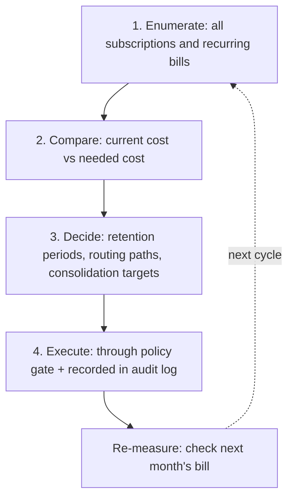

*A scene of scattered receipts and small fragments converging into a single stack, abstracting the agent's cost-audit loop of enumerating and comparing.*

## Why This Matters

If you are an engineer, SRE, or operator on a team that runs production cloud and treats cost cleanup as an annual accounting event, read this post. The reason is one: the era where AI FinOps was only a recommended topic on a dashboard is over. A verifiable case has appeared in which an agent went through the bills, the policies, and the subscriptions itself, and cut the costs for real.

The point to note upfront is not the amount saved. It is what a human missed and an agent found.

## In Plain Terms

Picture an apartment electricity bill. The amount comes in looking similar every month, and you cannot say exactly where it is climbing from, because the bill does not jump in steps. It creeps, one line here and one line there.

The agent is the family member who goes through the bill line by line. It says, "this subscription renews although nobody used it for six months," "this bucket is 50x overpriced because of an unlimited retention policy," "this domain renewal is above market." What the agent does is enumeration: it lists every subscription, every bucket policy, every renewal, and shows the gap between what you pay now and what you should pay. Everything in this post stands on that single analogy.

## Overview

Pieter Levels is the founder of PhotoAI ($68K/mo revenue), InteriorAI, and VibeJam. With 989K followers, he is a canonical case of a solo operator who has run production infrastructure since the one-person days. On November 3 he published "I dropped my total biz expenses to just $300 per month" on levels.io, an update on how he cut those costs.

The total operating cost of all his websites and apps is down to about $300/month. Including PhotoAI, whose cost is dominated by GPUs, it is about $8,000/month. The original post describes this as a 90% reduction versus the prior year. The tool that drove the reduction is Claude Code, an agent. The original text uses the phrasing "Claude analyzed..." in several places, recording which agent looked at what and changed what, item by item.

Let me anchor the scale first. Per year: 20,000 paying customers, 252 million visitors, 2.4 billion requests, 2.4 petabytes of bandwidth. This is not a small site. It is a production system with real traffic and heavy request volume. That is why the absolute savings are large.

## The Six Savings the Agent Found

The original post records six line items. All figures are quoted as written in the original; the table distinguishes where a number is the saved amount versus the current cost.

| Item | Mechanism | Figures from the original |
|---|---|---|
| PhotoAI video model + image routing | Switched to better and cheaper video models; routed some image jobs to GCP credits and to Sume (a platform that sells AI models at market cost) | $29,000/mo saved (includes GPU bill dropping from $36,000/mo to $7,000/mo) |
| Server consolidation | Cancelled Digital Ocean and Linode, moved everything to Hetzner | ~$3,000/mo saved |
| Backblaze B2 backups | Reduced unlimited versioning and lifecycle policies to 30 days | $1,200/mo to $26/mo, ~50x cheaper ($1,100/mo saved) |
| Cloudflare R2 (PhotoAI) | Added lifecycle policies | $1,200/mo to $800/mo ($400/mo saved) |
| Cloudflare domains | Agent analyzed all domain registrations; .io TLD renewals now $50/year | $118/mo saved |
| His own Claude subscription | Found he was not using Max 20x plan limits; downgraded $200/mo to $100/mo | $100/mo saved |

The total is the figure the original writes as "almost $34,000/mo."

Scanning the six items, one thing stands out. The largest item ($29,000) is "changed models," the second largest ($3,000) is "merged clouds," and the rest are "storage policies" and "subscriptions." Big money and small money are cut by the same principle: the gap between current cost and needed cost.

The first item deserves one more look. The image-job routing uses two paths. One is GCP credits. Credits are money already paid, so the marginal cost of running jobs against them is zero. Routing workloads to zero-marginal-cost capacity is pure savings. The other is Sume, which the original describes as "a platform that sells AI models at market cost." Market-cost selling means no markup on the resale margin. It is a comparison on the "provider to reseller to user" price curve with the markup layer removed. Inference workloads always have two choices: the capacity you use is never just one provider's one price, and a different path of equal quality is often no more expensive. The $29,000 saving came from making that comparison, not from running fewer jobs.

## Why an Agent Found It, Not a Human

Let me quote Levels' own words. Costs "slowly creep up over the years and you don't realize all the things you're spending on," and he adds that AI helps figure that out.

The key here is the axis of comparison. A human compares "last month versus this month," not "now versus when the contract was signed." Nobody remembers when and why unlimited versioning was turned on. The same goes for when a domain renewal price went up years ago. The agent's strength is that it can change that axis.

Next, the last item deserves attention. Among the waste the agent found is "his own Claude subscription." The auditor and the audited are the same agent. The judgment "I am not even using my Max 20x plan limits" is one only an agent with access to subscription usage data can make. A human would often stop at the decision to "cut my own subscription."

And the $118/mo domain item. It is small. But as the original puts it, "Claude analyzed all my Cloudflare Domain registrations": the agent went through them one by one. Small money, accumulated over a long period, becomes big money, and the agent can compute that "long period."

Finally, the structure of why it is an agent doing this. Traditional cost audits carry a fixed cost. A human must set aside a day, open each provider's console, and compare bills. When audit cost is high, the rational frequency drops to once or twice a year. Then the drift between the bill and the usage keeps accumulating in the gaps between audits. The agent drives that audit cost to near zero. Enumeration, policy reading, price comparison are all script work. When the cost of auditing drops, the rational frequency moves from "once a year" to "every month," "every week." The savings in this case are the six items plus the accumulated drift that would have kept growing in between. That is a structure dashboard FinOps could not produce.

## Four Patterns That Generalize

Lifting the six items to the level of principle gives four patterns. This is the core of the post.

First, inference model routing. Teams that keep using the most expensive model are mostly dragged by inertia. Video generation and image generation have different price curves, and GCP credits plus a market-cost resale platform (Sume) run the same inference through cheaper paths. The $29,000 saving comes from here. The cost problem is "which path," not "which model."

Second, provider consolidation. Merging Digital Ocean and Linode into one Hetzner saved $3,000/mo. The essence of this saving is shrinking the management surface. Two accounts become one, two dashboards become one, two bills become one. The consolidation became executable because the agent took on the repetitive migration work. For a human, consolidation is abandoned over "move cost"; for an agent it is a script, not labor.

Third, storage lifecycle. Cutting Backblaze B2's unlimited versioning to 30 days saved 50x (the original's phrasing), and adding lifecycle policies to an R2 bucket saved $400/mo. Storage gets more expensive as data accumulates and as policies get forgotten. "Unlimited retention" is someone's decision too. The moment a retention period is set, the cost curve changes, and that "act of setting" is what the agent found in the bills.

Fourth, subscription audit. Domain renewals, SaaS, and the agent's own subscription. The long tail of recurring billing. Unit price small, duration long, renewal automatic. Where the three overlap is the audit's maximum harvest zone, and the agent can sort that zone by "duration times unit price."

All four patterns are variants of the same operation: finding the gap between current cost and needed cost. The model changes its path, the provider shrinks its surface, the storage sets its period, the subscription trims its long tail.

## Your First Step, Tomorrow

Start with storage lifecycle, not the big items (model routing, provider consolidation). It is reversible, and its effect shows up on the bill immediately.

An S3-compatible lifecycle policy is the exact mechanism the Backblaze B2 and Cloudflare R2 items used. It looks like this:

```json
[
  {
    "id": "expire-30d",
    "filter": { "prefix": "backups/" },
    "status": "Enabled",
    "rules": [
      { "id": "1", "expiration": { "days": 30 } }
    ]
  }
]
```

A policy setting a 30-day expiration on the backup prefix. The moment this one line lands on a bucket where "unlimited retention" was the default, the cost curve changes. But before setting the period, answer one question: "how many days of retention do we need for recovery?" The number 30 should be derived from the recovery requirement. Cutting without that question produces risk instead of savings.

The four-step order is the same. 1) Enumerate all subscriptions and recurring bills. 2) Check storage retention periods one by one. 3) Look at provider consolidation candidates. 4) Change inference model routing. The order is the risk management. The front half (enumerate, check) is read-only; the back half (consolidate, route) requires execution capability. Every step has the same shape: "enumerate, compare, decide, execute," and that loop is exactly the unit an agent can run.


*The cost-audit loop an agent runs. Five steps from enumeration to re-measurement make one cycle, and re-measurement starts the next cycle's enumeration.*

## Implications for ThakiCloud

Through the Paxis lens, the agent in this case went beyond reporting savings "opportunities": it executed the downgrade, the policy change, and the migration. Lowering a domain price, changing a versioning period to 30 days, switching a subscription plan are all "execution." That is exactly the point where Paxis stands. High-risk operations (subscription cancellation, storage policy changes, server migration) execute after passing a policy gate, and the whole execution is recorded in the audit log. All four patterns are shapes that can be automated as Paxis skills. Cost-anomaly skills (the cost-anomaly-explainer family) run these patterns on top of the harness.

Through the ai-platform lens, this case asks whether the four patterns can move from "user-side effort" to "platform feature." Inference routing is already an area ThakiCloud's ai-platform has worked on (the economics of multi-model routing), and sensible storage lifecycle defaults plus provider abstraction are standards a platform can offer. Concretely, three things. First, cost telemetry per inference route. Without per-route cost accounting (model, provider, credits, resale), you cannot even verify that savings happened. Second, policy defaults for storage retention. Not frugality, but locking the lifecycle policy at bucket creation. Third, provider abstraction. Consolidation's cost is migration, and with an abstraction layer that makes workload moves a routine operation, that cost drops. All three are telemetry and defaults rather than features, and that is the part a platform can carry on behalf of the user. At the same time, one threat. If the customer's agent finds the waste itself, the cloud's value moves from "selling capacity" to "cost visibility plus optimization speed." This case shows the start of that move.

## Limitations and Counterarguments

The limits of this case need to be stated plainly.

First, it is one individual's case. A solo founder's cost structure differs from a large enterprise's structure with multiple teams and multiple approval layers. "The agent executed directly" is the core of this case and simultaneously its premise.

Second, the numbers are self-reported. Figures like $36,000 to $7,000 or $1,200 to $26 are quoted from Levels' own post, with no third-party verification. The items are specific and internally consistent, so they are trustworthy, but they are not "disclosed figures."

Third, the 90% reduction carries a large time component. The prior-year bill includes costs from before the GPU switch, so "first-cleanup effect" and "structural reduction" are mixed. The sum of the six items (~$34,000/mo) is the scale of the first cleanup; the 90% is the result stacked on top of the earlier accumulation.

Fourth, some savings are one-time or periodic. The $118/mo domain item is the effect of changing a renewal cycle, different in character from recurring monthly savings.

Fifth, the ceiling of the audit is "the surface the agent can reach." Only bills, policies, and subscriptions available via CLI/API are auditable. Subscriptions managed by phone or offline are outside this framework.

Sixth, and the most important counterargument. The versioning cut to 30 days, if it had been needed for recovery or compliance, comes back as risk. The judgment "it looks unused, so cut it" must carry a risk assessment, and the original post contains none. Ending at savings is not FinOps; in an unlucky case, it is an incident.

## Bottom Line

Let me collect the conclusion stated in the introduction. The next form of AI FinOps is the agent's execution, not a dashboard. The levels.io case shows that execution produced about $34,000/mo (six items) and brought the entire web infrastructure to about $300/mo.

The order to start tomorrow runs from small unit price and low risk. Subscription audit, storage lifecycle, provider consolidation, model routing. The further you go toward the fourth (model routing), the larger the savings scale and the larger the execution risk. The order is the risk management.

Levels wrote that the purpose of savings is "to trim all the fat and open up spending for better investments." The purpose of savings is reinvestment. The perspective that sees cloud cost cleanup as a loop an agent runs is what this case leaves behind.

In one line: hand your bills to an agent. The six items a human did not see come back as about $34,000 a month.

## Sources

- Pieter Levels, "I dropped my total biz expenses to just $300 per month," levels.io (2026-11-03): https://levels.io/biz-expenses-dropped-to-300
- Original tweet (levelsio, 2026-11-03): https://x.com/levelsio/status/2117694259558293692
- All quoted figures are based on the levels.io post. They are self-reported figures without third-party verification; this is stated explicitly.
