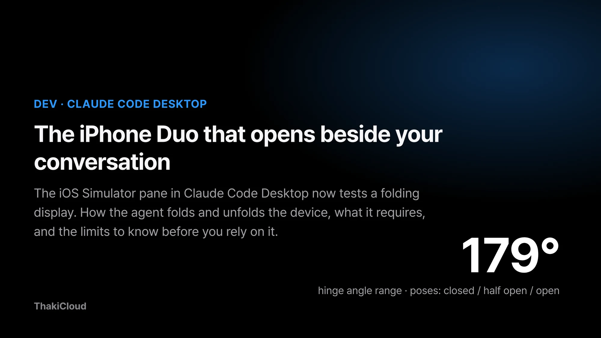
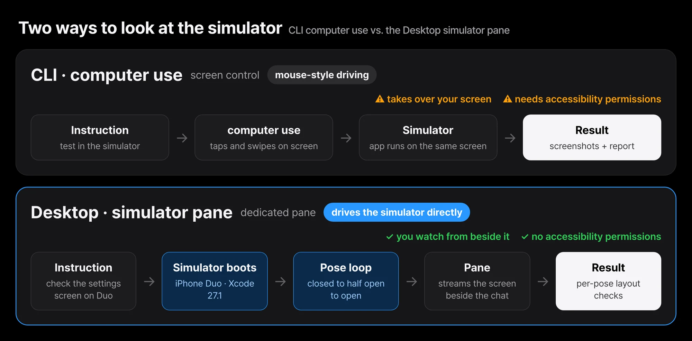
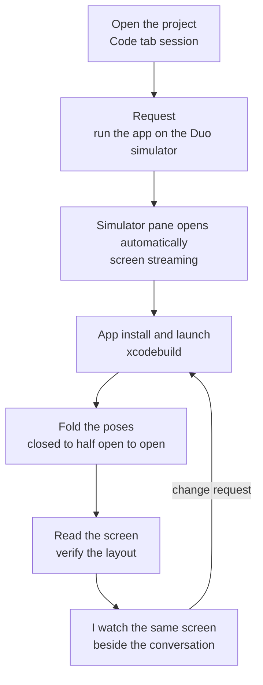
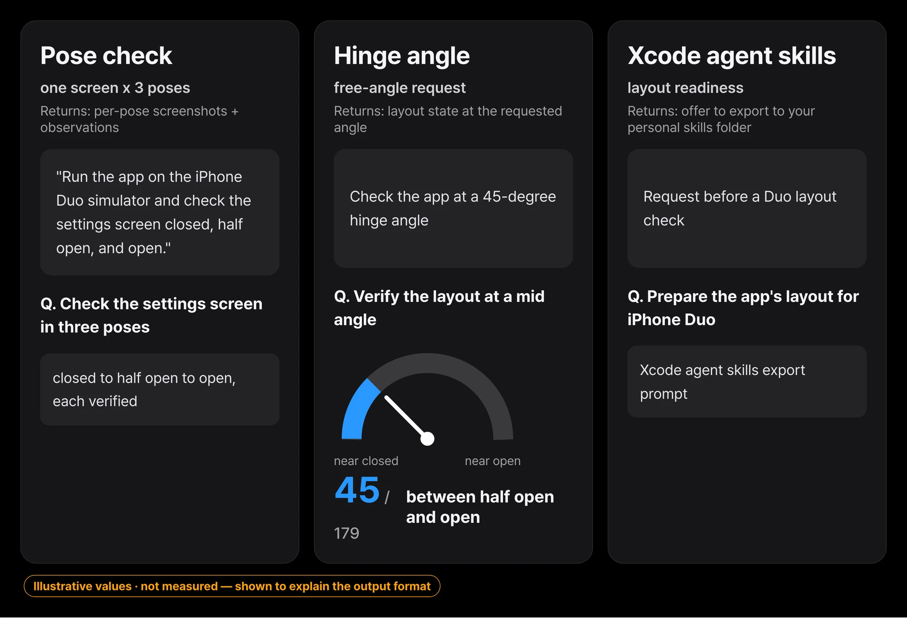

If you build iOS apps with an AI coding agent and test them in the simulator, you know this scene. The agent reports "I ran the app and checked it," and you have to decide whether to trust the report or open the simulator window yourself. Sometimes, while the agent is driving the screen, you are not allowed to touch it. This post is for the decision of whether to make a folding display a first-class target of agent testing.

Here is the conclusion first. On November 16, 2026, Anthropic announced that Claude Code Desktop now supports the iPhone Duo in the iOS simulator, in public beta. Two things matter. The app opens next to your conversation, and the agent folds and unfolds the device to check each layout.

This post walks through the whole structure from the official documentation. Why the pane works without taking over your screen, the three poses of the Duo and the 1 to 179-degree hinge range, device consent and permissions, and the limit that the agent's hands never reach a physical device.


*Claude Code Desktop, iPhone Duo simulator support (public beta). Hinge range 1 to 179 degrees; poses closed / half open / open.*


## In plain terms

This setup is an open kitchen.

When a cook works in a closed kitchen, the diner only gets the smell. To check whether the dish is right, you have to walk in. The simulator pane glass-walls the kitchen. Claude works in the kitchen (the simulator), building and running and checking the app, and I watch the same scene from right next to the glass.

The iPhone Duo is a folding menu card. Folded shut, one face. Half open, the boundary between two faces. Fully open, one large surface. How the card is folded changes the reading of the same text every time. Testing a folding-screen app is the job of checking that menu card at all three angles.

I will keep calling the simulator the "kitchen," the pane the "glass wall," and the poses the "menu card" to the end of this post.

## The glass wall beside the conversation

The pane opens without a command or a setting. When Claude builds, installs, launches, or checks the app, it opens on its own, and it streams the device screen live. If the request is about seeing the app, "does the new screen look right?", Claude boots a simulator before it starts the work.

One distinction matters. The pane drives the simulator directly. So it does not go through computer use, it never takes over my screen, and it does not hide my other windows. From the CLI, the way Claude reaches the iOS simulator is still computer use, driving it on your screen the way you would with a mouse. The same target, but the Desktop is a glass wall and the CLI is screen occupation.


*The CLI drives the simulator on your screen, mouse-style. The Desktop pane drives the simulator directly and streams it beside the conversation, so you watch the same scene from next door.*

The glass wall is not just for watching. I can reach into the same kitchen. Click and drag on the screen for taps and swipes. Cmd+S for a screenshot, Cmd+R for a screen recording; the files land on the Desktop. A rotate button turns the device a quarter turn, and the Home, lock, and volume hardware keys use the same shortcuts as Apple's Simulator.

And we are using the same device. When I tap, the app state Claude sees changes. If I want Claude to check a specific screen, I tap through to it first, then ask. When Claude is driving, a "Claude is using this device" badge sits above the screen. The habit is to wait for the badge to clear before touching it.

The session-device relationship has rules too. If the request does not name a simulator, Claude uses one that is already running. Parallel sessions that want their own devices name different ones in each prompt.

The device is not Claude's alone. A simulator Claude boots also appears in Apple's Simulator app, or in Device Hub on Xcode 27. Claude can install the app on a device I already booted. The pane's device menu lists each simulator's OS version and whether it is running, so I always know which device I am looking at.

Claude shuts down the simulators it booted when they are no longer in use: when the app quits, when the session is archived, or 10 minutes after I detach a device from its pane. Devices I booted outside Claude Code Desktop are never shut down automatically.

## The three angles of the folding menu card

The core of the iPhone Duo support is the poses. closed, half open, and open. The device can be folded into each of them, and in between, the hinge angle can be set from 1 to 179 degrees.



Folding it myself is a button. Three pose buttons sit next to the rotate button, and hovering shows their names: Closed, Half open, Open. For an angle between poses, I hover over the pose buttons and drag the slider that appears above them.

Asking Claude is language. I name one of the three poses, or a hinge angle from 1 to 179 degrees measured from half open. The official docs give an example request I can copy as-is.

```
Run the app on the iPhone Duo simulator and check the settings screen closed, half open, and open.
```

One line. Check the settings screen in the three poses. Three observations of one screen come back.


*Input and output shapes for iPhone Duo testing. Based on the official docs examples; not executed in this post.*

The requirements. Testing the Duo needs Claude Desktop v4.29.0 or later. The simulator pane itself starts at v1.24012.0, and the Duo asks for the newer version. It also needs Xcode 27.1 or later, plus the iOS 27.1 simulator runtime that carries the Duo simulator. If the runtime is missing, it is downloaded from Xcode's Components settings. If the Duo is not in the device menu yet, I pick Add simulator at the end of the list and choose an iPhone Duo device type.

One prompt the docs warn about ahead of time. Before a layout check on the Duo, Claude may ask whether to export Xcode's agent skills to my personal skills folder. Those skills ship with Xcode to guide coding agents, and once exported, Claude Code loads them in other projects too. Among them is a skill for getting the app's layout ready for the iPhone Duo.

## What does not change: consent and permissions

The more convenient the pane becomes, the more the consent structure for the device stays put.

Claude needs consent before it controls a device. Once per device, not once per session. It covers controlling that device and taking its screenshots. And the screenshots Claude takes of the device are sent to Anthropic and kept under the normal conversation retention settings. So the docs' warning is plain: do not sign in to real accounts on a device Claude uses.

After I allow a device, three actions still follow the session's permission mode. Opening a URL on the device, because a URL can carry data off the device. Building the app, because xcodebuild runs the project's build scripts on my Mac. And installing and launching the app, because Claude can run any app it names, not only the one I am building.

Organizations can switch it off entirely. The disableMobileSimulatorTools managed setting blocks Claude's simulator tools, leaving the pane usable for my own taps. The requireCoworkFullVmSandbox policy key runs the tools inside an isolated virtual machine instead, which disables the pane and the simulator tools as a whole. Enterprise organizations with a HIPAA configuration enabled, and third-party provider users, do not get the pane at all. And it is local sessions only; cloud and SSH sessions cannot reach the simulators on my Mac.

## Things to know before you rely on it

**A physical device is outside this setup.** Claude drives simulated devices only, and it cannot reach a real iPhone or iPad. To check one, I run the app from Xcode myself, then describe what I see or attach a screenshot for Claude to work from. The folding screen gets its angles verified in the simulator, but the feel of real hands and the physical hinge stay human work.

**With several Xcodes installed, xcode-select is the answer.** The pane uses whichever Xcode xcode-select points at. If 26.x and 27.1 coexist, I select 27.1 for Duo testing and restart Desktop.

**If no simulators are found, the pane shows the setup steps.** Check-box style, one by one. The missing piece is usually the iOS runtime, which I can download from Xcode settings or fetch with `xcodebuild -downloadPlatform iOS`.

**The glass wall costs resources, too.** The pane's Display menu can lower the frame rate and resolution when it strains the Mac. Those settings only change how the pane shows the device, not how the app runs.

## Paxis, and the agent's mobile testing

The part that catches the eye in this setup is that the test evidence becomes files. The screenshots Claude takes per pose, the one I drop with Cmd+S, the recording files. A claim like "the layout is right" now comes with checkable output behind it.

That is the same shape Paxis demands of agent actions. Every action passes a policy gate, lands in an audit log, and leaves evidence as an artifact. Device consent is once per device, three actions always follow the permission mode, and a managed setting can turn the whole device off. The questions "which device, whose permission, what scope" already have answers inside the system. In the era where an agent can see a screen, the boundary of that consent is set before the screen itself.

## In closing

A folding screen is now a first-class target of agent testing. The app opens beside the conversation, Claude folds and unfolds it through closed, half open, and open on its own, and checks hinge angles from 1 to 179 degrees. I watch the same scene at the glass wall, and tap the same device when I need to.

The first experiment you can run today.

1. Update Desktop to v4.29.0 or later and restart
2. Confirm Xcode 27.1 and the iOS 27.1 runtime
3. In the device menu, Add simulator and pick iPhone Duo
4. Ask: "Run the app on the iPhone Duo simulator and check the settings screen closed, half open, and open."

When three poses of your settings screen come back, the kitchen and the glass wall this post describes are standing on your desktop. Keep the limit in mind that a physical device is still human work, and inside the simulator, the agent checks first. That is the place this public beta opens.

## References

- Announcement: [@ClaudeDevs, 2026-11-16](https://x.com/ClaudeDevs/status/2122439098740674839)
- Official docs: [Test iOS apps in the simulator](https://code.claude.com/docs/en/desktop-ios-simulator) (Claude Code Docs)
- First announcement record: [Week 30 (July 20-24, 2026)](https://code.claude.com/docs/en/whats-new/2026-w30)
- All facts are as of the official documentation on 2026-11-18.
