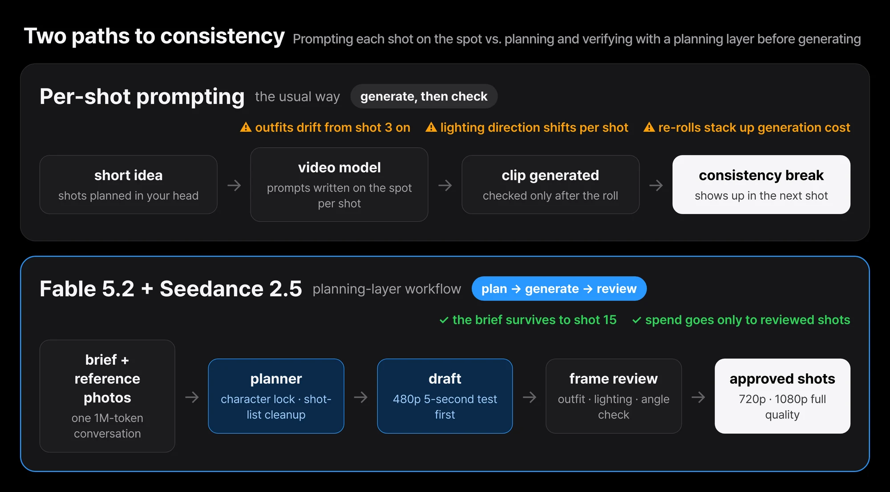
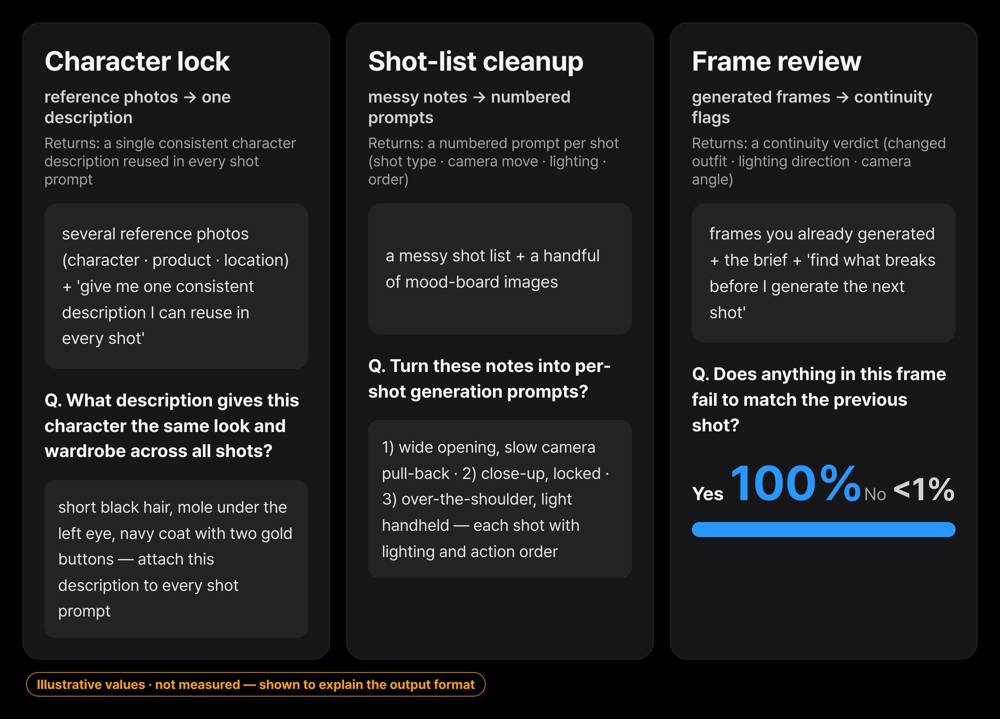
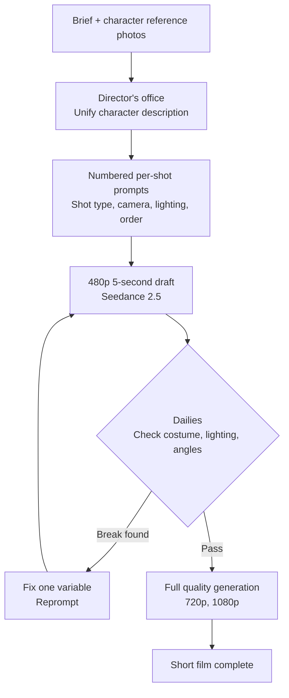

AI short films break around shot five. The protagonist's jacket changes color, and the light comes in from the left in one shot and from the right in another. By the time you notice the ending does not connect back to the beginning, the generation credits are already spent. The problem was never the video model. It was who was holding the script.

This post is for developers who shoot multi-shot AI short films with a video model, or who want to build such a workflow. On November 25, 2026, creator Social With Aayan published a short film made with Claude Fable 5.2 and Seedance 2.5, along with the workflow and the prompts. This post verifies that material against the official documentation of both models and the original video, and organizes it.

The core conclusion first. This workflow moves the cost of failure from the generation stage to the planning stage. The planner context is 1M tokens, so the brief, the character description, and every shot prompt live in one conversation, and a cache read is $0.20/MTok, so rereading the same brief is cheap. Failures get caught in the dailies of a draft, before any full quality generation.

## In plain terms

This structure is a film set. The video model is the camera operator. One shot looks like a movie, but the camera operator is not carrying the script. On shot 15 they do not remember what the protagonist wore in shot 1, and the light comes in from a different direction.

Fable 5.2 is the director. The director holds the script, that is, the brief. They write one line describing the protagonist from the reference photos and attach that description to every shot prompt. Before the next shot, they look at the dailies already filmed, that is, the generated frames, and ask for a reshoot that changes only one thing.

In this post, I call the planner conversation "the director's office," the unified character description "the script," and the pre-generation check "the dailies." Three words. They carry the whole post.

## The source: a short film from November

On November 25, creator Social With Aayan uploaded a short film made with Fable 5.2 and Seedance 2.5. "Disney-level short film, and the ending is breathtaking" is the creator's claim, not a measurement. The post spread because it included the workflow and prompts that back the claim, and this post reproduces them below.


*The original video, "How I Make Short Movies with Fable 5.2 + Seedance 2.5 in 4K". It shows the process of shooting a short film with the two models.*

Two things stand out in the video. First, the short film is not a single generation but a composite of multiple clips. Second, the consistency of people, places, and props holds across shots. The creator emphasizes that Fable 5.2's long context holds the brief, the reference descriptions, and every shot already written in one conversation, so consistency does not slip "around shot 15."

Note that the video title says 4K, but the Seedance 2.5 official documentation lists output resolutions of 480p, 720p, and 1080p. Resolution depends on the platform it passes through, so "4K" is a label to read on the platform's side.

## Why Fable 5.2 is the planner

In this workflow, the seat Fable 5.2 fills is the "planner." Anthropic announced the model on November 9, 2026, for "agent work that runs for a long time." Against the official documentation, three features fit that seat.

First, the context is 1M tokens. The maximum output is 128K tokens, and one multi-shot short film, its brief, its reference photos, and every shot prompt written, fits inside that range. The consistency problem the creator called "slipping around shot 15" happens exactly where the context is short.

Second, images come in as input. The official spec is "text and image input, text output." Writing a character description from reference photos and reading dailies from generated frames both happen on top of that input format.

Third, reasoning is on by default. Adaptive thinking always runs, and the depth is tuned with the effort parameter. A dailies review that asks "does this match the first 14 shots" is a judgment that cross-checks the whole brief, not a fast summary.

The model opens with the same ID (claude-fable-5-2) on the Claude API, Amazon Bedrock, Google Cloud, and Microsoft Foundry. The planner seat is not locked to any platform, and since the video model side is locked to one, that asymmetry shapes this workflow.

## The video model only remembers one shot

Seedance 2.5 is a model that takes an image and makes a video. The main specs, from the official documentation. Clips run 4-30 seconds. There is a 480p draft mode and 720p and 1080p output, and 1080p requires the premium tier. Synchronized audio can be turned on or off.

The API sets the mode by the number of input images. One image is a start frame, two are a first/last frame transition, three or more are reference mode. One side of the image must be 300-6000px, the aspect ratio 0.4 to 2.5, and the file under 30MB.


*Two paths to keep consistency. Per-shot prompting checks after generation, and the planner layer workflow spends generation cost only on approved shots.*

Reference mode is the deciding point of this workflow. Reference images guide the details of character, style, and props, but they do not appear as literal frames on the timeline. It is a way of telling the model "this is what the protagonist looks like" from outside the frame. But a guide is not a lock. The model does not remember previous clips, and the planner provides that memory.

| | Per-shot prompting | Planner layer workflow |
|---|---|---|
| Character description | Written anew per shot | ✅ Fixed to one, reused everywhere |
| Where consistency breaks | Past shot 3, discovered only after generation | ✅ Discovered in the pre-generation dailies |
| Where the cost lands | Spent on failed generations | ✅ Spent on planning and review |
| Guarantee level | ⚠️ No guarantee | ⚠️ No guarantee. But discovery is fast |

## The planner does only three things

The director's office does exactly three things. Each is simple, but the result differs between doing it per shot and doing it inside one conversation.


*The shape of what the planner layer receives and returns. One conversation carries all three uses, and the values are format examples.*

First, character unification. Feed multiple reference photos of a character, product, or place at once and ask for "one consistent description that can be reused in every shot prompt." What comes back is not a per-shot description but a single one. The protagonist's hair, moles, coat, and buttons are all written at once, and that description is attached to every shot. If there is one description, there is one place to fix.

```text
You have 4 reference photos of the protagonist.
Write one consistent description that can be reused in every shot prompt.
Include hair, facial features, costume, and accessories,
and describe them so nothing changes across shots.
```

Second, shot list cleanup. Give it a messy shot list and a few mood board images, and numbered per-shot prompts come back. Each prompt carries shot type, camera move, lighting, and action order, and the protagonist's appearance follows the description fixed above. The shot list becomes generation-ready prompts.

```text
Here is the messy shot list and mood board for a 20-second short film.
Organize it into numbered prompts, one per shot.
Each prompt should include shot type, camera move, lighting,
and the order of actions. The protagonist's appearance follows the earlier description.
```

Third, frame review. Before generating the next shot, show the already generated frames to the planner and have it find where continuity breaks. Changed costume, lighting coming from the opposite direction, angles that break continuity. The review happens inside the same conversation, before generation cost is paid. Since the brief, the script, and every previous shot are already in context, the review criterion is not "is this frame pretty" but "does it match the first 14 shots."

```text
Here are the frames generated so far and the brief.
Before generating the next shot, find where continuity breaks.
Check only costume changes, lighting direction, and camera angles.
```

The cost of these three can be translated into the official price list. Fable 5.2 is $8/MTok for input and $0.20/MTok for cache reads. The brief stays in the conversation, and every reread is billed at the cache read price. Planning and review are cheap, and generation credits are spent only on shots that pass. The economics of this workflow come from exactly that asymmetry.

One more observation points the same way. A post by Karya Studio that organizes the planner layer workflow wrote that an interface which shows the cost of the next generation before you press the generate button reinforces this structure. When cost is visible first, the value of the review step in front of it naturally goes up. The cheaper the director's office and the faster the dailies, the more the generation credits stay on approved shots only.

## The first cut is a 480p 5-second draft

The discipline on the generation side is stated in the Seedance official documentation. Start with a 480p 5-second draft to check motion, and only then decide big camera moves. The prompt structure is fixed as "subject lock + subject motion + camera motion + environment motion + last frame." Write one line each: who stays in the frame, and with what; what moves; how the camera moves; how the background changes; what the last frame looks like.


*The flow of the planner layer workflow. If the dailies find a break, fix one variable and reshoot the draft; only shots that pass are generated at full quality.*

The reason the draft comes first is that the cost of failure scales with resolution. If the lighting is wrong in a 1080p 30-second clip, that failure was paid at full price. In a 480p 5-second draft, the same mistake is cheap. The planner fixes one variable in the dailies, and only when the draft passes do we go to full quality.

One more rule: prompts are not for re-describing source images. The image is already in the frame, and the prompt's seat is time. What moves how, where the camera goes, how the background changes, what the last frame looks like. That is why the structure the official documentation recommends is "subject lock + subject motion + camera motion + environment motion + last frame." If you rewrite the description of a source image, the model reads it fresh and guesses again.

Keep camera directives from contradicting, and revisions change one variable at a time. If the lighting is wrong, fix the lighting, and only then touch the camera move. If you change two at once, you cannot tell whether the break found in the dailies was fixed or is new. The creator's claim that "the ending is breathtaking" has weight at this point. The final shot is not improvised; it is a shot that passed the same dailies.

## In Paxis, the planner seat holds a validation gate

The structure of this workflow is a form Paxis already handles. The director's office is an agent that plans the DAG, and the dailies are a validation step in front of cost. Paxis passes every agent action through policy gates and records it in an audit log. The rule "do not generate the next shot until the review passes" is exactly that form: put cheap validation in front of a paid action, and record the result.

Seen from the serving side, it becomes draft/full-quality tiers. ThakiCloud's Metis is a platform that handles model serving on K8s, and the cost structure of "first shoot 480p 5 seconds, then 1080p if it passes" is not one creator's habit but a general pattern of video model serving interfaces. If draft mode and reference mode are exposed as API parameters, the economics of the planner layer become something the platform owns.

This form also fits the audit log viewpoint. In this workflow, "which shots were approved and why, and which variables were fixed" is all recorded inside the director's office conversation. For every shot that spent generation cost, you can trace the reason behind it, and shots that fail the dailies leave no cost behind. Paxis's principle that agent actions which spend money need an audit log becomes, here, the single sentence "generate only approved shots."

## Four things to know before writing

First, "Disney-level" is a claim. There is no public benchmark for video quality, and the consistency of this short film is the judgment of the creator and the viewers. The direction of the workflow is verifiable from official documentation, but the level of the result is not a number.

Second, Seedance 2.5 is an external paid API. 1080p is the premium tier, and the draft is 480p. This workflow is effective under the premise that generation cost is not zero. If generation were free, the value of the review loop would shrink.

Third, the review loop itself costs money. Frame review uses planner tokens, and the more shots, the longer the context. Cache reads are cheap, so rereading the same brief is a small burden, but new frames and new review rounds come in as new tokens.

Fourth, reference mode is a guide. The official documentation says reference images "guide" details; it does not say they "guarantee" identity. That is why the dailies come after reference mode. It means not trusting the guide all the way to the end.

## In closing

This workflow moves the bottleneck of AI short films. From generation to planning and review. The video model still shoots one shot at a time; the planner holds the script, watches the dailies, and decides when to spend cost. The planner context is 1M tokens, and rereads are $0.20/MTok. The cost of failure moved from the full quality generation stage to the draft dailies stage.

The first experiment you can run today.

1. Pick one character and prepare 3-5 reference photos
2. In one conversation with a long-context model, ask for "one consistent description"
3. Organize the shot list of a 5-shot short film into numbered prompts
4. Generate the first shot at 480p 5 seconds, and in the same conversation ask "where the next shot will break"
5. If it passes, on to the second shot; if it fails, fix one variable and reshoot

When you reach shot five, you will know whether the script is in the planner's hands. That is the only question this workflow answers.

## References

- Original post: [Social With Aayan, 2026-11-25](https://x.com/socialwithaayan/status/2125633124004667412)
- Original video: [How I Make Short Movies with Fable 5.2 + Seedance 2.5 in 4K (YouTube)](https://www.youtube.com/watch?v=DhcSNj0tdPs)
- Seedance 2.5 official documentation: [Seedance 2.5 Image-to-Video](https://www.seeddance.io/blog/seedance-2-5-image-to-video)
- Planner layer workflow: [Claude Fable 5.2 Storyboard Review Workflow](https://www.karyastudio.io/blog/claude-fable-5-2-storyboard-review-workflow)
- Fable 5.2 official model documentation: [Claude Fable 5.2 Overview](https://platform.claude.com/docs/en/models/fable-5-2/overview)
- All numbers are from each model's official documentation as of 2026-11-27.
