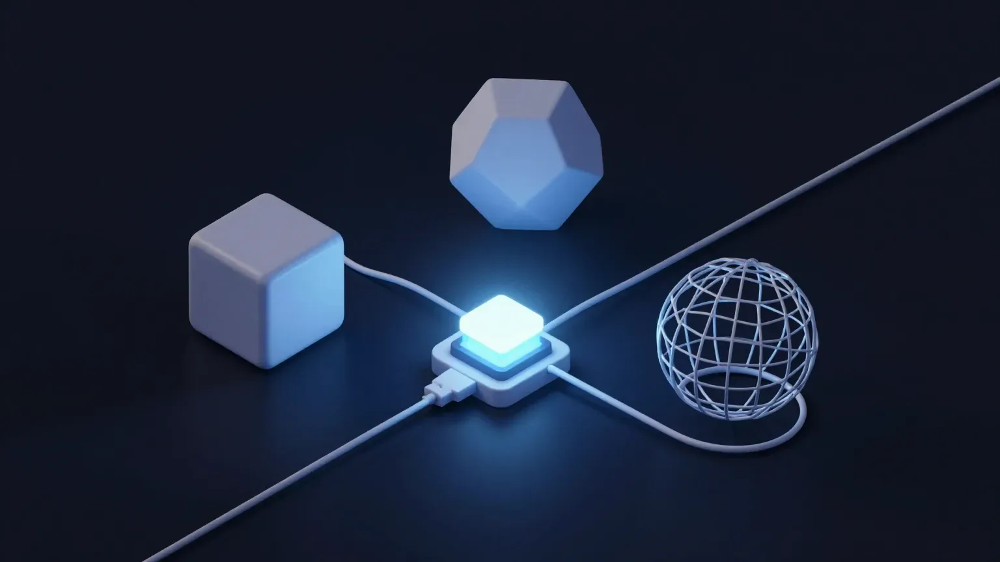
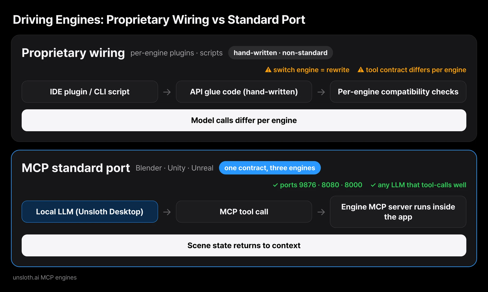
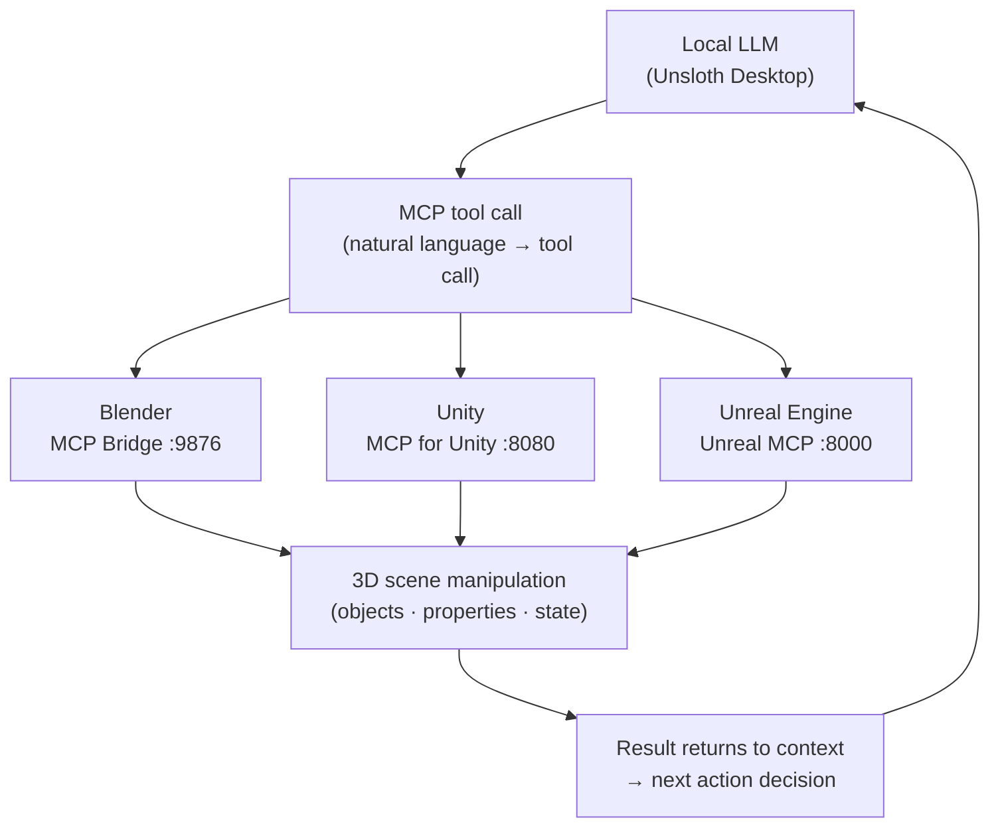
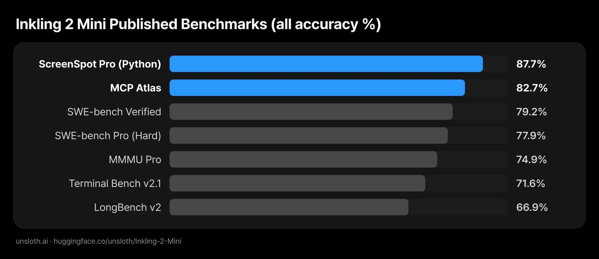
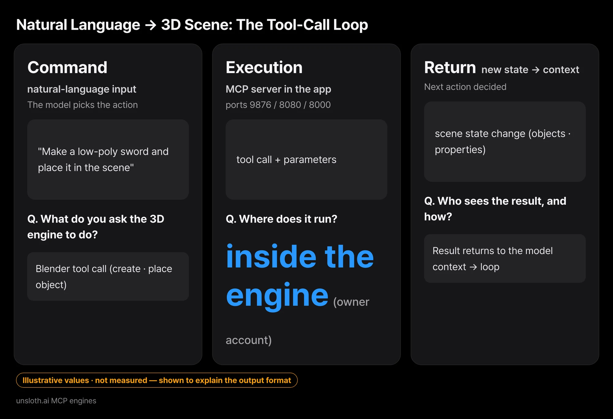

This post is for developers who want a local model on a PC to drive creative tools like Blender, Unity, and Unreal Engine directly, and for platform engineers who build the bridges between agents and desktop tools.

The headline up front: Unsloth has connected the three 3D engines to local models over a single MCP (Model Context Protocol) port standard, and the recommended model, Inkling 2 Mini, is a 26.4B-parameter MoE (5.4B effective active) that runs in 16GB of memory. The barrier to a local agent driving a 3D engine directly was never model size. It was the tool-port standard. This post covers how that port opens, per engine.

A note on sources. This post is based on the Unsloth official MCP engines documentation and the Inkling 2 Mini model page (unsloth.ai, Hugging Face unsloth/Inkling-2-Mini). The setup procedures and model numbers are documented values, and we did not perform hands-on runs of the three engines.

## In plain terms

The old way gave each engine its own proprietary wiring. One IDE plugin, another CLI script, and API glue code you wrote yourself. Switch engines and you rewrite it.

The new way has every engine plug into the same standard outlet (an MCP server). Blender on port 9876, Unity on 8080, Unreal Engine on 8000. Any model with a tool-calling plug fits any outlet.

This post is the story of 3D engines joining the world of the standard outlet, and of the local model that drives them fitting in a laptop.

## 3D engines join the MCP world

MCP is the protocol that exposes tools and resources in a standard shape for models to call. Search, files, and databases were the mainstream so far. This time the target of the tool call is the 3D engine itself. Scene manipulation, object creation, and property changes all become tool calls.

The supported engines and version floors are Blender 5.1+, Unity 2021.3+, and Unreal Engine 5.8+. The official documentation also lists Godot, Figma, and Roblox Studio.

The connection model is local-first. The engine must run on the same machine as the model, and the tools execute inside the app. Only the owner account can use them, and the MCP tools switch off automatically while Remote or LAN access is enabled. A security posture of "the model can only touch what is right in front of it."

*Left is the hand-written plugins and scripts each engine required. Right is the structure where engines open an MCP server and any local model calls them through one contract.*

## Three engines, three ports: setup procedures

Blender. Install the official MCP add-on; you drag the install button from the documentation page into Blender twice, once for Blender Lab and once for the add-on. Enable Online Access under Edit, Preferences, System. The MCP Bridge Server comes up on Auto Start; if it is down, start it from Add-ons, MCP. The port is 9876. In the Unsloth chat, select Blender, tick the permission box, and press Test connection.

Unity. After installing the editor in Unity Hub, install uv (the package starts the endpoint through uv). In the Package Manager, add the CoplayDev/unity-mcp package from a git URL, path /MCPForUnity, branch main. In Window, MCP for Unity, select HTTP and start on 8080. An amber indicator means the endpoint is up but the editor has not joined yet; green is ready.

Unreal Engine. Enable "Unreal MCP" and "All Toolsets" under Edit, Plugins, then restart. In Editor Preferences, General, Model Context Protocol, turn on Auto Start Server. The port is 8000. The community EngineWire plugin is separate, on port 3000.

Headless operation is documented too. On a displayless server, run Blender under xvfb-run, and run Unreal with the offscreen-rendering flags (-RenderOffscreen and -ModelContextProtocolStartServer). One caveat: the Blender bridge does not start in background mode (-b).

## Inkling 2 Mini: the 16GB agent

Inkling 2 Mini is a model from Thinking Machines Lab. It is a 26.4B-parameter sparse MoE: 3.4B natively active, with the middle 12 layers run three times (a looped transformer) for 5.4B effective active parameters per token. The context is up to 1M tokens, the license is Apache 2.0, and it was published on November 20, 2026. It is a multimodal autoregressive looped transformer that activates 8 of 128 experts.

The quantization ladder recommends UD-Q4_K_XL at 17.6GB. Lower bits go down to UD-IQ1_S at 7.76GB, and full precision is UD-Q8_K_XL at 22.87GB. Sixteen GB of memory runs it at low bits and 24GB at full precision, drawing the realistic floor for a local agent that drives 3D engines. The vision file (mmproj) adds 639MB.

The model page publishes SWE-bench Verified 79.2%, SWE-bench Pro (Hard) 77.9%, Terminal Bench v2.1 71.6%, MMMU Pro 74.9%, ScreenSpot Pro (Python) 87.7%, MCP Atlas 82.7%, and LongBench v2 66.9%. The official page positions it as the strongest for its size, ahead of Qwen3.8-27B. Of these, ScreenSpot is the benchmark for looking at a screen and locating an element, and MCP Atlas measures tool calling itself. The two capabilities a loop that "drives the engine by looking at the screen" needs most.

Note that these are Unsloth's published numbers, not our measurements.

*ScreenSpot Pro (operating a screen) and MCP Atlas (tool calling itself) sit in the low 80s. Published numbers from the unsloth/Inkling-2-Mini model card and model page, not our measurements.*

## The model must be good at tool calling

The official documentation's model requirement is one sentence: use a model that is good at tool calling. Its examples are Qwen3.8-27B (UD-Q4_K_XL) and Qwen3.8-Flash-Next, and the Inkling 2 Mini quantizations are listed alongside.

The loop is simple. The model emits a tool call, the engine's MCP server executes it inside the app, the result returns to the context, and the model looks at the new state and decides the next action. Whether the loop stands is decided by the model's tool-calling quality, not by the engine side. A number like MCP Atlas 82.7% becomes the reference line for that judgment.

*The model receives a natural-language command and gets back a change in engine state. Example values, not measurements.*

## Four things to watch before using it

First, the same-machine condition. The engine and the model must sit on the same machine; remote does not work. A multi-user, multi-machine environment is a different shape.

Second, the engine version floors. Blender 5.1, Unity 2021.3, Unreal 5.8. Older versions are outside the documented support range.

Third, headless operation. A server needs xvfb (Blender) or the offscreen flags (Unreal), and it does not come up in every environment.

Fourth, the permission surface. Tools executing inside the app means the model manipulates the scene directly, and destructive operations are possible. Undo discipline and project isolation are the harness's responsibility.

## Paxis's MCP connectors start here

The desktop MCP in this post is the same-machine, owner-only shape. ThakiCloud's Paxis (Agent-Native Cloud) treats MCP as a managed connector: OAuth auto-reconnect, a policy gate and audit log per tool call, execution in an isolated sandbox.

The 3D engine ports are first-class Tool resource candidates. Making "Blender scene editing" a tool that any Paxis agent can call, with permission and audit attached. The local MCP in this post is a prototype of that tool surface; Paxis is the shape that moves the same tool surface to a multi-tenant platform.

| | Local MCP (this post) | Paxis managed connector |
|---|---|---|
| Transport | same machine, local ports | remote managed, connector-mediated |
| Auth | owner account, in-app permissions | OAuth auto-reconnect, policy gate |
| Execution | inside the engine process | isolated sandbox |
| Audit | app logs | per-tool-call audit log |
| Multi-tenancy | not possible (switches off) | per-agent permission separation |

## In closing

If you run Blender on a laptop, the first experiment you can do today is start the MCP Bridge and press Test connection. A five-minute check that separates "the port opens" from "the model can drive it." If it does not connect, the port is the problem; if it connects but does not drive, the model's tool calling is the problem.

For platform-side readers, add one axis to how you evaluate agent-to-tool bridges: how much of the tool surface is already standardized by MCP. The 3D engines in this post are one instance of the standard port reaching creative tools.

The barrier was the port standard, not the model size. This post recovers that conclusion.

## Sources

- Unsloth, "MCP engines" documentation: https://unsloth.ai/docs/basics/mcp/mcp-engines
- Unsloth, "Inkling 2 Mini" model page: https://unsloth.ai/docs/models/inkling-2-mini
- Hugging Face, unsloth/Inkling-2-Mini model card: https://huggingface.co/unsloth/Inkling-2-Mini
- Discovery path (tweet): https://x.com/hjguyhan/status/2126560987038027965
