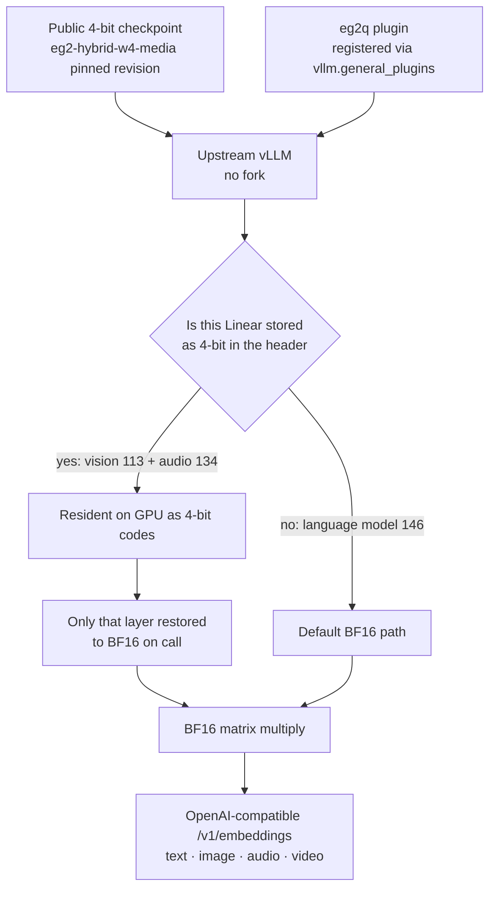

If you need to serve text, image, audio and video embeddings over an API and would rather give your GPU memory to the language model, this post is for you. We loaded the public 4-bit EmbeddingGemma 2 into unmodified upstream vLLM with a single plugin, and the GPU memory taken by weights dropped 43.7% against a BF16 reference. It does not get faster, and the only GPU we verified is the B200. We start with what EmbeddingGemma 2 is, where it fits, and its strengths and weaknesses. Then we show in numbers what the plugin changes and how far we checked it.

## What EmbeddingGemma 2 is

[EmbeddingGemma 2](https://ai.google.dev/gemma/docs/embeddinggemma/model_card_2) is a multimodal embedding model that Google released under Apache 2.0 on October 6, 2026. It takes text (including code), images, video and audio, and turns all of them into vectors in the same 768-dimensional space. That lets one model find a slide screenshot from a text query, or a related document from a meeting recording.

It has 740M parameters. The text backbone is 270M, with a 170M vision encoder and a 300M audio encoder on top. You can load only the encoders you need, for example 270M for text only or 440M for text and images. It supports more than 100 languages, and the input limit is 8,192 tokens across modalities. Output vectors can be cut from 768 dimensions to 512, 256 or 128 to save storage. For more on the model itself see our [introduction](/tech-blog/en/owm/embeddinggemma-2-multimodal-embedding/), and for the 4-bit runtime see the [previous post](/tech-blog/en/llmops/eg2-l2v1-low-memory-runtime/).

## Where to use it

The best fit is **internal search across mixed media**. Put documents, screen captures, meeting recordings and short videos into one index and query them with text. The old way turned images into captions and speech into transcripts first, then fed those to a text embedder. Two stages mean two models, and meaning lost in preprocessing cannot be recovered at search time. This model removes the first stage.

The second is **memory retrieval for work agents**. When an agent needs evidence from past documents, screens and voice records, this embedding sits underneath. If the language model and the embedding model share a GPU on an agent platform such as Paxis, every bit the embedder gives up goes back to the language model.

The third is **on-premises environments with data sovereignty requirements**. The license is Apache 2.0 and the model is small, so you can run multimodal search on one internal server without sending customer documents to an external API.

If you only search text, there is no reason to load all 740M. The 270M text-only setup is lighter, and the 4-bit media weights discussed here do not apply.

## Strengths

First, **four modalities in one space.** A text query vector and an image vector compare directly with the same cosine similarity, which keeps the search pipeline simple.

Second, **small and permissively licensed.** 740M takes a tiny slice of one GPU. A standard license with few limits on commercial use, internal deployment and derivatives shortens the adoption review.

Third, **storage cost is tunable by dimension.** Because of Matryoshka training, keeping only the front of a 768-dimensional vector preserves much of the ranking. The model card's multimodal benchmark (MMEB-v2) overall score is 59.01 at 768 dimensions, 58.38 at 512 and 56.24 at 256. Going to 256 cuts storage to one third for a drop of about 2.8 points.

Fourth, **encoders load on demand.** A service with no images never needs to load the vision encoder.

## Weaknesses

First, **multimodal quality falls off sharply at 128 dimensions.** On the same benchmark, 128 dimensions scores 45.65, more than 13 points below 768. The model card itself says 128 suits text-only use better. For a multimodal index, measure before going below 256.

Second, **do not run it in FP16.** The model card recommends bfloat16 or float32 and warns that FP16 activation ranges can cause NaNs or silent quality loss. The silent case is the dangerous one.

Third, **long inputs are cut.** Text is capped at 8,192 tokens, so long contracts and papers still need chunking. Audio longer than 30 seconds is truncated to 30 seconds by the model's processor.

Fourth, **published benchmarks are Google's own.** Check quality on your own Korean documents or business data, especially for deduplication or anything else where exact neighbor order matters.

Fifth, **serving paths are not yet guaranteed to produce the same vectors.** We found this during this work: for image and audio inputs, it is not yet proven, even for the BF16 model, that vLLM and sentence-transformers produce the same embeddings. Do not mix vectors from the two stacks in one index without checking.

## In plain terms

Think of a library stacks room. The official loader unpacks every vacuum-sealed bundle of books as soon as it arrives and shelves them all. The shelves (GPU memory) fill up to full size.

This plugin shelves the bundles still sealed. When someone asks for a book, only that one is taken out and opened, then sealed again. The shelves stay much emptier, but the extra unsealing step can slow a checkout a little. This time we attached that approach not to a private study but to the public lending desk that many people use at once: a vLLM server.

## What we built

The public checkpoint [`ThakiCloud/eg2-hybrid-w4-media`](https://huggingface.co/ThakiCloud/eg2-hybrid-w4-media) keeps the text weights in BF16 and quantizes only the vision and audio weights to 4 bits. v0.1.0 was a loader that kept this checkpoint 4-bit inside sentence-transformers. [`eg2-l2v1` v0.2.0](https://github.com/ThakiCloud/eg2-l2v1/releases/tag/v0.2.0) does the same thing in vLLM.

The `eg2q` plugin registers one quantization config through vLLM's standard extension point (the `vllm.general_plugins` entry point). It does not guess from layer types; it reads the checkpoint header and picks exactly the 247 Linear layers stored in 4 bits (113 vision, 134 audio). Those layers stay on the GPU as 4-bit codes and are expanded to BF16 only when called, then go into an ordinary BF16 matrix multiply. The 146 language-model Linear layers take vLLM's default path.



What did not change matters too. Nothing was re-quantized, no new checkpoint was made, and vLLM was not patched. It is not a native INT4 matrix multiply either. The matrix multiply is the same BF16; only how weights are stored on the GPU changed.

## Results

We measured on one NVIDIA B200. The reference arm is the same checkpoint expanded once to BF16 with the official loader and served with the same vLLM build and engine settings. That way any difference comes from how weights are stored, not from the serving stack. Pass criteria were registered before measurement and not changed after seeing results.

### Memory

The weight memory vLLM reports right after loading is 0.80 GiB, 0.563x of the reference's 1.42 GiB. The criterion was 0.70x or less.


*Figure 1. Resident weight memory reported by vLLM (B200). Whole-process GPU memory right after loading was 1,842 MiB for the plugin and 2,412 MiB for the reference.*

Do not read this as a cut in total server VRAM. vLLM pre-allocates activation and cache memory up to `--gpu-memory-utilization`, so how much GPU the server holds is set by that flag, not by the weights. The 0.62 GiB saved becomes useful only when you lower that flag and hand the memory to another process.

### Throughput

A run counted as valid only if the BF16-versus-BF16 control ratio in the same run stayed within 0.90 to 1.10 in every cell. Three of five runs were valid; the other two were discarded under that pre-registered rule.


*Figure 2. Lowest per-cell throughput across the three valid runs (reference = 1.0). Medians were text 0.993 to 0.998, image 0.932 to 0.992, audio 1.040 to 1.082, video 0.989 to 1.007.*

The lowest cell is audio at batch 64, 0.826x, which clears the pre-registered 0.80x floor. The audio median above 1.0 sits inside the control noise band and does not mean it got faster. The design adds a restore step, so if memory is not your constraint, BF16 is as fast or faster.

### Accuracy

We embedded 32 items per modality, 128 in total, three times with the plugin and three times with the reference, and compared nine pairs. In all four modalities the minimum cosine similarity was 1.0 at display precision, against a criterion of 0.99999. The 247 weights the engine restored matched the checkpoint's official loader down to sha256.

We also checked that the test could actually detect a difference. Injecting a small error into the 4-bit layers alone was caught immediately for image, audio and video. Text not moving was expected: the language model is not quantized, so the injected error never reaches the text path.

Some things we will not hide. In 4 of 128 items (2 text, 2 video), the plugin-versus-reference difference was slightly larger than the largest variation seen across six reference runs. The size is at the last digit of float32. In an earlier diagnostic run, one 3.85-second audio item wobbled intermittently even between reference runs; it did not reproduce this time. Not observed does not mean fixed.

Put simply: "On the same vLLM it is indistinguishable from BF16, but we do not promise bit-identical output under every condition."

### Serving

The OpenAI-compatible server started with `serve.sh` handled single requests for text, image, audio and video, and all 32 concurrent requests succeeded. The server process also loaded all 247 layers through the plugin.

## Does it reproduce outside?

We ran the README install steps verbatim in a clean B200 container with no access to internal registries, object storage, shared directories or credentials. The base was the public `python:3.12-slim-bookworm` image, and every package and the model came from public indexes and Hugging Face.

We ran it twice. The first run resolved dependencies fresh from public indexes and produced the lock file (199 packages). The second installed the lock file committed in the final release tree as is, and all 199 installed versions matched the lock. Both runs passed: 247 layers loaded, bit-identical with the official loader, embeddings for all four modalities, server ready in 70 seconds, 32/32 concurrent requests, and 0.80 GiB of weight memory.

## Try it

You need Linux x86_64, Python 3.12 and a driver that supports CUDA 13.0. The vLLM path uses PyTorch 2.13.0, so install into a fresh environment.

```bash
git clone https://github.com/ThakiCloud/eg2-l2v1.git && cd eg2-l2v1
sudo apt-get install -y gcc g++ libgl1 libglib2.0-0 ffmpeg
bash vllm/install.sh                               # locked deps, eg2q plugin, pip check
python vllm/selftest_vllm.py --out vllm_result.json   # exit 0 means pass
bash vllm/serve.sh                                 # /v1/embeddings on :8000
```

`serve.sh` downloads the checkpoint at the pinned revision, sets `EG2Q_CKPT` so the plugin sees the same directory, and starts the server with the arguments used in verification. Requests use the standard OpenAI embeddings API.

```bash
curl -s http://127.0.0.1:8000/v1/embeddings \
  -H 'Content-Type: application/json' \
  -d '{"model": "eg2", "input": ["a dog barking in the distance"]}'
```

The request format for images, audio and video is in `vllm/client_example.py` in the repository. Send audio as 16 kHz mono. The `model` value is `eg2`, the default name in `serve.sh`.

## What this changes

The biggest change is operational. You no longer need separate serving code or a vLLM fork to use the 4-bit checkpoint. A team already serving language models on vLLM can add one more embedding endpoint on the same engine and API conventions. On a platform that builds endpoints on vLLM, such as our inference platform Metis, upgrading upstream vLLM only means re-checking the plugin, so the maintenance cost is small. We have not yet verified it as a Metis endpoint.

0.62 GiB is not a large number on its own. It matters when a language model, a reranker and an embedder share one GPU. There, whatever you take off the embedder's `--gpu-memory-utilization` goes back to the language model's KV cache.

## What not to trust

- The only verified GPU is the NVIDIA B200 (SM 10.0). We do not claim support for other GPUs.
- 43.7% is resident weight memory, not total server VRAM.
- It is not a speed-up tool. There is no native INT4 kernel.
- The accuracy reference is 4-bit restored to BF16 on the same vLLM path. It is not a comparison with other serving stacks.
- Image and audio embedding equivalence between vLLM and sentence-transformers remains a separate open problem.
- The repository does not redistribute model weights or evaluation data. The checkpoint is fetched from Hugging Face at a pinned revision at run time.

These numbers are measured on one B200, not simulated, and the code and model are both released under Apache-2.0.
