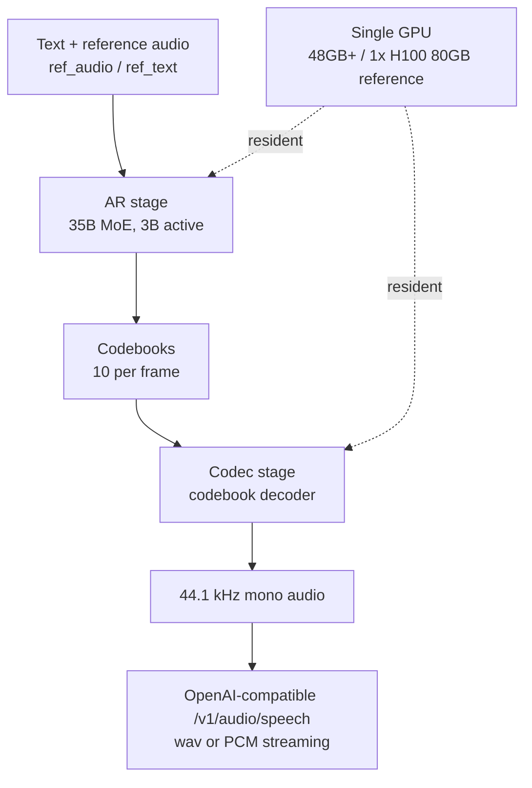

## Who should read this

This post is for the engineers who run vLLM-based inference endpoints on ThakiCloud's ai-platform and are deciding whether to add a TTS (text-to-speech) endpoint to the stack. vLLM-Omni now serves Fish Audio's multi-speaker TTS model, Drama 3, on a single H100, and the published first-audio latency (TTFA) is 126 ms at concurrency 1. The serving contract is stable enough to add to a stack today, but the numbers are the vendor's measurements, so the operational caveats matter just as much as the recipe.


## The model in one picture

Think of a radio drama recording studio. Up to sixteen actors sit at their microphone stands, and the sound director calls a number to put one on the air. The script carries bracketed directions like [sighs] and [whisper], and a short reference tape makes an actor imitate a given voice exactly. Drama 3 is that studio, and vLLM-Omni is the work of turning the studio into a broadcast tower. Anyone can book the studio through an OpenAI-compatible /v1/audio/speech door, and the audio comes out as a 44.1 kHz stream.

## Overview

vLLM announced Drama 3 support in its [official X post](https://x.com/vllm_project/status/2110651698847093121) on October 16, 2026. Drama 3 is a multi-speaker text-to-speech model from Fish Audio. The vLLM support matters for two reasons. First, the API contract is OpenAI-compatible, so an existing TTS client can call this endpoint with no code change. Second, it runs on the same engine as the LLM endpoints, so a GPU platform does not need a separate serving infrastructure.

The model is a 35B MoE (Mixture of Experts) with 3B active parameters. A text backbone generates codebooks, and a codebook decoder turns them into audio. Ten codebooks are produced per frame, and the output is 44.1 kHz mono. The three headline features are zero-shot voice cloning, 16 speaker tags, and inline event tags.

## What Drama 3 and vLLM-Omni are

### The model

Zero-shot voice cloning means the model speaks in a given voice from just a reference audio (ref_audio) and its transcript (ref_text), with no fine-tuning. You pass both parameters on every request, and there is currently no session concept for registering a voice once and reusing it.

Speaker tags put multiple speakers in a single request. <\|speaker:0\|> through <\|speaker:15\|> number the sixteen microphone stands, and any untagged line is spoken by speaker 0. Because one request synthesizes an entire scene, fixed turn-order dialogue is a particularly good fit.

Event tags are bracketed directions written inside the text. [sighs], [laughs], [laughing], [whisper], [angry], [excited], and [pause] are supported, and the recipe notes that mid-sentence placement works better than the start of a sentence. Note that the Fish Audio platform's own API offers event tags in a different angle-bracket set (<whisper>, <emphasis>, <soft>), so when serving through vLLM you follow the recipe's bracket notation.

### Serving structure

vLLM-Omni runs Drama 3 on a single GPU in two stages. The AR stage generates codebooks autoregressively, and the codec stage decodes them into audio. Both stages live on the same GPU, so there is no multi-GPU tensor parallelism, and the hardware requirement is one CUDA GPU with 48 GB or more. The reference test is a 1x H100 80GB, and the stage-0 weights are 36.9 GiB.



The API contract is the /v1/audio/speech endpoint. Requests use the same field shape as the OpenAI TTS API: response_format wav returns a file, and stream: true with response_format pcm returns a Server-Sent Events stream. In the stream, speech.audio.delta carries 44.1 kHz 16-bit PCM in base64. A client only needs to write those deltas into a playback buffer for real-time audio.

### Which use cases fit

**Real-time voice agents** are the first candidate. A voice loop that streams 44.1 kHz PCM over SSE straight into a playback buffer. With TTFA 126 ms and RTF 0.28 at concurrency 1 (vLLM measurement), a single stream does not fall behind the conversation. The 16-speaker structure is not even needed; voice cloning and event tags are enough.

**Multi-speaker dialogue content** is the second. Game NPC lines, radio drama, audiobook casting; if the turn order is fixed, one request synthesizes the whole scene. The speaker-tag protocol means no per-session voice management; assign a number to each character and write it into the script.

**One-shot voice cloning** is the third. The ref_audio and ref_text per-request shape fits "make this voice say this one line." For a service that keeps a fixed character voice long-term, though, budget for the overhead of passing the reference audio every time.

## Installation and integration

The commands below come from the [official vLLM recipe](https://recipes.vllm.ai/fishaudio/drama-3). Environment requirements: one CUDA GPU with 48 GB or more, vLLM 0.31 or newer, and vLLM-Omni.

```bash
uv venv && source .venv/bin/activate
uv pip install vllm==0.31.0 --torch-backend=auto
uv pip install git+https://github.com/vllm-project/vllm-omni.git
vllm serve fishaudio/drama-3 --omni --port 8000
```

The --omni flag brings the server up in the two-stage layout, and the model picks up the model_type=fish_omni config (vllm_omni/deploy/fish_omni.yaml) automatically. The first request triggers kernel compilation that takes about 10 seconds, so send a few warmup requests after startup. Otherwise the first-audio latency measures slower than it really is.

A basic voice-cloning request:

```bash
curl -X POST http://localhost:8000/v1/audio/speech \
  -H "Content-Type: application/json" \
  -d '{
    "model": "fishaudio/drama-3",
    "input": "The quarterly report is due on Thursday, so please finish it by noon",
    "voice": "default",
    "ref_audio": "https://huggingface.co/datasets/zhaochenyang20/seed-tts-eval-mini/resolve/main/en/prompt-wavs/common_voice_en_10119832.wav",
    "ref_text": "We asked over twenty different people, and they all said it was his",
    "response_format": "wav"
  }' --output cloned.wav
```

Two-speaker dialogue gets a speaker tag in front of each line.

```bash
"<|speaker:0|> Hi. <|speaker:1|> Hello."
```

Streaming is the combination of stream: true and response_format: pcm.

```bash
curl -N -X POST http://localhost:8000/v1/audio/speech \
  -H "Content-Type: application/json" \
  -d '{
    "model": "fishaudio/drama-3",
    "input": "[sighs] Fine. If we miss it, it's on you. [laughs]",
    "response_format": "pcm",
    "stream": true
  }'
```

The response is Server-Sent Events, and speech.audio.delta carries 44.1 kHz 16-bit PCM in base64. The event-tag example above is the recipe's, showing [sighs] at the start of a sentence and [laughs] mid-sentence.

## Measured results

First, the published measurement table from the vLLM recipe. Conditions: 1x H100 80GB with both stages on one GPU, one voice-cloning reference, sampling temperature 1.0 / top_p 0.9 / top_k 30, warm server.

| Concurrency | First audio p50 (TTFA) | RTF |
|---|---|---|
| 1 | 126 ms | 0.28 |
| 4 | 246 ms | 0.40 |
| 8 | 360 ms | 0.51 |

RTF 0.28 means producing one second of audio in 0.28 seconds of wall clock. That is 3.5x faster than real time, so a single stream can carry a streaming voice-agent loop. Even at concurrency 8 the RTF stays at 0.51, below 1.0, so the audio does not risk falling behind generation in streaming. TTFA grows from 126 ms at concurrency 1 to 360 ms at 8, roughly 2.9x for an 8x concurrency step. The recipe also lists a Whisper-large-v3 transcription WER of 0.000, but that is a limited evaluation set, so it needs re-confirmation on your own content.

From a serving-cost view, these two numbers let you size "how many simultaneous voice conversations per GPU." RTF 0.51 at 8 streams means one card carries eight conversations without the audio falling behind, and TTFA 360 ms keeps the perceived first-word delay inside human conversational pause territory. They are the calculation material for the concurrency-per-GPU decision. They are H100 measurements, though, and other cards need re-measurement.

Language coverage is another point to verify. The Fish Audio platform's own API lists language tags like <korean> as experimental, but the vLLM recipe says nothing about language coverage. The range of languages with assured quality on the open-weights path has to be tested directly, and Korean synthesis in particular is worth putting on the reproduction plan.

Reproduction status on our own cluster is recorded separately. As of the morning of October 16, 2026, every physical GPU across the H100 (2/2), B200 (8/8), and H200 (4/4) clusters was occupied by resident serving endpoints and running jobs. Kueue admits on quota, and a pod with no physical GPU sits Pending until the 10-minute PodsReadyTimeout evicts it, so submitting would only leave a failure signature. The numbers in this post are vLLM's published measurements, not ours. Once a GPU is available, we will run the same recipe on an H100, re-measure TTFA and RTF per concurrency, and update this post.

## ThakiCloud product implications

### ai-platform (Metis serving)

The first item when adding a TTS endpoint is GPU sizing. Drama 3 brings 36.9 GiB of weights plus the active memory of two stages, and the requirement is 48 GB or more. In our clusters that is an H100-class card or above, and whether a 48 GB card actually works needs confirmation from the two-stage residency measurement.

Second is warmup handling in the startup sequence. The 10-second kernel compile on the first request is one-time, but a health check and first-audio measurement run immediately after startup will misread that first request. A warmup pass before the endpoint registers as healthy is the honest startup sequence.

Third is the weight distribution path. 36.9 GiB is past the single-PUT upload limit, so it must come into the cluster via multipart upload or the model registry. Once registered, the endpoint is a serving-config change away, which is why the model registration step should not be skipped.

Fourth is the contract between the audio endpoint and the LLM endpoint. Both sit on the OpenAI-compatible path but with different content types. Clients handle text tokens and PCM audio differently, while on the platform side the endpoints coexist on the same engine with the same operational burden as text inference. That is the advantage over standing up a separate vendor TTS stack.

### Paxis (Agent-Native Cloud)

The 16-speaker structure is more interesting for voice agents than for plain TTS. Because one request returns an entire conversation, agent-to-agent dialogue, group announcements, and roleplay content all come out of a single API call. The speaker tag becomes the protocol for an agent to assign roles without per-session voice management.

Event tags are an expressive control that can be exposed as an agent parameter. When an agent decides the tone of an utterance, it passes [whisper] or [angry] inline in the text. It is in-band with the text, so no separate control channel needs to be defined.

For a real-time voice agent, the streaming contract is simple. The 44.1 kHz PCM deltas arrive over SSE and attach straight to the playback buffer. TTFA 126 ms at concurrency 1 (vLLM measurement) puts the perceived delay in human conversational-pause territory.

## Limitations and counterarguments

First, voice cloning is a per-request contract. ref_audio and ref_text must be passed on every call, and there is no session API to register a voice once and reuse it. A server-side reference-audio cache addressed by URL looks workable, but that needs confirmation in reproduction.

Second, some generations can come out silent. The recipe itself warns that takes starting with fillers or tags may hit max_new_tokens and produce silence. Production needs a silence-detection-and-retry guard.

Third, long-text handling is not exposed in the API. previous_takes and long-text chunking are not parameters yet, so long scripts must be split client-side. Sentence-level splitting is easy, but for scenes where prosody continuity matters it can become a quality problem.

Fourth, the weight license is unverified. Neither the Fish Audio docs nor the vLLM recipe states a license, so confirm the Hugging Face model card before any commercial use.

Fifth, the measured numbers are the vendor's. TTFA and RTF are vLLM's published values on an H100 80GB, pinned to vLLM 0.31.0. vLLM-Omni installs from git, so behavior can shift with upstream updates; pin the version in production.

## Bottom line

Multi-speaker TTS has entered the standard vLLM serving path. Drama 3 runs on one 48 GB-or-larger GPU, the API is OpenAI-compatible, and first-audio latency is 126 ms at concurrency 1 (vLLM published measurement). When you attach it to a platform, check three things: GPU sizing for the two stages, startup-sequence warmup, and the weight distribution path. For ThakiCloud's ai-platform it is a candidate audio endpoint on existing vLLM endpoints, and for Paxis it is the component that gives multi-speaker dialogue an agent-native protocol. The numbers are the published measurements, and once our cluster reproduction completes we will report the delta against them.
