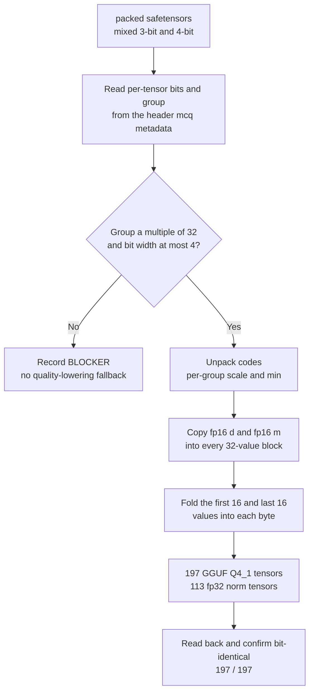

This post is for anyone who has to publish a model in an in-house quantization format whose reader code is private. The short version: we re-encoded the model into GGUF Q4_1 without changing a single restored weight value, and it now runs on stock llama.cpp. All 197 quantized tensors read back bit-identical, with a maximum absolute error of 0.0. It was not free. The file grows from 295,391,600 bytes to 378,522,208 bytes. Below is what we gave up, what we got, and where we got stuck along the way.


## The Problem We Had to Solve

ThakiCloud had a Qwen3-Embedding-0.6B checkpoint quantized with a different bit width per layer. Layers 0 to 6 use 4 bits with group size 64, layers 7 to 27 use 3 bits with group size 32, and the embedding table uses 3 bits with group size 64. It is an asymmetric scheme with a separate fp16 scale and fp16 min for every group, and the normalization weights stay in fp32.

The trouble was that no standard container could hold this layout. We pack codes bit by bit into our own layout, and the code that unpacks them stays private along with the quantization engine. When we decided to release the model, one condition came attached: an outside user must be able to actually run it without our private code. Lowering quality to fit, or open-sourcing the engine to fit, was not on the table.

So we narrowed the question. Can we change only the storage format and leave the restored values exactly as they are? If so, outside users need nothing but llama.cpp, and we never have to publish the algorithm.

## In Plain Terms

Think of two ways to put things in a warehouse. Ours is a custom shelf, carved to fit each item. It takes little space, but you need a separate blueprint to read it. GGUF Q4_1 is one standard crate for everything. Even a small item gets a full-size crate, so the total volume goes up, but any warehouse worker can come in and pull things out.

What we did was move the goods from the custom shelf into standard crates without changing the goods. Open a crate and every item inside is identical. The volume grows by 28%, and in exchange the blueprint is no longer needed.

## What a Q4_1 Block Looks Like

A ggml Q4_1 block is defined by a single struct: an fp16 scale `d`, an fp16 minimum `m`, and a `uint8 qs[16]` holding 32 four-bit codes. That is exactly 20 bytes for 32 values.

The nibble layout has a rule. The low 4 bits of `qs[j]` hold value number `j`, and the high 4 bits hold value number `j+16`. Restoration is `y[j] = d * (qs[j] & 0xF) + m`. Because the first 16 and the last 16 values are folded into the same bytes, getting the order wrong mixes up the values while still passing every size check, so the failure is silent.

Our format restores with `value = code * scale + min`, which is the same expression. That leaves two questions: can one group's scale and min be handed out across several blocks, and do our codes fit in a 4-bit nibble?

## Two Conditions That Make It Lossless

Two conditions are enough.

**The group size must be a multiple of 32.** Then a group never straddles a block boundary and splits into exactly `group / 32` blocks. Each of those blocks simply gets a copy of the same `(scale, min)`. Our groups are only 32 or 64, so the condition holds.

**The bit width must be 4 or less.** A 3-bit code runs from 0 to 7, and a 4-bit nibble holds 0 to 15. Putting a 3-bit value into a 4-bit slot widens the slot and leaves the number untouched. The scale it is multiplied by and the min it is added to are unchanged, so the result is unchanged too.

If any tensor violates either condition, we made the pipeline stop there and record a BLOCKER. We did not add a fallback that re-splits groups or clips codes to make things fit. A fallback like that produces the state "converted, quality unknown", and that is not a state you can release.



## The Code We Actually Ran

The block builder is the core. It replicates each group's scale and min once per block and folds the codes into nibbles.

```python
import numpy as np

def q41_blocks(codes, scale, mins, group):
    """Move packed codes into ggml Q4_1 block bytes.
    One block = fp16 d + fp16 m + uint8 qs[16] = 20 bytes, 32 values."""
    per = group // 32            # how many blocks one group splits into
    nb = codes.size // 32        # total number of blocks
    q = codes.reshape(nb, 32).astype(np.uint8)
    if q.max(initial=0) > 15:
        raise ValueError("some codes do not fit in a 4-bit nibble")

    d = np.repeat(scale.reshape(-1).astype(np.float16), per)
    m = np.repeat(mins.reshape(-1).astype(np.float16), per)

    out = np.empty((nb, 20), dtype=np.uint8)
    out[:, 0:2] = d.view(np.uint8).reshape(nb, 2)
    out[:, 2:4] = m.view(np.uint8).reshape(nb, 2)
    out[:, 4:] = q[:, :16] | (q[:, 16:] << 4)
    return out.reshape(-1)
```

`np.repeat` does all the work here. With group size 64, `per` is 2, so the same scale goes into two blocks. With group size 32, it goes into one. What matters is that no value is recomputed anywhere. This is relocation, not requantization.

## Bit Width and Group Size Come Only From Metadata

There was one trap. It is tempting to work the bit width backward from the packed byte count. The relation is `n_groups * group * bits == packed_bytes * 8`, but that equation only fixes the product `group * bits`. So `(bits=4, group=64)` and `(bits=2, group=128)` both come out as 256 and cannot be told apart.

We were bitten by exactly this once. We read 49 early-layer tensors, which we had protected at 4 bits, as 2-bit. Worse, we built both the reference values and the re-encoded file under the same wrong interpretation. Of course the two matched, so the "bit-identical" conclusion was circular. The check passed and checked nothing.

There is now a single source of truth: the JSON in the safetensors header at `__metadata__["mcq"]`. It carries `bits`, `group`, layout, and shape for each tensor, and if that metadata disagrees with the actual packed byte count, we raise a BLOCKER instead of filling the gap with a guess. We also check separately that no code exceeds its declared bit range.

## The gguf Library's raw_shape Trap

We lost a good while to the Python `gguf` package's `add_tensor(name, tensor, raw_shape, raw_dtype)`. When you pass `raw_dtype`, `raw_shape` is interpreted as a **byte shape**, not an element shape. Internally `quant_shape_from_byte_shape` divides by the block size of 20 to recover the element shape.

Pass the element shape as-is and it dies with this error.

```
ValueError: Quantized tensor bytes per row (96) is not a multiple of Q4_1 type size (20)
```

The right value divides the row length by 32 to get the block count, then multiplies by 20.

```python
# Pass the byte shape, not the element shape.
byte_shape = [shape[0], shape[1] // 32 * 20]
writer.add_tensor(
    gguf_name,
    buf.reshape(byte_shape),
    raw_shape=byte_shape,
    raw_dtype=gguf.GGMLQuantizationType.Q4_1,
)
```

We caught this with a local unit test on a Mac before sending any job to the cluster. We wrote four cases to a file and read them back to confirm bit equality, `(3-bit, 32)`, `(4-bit, 64)`, `(3-bit, 64)`, and a large-matrix combination, and only then submitted the real job.

## Tensor Names and KV Metadata

Moving the values is not enough to make the model run. The tensors also need names llama.cpp recognizes. HF's `self_attn.q_proj.weight` becomes `blk.N.attn_q.weight`, `embed_tokens.weight` becomes `token_embd.weight`, and the final `norm.weight` becomes `output_norm.weight`. If a name is missing from the mapping, our code returns `None` and that becomes a BLOCKER, because skipping it silently would produce a file with a tensor missing.

The memory order happened to line up without any work. In GGUF, `ne[0]` is the input dimension, and HF's row-major flattening of `[out, in]` matches llama.cpp's block layout order. This model's row lengths are 1024, 2048, and 3072, all multiples of 32 and 64, so block boundaries fall cleanly.

In the KV metadata we wrote everything an outside user needs to get the same result without knowing any flags. The architecture is `qwen3`, pooling is `pooling_type = LAST`, with `add_eos_token = true` and `add_bos_token = false`. The RoPE dimension is 128, the RoPE base is 1e6, and the file type is MOSTLY_Q4_1. The tokenizer is recorded as model `gpt2` with pre setting `qwen2`, and all 151,669 vocabulary entries and the merge rules are embedded in the file. That means outside users do not need our tokenizer code either.

## What We Checked by Reading It Back

Independently of the write path, we reopened the finished file with `GGUFReader`. After confirming that each tensor is of type Q4_1, we compared the dequantized values against `code * scale + min` computed from the source, at the level of floating-point bit patterns.

| Item | Value |
|---|---|
| Tensors in the file | 310 (197 quantized Q4_1 + 113 fp32 norm) |
| Read-back bit-identical | 197 / 197 |
| Max absolute error | 0.0 |
| Embedded vocabulary | 151,669 entries, 0 empty slots |
| File size | 378,522,208 bytes |
| sha256 | `1b95b9cbf157a7b6e5d08b0afa7a30342105681dbfb913b182d3680ef3a52a95` |

Bit-identical does not mean "close, down to rounding error." It means the bit patterns of the restored fp32 values are the same. This is a conversion with no room for precision loss in the first place.

## How to Read the Bigger File

This is the part that has to be written honestly. With a single Q4_1 type, 3-bit groups also take 4-bit slots, and every 32 values carry an fp16 scale and an fp16 min. So the packed file of 295,391,600 bytes becomes 378,522,208 bytes in GGUF, an increase of about 28%.

In our internal comparison this mixed layout was about 0.95% smaller than a uniform 3-bit, group-32 baseline by payload accounting, but **that size advantage does not carry over to GGUF.** The GGUF file is a 4-bit file whose restored values merely came from mixed 3-bit and 4-bit quantization. Citing this file as evidence of a 3-bit size advantage would be wrong.

What we got in return is runnability. It runs with one standard tool, with no custom kernel, no private loader, and no tokenizer code of ours. When you put a low-bit research artifact in front of outsiders, the question that remains is not size. It is whether someone else can run it.

## Trying It Yourself

The model is on [Hugging Face](https://huggingface.co/ThakiCloud/Qwen3-Embedding-0.6B-MultiCal-M1a-GPTQ). The pooling mode is stored in the file, so you get the same vectors without extra flags.

```bash
./llama-embedding -m model-q4_1.gguf --pooling last \
    -p "The capital of France is Paris." \
    --threads 8 --threads-batch 8 --embd-normalize 2
```

From Python, use it like this. The output vector is an unnormalized 1024-dimensional vector, so apply L2 normalization before computing cosine similarity.

```python
import numpy as np, llama_cpp

llm = llama_cpp.Llama(
    model_path="model-q4_1.gguf",
    embedding=True,
    n_ctx=512, n_batch=512, n_ubatch=512,
    n_threads=8,
    n_threads_batch=8,   # do not leave this unset in a container
)

def embed(text):
    v = np.asarray(llm.embed(text), dtype=np.float32).reshape(-1)
    return v / np.linalg.norm(v)

docs = ["The capital of South Korea is Seoul.", "The capital of France is Paris."]
q = embed("What is the capital of South Korea?")
print(np.stack([embed(d) for d in docs]) @ q)
```

Why `n_threads_batch` has to be set explicitly is a topic for a separate post. Left unset, it becomes severely slow inside a container.

## What This Means for ThakiCloud Products

ThakiCloud's ai-platform puts models on whatever hardware each customer environment has. On-prem, it is not unusual to need embedding search on nodes with no GPU at all. This conversion adds one option that works right away in that case. A quantization research artifact stuck in an in-house format never leaves the lab, but once a path to a standard container is confirmed, the same checkpoint can go both to a serving path on K8s and to CPU-only edge nodes.

The more important point operationally is that we made code own the verification. We put the conversion job in a Kueue queue, moved the output out of the pod, and took the verdict of the read-back check from an exit code rather than from human judgment. If the conversion fails, no converted file is produced, and if it succeeds, the bit-identical count is left in the log. For hard-to-undo steps like releasing a model, leaving the verdict to code is the safer arrangement.

## Limits and Counterarguments

What this conversion proves has a clear boundary. **It shows the restored values are the same. It does not mean we re-measured retrieval quality.** The quality numbers we have published come from measuring the packed artifact with our in-house fp32 loader. On the GGUF side we only checked embedding equivalence and ran a small smoke test. The two should not be read as one.

The conditions are narrow. If the group size is not a multiple of 32, or the bit width is 5 or more, this path does not hold. Anyone using a layout such as 2-bit with group 128 cannot apply the same method as is.

The larger file can also be a deal-breaker in some settings. In deployments constrained by disk or network, a 28% increase can cancel out the benefit of the conversion. And Q4_1 is an older type in the ggml ecosystem, so it does not get the full benefit of kernel optimizations tuned for newer types.

Finally, this model is a Research Preview. We have not published throughput or memory-savings figures, and this post does not claim any.

## Summary

If you have your own quantization format and no way to run it outside, check the **storage-format-only route** before you open the algorithm or cut quality. If the restore rule has the form `code * scale + min`, the group size is a multiple of 32, and the bit width is 4 or less, you can move to Q4_1 without changing a single value. In our case, all 197 tensors came out bit-identical.

There are three things to check, in this order. Read bit width and group size from metadata instead of working them backward from bytes. Confirm that the shape you pass to `add_tensor` is a byte shape. And verify by reading the file back independently of the write path. Skip the third and you can easily fall into the circular trap of verifying your own bug with your own bug. We fell in once. One read-back check breaks that loop.
