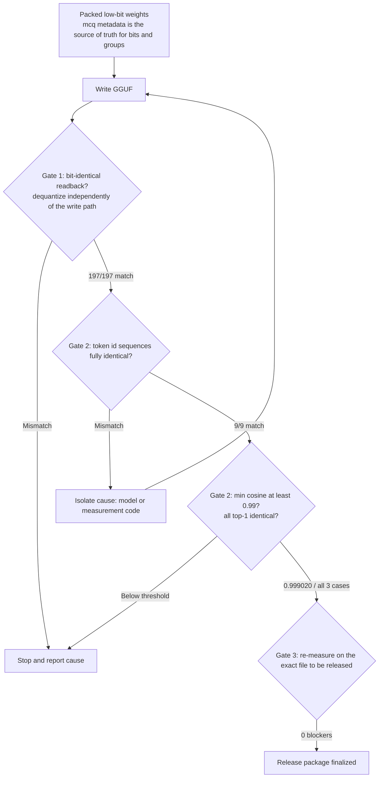

{: .align-center}

Releasing a model built in our own quantization format means clearing one hurdle: it has to run without our code. We cleared it by [converting to GGUF](/tech-blog/en/llmops/packed-lowbit-to-gguf-q41-lossless-reencode/) D50 M1a, a Qwen3-Embedding-0.6B quantized with different bit widths per layer, and the model is on [Hugging Face](https://huggingface.co/ThakiCloud/Qwen3-Embedding-0.6B-MultiCal-M1a-GPTQ). This post is about **the verification design that made that conversion trustworthy**. How the conversion itself works was covered in the earlier post.

The short version: we built a 3-gate check and got two NO-GOs. Both times the culprit was neither the quantization nor the conversion code but **the code doing the verifying**. The conversion was right from the start, and we were holding the wrong ruler. Do not read this as a story about luck. The defects surfaced because we wrote the thresholds down in advance and did not touch them after seeing the results.

## Verification Had One Question to Answer

A conversion job does not succeed when "the file was produced." It succeeds when an outside user, with nothing but llama.cpp, can get **the same vectors we measured**. Embedding models need extra care here. With a generative model, a human can read slightly different output and judge it. An embedding is just 1024 numbers, so a drift is invisible. Search quality can quietly degrade and ship that way.

So we split the question into three layers. Are the stored bits the same? Does the same input become the same token sequence? Do the resulting vectors match? The flow below is what actually ran.



## We Wrote the Thresholds Before Seeing Any Results

Before measuring, we fixed three conditions. Token id sequences must be **exactly identical**. The **minimum embedding cosine must be at least 0.99**. On a small retrieval set, **every top-1 must match**.

The reason for picking 0.99 should be on record too. Even with identical bits, we did not expect a cosine of 1.0. The same weights still diverge in the last digits, because llama.cpp's CPU kernels and PyTorch accumulate in a different order. At the same time, 0.99 is not a value that tolerates "slightly different." When quantization goes wrong, cosine falls into the 0.8s, so 0.99 left a wide enough gap to separate kernel noise from a real defect.

Writing the number down first is itself the mechanism. If you set the bar after seeing results, people almost always draw the line where things pass. The thought "what about 0.98?" only occurs after you have seen 0.989.

We also kept humans out of the verdict. The check script prints GO or NO-GO on its last line, and the conditions are constants in the code. A pass requires zero blockers, a minimum cosine at or above the declared value, and all top-1 results matching. That leaves no room for "it looks mostly fine" to slip into the decision.

## Gate 1: Read Back Independently of the Write Path

The first gate is simple. After writing the GGUF, **read it back**, dequantize, and check whether it is bit-for-bit equal to the original values. All 197 quantized tensors matched, with a maximum absolute error of 0.0.

What matters is how the comparison target is built. In earlier work on this same task we fell into circular reasoning. We derived each tensor's bit width from the packed byte count instead of reading it from metadata. That derivation only determines the **product** of bit width and group size. 4-bit with group 64 and 2-bit with group 128 both come out to 256, so they are indistinguishable. We built the reference values and the re-encoded result **both** from that wrong estimate, and "bit-identical" passed beautifully. Both numbers simply shared the same error.

So the source of truth for bits and groups is now a single place, the safetensors header metadata, and if the metadata disagrees with the file we raise a blocker instead of guessing.

```python
with safe_open(path, framework="np") as f:
    hdr = f.metadata() or {}
if "mcq" not in hdr:
    blockers.append({"why": '__metadata__["mcq"] missing, cannot read the source of truth for bits and groups'})

# If the metadata disagrees with the file, one of them is false. Stop instead of guessing.
if n_groups * group * bits != packed_bytes * 8:
    blockers.append({"why": "bits/group in metadata inconsistent with packed bytes", "tensor": name})

# The readback does not reuse the write path. It decodes blocks read directly from the file.
ref = (codes.reshape(-1, group).astype(np.float32) * scale[:, None] + mins[:, None]).reshape(-1)
back = dequant_from_file(gguf_path, name)
identical = np.array_equal(ref.view(np.uint32), back.view(np.uint32))
```

The `view(np.uint32)` comparison on the last line is deliberate. Comparing floats with `==` says 0.0 equals -0.0 and says NaN never equals anything. Viewing the bit pattern as an integer asks "are these the same bits" rather than "are these the same value."

## Gate 2, Run 1: NO-GO, and the Cause Was Not the Conversion

The first result of the runtime-equivalence measurement fell short. Cosines came out at 0.811831, 0.713135, and 0.820722. That is nowhere near 0.99, and it looked like what a broken quantization produces.

But the same log held a sharper clue. For every sentence, the HF tokenizer produced **exactly one more token** than llama.cpp: 9 versus 8, 16 versus 15, a constant offset of one. A broken quantization makes vectors wrong, not lengths wrong. A length gap points at the tokenizer.

I want to stress that the **shape** of the difference was the clue. If it had been 2 here and 3 there, we would have suspected the vocabulary or the merge rules. Across 9 sentences mixing Korean and English, the gap was uniformly one. That means a single special token being added or not. Counting failures and looking at the shape of failures are different activities, and the second is what narrows the cause.

The cause was our own GGUF writer. The `post_processor` in `tokenizer.json` is a TemplateProcessing that appends `<|endoftext|>` (151643) to the end of each sentence, yet we had written `add_eos_token` as false in the GGUF header. This model pools by reading the last token, and the token it needs to read is exactly that EOS. With one flag off, pooling picked the wrong token and the whole vector shifted.

The fix was to derive the flag from the template automatically. Typing the value by hand would repeat the mistake on the next model. We also raise a blocker if the token the template appends differs from the configured EOS. GGUF can auto-append only one token, so a model where the two disagree should not go down this path at all.

## Gate 2, Run 2: It Passed, and the Verdict Was NO-GO Again

Re-measuring with the rewritten file, the embeddings passed. Cosine across the 9 sentences was **minimum 0.999020, maximum 0.999679**, and top-1 for all 3 queries matched the reference. Yet only the token sequence comparison printed a mismatch on all 9 sentences, so the overall verdict was NO-GO again.

These two results cannot both hold. If the token sequences differ, vectors cannot sit at 0.999. When you see a contradiction, one of the two measurements is wrong.

The culprit was the comparison code. `Llama.tokenize(text, add_bos=, special=)` in `llama-cpp-python` passes its first argument to llama.cpp as `add_special`. So `add_bos=False` **turns off both BOS and automatic EOS**. The `add_eos_token=true` we had worked to enable was ignored on that call path. `llm.embed()`, on the other hand, turns `add_special` on internally when it tokenizes, so the embedding side was fine. We had been reading the same file in two different ways.

There were two choices. One was to adjust the threshold, or to write "the embeddings passed, so effectively GO." The other was to fix only the measurement code and measure again. We took the second, and to avoid filling the gap with words we enumerated every combination.

```python
for s in TEXTS:
    hf = list(hf_tok(s, add_special_tokens=True)["input_ids"])
    got = {}
    for add_special in (True, False):
        for parse_special in (True, False):
            got[f"add_special={add_special},parse_special={parse_special}"] = \
                list(llm.tokenize(s.encode("utf-8"), add_bos=add_special, special=parse_special))
    rows.append({"text": s[:40], "matched_modes": [k for k, v in got.items() if v == hf]})

# One **identical** combination must match on every sentence before we can say "same tokenizer."
common = set.intersection(*[set(r["matched_modes"]) for r in rows])
```

The result: both combinations with `add_special=True` matched the HF token id sequence on all 9 sentences. `parse_special` made no difference. A combination common to every sentence existed, and there were zero blockers. The last two lines are the heart of this check. A different combination matching by chance on each sentence is noise. So an empty intersection is also counted as a blocker.

## Gate 3: Measure Again on the File That Actually Ships

The last gate has a different target. The first two gates looked at working files, but what ships is the uploaded file. So we downloaded the release package as published and measured again. The GGUF is **378,522,208 bytes** with sha256 `1b95b9cbf157a7b6e5d08b0afa7a30342105681dbfb913b182d3680ef3a52a95`. Every number on the model card comes from this measurement.

In the same job we also checked that the embeddings are valid: dimension is 1024, all values finite, L2 norm above zero, and top-1 matches the earlier measurement. Nine calls took between 0.039 and 0.097 seconds, with zero blockers. We recorded digests for all 12 files, so a recipient can verify the same hashes.

## What We Did Not Verify Matters More

If we list only what passed, the card becomes a lie. Here is what we **did not** measure this time.

The 3 top-1 cases are a **smoke check** built from 6 documents and 3 queries. They show only that the vectors are in a usable state, and they are far too small to read as a retrieval score. The cosine comparison also needs a fair description of its reference. The reference is our own baseline, the same packed weights restored to fp32, so this number measures whether the **conversion** preserved the values, not retrieval quality. The retrieval quality of the original packed model, measured by nDCG, and this conversion check are different measurements, and we did not rerun the retrieval benchmark through llama.cpp.

We also disclosed one constraint. The normalizer in `tokenizer.json` is NFC, but llama.cpp's gpt2 tokenizer does not apply NFC normalization. If the input is not NFC, the token sequences diverge. So we pinned the test sentences as NFC in code, and the model card tells users to normalize to NFC before embedding. If you hide items like this, users discover them alone on their own data.

## Implications for ThakiCloud Products

ThakiCloud's ai-platform serves and trains models in customer environments. Many customers have on-prem and sovereign requirements, so we produce quantized checkpoints often, and those checkpoints must run on the customer's standard runtime. This verification design drops straight into that point.

Two things matter in practice. First, if the completion condition for a conversion job is "read back through an independent path, bits are identical, and a standard loader yields the same vectors," quality loss is caught before it reaches a customer's index. Second, if the verification job is a CPU batch queued through Kueue, the gate can run without taking a GPU slot. This entire verification ran on zero GPUs. A cheap gate gets run on every conversion, and an expensive one gets skipped.

One more point: the fact that what tripped us twice was the measurement code and not the model is itself an operational lesson. Verification code is code, and it has bugs. That is why the verdict must be owned by deterministic checks. A model's self-report cannot be a verdict. And when checks give contradictory signals, assume one of them is wrong and isolate the cause.

## Summary

What we released is the model. The quantization engine, the calibration generation, and the bit-allocation implementation stay private, and we uploaded only the weights, config, tokenizer, card, and license. The condition for this work was that an outside user can run the model without our code, and the 3-gate check above is the evidence we used to judge whether that condition was met.

This is a Research Preview. We make no claims about latency, throughput, or peak memory, and since the result comes from one model and one budget, we do not generalize it to other embedding models. Before using it, we recommend reading the limitations section of the [model card](https://huggingface.co/ThakiCloud/Qwen3-Embedding-0.6B-MultiCal-M1a-GPTQ) first. It tells you more than the numbers that passed.
