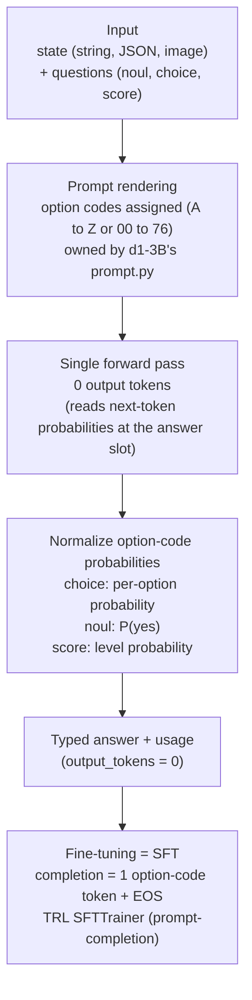

*A decision model that renders a verdict in a single forward pass, with no output tokens. An abstract rendering of the structure that puts probability mass on a single option code.*

## Why Read This

If you are an ML engineer or data scientist who needs your own labels on classification, routing, or moderation tasks, but does not want to pay the inference cost of a generative model for it, this post is the recipe. The conclusion comes first. **Fine-tuning a decision model (d1-3B) is "SFT where the completion is a single token," and what decides the quality of the result is not the training framework (TRL or Unsloth) but three data-hygiene steps. Liquid AI's two notebooks show the full pipeline running on a free-tier T4 in under 30 minutes.**

## In Plain Terms

An ordinary LLM is an essay exam. The model has to write the answer out token by token, and the length of the answer is unknown in advance. A decision model is a multiple-choice exam. You circle the option, and that is the end of it. d1-3B is the latter. It takes a state (for example, a customer message) and a question (for example, "which intent is this?"), and in a single forward pass it assigns a probability to each option. On top of this structure, fine-tuning means handing the model "past papers with the answers already filled in." The answer to be learned is "the circled number" (one option-code token), so the loss computation is light, and the past papers themselves (the data) decide the outcome.

## Overview

Leonie Monigatti of Liquid AI published two decision-model fine-tuning notebooks on X on October 18: the [TRL version](https://github.com/Liquid4All/cookbook/blob/main/finetuning/notebooks/sft_for_decision_models_with_trl.ipynb) and the [Unsloth version](https://github.com/Liquid4All/cookbook/blob/main/finetuning/notebooks/sft_for_decision_models_with_unsloth.ipynb). Both fine-tune d1-3B with SFT+LoRA, using Banking77 (customer-support message classification over 77 intents) as the example. The notebooks' official claim: about 30 to 35 minutes of training on a free Colab T4.

This post carries the TRL-version pipeline over to Apple Silicon (MPS) and reports the measured numbers. The Unsloth version is analyzed at the notebook-code level. The reproduction scripts and logs are in `outputs/blog-impl/sft-decision-model-d1-3b/`.

## What Is This Technology

d1-3B is a 3B-parameter decision model (measured 3,123,483,888), built on LFM2.5-VL-3B. The point is that it outputs a verdict rather than text. Each question is defined with one of three primitives.

- `noul`: yes/no, output as P(yes)
- `choice`: a probability for each named option
- `score`: a level on an ordered scale of 2 to 10

The external interface is the System One API. You pass a state and a bundle of named questions in one call to `system_one(state, questions)`, and you get back a typed answer (with probabilities) and usage. `system_one_batch` packs many requests with no padding. The state can be a string, JSON, or image (the base model has vision, since it is LFM2.5-VL). The output_tokens field of usage is always 0. That means there are no generated tokens.

The mechanism works through the "answer slot." The prompt is rendered with each option assigned a short code (A, B, C, ... or two-digit 00 to 76). At the end of the prompt, the model reads the next-token probabilities in a single forward pass. It takes only the probabilities of the option-code tokens and normalizes them, and that is the answer. So fine-tuning reduces to plain SFT data where the completion is the single option-code token plus an end-of-turn token (prompt-completion format).



## Installation and Integration

The TRL notebook uses pinned versions.

```bash
pip install -qqq "transformers==5.19.0" "trl==1.15.0" "peft==0.21.2" "torchao>0.16.0" datasets
```

The model is loaded in two modes. Inference (System One API) uses `AutoModel` + `trust_remote_code=True`. Training uses the standard LM-head class `AutoModelForImageTextToText`. Because d1-3B's checkpoint uses standard LFM2-VL module names, the training side does not need the custom code.

The model repository ships `prompt.py` (the prompt builder). You must reuse it to build your training data, so that the model sees exactly the same prompt during training and inference.

```python
from huggingface_hub import snapshot_download
from transformers import AutoModel, AutoTokenizer
import sys

local_dir = snapshot_download("LiquidAI/d1-3B")
sys.path.insert(0, local_dir)

tokenizer = AutoTokenizer.from_pretrained("LiquidAI/d1-3B")
model = AutoModel.from_pretrained("LiquidAI/d1-3B", trust_remote_code=True, dtype=dtype).to(device)
```

The notebooks also carry Open-in-Colab badges at the top (about 35 minutes for TRL, about 30 for Unsloth).

## Data Preparation (the Core)

Banking77 is about 13k online-banking customer messages, each labeled with one of 77 intents. The notebooks train on 3,000 and evaluate on 100. There are three data operations here. None of them produce the "answer"; all of them produce a "fair evaluation."

**1) Case-level dedup.** Banking77 contains rewordings of the same request, such as "can you tell me why my transfer failed?" and "Can you please tell me why my transfer failed?". If one lands in training and the other in evaluation, the evaluation rewards memorization. The notebooks treat two messages as the same case when they share at least 80% of their words, and drop training messages that reword a test message.

**2) Case-level 10% holdout.** Ten percent of the training set is set aside as an eval split for loss tracking, taken by case rather than by message. If the same case straddles both sides, you get the same problem as in step 1.

**3) Per-example option-list randomization.** Option codes are assigned by position. Option 1 gets code 1, option 2 gets code 2. If you always train with the same order, the model learns a "code = intent" mapping without reading the option list. Add or reorder an intent later and every code shifts, and the fine-tuned model breaks. So each training example gets its own fresh list: the correct intent plus a random 26 to 76 other intents, in random order. The code scheme switches between A to Z (up to 26 options) and two-digit codes (27 or more), so subsets are kept at 27 or more and the codes stay two-digit, exactly as when you ask with all 77 intents.

Measured in this reproduction: 6 training messages dropped (test rewordings), sft_train 2,694, sft_eval 300, 77 labels.

## Actual Experimental Results

We ran the TRL-version pipeline on Apple Silicon (M-series, 51GB, MPS). There is one Mac-specific adaptation. TRL 1.15.0's SFTTrainer forces a fused logprob kernel, which is triton-based, and there is no triton distribution for macOS (measured: `pip install triton` returns No matching distribution). So the training run used TRL 1.14.0 (the plain-logits path), and everything else (LoRA targets, SFT config, data pipeline) stayed identical to the notebook.

| Item | Measured |
|---|---|
| Model parameters | 3,123,483,888 (bf16, about 6.2GB) |
| Load time | 4.2s (MPS) |
| Baseline accuracy | 83.0% (100 test messages, system_one_batch, batch 16, 48.1s) |
| LoRA trainable parameters | 24,461,312 / 3,147,945,200 (0.78%) |
| Training | 150 steps, batch 2 x GA 2 (effective 4), lr 2e-4 cosine, warmup 5%, grad ckpt, max_length 4096 |
| Step time | about 5.3 to 6.1s (causal_conv1d not installed, reference implementation) |
| Wall time | 863s (about 14.4 min for 150 steps) |
| Loss | 0.283 (step 10) to 0.152 (step 150), overall train_loss 0.2657, mean_token_accuracy 0.91 to 0.98 |
| Fine-tuned accuracy | 87.0% (same 100 test messages, +4.0pp over the 83.0% baseline, i.e. 4 items) |

From an 83.0% baseline, 150 SFT steps brought it to 87.0%. Because the completion is a single token, the per-step loss swings a lot (0.08 to 0.41), and mean_token_accuracy (0.91 to 0.98) is the steadier training signal. With n=100, 4.0pp is exactly four items: a directional signal, not a magnitude to over-read.


*Measured results. Left: the 150-step SFT loss curve (high per-step variance because the completion is a single option-code token). Right: baseline 83.0% versus fine-tuned 87.0% on the same 100 test messages.*

The LoRA targets match the notebook: only the language model is adapted. Attention (q_proj, k_proj, v_proj, out_proj), the short convolutions (in_proj, out_proj), and the MLP (w1, w2, w3), with vision_tower explicitly excluded. The task is text-only, so the vision encoder stays frozen.

Reference latency from the official model card: one question in 30ms on Apple M5 Pro, 8ms on RTX 4090. Packing 64 states: 78/s on M5 Pro, 475/s on 4090, 1,106/s on MI325X. The model card claims the best sub-10B decision model on Decision Index 0.2.1 (48.57).

## The Two Notebooks (TRL vs Unsloth)

Both use the same data for the same purpose, but the training wrappers differ.

- **TRL version**: `AutoModelForImageTextToText` + PEFT `LoraConfig` (target_modules list) + `SFTTrainer` (prompt-completion format). The loss is computed only on the completion (the single option-code token).
- **Unsloth version**: `FastVisionModel.from_pretrained(model_name, auto_model=AutoModelForImageTextToText, max_seq_length=2048)` + a regex `target_modules` (`.*language_model.*\.(q_proj|...)`). It masks the instruction part of the loss with `train_on_responses_only`, and uses `adamw_8bit` and `use_gradient_checkpointing="unsloth"`.

The most important warning in the Unsloth notebook explains why it does not use `FastDecisionModel`/`DecisionTrainer`. Unsloth has classes for training decision models, but applying them to d1-3B would stack a freshly, randomly initialized decision head on top of the model and save the result in Unsloth's own decision-model format. You would lose d1-3B's trained readout and its System One API. So the Unsloth notebook also fine-tunes d1-3B's own trained readout via LM-head SFT, so the fine-tuned model behaves through `system_one` exactly like the original.

Both merge after training and copy d1-3B's code files (api.py, hybrid.py, lfm2_vl.py, modeling_d1.py, prompt.py, runner.py, processor_config.json, LICENSE) into the same folder, producing a "normal" checkpoint that keeps the System One API.

## ThakiCloud Product Implications

**ai-platform lens (serving, cost).** The "zero output tokens" structure of a decision model changes the cost structure of classification and routing services. There is no decode loop, and `system_one_batch` packs with no padding, which suits high-throughput batch triage. 3B plus 24.46M LoRA parameters is a scale that fine-tunes in 30 minutes on a free-tier T4, which makes "a customer fine-tunes a routing model on their own data and puts it on multi-tenant serving" an actually executable unit. Placing a decision model as a cheap router in front of a generative model changes the pipeline economics. Triage is 8ms on a 4090 (model-card reference value), and only the hard cases go on to the large model. In the environment where ThakiCloud's ai-platform runs an NVFP4-class serving stack, this 3B decision model is a candidate for the "routing layer," beyond sidecar placement next to the main model.

**Paxis lens (agents, audit).** A Paxis agent's guardrail checks ("is this action allowed?", "does this response violate policy?") are `noul`-style decisions, and LLM-as-a-judge scoring is a `score`-style decision. Instead of calling a 27B-class judge for every agent action, running a 3B decision model inline lowers the cost of audit checks by an order of magnitude, and the probability output feeds directly into a policy-gate threshold. In Paxis's structure, where every action passes a policy gate and an audit log, this is the configuration that keeps the gate itself cheap.

## Limitations and Counterarguments

First, the license. d1-3B is under the LFM Open License v1.0. Commercial use is licensed under this agreement only while the user or entity's annual revenue stays below $10M (or for qualified non-profits). Above that line, use is not licensed under the agreement, so a commercial service at scale needs a separate license negotiation with Liquid AI. The "lfm1.0" label on the model card is this.

Second, the fine-tuning numbers are demo-scale. This reproduction is 150 steps over a 2,694-sample subset (a Mac smoke run), separate from the notebook's full run (3,000 samples, 1 epoch, about 35 minutes on T4). The 100 test messages are a small sample where a single item carries a large weight, so the +4.0pp (four items) gap between the 83.0% baseline and the fine-tuned 87.0% must not be read as a trend's magnitude.

Third, it is not a chat model. Not writing out text is a strength for classification and routing, but you should not expect free-form responses, explanations, or fallback text.

Fourth, the option list is generated once per epoch. The notebooks are designed for "one epoch." To train for multiple epochs you must re-map the dataset per epoch (a different subset key) and concatenate the copies, so every pass sees fresh lists.

Fifth, the fine-tune is text-only. The LoRA targets exclude vision_tower, so the base model's image-input capability stays as pretrained. Fine-tuning on visual (image) state decisions needs a separate design.

## Wrap-Up

Decision-model fine-tuning is "SFT where the completion is a single token." The framework choice (TRL or Unsloth) is the second-order problem. The first-order problem is three data-hygiene steps: case-level dedup, case-level holdout, and per-example option-list randomization. All three are devices that make the model read instead of memorize. And the artifact must be saved as a "merged checkpoint that keeps the System One API," so the inference code behaves exactly as before training.

Three takeaways for the reader. If you need a decision model with your own labels, start from the TRL notebook and swap the choice criteria for your task's options. If you deploy the fine-tuned model, merge and copy d1-3B's code files into the same folder so the System One API survives. And if you plan to use it commercially, check the LFM Open License's $10M annual-revenue threshold first.

One-line conclusion: **Fine-tuning a decision model is not a framework problem. It is making fair past papers, and the quality of those papers decides the accuracy.**

## Sources

- Leonie Monigatti X post (2026-10-18): [x.com/helloiamleonie/status/2110994738811715943](https://x.com/helloiamleonie/status/2110994738811715943)
- Related RT (2026-10-18): [x.com/hjguyhan/status/2111793021306200510](https://x.com/hjguyhan/status/2111793021306200510)
- GitHub notebooks: [TRL](https://github.com/Liquid4All/cookbook/blob/main/finetuning/notebooks/sft_for_decision_models_with_trl.ipynb) · [Unsloth](https://github.com/Liquid4All/cookbook/blob/main/finetuning/notebooks/sft_for_decision_models_with_unsloth.ipynb)
- Hugging Face model: [LiquidAI/d1-3B](https://huggingface.co/LiquidAI/d1-3B)
- Liquid docs: [d1-3B](https://docs.liquid.ai/lfm/models/d1-3b) · [TRL fine-tuning](https://docs.liquid.ai/lfm/fine-tuning/trl)
- Dataset: [mteb/banking77](https://huggingface.co/datasets/mteb/banking77)
