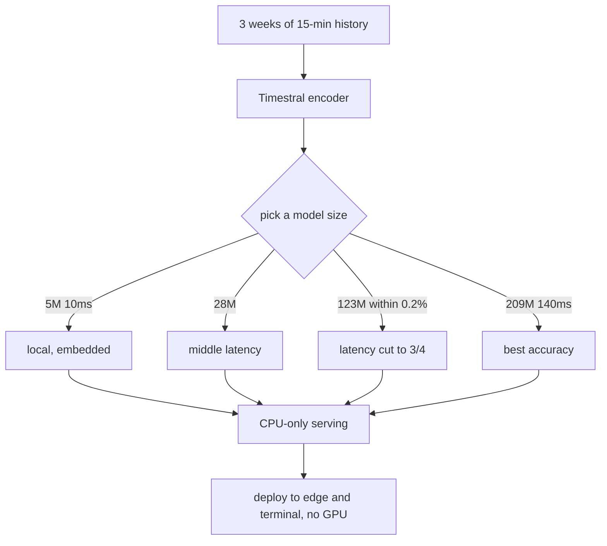

If you put time-series forecasting into production as a data scientist or ML engineer, this release changes the baseline for serving cost. Put bluntly: Timestral removes the GPU, which had been the bottleneck in time-series forecasting, and brings latency inside 140 milliseconds.

*The concept of a forecast moving from a GPU pool onto a CPU as the model shrinks.*

## Why read this

If you ask whether you need a GPU before you put a model on a server, this post works as a price-comparison reference. Timestral, announced by Mistral on the 15th, is a family of four time-series foundation models: 5M, 28M, 123M and 209M. They share one trait: all of them run on CPU, so no GPU infrastructure is required. Mistral says forecasting one day ahead takes 140 milliseconds with the 209M model and 10 milliseconds with the 5M. The core takeaway is this: the task of forecasting is starting to move from GPU pools in the data center to terminals and edge nodes.

## Overview

A time-series foundation model learns patterns across many domains in one large pretraining pass, then forecasts zero-shot, without per-task training. It is used for demand forecasting, anomaly detection, energy load and traffic volume. Historically these models ran large, at billions of parameters, with GPU inference as a precondition. Timestral inverts that precondition. It drops the size to under 209M and delivers near-real-time latency on CPU.

A smaller model is more than a cost issue. If you do not need a GPU, the deployment environment changes. You can run on ordinary CPU nodes, containers and local machines instead of a cluster's GPU pool. The set of serving targets widens, and the constraints on how often and where you call a forecast loosen.

## What Timestral is

Timestral is Mistral's first family of time-series foundation models. It comes in four sizes, each holding a different point on the trade-off.

| Size | CPU latency (1-day-ahead) | Note |
|---|---|---|
| 5M | 10 ms | Fastest, fits local and embedded |
| 28M | roughly 5x faster than 209M | A middle point on latency and accuracy |
| 123M | three quarters of the 209M latency | within 0.2% of the 209M score |
| 209M | 140 ms | Highest accuracy |

According to Mistral, on an 8-thread server CPU, forecasting one day ahead from three weeks of 15-minute-interval history takes the latencies above. The 123M stays within 0.2% of the 209M score at three quarters of the latency, so it holds accuracy while cutting latency sharply. On benchmarks it ranks first among pretrained zero-shot time-series models on GIFT-Eval, TIME and fev-bench, and reportedly beats existing models such as TimesFM-3 and Falcon-2.0 with fewer parameters.

The models are released under a Modified MIT license. Some coverage reports an usage cap based on revenue, but the official announcement does not state the figures or the conditions, so this is treated as [estimated].

## CPU inference reshapes the serving structure

The moment you move from GPU inference to CPU inference, the structure of serving cost changes. A GPU is a bottleneck per card, needs reservation and maintenance, and runs at a high price in the cluster. A CPU is already on every node, so the marginal cost of securing one is nearly zero.

Timestral's 140 milliseconds is the latency of a single forecast. At that latency you can make dozens of forecasts a second, and run hundreds of series in parallel on one node. In a job like demand forecasting that runs periodically across thousands of products, stores and regions, how far this scales depends on the CPU core count and the batch size.

From a serving standpoint, the important point is that Timestral is light enough that the serving container itself gets small. It does not consume GPU memory, so it can share a node with existing CPU workloads, and the scale-out unit becomes fine-grained. On Kubernetes, the resource request is cpu and memory rather than nvidia.com/gpu, so it is scheduled separately from the GPU queue.

## ThakiCloud product implications

ThakiCloud's ai-platform is infrastructure that serves models on Kubernetes. A light CPU model like Timestral raises two questions for that platform. First, can a CPU workload, not just a GPU one, be treated as a first-class serving target? Second, how does a high-frequency call on a light model connect to serving economics?

The answer to the first is that if the serving unit is designed only around the GPU, a CPU model becomes an extra management burden instead. Because Timestral runs on a CPU node, if ai-platform treats CPU workloads under the same serving contract as GPU ones (model registration, versioning, observability, cost accounting), the light model becomes a platform asset too.

The second question meets the Paxis lens. When an agent reads time-series data and calls a forecast, the unit price of that call is on the order of 140 milliseconds of CPU inference. When GPU inference was a precondition, an agent's forecast calls were expensive, so they were limited. If Timestral loosens that, an agent can ask for a forecast often inside its loop. Cheap CPU serving raises the frequency of agent action, which in turn raises forecast quality and completes the agent loop.

## Limitations and counterarguments

Timestral's figures are bound to the conditions Mistral stated, an 8-thread server CPU, 15-minute intervals, three weeks of history and a one-day-ahead horizon. Change the conditions and both latency and accuracy change. With shorter history, a longer horizon or a higher-resolution interval, it is hard to assume these numbers hold.

Zero-shot is a strength in that it runs without training, but for domain-specific forecasting it can be less accurate than a small model fine-tuned on that domain. Whether the 140-millisecond latency is per single call or holds under parallel batch is not stated in the official release. As an [estimate], the per-unit latency will likely rise as parallelism grows.

Timestral is also a time-series-specific model. It does not do natural-language understanding or generation; it only handles time-series input and output. When you serve it alongside an LLM, the context and token economics live on a different layer, so treating it as a single serving stack drifts from the cost model.

## Summary

Timestral matters not because one more model shipped, but because the serving unit for time-series forecasting has moved from GPU to CPU, loosening the constraints on where and how often you call a forecast. A data scientist can pick the 123M or the 28M to hold most of the 209M accuracy with lower latency. An ML engineer gains a serving unit that schedules without a GPU. From the agent-platform side, the unit price of a forecast call drops, and forecasting inside the loop becomes routine. From today, when you plan time-series forecasting, the first thing to ask is not the GPU, but the CPU core count.
