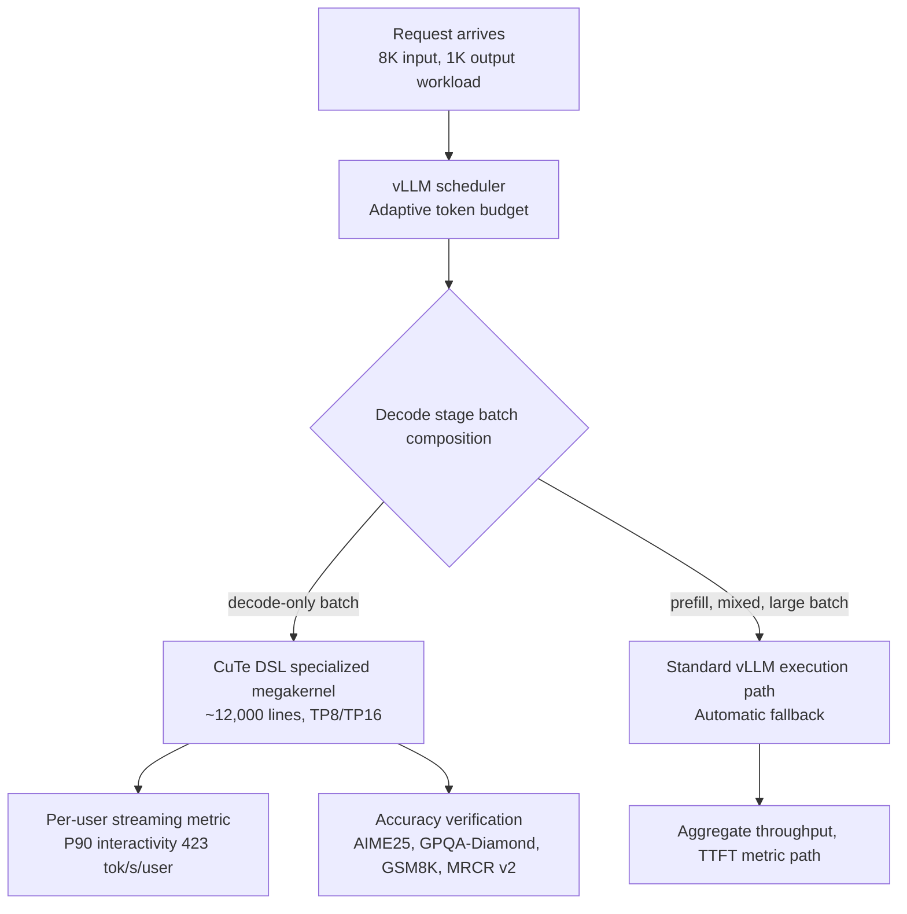

*The hardware stays the same; only the path changed. An image visualizing the specialized decode kernel that is the star of this post.*

## Why Read This

If you operate vLLM-based inference serving and have to decide a tuning direction from benchmark numbers, this post is the decision material for that call. Conclusion first. **NVIDIA upstreamed a Kimi K3-specialized decode kernel (a roughly 12,000-line megakernel built on CuTe DSL) to vLLM (PR #61867, merged October 16), and SemiAnalysis measured 423 tok/s/user and 1.68x on the same GB300 NVL72 hardware, publishing the result on October 18. The core of this news is not how much faster something got, but that the axis of the number is 'P90 interactivity'. It is a per-user streaming metric, not system-wide throughput.** Read the axis wrong and the tuning target itself is off.

## In Plain Terms

Let's start with a highway analogy. The vLLM community's September "Road to 2.8×" optimization was the job of improving every stretch of the road. They worked on the lane count (scheduling token budget), the intersections (KDA checkpoints), and the merge sections (zero-copy mixed batches), and as a result throughput on B300 nodes went from 2.2x up to 2.8x.

The PR NVIDIA upstreamed in October is a different beast. It carved a "Kimi K3-only lane" in the decode stretch, the final stretch where users receive tokens one at a time. Same road, same traffic, and the dedicated lane is 1.68x faster than before. The 423 tok/s/user number is the flow of that dedicated lane, not the total traffic of the whole road. The two improvements do not substitute for each other; each produces a number on a different axis.

## Background: Kimi K3 and the vLLM Stack

Kimi K3 is Moonshot AI's 2.8T-parameter MoE model. It has 104B active parameters, is natively multimodal, and supports a 1M token context. Structurally, it mixes KDA (Kimi Delta Attention, a Mamba-family SSM) with attention, and the expert weights use the MXFP4 format. Because this model has a hybrid attention structure, its serving path differs from a pure transformer's: the KDA recurrent state, not just the MLA KV cache, becomes an object of caching, transfer, and rollback.

vLLM's response came in two stages. First it completed Day-0 support on release day (July 27 blog post), and on September 13 it published "Kimi K3 Performance Optimizations in vLLM: The Road to 2.8× Throughput". The measurement conditions: an 8K input, 1K output workload, TP8, DSpark speculative decoding with 8 tokens, B300 nodes (CUDA 13.3), with the comparison baseline being v0.27.1 and the September 13 commit (82a85dc1).

| Concurrency | Avg Latency (s) | Throughput (tok/s) | Avg TTFT (ms) |
| --- | --- | --- | --- |
| 1 | 12.37 → 5.30 (−57.2%) | 83.3 → 183.3 (+120.0%) | 2262.9 → 376.3 (−83.4%) |
| 4 | 23.67 → 10.50 (−55.6%) | 166.7 → 416.7 (+150.0%) | 2314.9 → 640.5 (−72.3%) |
| 16 | 55.90 → 22.17 (−60.3%) | 258.3 → 725.0 (+180.6%) | 7601.1 → 1121.0 (−85.3%) |

*Source: vLLM official blog "Kimi K3 Performance Optimizations in vLLM" (2026-09-13). Each cell compares v0.27.1 against the main commit 82a85dc1.*

The reason this model puts load on the serving stack is structural. Unlike MLA KV, the KDA state is sharded at head and dimension granularity. Speculative decoding has to record the KDA recurrent state additionally at each draft position in order to roll back rejected tokens, and that is exactly the waste ReplaySSM targets. The assumptions built on the premise of a pure attention model start to fall apart here, one by one.

The changes representative of this path are already-merged PRs. The adaptive scheduling token budget (PR #51725, TTFT down 55~65% at 8K/1K) and the raised default limits for high-memory GPU tiers (#51726). The change that emits KDA prefix checkpoints within a single prefill pass (#52789, prefill for 8K input drops from 2 model forwards to 1, TTFT down 9~25%). The change that replaces the 6 and 2 index copies when mixing speculative and non-speculative batches with contiguous zero-copy slices (#56159, throughput up 5.2~7.7% at concurrency 4 and 16). The latency pinning that moves MXFP4 top-k finalization inside the latent-tail kernel (#53152, end-to-end latency down about 5%). And ReplaySSM (#51855, effective capacity up 10.97% at TP8 under the same 46.48GiB cache budget). The whole body of work is tracked in issue #50587.

## What Is This Technology: A CuTe DSL Specialized Decode Kernel

The October news is on a different axis from the stack optimizations above. An engineer named Benjamin on the NVIDIA CentML team contributed the Kimi K3-specialized decode implementation via PR #61867 "Kimi K3 Specialized Decode: CuTeDSL Optimized GB300 (1.5~2x)", merged on October 16.

CuTe DSL is the Python-native GPU kernel authoring language of the NVIDIA CUTLASS project. It describes kernels directly on top of CuTe's layout, tensor, and hardware abstractions. This implementation integrates the operations of the Kimi K3 decode stage into a single large kernel tuned for GB300 hardware, in the form of a roughly 12,000-line megakernel. It is not a change of model weights; it is a specialized runtime tuned for a specific model and hardware combination. The scope of this engineering philosophy is narrower than making "every model stage on every accelerator" faster: it optimizes the operations and execution patterns of the decoding stage for one combination.

The supported path is a decode configuration at TP8 or TP16, with or without speculative decoding. Activation is the opt-in argument `--additional-config '{"decode_backend": "latency_specialized"}'`. The important semantics here is the fallback. Prefill, mixed batches, and large batches continue to use the standard vLLM execution path as-is. The specialized kernel handles decode-only batches. So "decode is 1.68x faster" cannot be read as "the whole pipeline is 1.68x faster".

Accuracy was verified with the AIME25, GPQA-Diamond, GSM8K, and MRCR v2 tasks plus numerical checks, comparing the two implementations under published conditions. The PR's published microbenchmark conditions are clear. TP16 GB300, 1 input token, 1,024 output tokens, greedy decoding, FP8 KV cache with FP32 SSM cache, model-provider weights. The decode stage timing is the median inter-token latency with prefill excluded. In the speculative decoding test (32K input, DSpark DL7, synthetic acceptance 3.78, decode context parallelism enabled), the decode-only improvement was larger than the output throughput improvement that includes other requests' prefill work, and TTFT was on par. This synthetic acceptance rate must not be confused with the acceptance rate that real workloads achieve naturally.



*The insertion point of the specialized decode path. Only decode-only batches go to the CuTe DSL megakernel; the rest fall back to the standard path automatically. 423 tok/s/user is the axis of node F, i.e. a per-user streaming metric.*

## Enabling It: One Argument

The specialized path is opt-in. Activate it by attaching the following argument at server startup.

```bash
--additional-config '{"decode_backend": "latency_specialized"}'
```

Two points deserve an honest callout here. First, the server does not start with this one argument alone: the path only exists if you run a build that includes the merged change (#61867). Second, the supported path is TP8 or TP16 on GB300. On other hardware or other parallelism degrees you cannot guarantee the specialized path applies, and prefill, mixed, and large batches keep using the standard path as-is.

## Three Numbers, Three Axes

This news is confusing because three numbers on different axes get delivered tangled together.

First, 2.2~2.8x. The result of the vLLM blog's stack-wide optimizations, on the aggregate throughput axis, under B300 node, 8K/1K, TP8 conditions. At the same time TTFT dropped 72~85%, and adaptive scheduling alone is reported in isolation as TTFT down 55~65% and throughput up to 41.5%.

Second, 1.68x and 423 tok/s/user. The numbers SemiAnalysis published on October 18, on the P90 interactivity axis, assuming the same GB300 NVL72 hardware. P90 interactivity is a per-user streaming metric. The horizontal axis of the SemiAnalysis chart is explicitly labeled this way. It is not the aggregate token output, not a guarantee for every request, and not a 68% improvement of the whole pipeline. In the October 18 run on the InferenceX live dashboard (Kimi K3 2.8T, Agentic, FP4), the top GB300 NVL72 shows P90 interactivity of 424 tok/s/user. That is a later live display, not grounds to quietly change the original 423 figure. The dashboard also reports per-chip throughput in a separate column. These columns must not be summed or substituted for each other. A configuration optimized for fast individual streams can sacrifice aggregate throughput, and the reverse holds as well.

Third, the PR microbenchmark. The decode-only median ITL axis under the explicit conditions of input 1, output 1024, greedy, TP16. The three numbers each hold within their own conditions. None of them can substitute for another. A configuration optimized for fast individual streams can sacrifice aggregate throughput, and a high-throughput configuration can slow per-user streaming. The exact parallelism degree or prompt and output lengths for the 423 point have no confirmed source, so this number must be read under the condition of an unverified workload spec.

In practice, choosing the axis starts from the workload. If the service is interactive chat or an agent where the user receives tokens in real time, perceived speed is close to P90 interactivity, the metric this NVIDIA path targets. If total throughput is the goal, as in batch processing or offline generation, the 2.2~2.8x aggregate throughput of the vLLM stack optimizations is the baseline. If the wait to the first token (TTFT) is the problem, as in long-context, prefill-heavy workloads, adaptive scheduling, KDA checkpoints, and DCP are the more direct levers. On the same hardware, the "optimization with the biggest gain" changes depending on which axis you set as the KPI.

## What This Means for ThakiCloud

ThakiCloud's ai-platform operates vLLM serving on a Kubernetes base. This case yields three implications.

First, the axis of the metric is the number-one variable of a serving tuning target. Our serverless endpoints keep tuned defaults in workload_config (max_num_seqs, tool-call and reasoning parsers, compilation mode), and comparison arms must be re-measured on the same axis with the same configuration for the comparison to be valid. What this case shows is how differently a number changes when you switch axes on the same hardware. For Kimi K3-class models, `decode_backend: latency_specialized` is a per-model kernel investment. If cost per served token is the KPI, the gain from the decode-specialized path is largest in agent workloads with a high share of decode-only batches and short outputs. Conversely, if prefill dominates the workload, that benefit is limited.

Second, state-aware disaggregation is becoming a required feature for hybrid attention models. Kimi K3's PD disaggregation and cache offload have to transfer both MLA KV and KDA state. MLA KV is replicated per TP rank, KDA state is sharded at head and dimension granularity, and the Mamba alignment block tables are sparse and variable. This is a region where the assumption of pure attention transfer does not hold. If 1M-context agent workloads become mainstream, disaggregation design has to first decide "which state, moved in which units".

Third, DCP (decode context parallelism) is the capacity axis of multi-tenant long-context serving. In a 120k-token workload (114k shared prefix + 6k suffix, 400 output), KV cache capacity grew from 1.93M to 19.75M tokens, and at concurrency 1 TPOT p50 improved from 13.8ms to 10.5ms. This is not a general speed improvement; it is a capacity and latency improvement that appears only when long prefixes are shared. It matches exactly the shape of multi-tenant agent serving where system prompts and skill contexts overlap.

## Limits and Counterarguments

First, 423 tok/s/user is a number tied to specific hardware (GB300 NVL72), a specific axis (P90 interactivity), and an unverified workload spec. The moment you move this number as-is to other hardware or another metric, the number becomes a lie.

Second, a model-specialized kernel is a maintenance cost. A roughly 12,000-line megakernel was written for one model and one chip combination. When the next flagship model arrives, someone has to write another 12,000 lines, and if the hardware changes in between, it starts over. That is the tension with a general-purpose serving strategy.

Third, because of the fallback semantics, "1.68x" is not an improvement of the whole pipeline. Since prefill, mixed, and large batches use the standard path, the perceived improvement in a real traffic mix depends on the share of decode-only batches.

Fourth, parts of the speculative decoding test use synthetic acceptance. That is a different condition from the acceptance rate achieved naturally in real workloads, so you must not extrapolate field speed from these numbers.

The strongest counterargument to pull out: the value of the specialized decode path is not "make every request faster" but "latency-sensitive user streaming, on hardware at the same cost". For serving that sets P90 interactivity as the KPI (interactive, agent-style), this path is justified; for serving that sets batch processing or aggregate throughput as the KPI, stack-wide optimizations like adaptive scheduling or DCP may be more efficient. The two are not in an either-or relationship; they are options whose priority flips depending on the metric.

## Takeaways

The habit of reading the axis first is the whole of this news. NVIDIA carved a new decode path in software for one model, Kimi K3, and one hardware combination, GB300, and in exchange got 1.68x per-user streaming speed on the same hardware. The vLLM community, ahead of that, improved the whole stack and produced 2.2~2.8x aggregate throughput on B300. Both efforts signal that "serving optimization is not a configuration problem but a kernel problem".

One next action. If you run a vLLM cluster on GB300-class hardware, turn on `decode_backend: latency_specialized` and first check the share of decode-only batches. If that share is high and outputs are short, as in an agent workload, measure before and after on the same axis (P90 interactivity). This case, where the hardware stays the same and only the path changed, becomes the criterion for deciding where to spend the tuning budget.

This blog's tracking of Kimi K3 since July is in the same context. After Day-0 serving on the open-weights release day (July), the local serving experiments, and the DSpark decode experiments, the October specialized kernel fills the fourth stage: "a dedicated path on datacenter hardware". Now that the serving story has come down from configuration tuning to the kernel level, the next question is clear. How do you allocate the same investment to your own model and workload?

## Sources

- vLLM official blog, "Kimi K3 Performance Optimizations in vLLM: The Road to 2.8× Throughput" (2026-09-13): https://vllm.ai/blog/2026-09-13-kimi-k3-performance-optimization
- vLLM PR #61867 "Kimi K3 Specialized Decode: CuTeDSL Optimized GB300 (1.5~2x)" (merged 2026-10-16): https://github.com/vllm-project/vllm/pull/61867
- SemiAnalysis, Kimi K3 InferenceX dashboard: https://inferencex.semianalysis.com/inference/kimi-k3
- we0.ai, "Kimi K3 vLLM Optimization: NVIDIA's 1.68× Decode Speedup" (2026-10-19): https://we0.ai/articles/kimi-k3-vllm-optimization-nvidia-s-1-68-d-139bcc7e
- NVIDIA CUTLASS CuTe DSL documentation: https://docs.nvidia.com/cutlass/latest/media/docs/pythonDSL/quick_start.html
