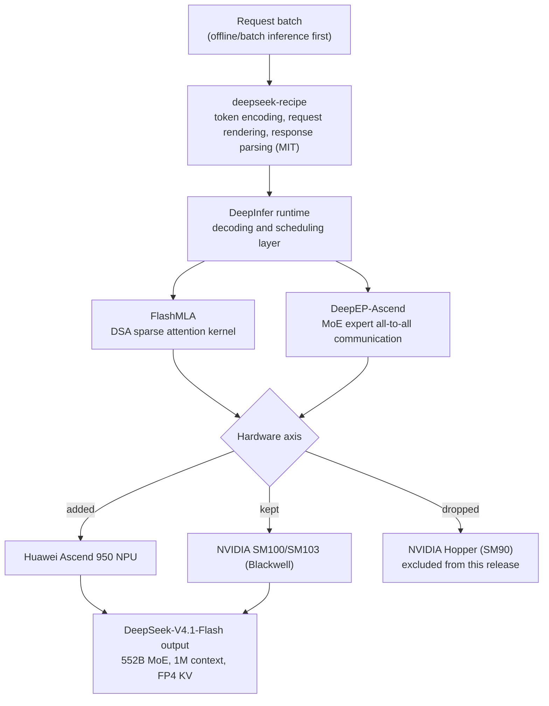

*The hardware changed; the path remained. An image visualizing the design philosophy of DeepInfer, the star of this post.*

## Why Read This

If you operate vLLM-based inference serving and want a framework for reading "an in-house engine built by the model's own team," or a basis for a multi-hardware (NVIDIA + Huawei) serving strategy, this post is the decision material for that call. Conclusion first. **On October 20, DeepSeek open-sourced its in-house inference framework DeepInfer under Apache 2.0, and the core of this release is the design direction, not the throughput number. It centers on offline batch inference, opens the model-specialized kernels (FlashMLA) and MoE communication (DeepEP-Ascend), and deliberately leaves out the hardest pieces of online serving (advanced KV cache management, prefill/decode disaggregation). At the same time, it moves the hardware axis away from NVIDIA Hopper and adds Huawei Ascend 950.** You have to read these four things as one flow, because then you can answer not "should we use this" but "what is this telling us."

## In Plain Terms

Let's use a highway analogy. vLLM is a shared road network that every vehicle (every model) can drive on. The lanes are the same regardless of vehicle type, and the core is a scheduler that balances traffic volume against perceived speed.

DeepInfer is a different beast. It is a dedicated road DeepSeek carved for hauling its own model (V4.1-Flash). It re-laid each kernel to match that model's attention (FlashMLA) and expert-parallel communication (DeepEP-Ascend), and it kept only part of the downtown stretch that must load cars in real time (online serving) while putting its weight on the long-haul outer loop (offline batch). So the question "is DeepInfer faster than vLLM" is itself framed on the wrong axis. You compare by asking how far the same vehicle (model), on the same road (hardware), carved the same stretch (online/offline).

## Background: What Is DeepSeek-V4.1-Flash

To understand DeepInfer, you first need to see the model this engine hauls. DeepSeek-V4.1-Flash is a sparse MoE multimodal model of roughly 552B parameters. It has a 1M token context and a 40-layer Causal Encoder-Decoder structure. It uses DSA (DeepSeek Sparse Attention) for attention and mHC (hyper-connection) on the residual path, so it is a hybrid rather than a pure transformer. The weights are released under the MIT license on Hugging Face, with FP8 as the heaviest precision, totaling about 510GB across 48 shards. The KV cache supports FP4 compression.

The reason this model loads the serving stack is structural. Because it is a sparse MoE, expert selection and inter-expert communication become the bottleneck rather than attention compute, and a 1M context with an FP4 KV cache is not trivial to manage. It is multimodal with hybrid attention, so its serving path differs from a pure transformer model's. DeepInfer is the engine built to spread that specific load across dedicated kernels.

## What Is DeepInfer: Three Layers of a Model-Specialized Engine

DeepInfer is hard to reduce to the single phrase "inference framework." Taken together across the public materials (`doc/inference_deployment_qa.md` and others), it splits into three layers.

**First, the token-encoding and request-rendering layer.** Alongside this release, a MIT-licensed package called `deepseek-recipe` was published. This is not the model weights; it is the outermost layer that encodes requests into tokens and parses responses. It handles the formatting before a prompt enters the model and the rendering after the model emits tokens. In effect, DeepSeek published the "recipe" for how the model's own chat template and token-ID mapping work across the server.

**Second, the attention and communication kernel layer.** This is the real technical core of the release.

- **FlashMLA**: DeepSeek's optimized attention kernel library. It implements V4.1-Flash's DSA (sparse attention) for the hardware. The detail to watch in this update is the hardware table. FlashMLA runs on **Huawei Ascend 950 NPUs and NVIDIA SM100/SM103 (the Blackwell family)**, and **NVIDIA Hopper (SM90) is dropped**. In other words, DeepSeek re-picked its inference workload's "chip set" not as "the fastest NVIDIA chip" but as "the chip set that fits its own model best," and Hopper is no longer in that set.
- **DeepEP-Ascend**: a high-performance communication library for Ascend NPUs. It handles the all-to-all operation of expert parallelism, the core bottleneck of sparse MoE. It is the layer that decides "which token goes to which expert" and moves the data there, built as a dedicated component.

**Third, the scheduling and decoding layer.** DeepInfer exposes its decoding and scheduling techniques. This is the logic for how request batches are divided and how prefill and decode are coordinated. However, this layer is not yet complete enough to make a "full online service" (the next section).

Seen as one picture, the outer recipe cleans the request and feeds it in, the middle engine stacks scheduling on top of the two dedicated kernels FlashMLA and DeepEP-Ascend, and the bottom is the hardware: Ascend 950 or NVIDIA Blackwell.

*The three layers of DeepInfer and the hardware axis. The recipe (outer) cleans the request, the engine (middle) stacks scheduling on the two dedicated kernels FlashMLA and DeepEP-Ascend, and the bottom is Ascend 950 or NVIDIA Blackwell. Hopper is dropped in this release.*

## What Was Opened, and What Was Deliberately Left Out

The most important lens for reading this release is "what is missing." Open-source does not mean DeepSeek published its entire production service.

**What was opened.** The core path for offline batch inference. The two kernel libraries, FlashMLA and DeepEP-Ascend, the decoding and scheduling techniques, and deepseek-recipe. With this set, you can reproduce an engine that runs V4.1-Flash offline/batch.

**What was left out, deliberately.** The two hardest pieces of online serving.

- **Advanced KV cache management.** In offline batch you can build and drop the KV cache per request, but in an online service, cache reuse (prefix sharing), offloading, and reclamation strategies are the core of performance. The public version does not include KV cache management at that level.
- **Prefill/decode disaggregation.** In real-time service, splitting prefill (initial parallelism) and decode (sequential streaming) onto different nodes is the baseline for capacity and latency. That is also absent from the public version.

So the public DeepInfer is "an engine that runs V4.1-Flash fast offline/batch," not "a complete real-time API server." To serve online in real time, you have to build the serving layer on top of this engine yourself. The community notes exactly this: it is incomplete as an online service.

This design choice is intentional. DeepSeek did not publish "everything" of its production service; it left an "offline inference engine" that is reproducible and usable for competitive analysis, while keeping the precise online-serving pieces private. The pieces it left out are exactly what had been DeepSeek's online-service differentiator.

## How to Read the Throughput Claims

Two throughput numbers are circulating with this release. One is "155 trillion tokens per day (155T tokens/day)," and the other is "25,000+ decode tokens per second."

Both need to be read with care. First, 155T tokens/day is a DeepSeek claim, not independently verified. "Trillions of tokens per day" is an aggregate service-wide throughput, and unless it is stated what hardware, what model, and what workload mix it averages over, it cannot be compared against a single throughput metric of another system.

Second, 25,000+ decode tokens/second is an aggregate decode throughput. The moment the word "decode" is attached, it is a mid-value excluding prefill, and it is neither per-user perceived streaming speed (P90 interactivity) nor time-to-first-token (TTFT). If the 423 tok/s/user in the Kimi K3 post was "the per-user streaming axis," this 25K is "the aggregate decode throughput axis." On the same hardware, a different axis makes the number mean something entirely different.

The lesson from ThakiCloud's perspective is the **separation of source and axis**, not the number itself. A vendor-published throughput, unless it states "under what conditions, on which axis," is repetition, not citation. Our serverless endpoint measurements follow the same discipline: we log `SERVE_CONFIG` (max_num_seqs, max_model_len, gpu_memory_utilization, compile mode) and gate comparisons to arms on the same axis with the same settings. When you want to "measure DeepInfer's number ourselves," asking for the axis first is the right move.

## Implications for ThakiCloud Products

ThakiCloud's ai-platform runs vLLM serving on Kubernetes. This DeepInfer release gives three implications.

**First, multi-hardware inference is a product differentiator, and DeepInfer confirmed the direction.** The fact that FlashMLA dropped Hopper and added Ascend 950 is a signal that "the latest NVIDIA chip is fast" is being replaced by "pick the chip set that fits our own model." In ThakiCloud's *One Paxis. Many Workflows. Any Cloud.* positioning, "Any Cloud" includes hardware diversity. A server that only handles NVIDIA H200/B200 and one that handles NVIDIA + Huawei Ascend together give different answers to on-prem and sovereign clients. DeepInfer publishing the Ascend path as first-class shows that an inference engine can now treat "chip choice" as a product feature. That is exactly why we assign GPUs with Kueue and run multi-cluster.

**Second, offline batch and online serving are different engines.** DeepInfer deliberately leaving out the online pieces (advanced KV cache, PD disaggregation) and weighting offline means that "one engine for every workload" is giving way to per-workload optimization as the standard. At ThakiCloud this is already separated: real-time API runs on vLLM's tuned defaults (max_num_seqs, tool-call/reasoning parser, compile), and batch processing runs on a separate path. DeepInfer's choice backs this separation as the right design. If you run offline batch inference (large-scale data augmentation, offline evaluation, batch generation) often, DeepInfer is worth reviewing as a batch-dedicated engine, while keeping vLLM for real-time serving.

**Third, the Paxis lens: agent economics.** Note that V4.1-Flash is a model aimed at "low-cost inference for long agent loops and coding workloads." A 1M context, FP4 KV, and sparse MoE is a design to "run long agent sessions cheaply." Paxis is the Agent-Native Cloud running on top of ai-platform; the economics of the whole workflow are decided when each agent step depends on cheap inference. DeepSeek optimizing the model and engine together for "agent-grade low-cost inference" points the same direction as Paxis, which runs 960+ skills in isolated sandboxes through a policy gate and audit logs. Lower inference cost means more agents can run, and more agents running is what makes the platform valuable.

## Limitations and Counterarguments

**First, the wall of verification.** Both 155T tokens/day and 25K decode tok/s are vendor claims without independent verification. With unclear hardware and workload specs, these numbers can be repeated but not cited.

**Second, the cost of reproduction.** To actually put DeepInfer on V4.1-Flash, you need the MIT weights (about 510GB), Ascend 950 or NVIDIA Blackwell hardware, and you must build the online-serving layer yourself. "Open source" does not mean "ready to use as-is."

**Third, the implication of dropping Hopper.** If FlashMLA drops Hopper, environments that run Hopper as their main force cannot take this release's benefit directly. DeepSeek's "chip-set re-selection" also affects a user's hardware investment. This is not a simple "the latest chip is better" story; it is a statement that "model-chip pairing" is becoming the first-order variable of performance.

**Fourth, the backfire of offline focus.** Leaving out the online pieces means they are still there, just private. To use DeepInfer for real-time serving, you must implement the missing parts yourself, and that implementation is exactly DeepSeek's non-public differentiator.

The strongest counterargument. The frame "DeepInfer is an alternative to vLLM" is itself wrong. vLLM is online serving for general models; DeepInfer (public version) is offline batch for a specific model. They are not competitors so much as different layers of the same inference stack. The significance of DeepInfer's release is that it does not break vLLM but leaves the axis of "model-specialized + multi-hardware" with the community.

## The Bottom Line

The news of this release is direction, not a number. DeepSeek opened its inference engine and, inside it, published three choices: "model-specialized kernels (FlashMLA/DeepEP-Ascend) + multi-hardware (Ascend 950 + Blackwell, Hopper dropped) + offline-batch focus." And it deliberately kept the precise online-serving pieces.

One next action. In a ThakiCloud environment, what you get from this is **two questions**, not a "vLLM alternative on Hopper." First: among our on-prem and sovereign clients, is there any case that requires NVIDIA + Huawei Ascend together? Second: is a large-scale offline batch inference workload (data augmentation, offline evaluation) accumulating, and if so, is DeepInfer worth a PoC as a batch-dedicated engine? If the answer to either is "yes," this release gives ThakiCloud real material on both the hardware axis and the workload axis.

This blog has followed the Kimi K3 inference story since July, and this is the same context. After Day-0 serving, local experiments, and the specialized kernel, DeepInfer fills a new step: "the company that made the model publishes the engine too." Now that the inference race has moved down from serving settings to kernels and hardware pairing, the next question is clear: where do we put the same investment, on which chip, for which workload.

## Sources

- DeepSeek DeepInfer official repository (Apache 2.0, 2026-10-20): https://github.com/deepseek-ai/DeepInfer
- DeepSeek official announcement (X @deepseek_ai): https://x.com/deepseek_ai
- MarkTechPost, DeepInfer open-source coverage (decode 25,000+ tok/s): https://www.marktechpost.com
- explainx.ai, "DeepSeek DeepInfer: Open Engine, 155T Tokens/Day Claim" (the 155T/day claim and its unverified scope): https://explainx.ai
- vLLM Ascend docs, DeepSeek-V4.1-Flash spec (552B MoE, 1M context, 40-layer Causal Encoder-Decoder): https://docs.vllm.ai (Ascend)
- narracomm.com, "DeepSeek ships Ascend 950 attention kernels and drops Hopper from FlashMLA": https://narracomm.com
