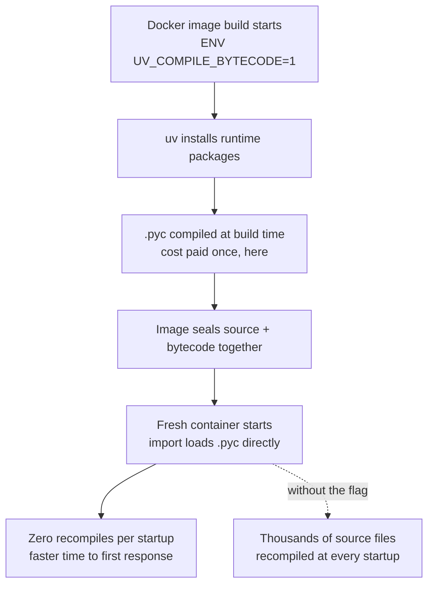

*A container that pays for thousands of compilations exactly once, at build time. The image visualizes the direction of the cost that this vLLM change moves.*

## Why Read This

Engineers who build vLLM serving images themselves, or platform operators who want to cut the cold-start time of inference endpoints that scale from zero, should read this. The core conclusion first: moving the cost of recompiling Python source on every fresh container to image build time cuts vLLM startup by 14-18%, about 18 seconds on H100. The fix is one build line: `UV_COMPILE_BYTECODE=1`.

## Overview

The vLLM project published "Reducing vLLM startup time with one uv flag" on its official blog on September 22, 2026. In author Nils Matteson's measurements, on an H100 SXM 80GB server, paired startup times for Qwen3-8B and Qwen3-32B showed the image with precompiled bytecode returning its first response a median 17.6s (17.6%) and 17.8s (13.9%) faster, respectively.

The change is already on the distribution path. vLLM PR #55422 is included in the CUDA nightly image (`vllm/vllm-openai:nightly-8cbd5d03006c33185f402249ff2b448efd594986`), and official release images ship the setting by default from v0.32.0. Teams on official images do not need to set the flag themselves.

Why is this a serving-infrastructure topic? Because cold start is the cost paid on every scale-up in a scale-from-zero workload. If a serverless inference endpoint boots a fresh container when requests arrive, those "seconds" are all user wait time, i.e. TTFT. This post shows, with vLLM's official measurements and our local reproduction, that the cost is Python compilation.

## What This Technique Is

CPython compiles source into code objects before executing it. The compiled artifact is the `.pyc` file, and a valid `.pyc` lets Python load directly without re-reading the source. Whether package install tooling writes that file decides whether compilation happens "once at build" or "every startup".

pip compiles bytecode at install by default. vLLM images install packages with uv, and uv skips bytecode compilation. That speed property is exactly why the compile step falls out of uv-based images by default. In vLLM's matched Docker image study, the default build image had valid bytecode for only 407 of 26,734 source files, while the precompiled build image had all 26,734. That gap becomes the per-startup compilation work directly. In the same study, the serving-CLI import (`import vllm.entrypoints.cli.serve`) compiled 5,257 source files in the default build and zero in the precompiled build.

There is a structural reason underneath. If the Python interpreter writes missing caches while a container runs, those files live in the container's writable layer and never reach the next fresh container. The next container starts from the same image, with the same compilation work still waiting. That is why a fresh container repeats "compile thousands of Python files" at every startup. uv's own Docker guide recommends enabling compilation for production images.

torch.compile and GPU kernel compilation are separate cache paths. This change covers the pure Python import path, i.e. the source compilation that happens when modules are loaded. The flow is in the diagram below.



## Installation and Integration

For images you build yourself, enable the environment variable before the uv install step.

```dockerfile
# Compile Python source of every uv-installed package at build time
ENV UV_COMPILE_BYTECODE=1

RUN uv pip install --system vllm==0.32.0
```

Teams on official release images (v0.32.0 and later) do not need to set this. The image already ships the bytecode.

The trap the blog points out is an existing base image. When packages are already present in the image you `FROM`, whether a later uv command also compiles bytecode for the inherited packages depends on the uv version and the command shape. So verify the final image, and fill any missing caches with the runtime Python's `compileall`. When copying package directories between images, copy source and bytecode together.

Verification is simple. After the build, check that the count of `*.pyc` files in the final image matches the `.py` count, and that the serving-CLI import stage performs zero source compilations. Two checks, and you know whether the setting actually landed.

## Measured Results

Starting with vLLM's official H100 numbers. On a Xeon Platinum 8480+ / H100 SXM 80GB server, with the image and model files already local, they measured process launch to first correct response in 4 pairs (2 in each order). All 8 pairs favored the precompiled image.

| Study | Hardware | Models | Median saving |
|---|---|---|---|
| H100 server | Xeon 8480+ / H100 SXM 80GB | Qwen3-8B | 17.6s (17.6%) |
| H100 server | same | Qwen3-32B | 17.8s (13.9%) |
| Laptop | i9-13900HX / RTX 4090 Laptop | Qwen3-0.6B, 1.7B, SmolLM2-1.7B (6 pairs each) | 12.8-13.5s |
| Image delivery | loopback registry + empty Docker store | Qwen3-0.6B (3 pairs, pull included) | 15.4s |

Two footnotes matter. First, the saving does not scale with model size. The absolute savings for 8B and 32B were similar (17.6s vs 17.8s), and the percentage was higher for 8B, because both models share the same Python import work. Second, the saving remained at 9-12s per startup even when the 8.85GB of source files were already resident in the page cache. The cost is compilation itself, not file I/O.

The price is image size. In the delivery study, the precompiled image was 153MB larger compressed, 1.8%. Environments with slow first pulls should account for that tradeoff.

We reproduced the same mechanism locally. On an Apple Silicon MacBook with CPython 3.12.8, we copied the `transformers` (2,556 .py, 46.81MB) and `sympy` (1,532 .py, 26.17MB) package trees from our shared venv, and timed fresh-process imports 3 times each, with no `.pyc` present versus after a full `compileall` pass, taking medians.


*Left: import time medians (3 fresh processes each) with and without bytecode. Right: pure `compile()` cost over each package's whole tree. Local measurements.*

The results split sharply by package.

| Package | Cold import median | Precompiled import median | Saving |
|---|---|---|---|
| sympy | 1.030s | 0.135s | 0.895s (86.9%) |
| transformers | 1.069s | 1.040s | 0.029s (2.7%) |

Why the gap? We counted the .py files actually read during the import with an audit hook. `import sympy` loads 419 of its 1,532 files eagerly, and that is the volume of compilation avoided. `import transformers` at the top level loads only 230 modules; the rest of the tree is lazy, resolved on attribute access. So measured at the top-level import, the saving is only 2.7%.

The measurements were also well-behaved. sympy's three precompiled observations clustered at 0.135, 0.136, 0.128s, while transformers' three cold runs (1.003, 1.069, 1.278s) had more spread, so the median is the right reading. One warm-run observation at 1.51s was an isolated outlier, and the median converged to 1.040s without it.

Here is the key lesson. The size of the saving depends not on "how big the package is" but on "how many files the server's startup path actually compiles". The vLLM serving-CLI import had to compile 5,257 files in one go, which is why it saved more than 17 seconds on H100; an environment whose startup path only imports lazy packages will feel far less.

We also measured the build-time cost. In a pure-compiler test (all sources read into memory, then `compile()` only), the whole transformers tree (2,556 files) took 4.32s (1.69ms per file) and sympy (1,532 files) took 3.03s (1.98ms per file). Same scale as the official blog's Xeon measurement (5,118 files, 78.6MB, 6.30s). A few seconds of build work replaces thousands of startup compilations.

## ThakiCloud Product Implications

ThakiCloud's ai-platform is the K8s-based inference infrastructure, and the place this change matters most is Metis's scale-from-zero inference endpoints. In the pattern where an endpoint boots fresh pods as traffic arrives, the Python compilation cost inside vLLM startup is re-charged on every scale-up. Applied to this result, a saving of roughly 10s+ per startup goes straight into the TTFT distribution of scale-from-zero workloads. Same response quality with shorter wait time is, in the end, a serving cost competitiveness question.

There are two concrete paths. Endpoints based on the official vLLM image gain the benefit by bumping the base to v0.32.0 or later. Custom images need `ENV UV_COMPILE_BYTECODE=1` before the uv install step, plus a read-back check that the final image actually contains the bytecode. Skip the check and you can fall into the trap: flag set, but packages inherited from the base image still uncompiled.

One line from the Paxis side. If agent workflows spin up isolated sandboxes frequently, the same principle applies to the Python startup cost inside those sandboxes. A few seconds of boot latency per agent multiplies across a whole workflow, so build-time precompilation is a responsiveness item for agent platforms too.

## Limitations and Counterarguments

First, vLLM's H100 numbers are paired medians from a single deployment. The blog itself states they are not a fleet-wide estimate. Hardware, Python build, vLLM commit, and CPU frequency state all move the saving. Our local reproduction is the same: we measured a few seconds of compilation on Apple Silicon, but that does not reproduce the 17-second server startup saving on a specific host. The direction of the mechanism is confirmed; the absolute number must be settled by paired measurements in your own deployment.

Second, the saving applies to the import path only. torch.compile graph compilation, Triton kernel caches, model weight loading, and CUDA initialization are outside this scope, each with its own cache path and optimization. This one line does not solve "cold start" as a whole.

Third, the 1.8% image size increase can bite back in environments with narrow registry bandwidth, lengthening the first pull. In frequent scale-from-zero with fast in-cluster pulls the price is negligible; pulling from outside the cluster requires re-running the arithmetic.

Fourth, workloads centered on lazy-import packages will feel little. As transformers showed at 2.7%, if the startup path compiles few files eagerly, the saving is small. The precise statement is not "the image gets faster when you build it"; it is "you reduce the number of files recompiled at every startup".

## Takeaways

The hidden cost of vLLM startup is Python compilation, and one line, `UV_COMPILE_BYTECODE=1`, moves it to build time. Official images from v0.32.0, custom images with the env var before the uv install step, and a read-back check for bytecode presence in the final image. That is the whole change.

Your next action is one. Time your current vLLM image's startup in pairs. "Two images, flag on/off, same model, same hardware, 4 pairs" is the method vLLM's official blog used, and a difference of 5 seconds or more is a number that goes straight into the TTFT of your scale-from-zero workloads. We confirmed locally, with sympy at 86.9% and transformers at 2.7%, that the saving scales with how much eager compilation the startup path performs. If you are compiling thousands of files at every startup, you have already paid that cost once. Just stop paying it again at build time.

## Sources

- [Reducing vLLM startup time with one uv flag (vLLM official blog, 2026-09-22)](https://vllm.ai/blog/2026-09-22-python-bytecode-startup)
- [vLLM PR #55422](https://github.com/vllm-project/vllm/pull/55422)
- [vLLM official tweet (2026-10-19)](https://x.com/vllm_project/status/2111990039806914908)
- Local reproduction results: `outputs/blog-impl/vllm-uv-compile-bytecode/` (run-1, run-7, run-8 logs)
