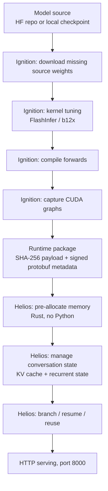

*An engine that serves quietly at a desk, not in a data center.*

## Why Read This

This is for ML engineers putting LLMs on new local hardware such as the DGX Spark or the RTX PRO 6000 Blackwell, and for platform operators who need to place "serving engines other than vLLM" on the map. The conclusion, up front: Flare's value is not competitive serving throughput. It is two concepts. Moving model preparation into a **signed runtime package**, and serving that package on a **Python-free Rust runtime**. It defines itself as a research prototype for local agent workloads, not a replacement for production serving.

## In Plain Terms

Think of a to-go restaurant. The kitchen is Python. It goes out to buy the ingredients (download the weights), does the prep (tune the kernels), pre-cooks everything (compile the forwards, capture the CUDA graphs), and packs it all into a delivery container with a signature (the runtime package). The serving counter is Rust. No kitchen equipment, no chef who cooks on the fly. It only heats what came pre-made and serves it. That is why the counter is fast, small, and makes no mistakes. Flare's entire design comes from one thing: physically separating the kitchen from the serving counter.

## Overview

NVIDIA's AI team put Flare on GitHub without an announcement. No blog post, no press release. The first developer-forum post was a community one, at 01:11 on October 21, 2026, titled along the lines of "NVIDIA-AI quietly dropped its own local inference server." Stars were single-digit right after the drop, and at the time of this writing they had grown to 578. The repository is NVIDIA/flare-local-inference, licensed Apache-2.0.

The sentence that sets the temperature of this story is an NVIDIA staff member's reply in that same forum: this is still a research prototype, so adjust your expectations accordingly. There is no official benchmark and no product roadmap. There are, however, two lines in the README.

> "Flare is not, and will never, be a replacement for production inference engines like vLLM."
>
> "This is a research prototype, and is made available via open-source to enable technical collaboration and collect early feedback."

A serving engine that puts "we will never be a replacement" and "this is a research prototype" side by side in its own README is a first, as far as we can see. Declaring your own position instead of competing is what makes it worth reading.

## What Is Flare: Separating Kitchen from Counter

The README's own definition: "a local inference server for NVIDIA SM120/SM121 GPUs, built for long conversations, coding agents, and repeated tool use." The structure has two stages.

**Ignition (the kitchen, Python)**: on a PyTorch + Transformers + FlashInfer (b12x kernels) environment, it does four things. It downloads missing source weights, tunes the kernels, compiles the forwards, and captures the CUDA graphs. The output is a single **runtime package**.

**Helios (the counter, Rust)**: it takes that package and serves HTTP. There is no Python on the serving path. The Dockerfile makes the separation physical. The build stage is rust:1.94.1-slim-trixie, and the runtime stage is debian:trixie-slim with only build-essential, cmake, nasm, protobuf-compiler, and libibverbs for multi-host RDMA on top. There is no Python in the serving image at all. EXPOSE is a single port, 8000, and the ENTRYPOINT is the single binary /usr/local/bin/flare.



Why split it this way. Preparation is research-grade work, so the Python ecosystem fits: you pin a FlashInfer fork, tune kernels per hardware, and debug when things fail. Serving is operational work, so a minimal footprint fits: a Rust runtime pre-allocates memory before serving, has no GC sweeps, and does no on-the-fly compilation mid-serve, because the CUDA graphs were already captured in the kitchen.

## The Runtime Package: A Signed Delivery Container

The runtime package that Ignition produces is not a plain archive. The payload is bound with a SHA-256 hash, and the metadata is signed protobuf. The run side takes --publisher-keys and --trust-store. Who signed the container, and whether you trust that signer, is part of the serving contract.

This is a new shape in the serving world. The trust boundary of container serving today ends at "the image digest you pulled from the registry." Flare adds a layer inside that boundary: a check that the model package, once prepared, must not change. As long as memory allocation, kernel versions, and CUDA graphs are all bound inside the package, the equation "same package = same serving" is enforced by the signature.

If you have served models in containers, this is a familiar problem. Rebuild the same model image and the kernel version or compile settings change, and the numbers change with them. What the runtime package pins is exactly that part. The signature makes that pin auditable.

## Supported Models and Hardware

The README's hardware line is SM120/SM121. On the forum it is the RTX PRO 6000 Blackwell and the DGX Spark; the README says "workstations and compact systems such as DGX Spark." Official support for consumer RTX 50-series cards is nowhere in the docs. [unconfirmed]

Models are provided as "recipes." The confirmed list:

| Recipe | Format characteristics |
|---|---|
| Nemotron 3.5 Bolt 74B-A9B (24GB) | C-RADIO encoder, LiLiCorr draft, FP8 KV |
| Qwen3.8-27B-NVFP4 | NVFP4 MLP, FP8 attention projections, BF16 selector keys |
| Qwen3.8 Flash | MTP up to 5 draft tokens, FP8 KV, vision |
| DeepSeek V4.1 Flash | MXFP4 expert scales, Engram tables, DSpark |
| DeepSeek V4 Flash | CSF lossless, vision encoder, DSpark |
| MiMo V2.6 Pro MOPD | MXFP4 experts, block-FP8 dense, DFlash |
| Step-5 Preview NVFP4 | NVFP4 routing experts, W4A4/W4A16, MXFP8 gate/up |
| Kimi K3 | MXFP4 experts, CSF, FP32 KDA state |

Three things stand out. First, every recipe is an FP4/FP8 low-precision serving recipe. Second, Qwen3.8-27B-NVFP4 is in the list. Third, EXL3 is not supported. All three are within the confirmed range.

## Install and Run: The Actual Commands from the Docs

The real commands, from the repo docs:

```bash
# Kitchen (Python) setup
uv sync --locked --extra prepare --extra test

# Ignition: prepare model -> runtime package
.venv/bin/ignition export qwen3.8-27b --gpus 0 --output /packages/qwen3.8-27b.safetensors

# Counter (Rust) build
cargo build --release --manifest-path flare/Cargo.toml

# Helios: serve the package
./target/release/flare run /packages/qwen3.8-27b.safetensors --gpus 0 --port 8001
```

The container path:

```bash
docker build -t flare:local .
docker run --rm --name flare \
  --gpus 'device=0,capabilities=compute' \
  --ulimit memlock=-1:-1 \
  --stop-timeout 60 \
  -p 127.0.0.1:8000:8000 \
  --mount type=bind,src=/absolute/path/to/packages,dst=/models,readonly \
  flare:local run /models/model.safetensors \
  --publisher-keys /models/publisher.json \
  --trust-store /models/trust.toml \
  --gpus 0 --host 0.0.0.0 --port 8000
```

Models can also be pulled with `flare download ORG/MODEL --revision gb202 --cache-dir /cache`. The docs list flags such as --mtp-draft-tokens, --kv-cache-limit, --memory-limit, and --embedding-table-storage ram, and TP is specified as two ranks with --gpus 0,1, a form that has been tested.

## What We Can and Cannot Run: The 16GB Arithmetic

ThakiCloud's dev cluster aio5070 is two nodes of RTX 5070 Ti 16GB. It is SM120, so it is inside the architecture range. But the memory arithmetic does not work.

Take the smallest recipe, Qwen3.8-27B-NVFP4. NVFP4 (4-bit weights plus scales) for 27B parameters is roughly 14GB [estimate]. Add the FP8 KV cache, activations, and CUDA graph buffers, and you are past the 16GB ceiling. The remaining recipes start at the 24GB class. So on our 16GB cards, no Flare recipe has room to reach serving.

That is why we did not attempt a reproduction. Not "we tried and it failed," but "the arithmetic says it cannot run." The distinction matters. Flare's target hardware is the DGX Spark with 128GB of unified memory, or the RTX PRO 6000 class. Its "local" assumes a datacenter-class memory machine on a desk, not a consumer 16GB card.

## Implications for ThakiCloud

Through the ai-platform lens, Flare is another answer sheet for cold start and reproducibility. ThakiCloud's ai-platform serves models across diverse customer environments and competes on serving cost. If the hidden cost of a vLLM cold start was Python compilation (see our earlier post), Flare sidesteps that problem a different way: there is no Python on the serving path at all. Moving preparation into a signed package points the same direction. Once the package is prepared, starting serving is reduced to "open the file and heat it up."

The Qwen3.8-27B-NVFP4 recipe is especially close. The model family on ThakiCloud's B200-resident marm endpoint is Qwen3.8-27B NVFP4. Running "the same model on a Kueue job in the data center, and on Flare locally" would produce cross-hardware data on NVFP4 serving. Even though Flare says it is not a vLLM replacement, on the axis of standardizing low-precision serving recipes it is walking the same road.

Through the Paxis lens, the workloads Flare is built for (long conversations, coding agents, repeated tool calls) overlap exactly with Paxis's local agent execution. Paxis is ThakiCloud's Agent-Native Cloud, and it builds the economics of agent execution by treating skills, tools, policies, and audit logs as first-class resources. If that structure can run on "a desktop with datacenter-class memory," a segment of agent workloads steps out of cloud dependency. The branch/resume/reuse design of conversation state has the same problem statement as Paxis's execution model, where an agent rewinds a failed tool call and takes a different fork.

## Limits and Counterarguments

First, it is a research prototype. NVIDIA's own staff asked people to adjust their expectations. It is in none of production SLA, security certification, or long-term support.

Second, there are no official benchmarks. The only numbers in circulation are NullBurn's "GLM-5.3-Flash on 2x DGX Spark" case and community posts on the forum. You cannot write a sentence that says "NVIDIA measured Flare to be faster."

Third, there are eight recipes. The "supported models" range is narrow, and it does not take existing local serving formats like EXL3. It does not immediately plug into a local LLM user's existing pipeline.

Fourth, consumer card support is uncertain. The gap between the SM120/SM121 architecture line and the marketing that names only the RTX PRO 6000 and DGX Spark can be read by 50-series users as "it works, but it is not official." [unconfirmed]

Fifth, the word "released" deserves a second look. A tweet that called a quiet GitHub drop "NVIDIA just released Flare" started this story. Reading a quiet drop as a release lifts the prototype's status by one step.

## Summary

Read Flare as "a new serving engine" and you will be disappointed. It is a prototype, it has eight recipes, and it has no official benchmarks. The two concepts are what deserve attention.

The first is the **signed runtime package**. Finishing model preparation before serving, signing the output, and enforcing "same package = same serving." The second is the **Python-free Rust serving path**. A structure that does not assume anything improvised happens mid-serve.

If you put LLMs on local hardware, and the DGX Spark or the RTX PRO 6000 Blackwell is on that list, this repository belongs on your watch list. If you are a 16GB-card team, use the arithmetic itself: it tells you which memory class the next stage of local serving assumes.

## Sources

- GitHub: NVIDIA/flare-local-inference (Apache-2.0): https://github.com/NVIDIA/flare-local-inference
- NVIDIA developer forum: Flare, NVIDIA's new inference server in Rust: https://forums.developer.nvidia.com/t/flare-nvidias-new-inference-server-in-rust/386436
- MiaAI_lab tweet: https://x.com/MiaAI_lab/status/2112812782508794105
- NullBurn community case (2x DGX Spark): https://x.com/NullBurn/status/2112961766456221990
