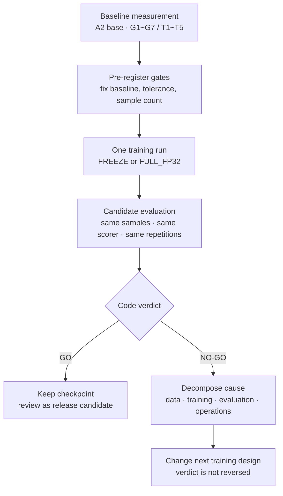

When a team says it is building its own speech model, the first question is usually "how much better is it?" We put that question off and wrote down, in code, "what must pass before we ship." The ASR side has seven gates (G1 to G7): general Korean error rate, domain-term error rate, number accuracy, silence hallucination, English retention, leakage, and latency. The TTS side has five (T1 to T5): content accuracy, speaker consistency, naturalness, runaway or silent output, and real-time factor. Before any training run we measured the baseline, compared candidates only on the same samples with the same scorer, and agreed not to reverse a verdict if a candidate failed.

This week's scorecard is the result. Seven of nine verdicts were NO-GO. On the numbers alone, that is a failure. Still, the most valuable output of pre-registered gates was the breakdown of why each candidate failed. Case by case, we could tell whether the problem sat in the data, the training recipe, the evaluation contract, or operations, and that split changed how we design the next run. This post collects those lessons in a form a team building its own ASR and TTS can use directly.

*We built the gates before the training. The breakdown of why candidates failed was a bigger output than the pass count.*

## Why we hard-code the gates first

Speech fine-tuning is an area where results look convincing too easily. A few listened samples sound better, and a lower CER on one benchmark tempts you to call it a success. We set the gates first so that code would block that temptation. Gates are registered before training, the baseline model is measured first with the same harness, and candidates are compared only with the same sample count and the same number of repetitions. A script issues the verdict. People interpret the result.

Two things matter in this structure. First, we do not turn a NO-GO into a PASS after the fact. Once you drop unfavorable samples from the evaluation set or lower a threshold to reverse a verdict, the gate becomes decoration from that moment on. Second, that does not mean a gate cannot be wrong. For the next version, thresholds can be registered again as a new version. Past verdicts are kept, and new criteria are declared before training. Keeping those two apart makes a gate both strict and able to learn.

## The biggest lesson was label notation

Our first Korean ASR candidate was [Qwen3-ASR-1.7B](https://huggingface.co/Qwen/Qwen3-ASR-1.7B) fine-tuned for one epoch on the Zeroth read-speech corpus plus domain data. General Korean CER dropped from 3.83% to 2.36%. On 60 silent and low-volume noise clips, the baseline hallucinated a stock filler phrase (the Korean equivalent of "right, right") on all 60, and the candidate did so on none. We confirmed through the same inference path that this was a change in the model itself, not in pre- or post-processing. Latency measured on the same cluster fell 28%. So far this reads as a success.

But on the [FLEURS](https://huggingface.co/datasets/google/fleurs) read-speech evaluation, CER rose from 5.52% to 7.45% and failed G1. The cause was label notation. Zeroth labels spell numbers out in Hangul and carry no punctuation. The model learned that notation faithfully, and on FLEURS, which uses Arabic numerals and punctuation, character-level errors went up. In the number evaluation too, about half of the errors were notation differences, such as "sixteen thousand won" spelled out in Hangul versus "16000 won" in digits, which write the same words differently.

A 10-minute check before training would have caught this. Put 100 training labels next to 100 evaluation labels and compare the rates of number notation, punctuation, and English tokens, and the gap is obvious. We confirmed it only after two training runs, so we have since put that check into the submission path as code. If the notation distributions of training and evaluation labels differ by more than a set margin and there is no policy file declaring the target notation, the submission is blocked.

We were also careful about the fix. We do not bulk-convert every number to Arabic numerals. "Samsung" (whose first syllable is also the word for three), "three minutes" spelled out, "3 minutes" in digits, and "Qwen3" each follow different rules by context, and a substitution that changes meaning ruins the labels. Instead, we put the baseline model's transcription of the training audio alongside, and rewrite a label into the baseline's notation only for utterances where matching the number reading makes the characters identical. We store the original transcript, the normalized transcript, and the normalization rule version separately for every row so that any change can be undone.

## If you freeze the audio encoder, it cannot learn accents

The second candidate trained the whole model in fp32, audio encoder included, on the same data. It still did not pass the general CER gate, but the enterprise domain-term error rate fell 47%, from 5.69% to 3.04%, and the count of plausible-but-wrong numbers in the number evaluation fell from 26 to 5. Even with the label notation problem unchanged, the run that trained the encoder heard terms and numbers better.

The difference was sharper on the dialect track. We built pilot data at 10 hours per region across five regions and compared a recipe with the audio encoder frozen against one that trained the whole model, on the same sealed evaluation set. The frozen recipe improved Jeju CER by only 9.0% relative and Gyeongsang by 2.9%. The full-training recipe reached 14.5% for Jeju, 10.8% for Gyeongsang, and 8.6% for Jeolla. To make a model understand speech with a different accent, the layers that hear the sound have to move too.

Even so, neither candidate reached the pre-registered 15% regional CER improvement threshold, so both are NO-GO. It is frustrating that Jeju's 14.5% sits just under the line, but we did not lower the threshold. We redirected the next investment to data instead. Ten hours per region is pilot scale, and the next step is one full training run after securing 50 hours per region with speaker diversity. With the current data we cannot tell whether missing 15% at 10 hours came from the recipe or from the amount of data, and adding data is the cheapest way to tell them apart.

Here are the gate results of the three ASR candidates in one table.

| Metric | Baseline | Encoder frozen | Full fp32 |
|---|---|---|---|
| Zeroth CER | 3.83% | 2.36% | 3.22% |
| FLEURS CER | 5.52% | 7.45% | 8.71% |
| Domain-term error rate | 5.69% | 5.20% | 3.04% |
| Number accuracy | 25.8% | 25.0% | 30.8% |
| Plausible wrong answers | 26 | 29 | 5 |
| Silence hallucination | 60/60 | 0/60 | 0/60 |

Both candidates are NO-GO, but reading the table column by column shows where the next training should go. Aligning the label notation and keeping the fp32 path is the recipe for the third candidate.

## Two hours was enough for a brand voice, and thirty minutes was not

On the TTS side, the experiment attached a LoRA to [VoxCPM2](https://huggingface.co/openbmb/VoxCPM2) to build a single-speaker brand voice. The baseline is zero-shot cloning with the base model given a reference clip of the same speaker, and the candidate is a LoRA trained on that speaker's reading. The harness forces both arms to use the same reference clip and the same 100 sentences.

The first candidate, trained on 30 minutes of audio, failed. Speaker cosine similarity was identical at 0.969 for both baseline and candidate. Reference cloning alone had already filled most of the speaker similarity, so the LoRA had nothing left to add. On top of that, the 30-minute LoRA cut content accuracy, lowered naturalness, and produced runaway generation in 12 of 100 sentences, where output never ended and ran to the length cap. The lowest rung of the ladder was not an opponent worth beating.

Two candidates trained on 2 hours each passed. We trained one female and one male standard-Korean professional voice actor with the same recipe: rank 32, alpha 32, learning rate 1e-4, effective batch 16, 2 epochs. Speaker cosine rose from 0.9405 to 0.9464 and from 0.9584 to 0.9673. [UTMOS](https://arxiv.org/abs/2204.02152) naturalness rose by 0.20 and 0.35, and there were no runaway or silent outputs. The third voice actor failed because speaker cosine dropped by 0.002, a difference that sits inside the noise of a single measurement. We still left the verdict as registered.

The real-time factor gate produced one lesson on the harness side. Measured on the model object with the LoRA attached, inference is 25% slower and fails T5. Merging the weights into the base made no difference on that same object; only loading the merged weights into an ordinary base object, built without a LoRA config, gave the same speed as the baseline. The slowdown came from the inference path of the model object built with the LoRA config. The adapter computation itself was not the cause. Since the serving condition uses merged weights, we fixed T5 to be measured in the merged state and wrote that into the gate definition.

There is one more lesson for the next version of the gates. Measuring the same baseline model twice made the content accuracy metric swing by up to 3 points. Yet speaker similarity decided a verdict on a 0.002 difference. Metrics differ in distribution and variability, so one noise band cannot be applied to all of them. The right approach is to repeat measurements per metric to set the tolerance, and to use paired comparison on the same samples. This verdict stands as registered. The next gates will register that tolerance too.

## Operations incidents burn time regardless of the science

One job transcribed 40,000 training utterances with the baseline model and was expected to take five hours. We declared 300 minutes, hit the timeout at 300 minutes, and got zero outputs. Two things stacked up. The transcripts were written in one go at the end of the set, so there were no intermediate results, and the arithmetic of utterance count times per-utterance measured latency, which shows right away that it would not fit in five hours, had not been done.

We fixed three things. Transcripts are now written to file per utterance, so whatever the reason the job ends, what it produced stays in storage. On restart, utterances already done are skipped. Before submission, we compute the expected duration from utterance count and measured latency and compare it to the timeout, and for jobs over an hour, a submission is rejected unless the spec declares intermediate saving and a restart method. The very next transcription job hit the timeout again, but this time 11,000 utterances were preserved and only the remainder was run. The same kind of incident went from total loss to a delay.

Something similar happened with the gate that watches the loss curve after training. The absolute threshold that treated a first loss above 8 as divergence gave two false positives, on the fp32 run and the dialect run. The absolute value of the first loss was in a normal range of 8 to 21 depending on precision and label length. What matters is how far the loss falls and which direction the validation loss moves. We switched the gate to a relative criterion and added boundary-value tests. An operations defect is closed with a test.

## Where ThakiCloud uses these results

This experiment is for the in-house ASR and TTS that will go into the Paxis voice agent and BizPilot voice support. Enterprise work commands mix product names, alphanumeric codes, amounts, and dates, and even with a good general benchmark, if the model gets "2 of the 8 B200 cards" wrong, the agent does the wrong job. That is why we gave the gates a separate domain-term error rate and number accuracy. The silence hallucination gate is there so that, in services like phone support where silence arrives often, the model does not invent words that were never said.

Training and evaluation all ran as queued jobs on our internal GPU cluster, and checkpoints and the measurement ledger stay in internal storage. On the Metis serving side, the fact that merged weights run at the same speed as the baseline applies immediately. On the Maxis training side, the pre-checks we just put into code become the default for the next run. The label notation comparison, the duration arithmetic, and the intermediate-save declaration go into the submission path of other fine-tuning jobs in the same form.

## Model release waits for a legal decision

The terms of the public speech data used for training allow distribution of the trained model. The original audio, the transcripts, and files made by simple processing of them cannot leave, and this post does not include them. But the two brand-voice candidates are weights that reproduce the timbre of one specific voice actor as is. Permission to use the data and consent to "let a third party download and use a model that reproduces that person's voice" are matters of different scope. Seoul Central District Court decision 2025Kahap20687 held that a contract to provide training data for speech synthesis alone cannot be read as permitting the supply of an identical or similar voice. So releasing the trained model weights proceeds only after a legal decision.

The public brand voice takes a different path. We design a synthetic voice that does not reproduce a real speaker, using Voice Design, and judge it with the same LoRA recipe and the same T1 to T5 gates. The recipe that passed this time is reused as is, and only the reproduction target changes. A team preparing its own speech model will save time later by checking the scope of speaker consent in the same step as checking the data terms.

## One next training run

This week's conclusion is three lines. We will train Korean ASR once more with a fp32 recipe that includes the audio encoder, after aligning the label notation. For dialects, we will not spend GPU until we have secured 50 hours per region with speaker diversity. For the brand voice, we will use the two passing models internally and rebuild the public one from a synthetic voice. The number of passing gates is still two. Code already knows where the next training run has to fix things.

## Sources

- ASR baseline/candidate model: [Qwen3-ASR-1.7B](https://huggingface.co/Qwen/Qwen3-ASR-1.7B)
- TTS baseline/candidate model: [VoxCPM2](https://huggingface.co/openbmb/VoxCPM2)
- Read-speech evaluation set: [FLEURS](https://huggingface.co/datasets/google/fleurs)
- Naturalness metric: [UTMOS (arXiv:2204.02152)](https://arxiv.org/abs/2204.02152)
