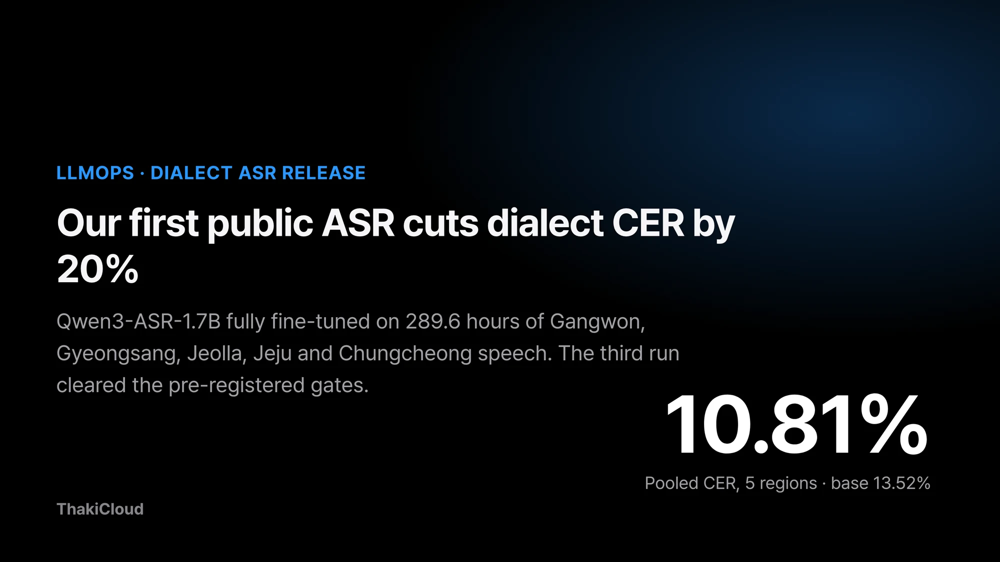
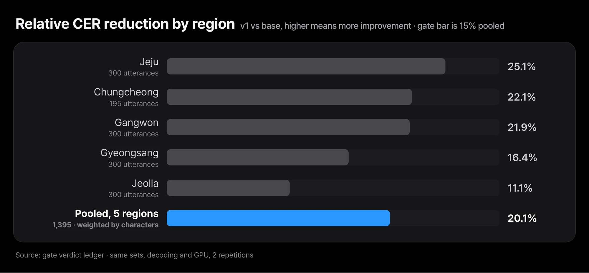
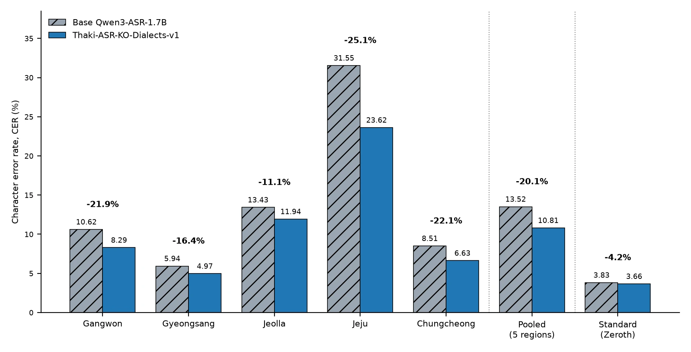
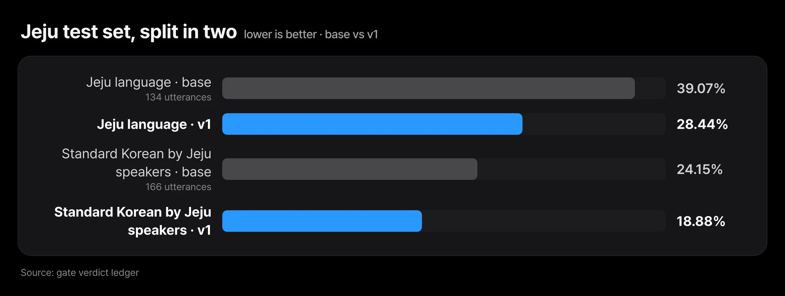
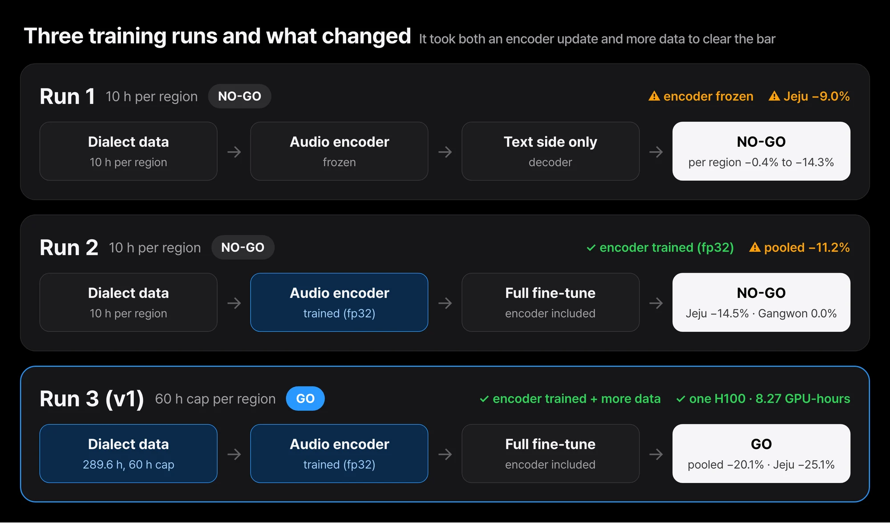
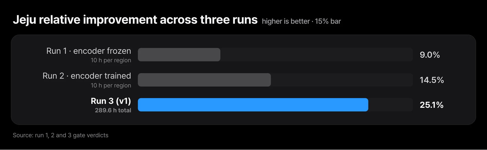
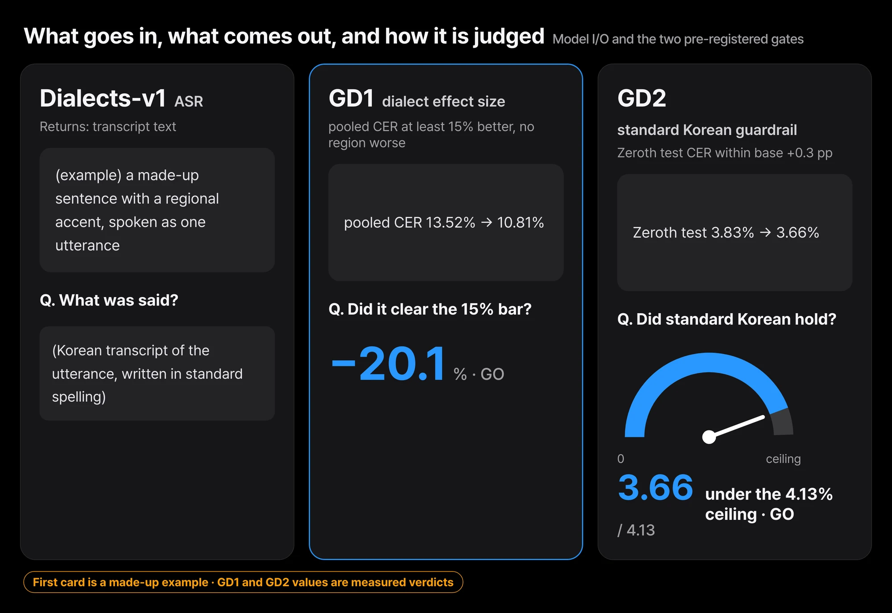

Phone support does not arrive in standard Korean only. If an ASR (speech recognition) model mishears an utterance spoken with a Jeju accent, the agent downstream does the wrong thing. That is why ThakiCloud's first public speech recognition model goes after dialects first.

We have published [Thaki-ASR-KO-Dialects-v1](https://huggingface.co/ThakiCloud/Thaki-ASR-KO-Dialects-v1) on Hugging Face. It is [Qwen3-ASR-1.7B](https://huggingface.co/Qwen/Qwen3-ASR-1.7B) fully fine-tuned on 289.6 hours of dialect speech from five Korean regions: Gangwon, Gyeongsang, Jeolla, Jeju and Chungcheong. On dialect test sets sealed before training, character error rate (CER, the share of reference characters the model gets wrong) fell from 13.52% to 10.81%, and all five regions improved.

Jeju language, the hardest of the five, went from 39.07% to 28.44%. Standard read Korean (Zeroth-Korean) stayed where it was, 3.83% to 3.66%. The weights are Apache-2.0 and the checkpoint is a drop-in replacement for `Qwen/Qwen3-ASR-1.7B`. This result only came on the third run. Below we show the regional numbers, why the first two runs failed, the gates that kept the verdict honest, and what we still do not know.

## All five regions improved, and Jeju moved the most

The numbers below are our own measurements of the base model and the released model on the same test sets, the same decoding and the same GPU, two repetitions each. Greedy decoding produced character-identical output across both repetitions, so no spread is shown. The 15% bar that our 10-hour pilot could not clear in the previous post was cleared this time.

*All five regions improved, and the pooled relative change is −20.1%. Jeolla, at −11.1%, is the only region that would not have cleared 15% on its own.*

*Values read straight from the gate verdict ledger. Jeju improved the most, Jeolla the least.*

| Region | Utterances | Base CER | v1 CER | Rel. change |
|---|---|---|---|---|
| Gangwon | 300 | 10.62% | 8.29% | −21.9% |
| Gyeongsang | 300 | 5.94% | 4.97% | −16.4% |
| Jeolla | 300 | 13.43% | 11.94% | −11.1% |
| Jeju | 300 | 31.55% | 23.62% | −25.1% |
| Chungcheong | 195 | 8.51% | 6.63% | −22.1% |
| Pooled, 5 regions | 1,395 | 13.52% | 10.81% | −20.1% |
| Standard Korean, Zeroth test | 200 | 3.83% | 3.66% | guardrail passed |

The pooled CER adds up every wrong character (substitutions, deletions, insertions) across the five regions and divides by the total of 25,332 reference characters. Regions are weighted by reference characters rather than by utterance count, so this differs from the utterance-weighted mean of the regional CERs (14.42% to 11.43%). The gate was judged on the pooled value, and the model card reports both.

### Split Jeju in two, and the dialectal side improved more

We also split the Jeju test set by whether the transcript contains dialectal forms.

*The 134 Jeju-language utterances went from 39.07% to 28.44%, and the 166 standard-Korean utterances spoken by Jeju residents from 24.15% to 18.88%. Much better, still high.*

The dialectal side improved more. The dialectal splits of the other regions are small, 27 to 63 utterances, so they should be read for direction only, and they were not gate criteria.

## It took both an encoder update and more data to clear the bar

We trained the same base model on dialect data three times. The first two used 10-hour pilot sets per region, and both were NO-GO.

*Runs one and two differ in whether the audio encoder trained; runs two and three differ in data volume. Neither alone cleared the 15% bar.*

| Run | Training data | Audio encoder | Jeju rel. change | Pooled rel. change | Verdict |
|---|---|---|---|---|---|
| 1st | 10 h per region | frozen | −9.0% | per region, −0.4% to −14.3% | NO-GO |
| 2nd | 10 h per region | trained (fp32) | −14.5% | −11.2% | NO-GO |
| 3rd (v1) | 60 h cap per region, 289.6 h total | trained (fp32) | −25.1% | −20.1% | GO |

The first run froze the audio encoder (the front end that turns sound into features) and trained only the text side. Jeju's 9% gain was the largest, and Jeolla barely moved. That is where we concluded that teaching a model to hear a different accent requires the listening layers to move too.

The second run trained everything, encoder included, on the same 10 hours. Jeju climbed to 14.5%, just under the bar, but the pooled figure stopped at 11.2% and Gangwon did not move at all (0.0%). The third run raised the per-region cap to 60 hours, 289.6 hours in total, and took 8.27 GPU-hours on a single H100.

*Jeju's relative change stopped at −9.0% in run one and −14.5% in run two, just under the bar, and reached −25.1% in run three with 289.6 hours of data.*

The difference between runs one and two is the effect of training the encoder. The difference between runs two and three is the effect of data volume. Neither data volume nor the encoder update cleared the bar on its own.

## The pass criteria were written in code before training

A pre-registered gate is a release criterion written down in code before training, and the verdict is produced by a script, not by a person.

*The first card is a made-up example, not training data. The values on the second and third cards are the measured gate verdicts from the post.*

GD1 requires the pooled five-region CER to drop at least 15% relative to the base model, with no region of 150 or more utterances getting worse than base. GD2 requires the Zeroth test CER to stay within 0.3 percentage points of the base. This time GD1 passed at −20.1%, and GD2 came in at 3.66%, under the 4.13% ceiling.

### Why the gate moved to a pooled criterion

The rule used for the first two verdicts was a 15% improvement in every region individually. In the second run, a single region like Gangwon, with a small set and few recording sessions, decided the whole verdict. So before submitting the third run we registered a new rule: effect size is asked of the pooled figure, and regions are only asked not to regress.

The two earlier verdicts were preserved under the old rule. The new rule was self-tested to confirm it reproduces both earlier failures as NO-GO before training started, and the threshold was not touched after training finished.

Jeolla, at −11.1%, is the only region that would not have cleared 15% on its own. The registered rule asks for the pooled figure and no regression, and v1 meets that rule. The model card says the same thing in the same words.

## Only the weights are public, and much is still unknown

The repository contains only the weights and the tokenizer and processor configuration. None of the AI Hub Korean dialect speech data used for training is included, not the audio, the transcripts or the metadata. AI Hub's terms permit distributing a model trained on the data but prohibit redistributing the data itself. The source attribution is written on the card in the required form. Zeroth-Korean is CC BY 4.0.

| Condition | In this release |
|---|---|
| Five-region dialects, clean single-channel recordings | ✅ measured on sealed test sets, pooled 10.81% |
| Standard read Korean | ✅ Zeroth test 3.66%, guardrail passed |
| Male, child and elderly speakers | ⚠️ female speakers are 78% to 89% per region; the Chungcheong test set is all female |
| Noise, far-field microphones, telephone audio, overlapping speech | ⚠️ not measured |
| Languages other than Korean | ⚠️ not measured; use the base model |
| Production environment | ⚠️ passed a research gate only, not yet validated |

In both training and evaluation, female speakers account for 78% to 89% of utterances per region, and speakers in their twenties dominate. The Chungcheong test set is entirely female. Treat accuracy for male, child and elderly speakers as unknown.

We used clean single-channel recordings only and did not measure noise, far-field microphones, telephone audio or overlapping speech. We did not measure other languages either. In a separate Korean-only fine-tune of the same base, Japanese CER nearly doubled, so use the base model for non-Korean audio.

The Jeolla gain is modest, and the Jeolla dialectal split has 27 utterances, where a single utterance is worth about 3.7 percentage points of CER. Jeju is still high at 23.6% overall and 28.4% on Jeju-language speech. It is much better, not solved. This release means the model passed a research gate, not that it has been validated in a production environment.

## This is the first in-house ASR checkpoint for Paxis voice agents

This is the first public checkpoint of the in-house ASR going into Paxis voice agents and BizPilot voice support. Phone support and on-site voice commands do not arrive in standard Korean only. If the model mishears an utterance with a regional accent, the agent does the wrong thing.

Training and evaluation ran as queued jobs on our internal GPU cluster, with checkpoints written to object storage every 200 steps with hash verification so that an interrupted run can resume. The architecture and parameter count match the base model, so it goes into Metis serving with the same configuration as the base. On the evaluation run, median latency for 3-to-8-second utterances was 0.39 to 0.61 seconds.

## Closing

We are not running further dialect tuning. The remaining factors are speaker diversity and noisy-environment data, and those wait for the next round of data collection; this checkpoint is sealed here.

The speech track's next public model is TTS. We plan to apply the brand-voice LoRA recipe that passed in the previous post to a synthetic voice designed with VoxCPM2 Voice Design rather than a real voice actor, judged by the same gates. Weights trained on real voice actors will not be published until the rights are confirmed.

The experiment you can run today is simple. Swap this model in where you use `Qwen/Qwen3-ASR-1.7B`, and measure the CER of both models side by side on a few recordings with regional accents that you already have.

## Sources

- Released model: [ThakiCloud/Thaki-ASR-KO-Dialects-v1](https://huggingface.co/ThakiCloud/Thaki-ASR-KO-Dialects-v1)
- Base model: [Qwen/Qwen3-ASR-1.7B](https://huggingface.co/Qwen/Qwen3-ASR-1.7B), [Qwen3-ASR Technical Report (arXiv:2601.21337)](https://arxiv.org/abs/2601.21337)
- Standard-Korean guardrail data: [Bingsu/zeroth-korean](https://huggingface.co/datasets/Bingsu/zeroth-korean) (CC BY 4.0)
- Previous post: [What We Learned from Failing 7 of 9 Speech Model Fine-Tuning Gates](/tech-blog/en/llmops/speech-finetuning-pre-registered-gates/)
