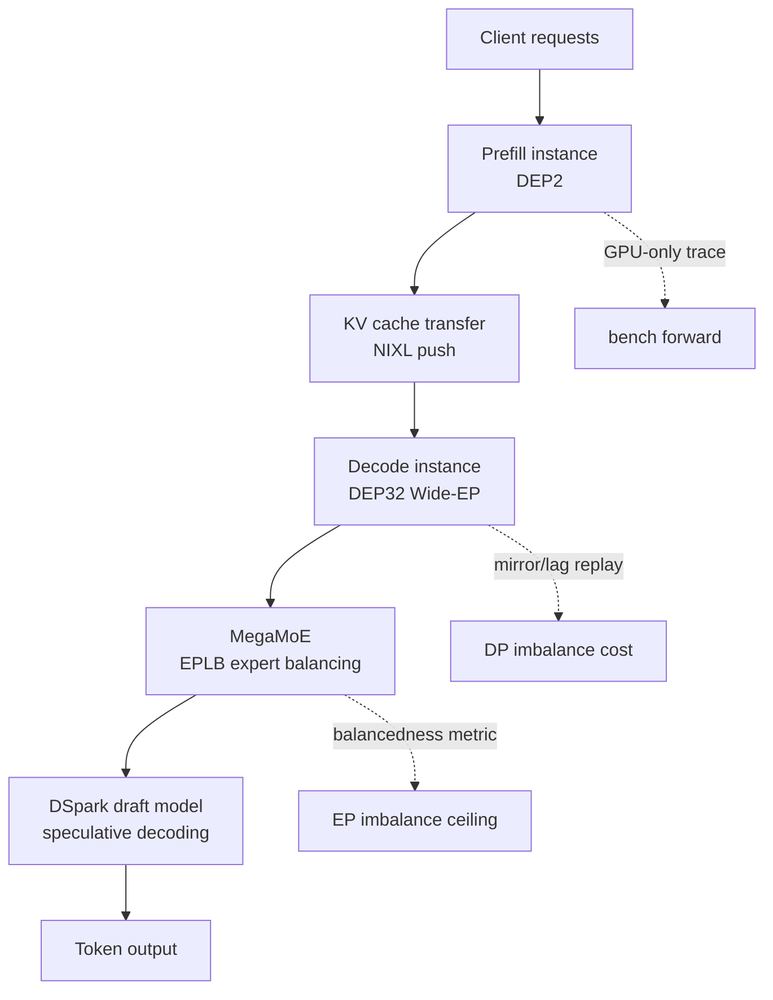

## Who should read this

A post for engineers serving inference on vLLM, or preparing to, and for platform teams deciding which vLLM release to track. The conclusion first: more important than the news that vLLM matched DeepInfer within 6% on decode are two things. One is the measurement method that makes the numbers credible, the mirror/lag replay and the balancedness metric. The other is the fact that, as of October 25, most of these optimizations are PRs on main that have not landed in any stable release. If you own the upgrade timing of a vLLM serving stack, knowing those two things is more practical than knowing the result numbers themselves.

*The moment a general-purpose engine's curve catches up to a model-specific one.*

## Overview

On October 23, the vLLM team (Inferact led this particular effort) published "Serving DeepSeek-V4.1-Flash at Scale". On a single NVIDIA GB300 NVL72 rack, with P/D disaggregation and Wide-EP, it serves DeepSeek-V4.1-Flash at 954K tokens/s per GPU on the SemiAnalysis AgentX workload, with a P90 of 196 tokens/s per user, 7.9x the single-node result from the first post, and $38.96 per GPU-hour at DeepSeek's off-peak pricing. In the same post, vLLM's decode throughput tracked DeepInfer's published curves within 6% across batch sizes 8 to 256, and a specialized decode path reached a P90 of 826 tokens/s for a single user on four B300 GPUs.

Our strategy analysis this week (the moat was filled) covered the market side of this news: the gap between model vendors' in-house engines and open frameworks is closing, and serving-stack comparison is moving from a quarterly event to a release-unit recurring job. This post goes into the technical part behind it, and adds one more thing: which vLLM version these optimizations actually ship in, and where our serving stack baseline stands against that, verified by querying the real GitHub release list and PR merge state on October 25.

## What it is: a general engine matching a model-specific one

DeepInfer is DeepSeek's own inference engine for DeepSeek-V4.1-Flash, released this week. The point the post emphasizes is that DeepInfer was originally built on vLLM. Both engines share a lineage, and vLLM has continuously integrated the kernels DeepSeek open-sourced, MegaAttn, MegaMoE, and Mega-mHC, while optimizing the rest of the stack around them. So "vLLM matches DeepInfer" does not mean an external framework imitated someone else's engine. It is closer to two engines born in the same stack meeting again for a verdict.

The comparison setups need precision. The decode comparison runs DeepSeek's decode configuration (131K context, nextn=3) on vLLM (GB200) against DeepInfer's published numbers across batch sizes 8 to 256, within 6%. Prefill is different. DeepInfer's published curve uses EP4DP4 with 32 redundant experts and a 140-token bounded replay, on hardware the chart does not state. vLLM's run used DEP2, no redundant experts, and a 128-token replay, so the post itself declares that the gap between the two curves should not be read as an engine-to-engine speedup. What it shows is that vLLM's prefill tracks the trend DeepSeek's engine published over the range they published.

The solid lines in the diagram are the serving flow, the dotted lines the measurement layer. That structure is the recurring shape of this post: serving optimization and measurement optimization were designed together, and the measurement method was fixed before the numbers came out.

## Why DeepSeek-V4.1-Flash serves differently

The optimization strategy comes from the model's structure. Before tuning, the vLLM team quantified the model's architectural traits. Four matter.

First, the global KV cache footprint is only 890 bytes per token, thanks to cross-layer KV sharing and FP4 compression. Second, attention is lightweight. Layers 2, 8 and 14 do full-context indexing with 2x compression, and with bounded replay, layer 20 writes KV for all tokens but runs indexing and attention only on the last 128, while layers 21 through 39 process only those tokens. Third, decode is MoE-bound even in long context. At 128K context with 64 requests per rank, MoE takes 62% of the target step, while attention and the indexer together take 13%. Fourth, decode step time barely depends on context length. At DEP32 with 16 requests per rank and one token plus five DSpark draft tokens per request, the target forward time on GB300 is 8.86ms at 64K, 8.93ms at 128K, and 9.53ms at 855K. A 6.7x context increase adds only 0.6ms, a 7% delay increase.

Those four traits determine the rest. Prefill wants a small DEP size, because the KV cache fits in HBM with room to spare and batch size is not KV-limited. Decode is bounded by MegaMoE weight reads, so Wide-EP cuts that dominating cost directly. And DP load balancing simplifies to least-load by request count per rank.

## The measurement layer: before you trust the numbers

The part this blog should adopt is the measurement methodology. Three tools.

First, `vllm bench forward` (PR #61339) measures the model-forward time of an exact prefill or decode batch through the real execute_model path across DP and EP ranks. It measures GPU time only, giving a clean trace. DecodeBenchConnector measures engine-level end-to-end decode on top of that, and the gap between the two reveals unexpected overhead.

Second, the mirror/lag replay that isolates the cost of DP imbalance. Agentic traces vary run to run, making imbalance hard to isolate, so they replay identical requests on every DP rank. In the mirror run all ranks receive their requests at the same time; in the lag run, rank r receives the same requests 5 times r seconds later. Same total work, out of step, so the difference between the two runs is exactly the cost of DP imbalance. Results: with prefix caching off, the lag replay costs DEP2 5.9% (138.7K to 130.5K tokens/s) and DEP4 13.6% (267.6K to 231.1K). In a concurrency-256 AgentX prefill-only run, DEP4 delivered only 83% of DEP2's per-GPU throughput (64.4K vs 53.3K), and that gap is attributed to this DP imbalance. DEP2 becomes the prefill default.

Third, the balancedness metric that defines the ceiling of EP imbalance. For each MoE layer, it takes the mean rank load divided by the max rank load, averaged per step over the EPLB window. The balanced reference is the same decode batch routed uniformly at random, and even that reference carries sampling noise: at DEP32 with 72 requests per GPU, uniform routing reaches 0.96 balancedness for the target (top-6) and 0.94 for the draft (top-3). The gap between real and uniform routing is the most expert balancing can recover, and the EPLB run shows how much it actually recovers. EPLB rearranges experts every 3,000 steps based on the previous 1,000, lifting balancedness from 0.35 to 0.94 for the target and from 0.21 to 0.89 for the draft, recovering about 97% and 93% of the gap to uniform routing.

## Measured results

The results from the vLLM team that carry this post's argument. Prefill: three bottlenecks hidden behind the trace. Extending SWA bounded replay to layer 20 (PR #59894, +19.9% at 32K new tokens, rising from 10.1% at 4K to 23.1% at 64K), moving the Engram shared host tables from 64KB to 2MB GPU pages to cut TLB misses (PR #62359, +2.8%), and DeepSelect top-k in the prefill indexer (PR #62240, +15.6%). On top of a 128K cache hit, the combined gain is 35.6 to 43.9% across 4K to 64K new tokens, and at 64K throughput goes from 71.2K to 102.5K tokens/s/GPU.

Decode: finding where diminishing returns start in Wide-EP scaling. Going from DEP4 to DEP32 at 64 requests/GPU and 128K context, the target MegaMoE time drops from 13.4ms to 6.0ms, but the remaining work stays around 10ms, so per-GPU gains diminish, and at DEP32 the draft's communication overhead starts to offset wider parallelism. CPU overhead becomes the dominant variable in rack-scale decode. An unoptimized DEP32 ran slower than DEP16 (17.57ms vs 13.84ms per step) even though its GPU execution was 1.1ms faster. Cause by cause:

| Cause | Fix | Effect (setup) |
|---|---|---|
| KV read posted synchronously on the decode worker thread | NIXL push + UCX scatter-gather, packed KV rows as one NIXL region (#61121) | 141K to 440K tokens/s/GPU, P90 ~40 to 159 (GB300, 8P1D, c3,072) |
| Gloo all-reduce latency grows linearly with rank count | Recursive-doubling CPU all-reduce (#61767) | DP sync 10.8 to 1.5ms/step, step 16.10 to 13.15ms (DEP32) |
| Admission bursts, up to 140 requests in one step | Opt-in cap of 4 new KV loads per step (#61725) | 460K to 516K tokens/s/GPU, P90 109 to 153 (GB300, 7P1D, c4,800) |
| Admission work grows with prompt length | Prompt as one int32 buffer, skip SWA null blocks, chunked copy (#59908 et al.) | 855K prompt: 38.8 to 6.0ms CPU per admission |

That is the vLLM team's numbers. Now the part we actually verified.

### What we verified: which releases contain these optimizations

The blog says "vLLM" with no version. To pin down which build produced the result, and what a stable-release tracker like us can actually pick up, we queried the vLLM GitHub release list and the merge state of the corresponding PRs on October 25. The results are preserved in the run-2 log (outputs/blog-impl/vllm-deepinfer-parity/run-2.log) and release_map.json.

The release timeline first. v0.32.0 shipped October 18, v0.31.0 October 5, v0.30.0 September 22, v0.29.0 September 9. The stable release closest to the blog's publication (October 23) is v0.32.0.

Then the PR merge state. Of the 16 key PRs, merged around the v0.32.0 window are the measurement tool `vllm bench forward` (#61339, October 14), the layer-20 SWA replay (#59894, October 9), the recursive-doubling CPU all-reduce (#61767, October 15), the admission prompt copy kernel (#61724, October 15), and the first specialized decode kernel (#61868, October 21). Still open on main are the NVLink symm_mem EPLB backend (#62009), NIXL push UCX scatter-gather (#61121), the admission cap (#61725), the DeepSelect prefill indexer (#62240), Engram 2MB pages (#62359), heterogeneous target/draft EPLB (#61395), the prompt int32 buffer (#59908), the SWA null block skip (#62702), the second specialized decode kernel (#61869), and the recursive-doubling base (#60267). One of them, #62698 (the admission CPU fix), merged on October 25, the day this post was written.

*Source: release_map.json, queried 2026-10-25. Dots are merged PRs at their merge date; marks are PRs still open as of October 25.*

The conclusion is clean. v0.32.0 contains the measurement tooling and part of the CPU overhead fixes, while the core of the NVL72 rack result (NIXL push, symm_mem EPLB, the admission cap, the specialized decode path) sits on main after v0.32.0. Reproducing the blog's numbers as-is requires a main build, not a stable release. And our baseline: the October 20 serving ledger runs vLLM v0.29.0. Three releases behind the latest stable, and further still behind the optimizations this post is about. Given roughly biweekly releases, a v0.29.0 baseline is a six-week-old stack.

## ThakiCloud product implications

ThakiCloud's ai-platform runs multi-tenant AI/ML serving infrastructure on Kubernetes. Two actions follow from this post for us.

First, porting the measurement method. We already run P/D disaggregation benchmarks (vllm-pd-disagg-benchmark). Mirror/lag replay gives a way to isolate the cost of DP imbalance into a single number, and balancedness gives a way to define the ceiling of what expert balancing can recover, then measure how much of it actually recovers. Neither depends on hardware: without NVL72, on a B200 node or an H200 cluster, you can run mirror/lag with any rank count, and measure balancedness whenever you serve a MoE model. The lag run design in particular (delay rank r by 5 times r seconds) only needs scheduler timing manipulation, no load-testing tooling, so the adoption cost is low.

Second, changing the reference for release tracking. The policy "follow the latest stable vLLM" shows its limit this week. Big inference performance moves happen on main, faster than the stable release cadence, and first on a specific model on a specific hardware rack. Our serving stack's engine version policy now needs a step that verifies a benchmark blog's PR list as a release map, and this post's release_map.json is the template.

## Limitations and counterarguments

The boundaries that narrow the applicability of these results.

First, hardware specificity. The rack-scale numbers (954K tokens/s/GPU, $38.96/GPU-hour) are GB300 NVL72 results. A result whose NVLink domain is an entire rack does not transfer as-is to B200 bare metal or H200 passthrough VMs. The within-6% decode comparison was measured on GB200, but it is only interpretable under the same premise of in-rack interconnect.

Second, model specificity. The Engram host tables, MegaMoE, the DSpark draft, and SWA bounded replay are DeepSeek-V4.1-Flash-specific. Most of the 16 PRs are meaningless on other models, the ones directly dependent on those four components. What ports hardware-independently is the measurement method and the CPU overhead fixes (the Gloo all-reduce replacement, the admission cap, NIXL push).

Third, the nature of the comparison target. DeepInfer is an offline engine. It is not on the same footing as online, multi-tenant, SLA-driven serving. "vLLM matches DeepInfer" means matching on offline benchmark curves, and the online advantage comes from P/D disaggregation and Wide-EP, not from replacing DeepInfer.

Fourth, unverified numbers and reproducibility. The prefill comparison reads values off DeepInfer's README charts, and the post itself states that this is not an engine-to-engine speedup. And a large part of the core optimizations are open PRs on main, so any attempt to reproduce them on a stable version fails. The PR merge state in this post is a snapshot as of October 25, and given the release cadence, the next stable may contain them by early November, which is the next verification point.

## Bottom line

The technical implications of the "vLLM matched DeepInfer" news split into three layers. The first is the result: the decode gap between a model-specific engine and a general-purpose engine closed to within 6%, and the general-purpose engine moved ahead at rack-scale serving. The second is the method: the mirror/lag replay and balancedness that make that gap credible are measurement techniques that port hardware-independently. The third is operations: these optimizations live on main, not in stable releases, so serving engine version policy now has to be verified by PR inclusion, not by release number.

The reader's next actions. If you operate vLLM serving, first check whether `vllm bench forward` works on the version you run. If it does, set up the measurement layer, then apply mirror/lag and balancedness to your workload, the cheapest move. And build the habit this post's release_map.json demonstrates: cross-check the merge state of the PRs cited in a benchmark against the releases. In an era where general engines match specific ones, the contest has moved from engine choice to the cadence of measurement and tracking.

## Sources

- vLLM Blog, [Serving DeepSeek-V4.1-Flash at Scale: vLLM Matches DeepInfer and Scales to GB300 NVL72](https://vllm.ai/blog/2026-10-23-deepseek-v41-flash-pd-wide-ep) (2026-10-23)
- vLLM GitHub releases and PR records (queried 2026-10-25, outputs/blog-impl/vllm-deepinfer-parity/release_map.json)
- ThakiCloud serving ledger (2026-10-20 vnext, vLLM v0.29.0 baseline)
