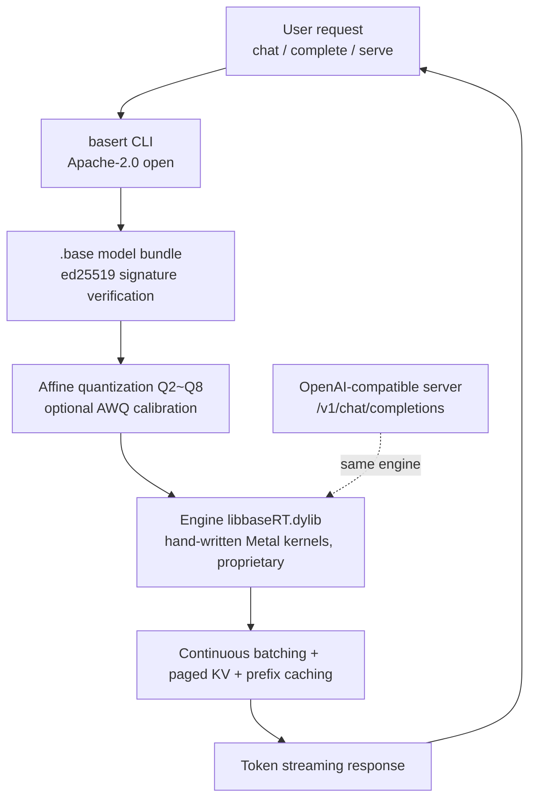

## Why Read This

If you run LLMs locally, or you are picking an inference engine for edge and on-prem environments, you have likely seen the name BaseRT recently. It is a new runtime that is said to run several times faster than llama.cpp on Apple Silicon.

Let me state the conclusion first. BaseRT's hand-written Metal kernels and signed quantized bundles genuinely raise local inference speed. However, most of the fast numbers in this post are published by the vendor, not independently reproduced by a third party. And while the CLI and the model format spec are open, the engine binary that produces that speed is proprietary. The criterion for choosing a local inference runtime has widened from "how fast is it" to "who owns that speed." That is the core of this post.

## Overview

BaseRT is a local LLM inference runtime by Base Compute. The repository was created on June 26, 2026, and v0.4.2 shipped on October 27, adding package-registry installation, CUDA 13 support, and batch-decoding speedups. On October 28, a poster's tweet claiming "4x faster than llama.cpp on Qwen3.5 9B" brought it back into the spotlight. It had actually circulated once before, around July 20, on Hacker News under the title "6.4x faster than llama.cpp, 3.9x faster than MLX."

Running local LLMs on Apple Silicon has long followed two paths: llama.cpp's GGUF format, and Apple's own MLX. BaseRT opens a third path between them, built on hand-written Metal kernels. The key difference is the format. BaseRT uses its own `.base` format, so let us start with what that format looks like.

## In Plain Terms

Think of a car. llama.cpp is a standard engine that fits any car, and its fuel, GGUF, is an open standard you can get anywhere. BaseRT is a racing engine hand-built for this specific car, the Apple Silicon Metal environment. On this car it is undeniably fast. But the engine is sealed, and it only takes fuel in the manufacturer's signed can, the `.base` format.

This analogy runs through the whole post. The engine that is the source of speed, and the model format that engine consumes, are tied to a single vendor. The open part is the CLI and the format spec; the sealed part is the binary that produces the performance. Below, we look at exactly where that boundary is drawn.

## What Is BaseRT

In one line, BaseRT is a runtime in which an open CLI hands a signed quantized bundle to a sealed engine. Let us go through each component.

First, the `basert` CLI. It is open-sourced in the repository under the Apache-2.0 license. It handles model pull, conversion, chat, one-shot completion, benchmark, and server startup.

Next, the `.base` format. It is the in-house format BaseRT stores models in, defaulting to "affine quantization from Q2 to Q8," with optional AWQ calibration. It is distributed as a bundle with an ed25519 signature. The signature means you can verify where a model bundle came from and whether it was tampered with. That contrasts with GGUF, which circulates unsigned.

And the source of the performance, the engine binary `libbaseRT.dylib`. The repository describes this engine as "accelerated by hand-written GPU kernels," but the binary itself is proprietary and ships under "its own license." In other words, the code that makes it fast is not open.

There are two backends. Apple Silicon (M1 and later, macOS 14 and later) uses Metal; NVIDIA GB10 (DGX Spark) and Linux arm64 use CUDA. Notably, the CUDA backend is limited to GB10, an ARM-based device, rather than a general x86 server, which marks this as a runtime for local and edge use.

The serving features mirror a production stack: an OpenAI-compatible server, continuous batching, paged KV, prefix caching, and rate limiting. These are techniques already validated in production serving stacks like vLLM. The fact that a local runtime is catching up to these features is another way to read BaseRT.



*The request-handling flow in BaseRT. The point where the open CLI and signed format lead into the sealed engine that produces the performance is the key.*

## Installation and Integration

Installation is a single command. You pipe the installer script from the vendor domain into your shell.

```bash
curl -LsSf https://basecompute.co/install.sh | sh
```

This command places `libbaseRT.dylib`, the `basert` CLI, and the `basert-*` runtime tools in `~/.basert` and registers them on the PATH. There is no brew or pip path. For a manual install, you take the `basert-engine-macos-arm64` archive from the GitHub release and build it.

You bring models in with pull. There are pre-converted `.base` files from Base Compute, and a path to convert HuggingFace models directly.

```bash
basert pull basecompute/Qwen3-0.6B   # Metal Q4, ~430MB
basert pull Qwen/Qwen3-4B            # converted from HuggingFace, then pulled
basert convert <src>                  # convert a local model to .base
```

The default pull target is `base-q4`, and you can adjust it with the `--target`, `--revision`, `--force`, and `--dry-run` flags.

There are three ways to use it: chat, one-shot completion, and benchmark.

```bash
basert chat basecompute/Qwen3-0.6B
basert complete basecompute/Qwen3-0.6B --prompt "..." --max-tokens 256
basert bench basecompute/Qwen3-0.6B -p 512 -n 128 -r 3
```

`bench` takes `-p` (prefill token count), `-n` (number of decode tokens to generate), and `-r` (repetitions, averaged), and reports prefill and decode in tok/s respectively. Check the subcommands with `--help`.

The server opens an OpenAI-compatible endpoint.

```bash
basert serve basecompute/Qwen3-0.6B --api-key "$(uuidgen)" --port 8080
# http://127.0.0.1:8080/v1/chat/completions
```

One thing to note here. Taking a proprietary binary from the vendor domain via `curl | sh` is a point that must be chosen deliberately from a supply-chain perspective. The open CLI and format spec are verifiable in the repository, but the engine that produces the performance is a binary as-is.

## Actual Experiment Results: Reproduction and Benchmark

I will be honest. Reproduction failed in this environment. The environment where this post was written is an unattended headless session in which the shell's outbound network calls and package installation are blocked by an approval gate, so I could not directly run the BaseRT install, model pull, or benchmark. Therefore, all the numbers below are published by the vendor and the poster, i.e., source-attributed figures. They are not ThakiCloud local measurements.

The vendor page's M5 Pro figures, organized:

| Model | Format | Metric | BaseRT | llama.cpp | Vendor-stated ratio |
|---|---|---|---|---|---|
| Gemma 4 E2B | Q8, pp2048 | Prefill (tok/s) | 16,264 | 2,547 | ~6.4x |
| Qwen3 0.6B | Q4 | Decode (tok/s) | 531 | not stated | (M5 Pro) |

The vendor states, "up to 6.4x prefill versus llama.cpp and 3.9x versus MLX; up to 1.33x on decode." The point to notice is that the 6.4x is a prefill, i.e., prompt-processing, figure. On decode-heavy workloads like interactive chat, the ratio drops to around 1.33x. The tweet's "4x faster" figure is the poster's own statement and does not directly correspond to a specific number on the vendor page.

The v0.4.0 release notes state "Qwen 3.5/3.6 MoE speedups," supporting that the Qwen3.5 support mentioned in the tweet landed at this point.

In short, multiple sources agree on the direction that BaseRT runs fast. But the specific ratio varies greatly by hardware (M5 Pro), model (Gemma 4 E2B, Qwen3 0.6B), and metric (prefill vs. decode), and the numbers cited in this post are all vendor- and poster-stated figures.

## ThakiCloud Product Implications

ThakiCloud's ai-platform operates multi-tenant model serving on K8s. The direction BaseRT points to shows where the edge extension of this serving stack is heading.

First, the unit of local and edge inference is coming down to consumer hardware. If one Apple Silicon unit delivers thousands of tok/s of prefill, the unit economics of serving draw a different curve than a datacenter GPU. In the environments that on-prem and sovereign AI demand, where "data does not leave the facility," a local engine with sufficient performance becomes a practical option.

Second, the fact that BaseRT supports continuous batching, paged KV, and prefix caching shows that local runtimes are catching up to production serving features. If ai-platform runs these features on a vLLM stack, the feature gap with local engines narrows. It is the license difference, not the feature difference, that draws the boundary between local and production.

Third, and this is the most important point. The split of open CLI and format spec versus proprietary engine is a point to evaluate from a sovereign perspective. The format is signed, so tampering can be verified, but the code that produces the performance is sealed. To the question of whether you can fully audit "the model I serve and its execution path," BaseRT gives a half answer. On the same line as ThakiCloud's emphasis on on-prem and self-hosting, the ownership boundary of a local engine is an item that belongs in the adoption decision.

It also touches one line from a Paxis perspective. When you run agent workloads on edge and consumer hardware, what determines the execution economics is precisely the per-token cost and ownership boundary of such local inference engines.

## Limitations and Counterarguments

Six points.

First, the engine is proprietary. Unlike llama.cpp, which keeps everything open, BaseRT seals the source of performance. It is at a disadvantage in auditability and modifiability.

Second, the benchmark is a single vendor source. It is on M5 Pro, with no independent reproduction. The 6.4x is a figure under a specific prefill condition; decode is 1.33x. Do not lose this metric difference when generalizing "it is fast."

Third, the `.base` format is in-house. The signature is an advantage for trust, but the fact that the model is tied to the BaseRT toolchain reads as format lock-in. Even with `basert convert`, it is not used as a standard fuel like GGUF.

Fourth, the CUDA backend is limited to NVIDIA GB10 (ARM). It cannot be used on general x86 datacenter GPUs, so it is dedicated to local and specific edge devices.

Fifth, the install method of taking a proprietary binary via `curl | sh` needs supply-chain review.

Sixth, no documentation was found on whether the runtime requires outbound network or has telemetry. Do not assume there are no external calls just because it is a local engine.

## Summary

We recover the conclusion set in the introduction. BaseRT raises the speed of local inference on Apple Silicon with hand-written Metal kernels and signed quantized bundles. However, the fast numbers are vendor-stated, and the engine that produces the speed is proprietary.

To those choosing a local inference engine, the next action: do not cite the vendor's ratio as-is. Check your own hardware and your workload's prefill-to-decode ratio, and confirm whether the boundary between the auditable part (open CLI and format) and the sealed part (proprietary engine) is within your tolerance before deciding on adoption. Speed must now be a number reproduced on your own machine, not a number proven by the vendor.

In one line: at the point where speed becomes a commodity, the ownership boundary of the engine that produces that speed is the new criterion for local inference.

## Sources

- Base Compute, [baseRT repository](https://github.com/basecompute/baseRT) (Apache-2.0 CLI, proprietary engine, v0.4.2 2026-10-27)
- Base Compute, [baseRT official page](https://www.basecompute.co/getbasert) (M5 Pro benchmark figures)
- HuggingFace, [basecompute/Qwen3-0.6B model card](https://huggingface.co/basecompute/Qwen3-0.6B) (.base format, Q4 430MB)
- Hacker News, [baseRT discussion](https://news.ycombinator.com/item?id=48973357) (2026-07-20)
- Poster tweet: [@_avichawla](https://x.com/_avichawla) "Qwen3.5 9B, 4x faster than llama.cpp" (2026-10-28, source-attributed)
