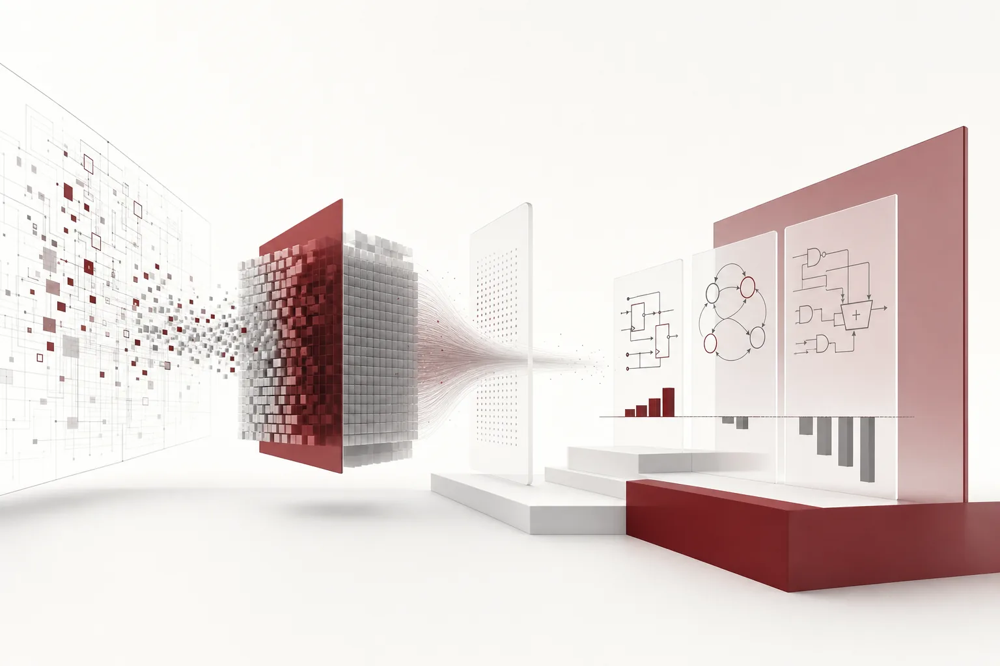
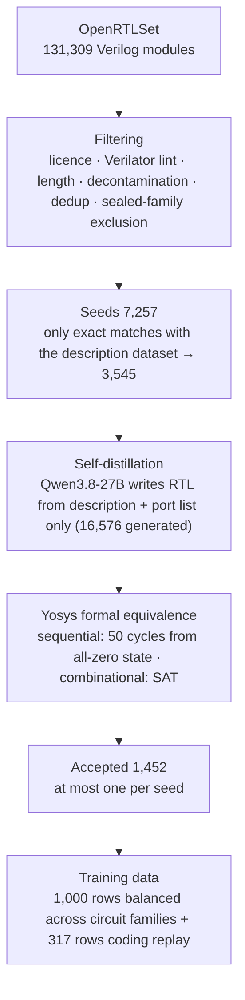

*A visual metaphor for the article's key idea.*

## Summary

We released [Thaki-HW-27B-v0.1](https://huggingface.co/ThakiCloud/Thaki-HW-27B-v0.1), a Qwen3.8-27B fine-tuned for Verilog RTL generation, on Hugging Face. The result comes first. It met the release criteria we fixed before training, but **we found no statistically significant improvement over the original Qwen3.8-27B.** VerilogEval moved +0.85pp with a 95% confidence interval that includes zero. RTLLM moved −4.27pp, so the point estimate is lower than the base, and a regression cannot be ruled out.

That is why the model is a research preview, and why we recommend the base model for real work. We are still writing this up because the shape of the failure is specific. Of 156 VerilogEval tasks, 103 did not change, 28 improved and 25 got worse. The improvements were simple sequential circuits such as flip-flops, counters and shift registers. The regressions were state-heavy FSMs and RTLLM arithmetic circuits. This post covers how we built the data, how we fixed the evaluation rules in advance, and what the result taught us.

## Why we built it, and what failed before

RTL generation is a strict kind of code generation. A design can be syntactically valid and synthesise, and still be wrong if a single cycle differs from the testbench. General coding models write some Verilog, but an in-house hardware design agent needs that accuracy pushed higher.

We tried twice before v0.1 and failed both times. The evaluation conditions differed from this run, so the numbers are not directly comparable, but the failure patterns were clear.

- **Gate 0**: LoRA training on about 9,500 public RTL rows. The total update size (learning rate × steps) was 0.191, and RTLLM dropped 24.8pp.
- **P2-R0**: 342 rows for 2 epochs. Final loss reached 0.0005, which is memorisation. VerilogEval functional pass rate fell 5.51pp while compile rate rose 4.10pp.

The second pattern mattered most. The model learned to write Verilog that compiles and lost the ability to write circuits that work. Judged by compile rate alone, it looked like progress. v0.1 was designed first of all not to repeat either failure.

## Data: licence-traced seeds and self-distillation

### Cutting the seed pool to 7,257

The starting point was 131,309 Verilog modules from [OpenRTLSet](https://huggingface.co/datasets/ESCAD/OpenRTLSet). Because the data would go into a public model, we filtered conservatively.

| Step | Modules left |
|---|---:|
| All of OpenRTLSet | 131,309 |
| Per-row upstream licence is permissive (MIT, Apache, BSD, ...) and the repository is not machine-generated | 57,610 |
| Drop code that also appears in any non-permissive row | 39,665 |
| Passes Verilator lint, single module, ports only | 23,596 |
| Length limits | 20,865 |
| Decontaminated against evaluation benchmarks | 20,460 |
| Deduplicated | 14,031 |
| Excluding families from an internal sealed benchmark | **7,257** |

Keeping only seeds whose code exactly matches a [dataset with module descriptions](https://huggingface.co/datasets/theepicflyer/openrtlset-permissive-verified) left 3,545. Those descriptions were written by an LLM looking at the source RTL, so they are not independent specifications. We capped code-like lines and 6-gram overlap with the source to keep implementation leaking into the descriptions to a minimum.

### Why the source code was not the training target

We did not train on the source RTL directly. Instead, Qwen3.8-27B received only the description and the port list and wrote the RTL itself. A sample went into training only if it passed a **Yosys formal equivalence check** against the source: 50 cycles from an all-zero initial state for sequential designs, SAT for combinational ones. At most one sample per seed was kept, so easy tasks could not dominate.

There were two reasons. The first is correctness. Even human-written source code is not guaranteed to match its description, while a sample that passes the equivalence check at least behaves like the source. The second is redistribution rights. The case for publishing rests on the licence of the source RTL, not on an argument that model output is free to use.

We generated 16,576 samples and accepted 1,452. From those we chose 1,000, spread evenly across circuit families, taking the most complex first within each family. We mixed in 317 rows of general coding replay (OpenCodeInstruct and the permissive part of CommitPackFT).

### How the checker shaped the data

In a 400-seed pilot, 537 of 1,600 samples passed (33.6%). Of the 321 undecidable (ERROR) samples, about 61% were limits of the checker, not mistakes by the model. Yosys SAT cannot model memory cells, asynchronous flip-flops or latches, so FIFO and memory designs could not be accepted even when correct. The final 1,000 rows contain only 5 FIFO rows and 10 accelerator-datapath rows. We knew about this bias before training and stated it on the card.

## Training: move less than the earlier failures

We fixed a single recipe and ran no grid.

| Item | Value |
|---|---|
| Base | Qwen3.8-27B (revision `1d4bf0f2`, sha256 of all 18 safetensors checked before training) |
| Method | LoRA r=8, alpha=16, 496 language-model linear layers (incl. linear attention, vision encoder frozen) |
| Learning rate | 5e-5 constant, no warmup |
| Data | 1,000 HW rows + 317 coding replay rows, 1 epoch, 1,317 steps |
| Total update | 5e-5 × 1,317 ≈ **0.066** (well below Gate 0's 0.191) |
| Format | Non-thinking chat turns; no reasoning traces trained |
| GPU | One B200; 4.6 GPU-h for the whole track (generation, training, merge, evaluation) |

Capping the total update at about a third of Gate 0 was the key decision. P2-R0 broke even at 0.068, but that was 342 rows seen twice. This time a similar total was spread across 1,000 unique rows for one epoch, plus replay.

After training, the LoRA was merged in fp32 into the bf16 base weights. Code checked the merged model against the unmerged one (max logit difference ≤ 1e-2), bit-identity of non-target tensors, serving determinism, and per-file hash equality between the Hugging Face upload and the S3 artifact.

## Evaluation: rules fixed before seeing results

Evaluation conditions and release criteria were written down and hashed before any GPU job was submitted, so the rules could not be bent after seeing results.

- **Conditions**: thinking mode on, up to 65,536 output tokens, vLLM 0.29 in bf16, the model card's recommended sampling (T 1.0, top_p 0.95, top_k 20). Base and fine-tune used the same image and serving flags.
- **Benchmarks**: VerilogEval v2 spec-to-RTL (156 tasks), the 39 RTLLM tasks that an empty answer does not pass (3 samples per task for both), and HumanEval+MBPP (661 problems, 1 sample).
- **Statistics**: task-level paired bootstrap (B=10,000), 95% confidence intervals.
- **Release criteria**: fail on a VerilogEval drop of more than 2.0pp, an RTLLM drop of more than two tasks (5.13pp), or a coding drop of more than 3.0pp. A separate rule forbids calling the result an improvement if compile rate rises while functional pass rate stays flat or falls. That rule exists to catch the P2-R0 pattern.

We also worked out what one task is worth: 0.64pp on VerilogEval and 2.56pp on RTLLM. A 4pp change on RTLLM is less than two tasks.

## Results: release criteria met, improvement not demonstrated

| Benchmark | Qwen3.8-27B | Thaki-HW-27B-v0.1 | Δ | 95% CI |
|---|---|---|---:|---|
| VerilogEval v2 (156) | 119.67 (76.7%) | 121.00 (77.6%) | +0.85pp | [−2.99, +4.70] |
| RTLLM (39) | 31.67 (81.2%) | 30.00 (76.9%) | −4.27pp | [−12.82, +4.27] |
| HumanEval+MBPP (661) | 649 (98.2%) | 649 (98.2%) | 0.00pp | [−1.06, +1.06] |

"Correct" is the sum of per-task pass rates averaged over 3 samples. All three benchmarks stayed within the release criteria, and all three intervals include zero. In the wording we fixed in advance, the result is "release criteria met, improvement not demonstrated". Coding is near ceiling for the base (98.2%), so that benchmark can only show drops, not gains.

Compile rate moved +2.14pp on VerilogEval and −8.55pp on RTLLM. On VerilogEval the functional pass rate also rose, so the P2-R0 rule (compile up, function down) did not fire. On RTLLM both went down.

Outputs got shorter. Mean generated tokens, thinking included, went from 6,703 to 5,720 on VerilogEval and from 15,966 to 14,121 on RTLLM. Thinking-mode output shortened even though only non-thinking answers were trained. That helps serving cost, but we did not measure how it relates to the change in accuracy.

## Where it got better and where it got worse

The average barely moved, but individual tasks moved in both directions. With only three samples per task, a change of 0.33 is a single sample. Read the following as observed patterns, not statistical conclusions.

**VerilogEval: 28 up, 25 down, 103 unchanged**

- Improved: `count10`, `dff8r`, `dff8ar`, `shift4`, `edgecapture`, `rotate100`, `dff16e`, `lfsr32`, `fsm1s`, `fsm3s`, `fsm_onehot` and others. Mostly flip-flops, counters, shift registers and FSMs with few states. Six tasks went from 33% to 100%.
- Regressed: `lemmings1` to `lemmings4`, `review2015_fancytimer`, `review2015_fsmseq`, `fsm_ps2data`, `gshare`, `rule110`, `count_clock`, `always_casez` and others. Behavioural FSMs with many states and long transition conditions stand out, as does a branch predictor. All four Lemmings problems dropped, which is hard to dismiss as chance.
- 13 tasks were never solved by either model. Training opened none of them.

**RTLLM: 6 up, 9 down, 24 unchanged**

- Improved: `ROM`, `LIFObuffer`, `parallel2serial`, `freq_div`, `multi_16bit`, `fixed_point_substractor`.
- Regressed: `multi_8bit`, `sub_64bit`, `adder_32bit`, `alu`, `div_16bit`, `float_multi`, `fsm`, `JC_counter`, `traffic_light`. Several arithmetic circuits fell.

This fits what the training data was. The targets were answers the base model had already got right, filtered by an equivalence check. Data gathered that way is rich in short sequential circuits the checker handles well and poor in the complex circuits the base struggles with. The model got steadier where it was already good and wobbled where it had almost no data. Our pre-registration had listed exactly this as the strongest counter-argument: self-distillation sharpens what the model already does and does not add abilities it lacks.

## A matched control track: training on reference RTL

We ran a second track with the same recipe for comparison. It used the dataset's reference RTL as targets instead of model-generated code. Some rows have unconfirmed provenance, so this track is internal only and was never published. Step count, replay set and total update matched the public track.

| Benchmark | Public track (self-distilled) | Control track (reference RTL) |
|---|---|---|
| VerilogEval | +0.85pp [−2.99, +4.70] | −1.92pp [−5.98, +1.92] |
| RTLLM | −4.27pp [−12.82, +4.27] | −5.13pp [−12.82, +1.71] |
| Coding | 0.00pp [−1.06, +1.06] | −1.51pp [−3.03, −0.15] |

The control track showed a statistically detectable coding drop. On VerilogEval it also showed the compile-up, function-down pattern. Training on human-written reference code did worse. The two tracks differ in more than who wrote the targets, though: the data sources and training token counts (679K vs 826K) differ too. We do not read this as "self-distillation is better".

## What we found after release: a training-data audit

After release we re-checked the 1,000 training rows with a different method, iverilog differential simulation instead of formal equivalence. 729 rows matched, 27 showed output differences, and 244 could not be decided. Some differences may come from the simulation setup, so the true error rate of the training data is not established. Those 27 rows were already trained on, and we did not retrain. The audit result was added to the model card.

The formal check only guarantees that a design matches the source for 50 cycles from an all-zero state. It is not a proof of correctness against a specification. The audit shows where that limit appears in real data.

## Why we never trained the expanded version

We had also pre-registered an expanded version (v0.1-L) with 3,000 to 5,000 examples. Its main metric was not the total row count but growth in the under-represented families: targets of at least 15 FIFO, 25 accelerator-datapath and 250 memory tasks. After strengthening the checker and counting again, the trusted verification path yielded 2 FIFO, 0 accelerator and 0 memory tasks. With the target clearly missed, we closed it without training.

Self-distillation plus reference equivalence could not produce data for families the base cannot already solve. v0.1's result and the closure of the expanded version point to the same fact.

## What we learned

1. **Compile rate can be a trap rather than a metric.** After P2-R0 showed compile rate rising while functional accuracy fell, we turned that pattern into a gate rule. On RTLLM both fell this time, so compile rate gave no basis for a claim of improvement.
2. **Capping the total update prevents damage but may also prevent gains.** We avoided the large drops of the two earlier experiments, and the effect disappeared inside the confidence interval.
3. **The checker's blind spots shape the data distribution.** A checker that cannot model memories and latches removes FIFO and memory data, and the model never learns those families.
4. **Averages hide things.** Behind a +0.85pp mean, 28 tasks went up and 25 went down. The release decision used the mean and its interval, but the direction for the next experiment came from the per-task changes.
5. **Fix the rules first, so a failure can be called a failure.** Because the release criteria and result labels were set in advance, there was no room to hesitate about writing "improvement not demonstrated" on the model card.

## From ThakiCloud's product perspective

This model is not integrated into any ThakiCloud product. The following are possible applications, not measured or implemented features.

- **Maxis (training, fine-tuning, downsizing)**: each stage of this pipeline can carry over as a domain fine-tuning procedure: per-row licence tracing, self-distillation filtered by a formal check, a cap on total update, pre-registered gates, merge-integrity checks. Any domain whose answers can be verified by machine has the same structure, not only RTL.
- **Metis (inference and serving)**: the evaluation ran under exactly the conditions of serving a 27B bf16 model with 64K thinking-mode output. The drop in mean output tokens after training is worth measuring separately as a serving-cost effect.
- **Paxis (agents and work automation)**: for a hardware design agent, the generate → simulate → formally check → fix loop matters more than a single generation. This result is evidence that weights alone are a hard way to raise accuracy, and it favours designs that verify through a tool loop.

## Limitations

- A single training run, so retraining noise is unknown.
- Evaluation covers single-module spec-to-RTL and Python coding. Repository-level design and complex FPGA, GPU or NPU blocks were not evaluated.
- The training descriptions were reverse-generated from source code and are not independent specifications.
- 27 training rows showed simulation differences; the actual error rate is not established.
- With three samples per task, per-task changes are observed patterns, not statistical conclusions.

## Closing

Thaki-HW-27B-v0.1 is not a better model than the base. It is a checkpoint that confirms a training method that does not damage the base. Along with the weights, we published the data attribution list, evaluation conditions and limitations on the [model card](https://huggingface.co/ThakiCloud/Thaki-HW-27B-v0.1). We hope it helps other teams training RTL models avoid the same traps.

## References

- Model: [ThakiCloud/Thaki-HW-27B-v0.1](https://huggingface.co/ThakiCloud/Thaki-HW-27B-v0.1) (Apache-2.0, research preview)
- Base model: [Qwen/Qwen3.8-27B](https://huggingface.co/Qwen/Qwen3.8-27B)
- Seed data: [ESCAD/OpenRTLSet](https://huggingface.co/datasets/ESCAD/OpenRTLSet); descriptions: [theepicflyer/openrtlset-permissive-verified](https://huggingface.co/datasets/theepicflyer/openrtlset-permissive-verified)
- Evaluation: VerilogEval v2, RTLLM, HumanEval, MBPP
