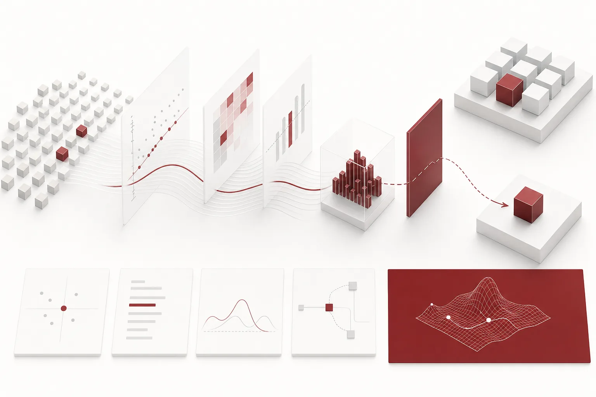
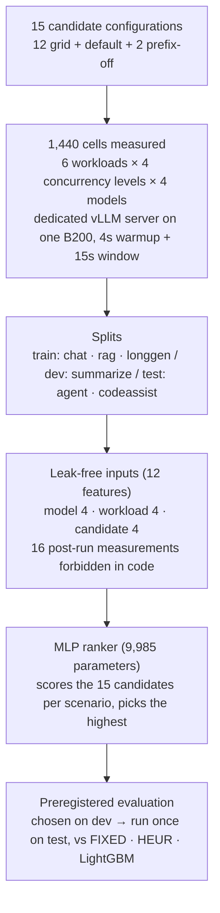

*A visual metaphor for the article's key idea.*

## Summary

[Thaki-MemoryPolicy-vLLM-Ranker](https://huggingface.co/ThakiCloud/Thaki-MemoryPolicy-vLLM-Ranker) is a ranker with about 10,000 parameters. Looking only at the model architecture and the workload specification, it picks one of 15 vLLM serving configurations before any server is started. One recommendation takes about 0.15 ms on CPU.

The result first. **We found no evidence that it beats vLLM's default configuration on unseen workloads.** On the 16 test scenarios, the SLO-violation rate was 0.25 for both the ranker and the default, and the throughput difference was +19.0 tok/s with a 95% CI of −82.8 to +119.9, which includes zero. The latency tail got worse: the 95th percentile of per-scenario p95 TTFT was 10.78 s for the default and 12.99 s for the ranker. All six pre-registered release gates passed, but the gates only required "not worse than the default", so passing them means parity.

There are still reasons to write this up. On the dev split used for model selection, the ranker cut the default's SLO-violation rate from 0.5625 to 0.375 and brought throughput loss against the best configuration down to 0.6%. That gain did not carry over to unseen workloads. We also found that the first version was reading the answer through its inputs, and discarded it entirely. This post is about those two things.

## Why we built it

Starting a vLLM server means choosing `--max-num-seqs`, `--max-num-batched-tokens`, `--gpu-memory-utilization` and whether to enable prefix caching. For the same model, the right values change with prompt length, output length and concurrency. A bad choice lowers throughput or pushes time to first token (TTFT) past the SLO.

Usually a person picks from experience, or starts each candidate and measures it. You can also ask a large LLM. Our question was simple: **does this decision need a large LLM at all? How good a decision can a 10K-parameter ranker trained on measured data make?**

## The setup: 15 configurations, 1,440 measured cells

### The 15 candidate configurations

| Group | Configuration |
|---|---|
| Default | `max-num-seqs` 256, `max-num-batched-tokens` 8192, `gpu-memory-utilization` 0.90, prefix caching on |
| Grid (12) | `max-num-seqs` {32, 128, 512} × `max-num-batched-tokens` {2048, 8192} × `gpu-memory-utilization` {0.45, 0.85}, prefix caching on |
| Prefix off (2) | the default with prefix caching off, and 128/2048/0.85 with prefix caching off |

### Workloads and measurement

| Workload | Prompt → output tokens | Shared-prefix ratio | Split |
|---|---|---|---|
| chat | 512 → 256 | 0 | train |
| rag | 6000 → 128 | 0.7 | train |
| longgen | 256 → 1024 | 0 | train |
| summarize | 12000 → 256 | 0.1 | dev |
| agent | 3000 → 256 | 0.9 | test |
| codeassist | 1500 → 512 | 0.5 | test |

Concurrency took four levels: 4, 16, 64 and 256. The models were Qwen3-0.6B, 1.7B, 4B and 8B. 15 configurations × 6 workloads × 4 concurrency levels × 4 models gives 1,440 cells, with none missing and no duplicates.

Each measurement ran a private vLLM 0.28 server on one B200 inside a Kueue job. The server restarted for every configuration. Requests were driven in a closed loop with a 4-second warmup and a 15-second measurement window. Prompts are random token IDs with a fixed shared prefix, and every request generates its full output budget (`min_tokens = max_tokens`, EOS ignored). No production traffic, user prompts or shared serving endpoints were used.

The SLO was p95 TTFT ≤ 3 s, p95 TPOT ≤ 60 ms, error rate ≤ 1%, and a server that started. A "failure" means the server did not start or no request finished inside the measurement window.

## The first version was looking at the answer

Of the first version's (v1) 17 input features, 9 were measured **after actually running the default configuration** on the same scenario: KV-cache usage, queue length, prefix hit rate, TTFT and TPOT, throughput, and even whether that configuration met the SLO. The design imitated an operator who changes settings after looking at what the current configuration shows.

The problem was that the default is one of the 15 candidates. The ranker was receiving one candidate's run results and its SLO label as input. The outcome of the "default configuration" policy it was compared against sat right in its inputs. Once we saw this, we treated all v1 numbers as invalid. The test v1 used (agent and codeassist on 8B and 0.6B) had already been looked at, so it was never used again.

The rebuilt version uses **only values known before choosing a configuration**.

| Kind | Features |
|---|---|
| Model (4) | weight size (GB), layer count, hidden size, KV bytes per token |
| Workload (4) | prompt length, output budget (`max_new_tokens`), the shared-prefix ratio the workload is designed with, log2(concurrency) |
| Candidate (4) | log2(`max-num-seqs`), log2(`max-num-batched-tokens`), `gpu-memory-utilization`, prefix caching on/off |

Sixteen kinds of post-run measurement (KV, queue, prefix hit rate, TTFT, TPOT, throughput, SLO flag, preemptions, error rate and so on) are hard-coded as forbidden inputs. Measurements are used only for labels and evaluation. The training code runs one more check: all 15 candidates of a scenario must have the same state vector, which means the state cannot depend on any candidate's run. If the check fails, the code exits without training or testing. All 96 scenarios passed.

## The model and the baselines

The ranker is an MLP with a 12 → 128 → 64 → 1 shape and 9,985 parameters. For each scenario it scores the 15 candidates and picks the highest. It is trained with the ListNet loss. A candidate's utility is "throughput ÷ the scenario's best throughput" if it met the SLO and −1 otherwise. Training used temperature 0.1, AdamW, 400 epochs and seed 0, and the training job took 0.29 minutes on CPU. Normalisation statistics come from train only.

There are three baselines.

- **Default (FIXED)**: always the default configuration.
- **Heuristic (HEUR)**: `gpu-memory-utilization` 0.85, `max-num-seqs` set to the grid value closest to concurrency, `max-num-batched-tokens` 8192 if the prompt is at least 2048 tokens and 2048 otherwise, prefix caching on.
- **LightGBM**: a separate SLO-pass classifier and throughput regressor; among candidates with pass probability ≥ 0.5, pick the highest predicted throughput.

We pre-registered that one of MLP and LightGBM would be chosen on dev by (SLO-violation rate, regret), and only the chosen policy would be evaluated once on test. Regret is how far the chosen configuration's throughput falls short of the best throughput among SLO-meeting candidates, as a ratio.

## Dev results: close to the best configuration

Dev is 16 scenarios of the summarize workload (12000 → 256 tokens). It was used for model selection, so it carries selection bias.

| Policy | SLO violation | Failure | Goodput (tok/s) | Regret vs best |
|---|---:|---:|---:|---:|
| Default | 0.5625 | 0.375 | 593 | 0.194 |
| Heuristic | 0.500 | 0.125 | 682 | 0.024 |
| LightGBM | 0.375 | 0.000 | 1,049 | 0.0091 |
| **MLP ranker** | **0.375** | **0.000** | **1,054** | **0.0063** |

Goodput counts throughput only for scenarios that met the SLO and 0 otherwise, then averages. The default failed in 6 of 16 scenarios. The ranker had no failures and its throughput loss against the best configuration averaged about 0.6%. With equal violation rates, the MLP won on regret and was selected.

## Test results: parity with the default

The test is 16 scenarios built from two workloads never used in training (agent, codeassist), on Qwen3-1.7B and 4B at four concurrency levels. It ran once. Both models were also in the training data, so this test measures generalisation to unseen workloads on known models. It is not an evaluation on unseen models.

| Policy | SLO violation | Failure | Mean throughput (tok/s) | Goodput (tok/s) | Throughput ratio (both SLO-ok) | p95 TTFT (95th pct of per-scenario p95) |
|---|---:|---:|---:|---:|---:|---:|
| Default | 0.250 | 0 | 9,483 | 5,343 | 1.000 | 10.78 s |
| Heuristic | 0.250 | 0 | 8,172 | 4,090 | 0.765 | 13.11 s |
| LightGBM (not selected) | 0.1875 | 0 | 8,580 | 5,811 | 0.977 | 10.43 s |
| **MLP ranker** | **0.250** | **0** | **9,502** | **5,369** | **1.005** | **12.99 s** |

The paired comparison with the default used a scenario-level bootstrap (B=2000).

| Metric | Observed Δ | 95% CI |
|---|---:|---|
| SLO-violation rate | 0.0 | [0, 0] |
| Throughput (tok/s) | +19.0 | [−82.8, +119.9] |
| Goodput (tok/s) | +26.0 | [−17.0, +77.7] |

A violation CI of [0, 0] means the two policies violated the SLO in exactly the same scenarios. It is not evidence of fewer violations. The throughput and goodput CIs include zero too. By metric:

- **Throughput**: indistinguishable from the default.
- **Latency**: the TTFT tail got worse (10.78 s → 12.99 s). This was not one of the release gates. p95 TPOT was around 7 ms for both policies.
- **Memory**: `gpu-memory-utilization` is only one of the settings being chosen. Per-policy memory use and KV-cache usage were not aggregated as evaluation metrics, so this post reports no numbers for them.
- **Selection accuracy**: we did not measure how often the best configuration was picked. The closest metric, regret, is reported only for dev, because on test it also counts the throughput of configurations that broke the SLO and can go negative.

On test the heuristic had 1,311 tok/s lower throughput than the default, with a 95% CI of [−2,408, −417] that excludes zero. A plausible hand-written rule was clearly worse than the defaults. LightGBM looked better on violation rate and goodput but was not chosen on dev. Swapping it in after seeing the test would be post-hoc selection, so the released model stays the MLP.

## Why the dev gain did not carry over

We separate what we verified from what we suspect.

Two things are verified. On dev (12000-token prompts), the default failed in 6 of 16 scenarios, meaning the server did not start or no request finished inside the window. On the test workloads the default had zero failures. There was far less room to improve than on dev.

What we suspect: the agent workload in test has a shared-prefix ratio of 0.9, above the highest value seen in train (0.7). That is outside the input range the ranker learned, so its scores may have been less reliable there. We did not test this hypothesis.

## What we learned

1. **Check policy inputs against "is this known before the choice?"** Telemetry added to imitate real operations turned out to be the answer. A forbidden list and a "same state across candidates" check are now enforced in code.
2. **The defaults are a stronger baseline than they look.** On short and mid-length workloads, vLLM's defaults were already close to the best, and the hand-written heuristic was clearly worse.
3. **A "not worse" gate says nothing about improvement.** All six gates passed, some trivially, like the violation CI of [0, 0]. The model card says "parity".
4. **Look at costs the average hides.** Mean throughput was the same, but the TTFT tail got more than 2 seconds worse.
5. **This decision may not need a large LLM.** But what this result shows stops at "10K parameters can choose as well as the defaults". Choosing better than the defaults first needs more varied workloads and measurements on real traffic.

## From ThakiCloud's product perspective

This ranker is not integrated into any ThakiCloud product, and the decision to adopt it as a Metis serving policy is on hold. The following are possibilities, not implemented or measured features.

- **Metis (inference and serving)**: when a serving endpoint is created, the ranker could narrow the candidate settings from the model architecture and expected workload. Using it would first require re-measurement on real traffic and an online comparison.
- **Maxis (training, fine-tuning, downsizing)**: the same data shows how a served model's size and KV layout affect configuration choice. Quantized models were outside this measurement.
- **Paxis (agents and work automation)**: agent workloads have large shared prefixes and bursts of concurrent requests. The agent scenarios in this test imitate that shape, but they are synthetic and cannot be said to represent real agent traffic.

## Limitations

- No evidence of improvement over the default on test. Use it only as a parity starting point, not as a tuner known to improve serving.
- The TTFT tail is worse than the default (12.99 s vs 10.78 s).
- Coverage is one B200, vLLM 0.28, the Qwen3 dense family from 0.6B to 8B, BF16 weights, concurrency 4 to 256, and the 15 configurations above. Other GPUs, engine versions, quantized models, MoE and tensor parallelism are out of range.
- Workloads are synthetic with fixed output lengths and prefix ratios. Real length distributions and request bursts are not modelled.
- The test has only 16 scenarios, so the confidence intervals are wide. The test models were also in training, so unseen models were not evaluated.
- Every candidate was measured on its own fresh server. Changing the configuration of a running server was not tested.

## Closing

Our experiment with a 10K-parameter ranker for vLLM configuration stopped at "it chooses as well as the defaults". The large dev gain did not carry over to unseen workloads, and the latency tail got worse. The weights, input contract and aggregate evaluation results are published together on the [model card](https://huggingface.co/ThakiCloud/Thaki-MemoryPolicy-vLLM-Ranker). We hope it helps other teams avoid leaking the answer into policy inputs and reading a "not worse" gate as a win.

## References

- Model: [ThakiCloud/Thaki-MemoryPolicy-vLLM-Ranker](https://huggingface.co/ThakiCloud/Thaki-MemoryPolicy-vLLM-Ranker) (Apache-2.0, research preview)
- Serving engine: [vLLM](https://github.com/vllm-project/vllm)
- Measured models: [Qwen3](https://huggingface.co/Qwen) 0.6B, 1.7B, 4B and 8B (weights not redistributed)
- Training objective: Cao et al., "Learning to Rank: From Pairwise Approach to Listwise Approach" (ListNet, ICML 2007)
