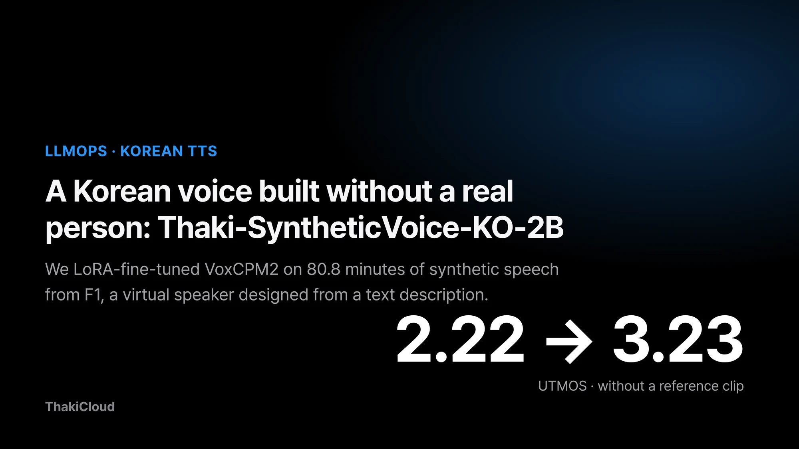
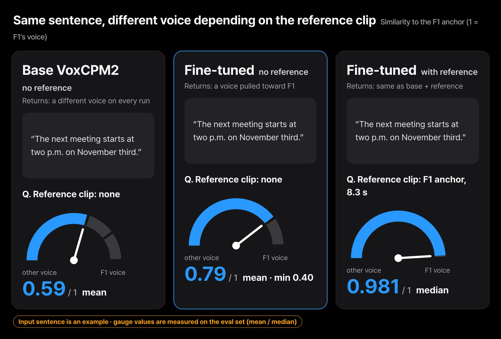
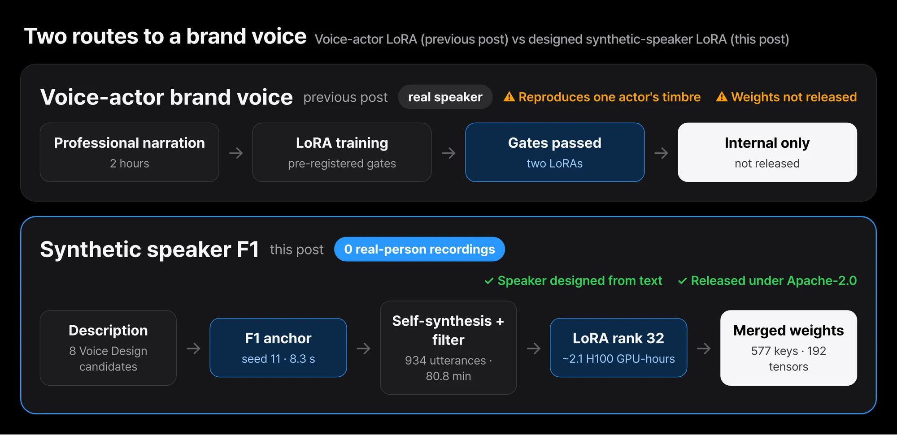
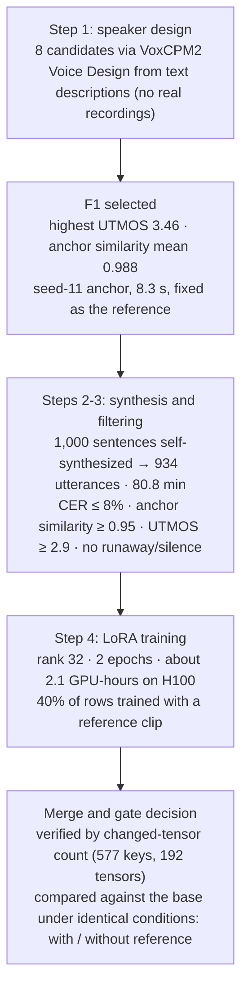
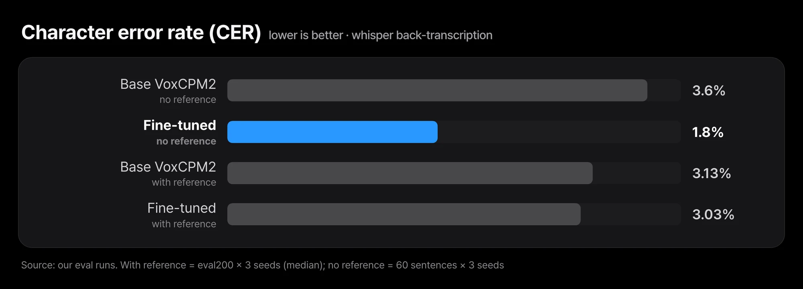
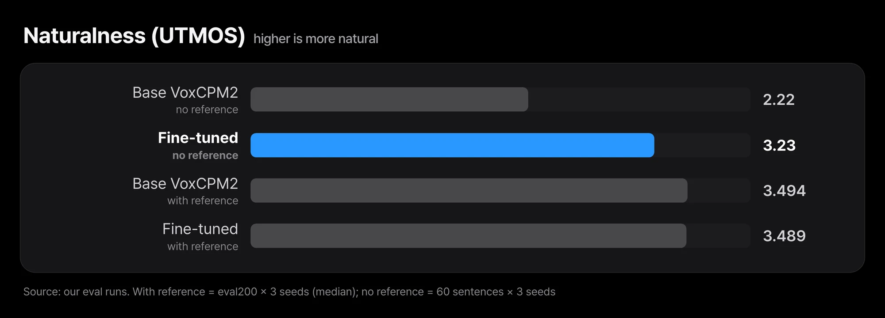
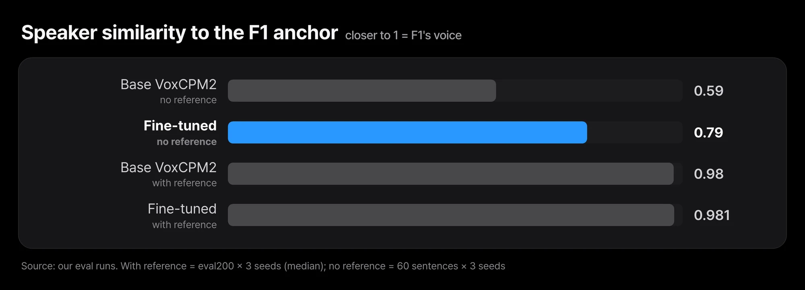

When a company picks a voice for its phone guidance or AI assistant, the usual route is to hire a voice actor and record. A speech model trained on that recording sounds good, but releasing weights that reproduce one specific actor's timbre is hard to justify. You can also pass a reference clip to a public TTS model on every call, yet without one it produces a different voice on every generation.

[Thaki-SyntheticVoice-KO-2B-v0.1](https://huggingface.co/ThakiCloud/Thaki-SyntheticVoice-KO-2B-v0.1) is our attempt to solve this without any real person. It is [VoxCPM2](https://huggingface.co/openbmb/VoxCPM2) (2B, Apache-2.0) LoRA fine-tuned toward one virtual speaker, F1, and merged back into the base weights. LoRA is a fine-tuning method that leaves the base weights untouched and trains only small correction matrices. F1 was created by VoxCPM2 Voice Design from a text description alone ("a calm, low-pitched Korean woman in her thirties, corporate-assistant tone"). No real person's recording was used as a reference at any stage.

Without a reference clip, the UTMOS naturalness score rose from 2.22 to 3.23. This post covers how the results split by condition, how we designed the speaker and filtered the training data, and what we checked before release.

## Same as the base with a reference clip, better only without one

*Without a reference, the base model picks a different voice each time (0.59) while the fine-tuned model is pulled toward F1 (0.79). With a reference clip, both sit around 0.98. The input sentence is an example; the gauge values are eval-set measurements.*

A reference clip here is a short audio file passed along with the text to say "read it in this voice." We use three metrics. Character error rate (CER) re-transcribes the synthesized audio and counts how many characters differ from the script. UTMOS is an automatic scorer trained to imitate human naturalness ratings. Speaker similarity is the cosine between the speaker embeddings of two clips.

- **With a reference clip**: on par with base VoxCPM2 given the same clip. CER 3.13% vs 3.03%, speaker similarity 0.980 vs 0.981, naturalness (UTMOS) 3.494 vs 3.489. No advantage.
- **Without a reference clip**: clearly better than the base. UTMOS 2.22→3.23, CER 3.6%→1.8%, mean speaker similarity to the F1 anchor 0.59→0.79. The minimum is 0.40, though, so some utterances still come out in a different voice.
- The training audio is the base model's own output, so this is self-distillation, meaning a model is retrained on its own outputs. It cannot teach the model a sound the base cannot already make; it can only pull the model toward one voice.
- The whole pipeline took about 2.1 GPU-hours on one H100. Every number comes from synthetic audio and automatic metrics; there was no external listener study.

## We designed the speaker from text instead of recording a voice actor

*The voice-actor LoRA in the previous post passed its gates but reproduced one person's timbre, so we could not release it. This time the same recipe ran on synthetic speech from a speaker designed by text, and the weights are public.*

In our October 23 post, [What We Learned from Failing 7 of 9 Speech Model Fine-Tuning Gates](/tech-blog/en/llmops/speech-finetuning-pre-registered-gates/), we reported that two brand-voice LoRAs trained on two hours of professional voice-actor reading passed our pre-registered gates. One conclusion of that post was that we would not release those weights. Letting third parties download a model that reproduces one specific actor's timbre is a different question from permission to use the data.

That post ended with another route: design a synthetic voice that reproduces no real speaker, then apply the recipe and gates that had already passed. This post records that route, followed all the way to release. The earlier post covered gate design and the voice-actor experiments; this one covers how the speaker was made, how the training data was filtered, and what changed compared with the base model.

## Five stages, each with its own filter

The flow from speaker design to the release decision is below. Every stage had a pass condition fixed before it ran.

### Step 1: eight speakers from text descriptions, one selected

VoxCPM2 Voice Design creates a voice from a description of gender, age range, pitch, tone and pace, without any reference audio. We wrote four female and four male descriptions and synthesized, for each candidate, one fixed anchor sentence of about 8.3 seconds plus ten test sentences. No celebrity, voice actor or character was named in any description.

We compared candidates on three metrics: naturalness by UTMOS, speaker consistency by WavLM speaker-embedding cosine similarity to the anchor, and content accuracy by CER from whisper-large-v3-turbo back-transcription. F1 had the highest UTMOS of the eight (3.46) and the most stable similarity to its anchor (0.988 mean, 0.976 minimum). Its CER of 7.3% was higher than two other candidates (4.6% and 5.6%), but after checking sentence by sentence we chose the voice that fit the intended use, a corporate AI assistant.

The same description gives a different voice under a different seed. So one 8.3-second anchor file made with seed 11 (sha256 `cb73d996…dfbad`) became the fixed reference for every later synthesis and evaluation. It is the same file as `reference/anchor_F1_16k.wav` in the public repository.

### Step 2: a 1,200-sentence script and a held-out evaluation set

We wrote the 1,200 script sentences ourselves from templates, across categories: general, enterprise and tech, numbers/money/dates, alphanumerics and product names, long sentences, customer-service dialogue, and hard pronunciation. Each sentence has a display form and a spoken form. Train, validation and evaluation splits were cut by template, so no template appears in two splits. The 200-sentence evaluation set (eval200) was used only after passing a leakage check against the training split. No external data and no LLM-generated sentences were used.

### Step 3: synthesize and filter, after fixing the scorer first

Base VoxCPM2 with the F1 anchor as reference synthesized the 1,000 training-split sentences (cfg 2.0, 10 steps). An utterance entered training only if it passed all four filters: whisper back-transcription CER at most 8%, speaker similarity to the anchor at least 0.95, UTMOS at least 2.9, and no runaway or silence.

A 206-sentence pilot came first, and 22 of its 30 rejections were not TTS errors. Whisper had written spoken Korean dates as Arabic numerals and transliterated "Metis" differently, which raised the CER. The audio read the text correctly; the scorer counted spelling differences as errors.

After adding a numeral-aware CER, which expands Arabic numerals in the transcript using Korean reading rules and drops paired Latin tokens from the comparison, acceptance rose to 90% (185/206). The remaining rejections were real transliteration and unit-reading differences plus one or two actual speech errors. Cutoffs were set with a margin below the pilot's 10th percentile (speaker similarity 0.975, UTMOS 3.13), so that only utterances far outside the distribution were removed.

The full run targeted 120 minutes but stopped at 934 utterances, 80.8 minutes, when the 1,000-sentence pool was used up. Of the 66 rejections, 64 were for CER, and alphanumeric sentences had the most rejections (38 of 125). We did not lower the bar to reach the target length. The data was split into 888 training and 46 validation utterances.

### Step 4: LoRA training and merging

We kept the recipe that had passed with voice-actor data: rank 32, alpha 32, learning rate 1e-4, batch 4 × gradient accumulation 4, 2 epochs (112 steps). 40% of training rows carried a same-speaker reference clip; the rest were trained without one. Validation loss fell from 0.689 to 0.586.

We did not read that drop as improvement. Because the training audio is VoxCPM2's own output, a falling loss mostly means the model re-fit its own distribution. The release decision rested only on the comparison with the base model in the next sections.

The trained LoRA was merged into the base weights (`W += B·A·α/r`, 192 modules) and released as one checkpoint. The merge had a small incident. Key names in the training checkpoint carried prefixes such as `_orig_mod.` added by `torch.compile`, so on the first attempt only 342 of 577 keys matched. Our merge script checks that the number of tensors whose values changed equals the number of LoRA modules, so this half-merged checkpoint was caught before release. The second attempt failed the same way, and the third recovered the encoder keys but still missed 123 DiT keys. The fourth attempt normalized the prefixes: 577/577 keys matched and exactly 192 tensors changed.

That check is what kept the half-merged checkpoint from being published. One listening sample made from the half-merged weights did read different words than the input, and the effect did not reproduce with the correct merge. Verifying the merge by the count of changed tensors, not by "it loaded", was the most useful check in this project.

## With a reference: non-inferior to the base, no advantage

Evaluation used the 200 held-out eval200 sentences, three times with seeds 0, 1 and 2. Both arms received the same F1 anchor as reference and used the same H100, bf16, decoding settings (cfg 2.0, 10 steps) and scorer. Values are medians over the three seeds. Quality metrics (T1 to T4) were measured on the LoRA before merging; the merged checkpoint was checked separately for real-time factor (T5) and in pre-release smoke tests.

| Metric | Base VoxCPM2 + ref | Fine-tuned + ref | Gate |
|---|---|---|---|
| CER (T1) | 3.13% | 3.03% | ≤ base → pass |
| Speaker similarity (T2) | 0.980 | 0.981 | ≥ base → pass on 2 of 3 seeds |
| UTMOS (T3) | 3.494 | 3.489 | ≥ base −1% → pass |
| Runaway / silent (T4) | 0 / 0 | 0 / 0 | pass |
| Real-time factor, merged (T5, 60 sentences) | 0.1348 | 0.1465 | ≤ base ×1.1 → pass |

*Without a reference, CER halved from 3.6% to 1.8%. With a reference, 3.13% vs 3.03% is no real difference.*

The verdict is non-inferior. A user who already passes a reference clip gets the same quality from base VoxCPM2. The 0.0002 difference in speaker similarity is smaller than the measurement noise we saw in the earlier post, so we do not read it as an advantage. Measured on the unmerged LoRA object, the real-time factor was 0.176, 22% slower; with the merged weights loaded into a plain model object it was 1.087× the base, inside the gate. The cause is the same one we had already found with the voice-actor LoRAs.

## Without a reference: better pronunciation and naturalness, partial speaker locking

Without a reference the picture changed. We generated 60 category-balanced sentences with three seeds and compared the base and fine-tuned models, both without a reference. This comparison also used the LoRA before merging.

| Metric | Base VoxCPM2, no ref | Fine-tuned, no ref |
|---|---|---|
| CER | 3.6% | 1.8% |
| UTMOS | 2.22 | 3.23 |
| Similarity to F1 anchor, mean | 0.59 | 0.79 |
| Similarity to F1 anchor, minimum | 0.21 | 0.40 |
| Speaker similarity across utterances | 0.65 | 0.74 |
| Same sentence, different seed | 0.70 | 0.81 |

*Without a reference, UTMOS rose from 2.22 to 3.23. With a reference, base and fine-tuned score 3.494 vs 3.489, effectively the same.*

*Without a reference, speaker locking improved from 0.59 to 0.79 but stays short of the 0.98 you get with a reference.*

Without a reference the base model picks a different voice on every generation. The fine-tuned model is pulled strongly toward F1, and its pronunciation and naturalness improved. Still, with a reference the anchor similarity is 0.98, so 0.79 is some distance away, and a minimum of 0.40 means some utterances clearly sound like a different voice. In the anonymous-download smoke test after release, anchor similarity for five fixed no-reference sentences was spread across 0.95, 0.55, 0.55, 0.71 and 0.91. Reference-free speaker locking was achieved only in part.

## Five conditions we checked before release

We set five release conditions in advance and confirmed all of them before going public.

- **Listening to 30 number and English items**: automatic screening put 29 of 30 at or below 8% CER; the one above was whisper transliterating "ThakiCloud" into Korean, a spelling difference. An internal reviewer listened to all 30 and passed all 30. This was not an external listener study.
- **Merged-checkpoint smoke test**: while still private, the merged checkpoint showed a median CER of 0.0 and anchor similarity of 0.986 with the reference.
- **Anonymous-download smoke test**: after the switch to public, we downloaded the repository without a token and confirmed it loads and plays (median CER 0.0 and speaker similarity 0.985 with the reference).
- **Limitations in the card**: "on par with base when given a reference; not fully locked without one" is stated on the first screen and in the limitations section of both the English and Korean cards.
- **Rights review**: summarized in the next section.

After release we added one thing to the card. The model reads numbers correctly only when they are written in Korean words. To ease that constraint we published preprocessing code (`text_normalization/`) that expands version strings such as "v1.5.5" into their spoken form. It changes 34 of the 1,200 script sentences, and the weights did not change (`model.safetensors` sha256 `3272b74c…f389`). A v0.2 that would solve this by retraining fell short of its pre-registered threshold (a CER gap of at least 2.0 percentage points between display and spoken forms; measured 0.47) and was not trained.

## Rights: facts and open questions, written separately

The facts about the process: the speaker is virtual, created from a description, and no real person's recording was used as a reference. No AI Hub data and no voice-actor recordings were used, and the script comes from our own templates. Base VoxCPM2 is Apache-2.0; the merged weights are released under Apache-2.0 with LICENSE and NOTICE files. The 934 training utterances are not released; only the 8.3-second synthetic reference clip needed for reproduction is included.

On the rights to generated audio, the VoxCPM maintainers stated in issues [#407](https://github.com/OpenBMB/VoxCPM/issues/407) and [#409](https://github.com/OpenBMB/VoxCPM/issues/409) on October 12, 2026 that Voice Design output may be saved, reused, published and used commercially, subject to applicable law and third-party rights, and that this is not legal advice. Their replies do not mention training on generated audio, which is how this model was made. That point stays an open question in our ledger and the card. Neither the card nor this post says "it is synthetic, so there is no rights issue." A clean process and the absence of legal risk are different claims.

## Four lessons from this work

- **When a model already clones well from a reference, the value of a single-speaker LoRA is in reference-free use.** With a reference, the base already reached speaker similarity 0.98 and the LoRA had nothing to add. This is the same structure we saw with the 30-minute voice-actor LoRA in the earlier post.
- **A self-distillation loss curve is not evidence.** We decided only from paired comparisons with the base under identical conditions.
- **Check the scorer before building filters.** More than two-thirds of the pilot rejections were the scorer's numeral spelling. Left alone, number sentences would have been systematically dropped from the training data.
- **Verify a merge by the count of changed tensors.** A successful load did not catch the half merge.

## Paxis voice runtime uses the anchor clip, not the weights

Training and evaluation ran as single-H100 jobs on our internal GPU queue, and checkpoints and measurement ledgers stay in internal storage. The flow of speaker design → filtering → LoRA → merge → gate verdict has the same shape as the training and fine-tuning path Maxis covers, and the measurement that merged weights serve at base speed is a fact the Metis serving side can use. The model itself has not been integrated into Maxis or Metis as a feature.

What the product side actually used is the F1 anchor clip, not the weights. In an October 27 serving smoke test, the internal speech runtime for Paxis voice agents used the F1 anchor as the reference clip for its default voice, with base VoxCPM2 rather than the fine-tuned weights. That choice fits this measurement: with a reference, base and fine-tuned are equivalent. That path is also still in internal validation and has not shipped to customers.

## Six things to know before you use it

- All evaluation used Korean, clean synthetic conditions, one female speaker, and no emotion or speed control.
- CER is based on whisper back-transcription, and UTMOS22 is not calibrated for Korean. There was no external listener study. Results on synthetic data are not evidence that the model generalizes to real service conditions.
- Speaker locking without a reference is partial (minimum anchor similarity 0.40).
- Numbers must be written in Korean words; the preprocessing code handles version strings only.
- Real-time factors were measured on an H100.
- Whether training on generated audio is permitted remains an open rights question.

## Closing thoughts

This model is not a better TTS than base VoxCPM2. With a reference clip it is the same; without one, it stays closer to one voice and sounds more natural. What we confirmed is that there is a procedure for building a releasable brand voice without any real person, and the task that procedure leaves open is speaker locking without a reference.

The first experiment you can run today is simple. Take `reference/anchor_F1_16k.wav` from the repository and listen to a few sentences with and without it as the reference. For sentences with numbers, write them out in Korean words or run the `text_normalization/` preprocessing first.

## References

- Model: [ThakiCloud/Thaki-SyntheticVoice-KO-2B-v0.1](https://huggingface.co/ThakiCloud/Thaki-SyntheticVoice-KO-2B-v0.1)
- Base model: [openbmb/VoxCPM2](https://huggingface.co/openbmb/VoxCPM2)
- Earlier post: [What We Learned from Failing 7 of 9 Speech Model Fine-Tuning Gates](/tech-blog/en/llmops/speech-finetuning-pre-registered-gates/)
- VoxCPM maintainers on generated-audio rights: [OpenBMB/VoxCPM #407](https://github.com/OpenBMB/VoxCPM/issues/407), [#409](https://github.com/OpenBMB/VoxCPM/issues/409)
- UTMOS: [arXiv:2204.02152](https://arxiv.org/abs/2204.02152)
