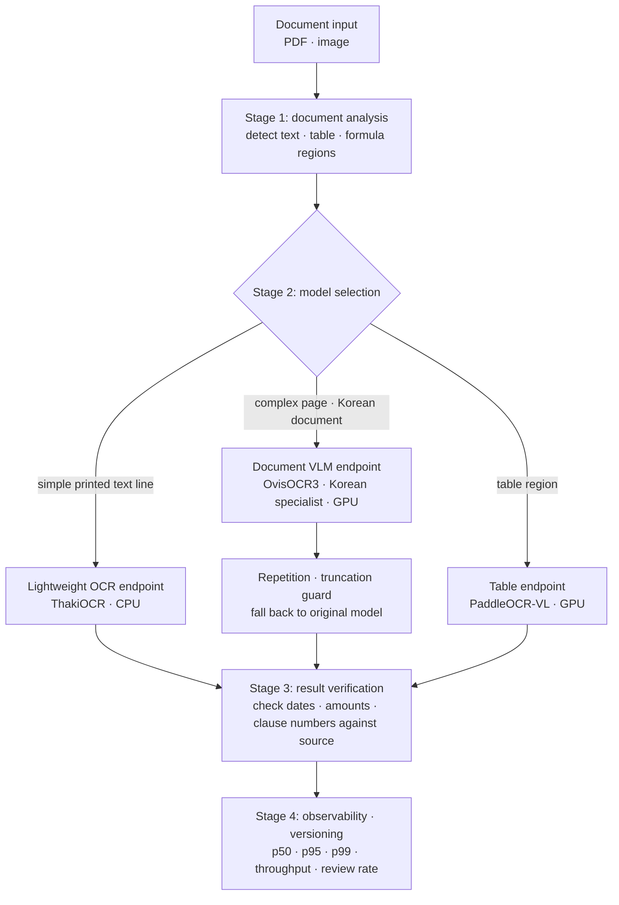

Business documents come in every shape. Some regions are a single printed line, some pages are multi-column contracts, and some reports mix tables and formulas. If every region goes through the same large vision-language model (VLM), the easy regions cost about as much to process as the hard ones.

This post is for engineers who run document AI. Using measurements from ThakiCloud's work on both lightweight OCR models and document VLMs, we propose a tiered design that serves the two kinds of model separately on Metis. The Metis layout described here is a proposed architecture, not a configuration already running in production.

## In plain terms

Think of a hospital's front desk and its specialists. Simple paperwork is settled at the desk, and only complex cases go to a specialist. Send every patient to a specialist and the queue grows and the bill goes up.

The catch is that the desk can misread a form. So you need rules that decide who handles which form, and a step that checks the result again.

## Reading one text line with 2.13M parameters

ThakiOCR A is a 2.13M-parameter, CTC-based line recognizer. Reading one line image resized to 512 pixels wide took a median 5.61 ms on 4 threads of a data-center server CPU. Its successor G2M, with 8.93M parameters, took a median 13.3 ms per line under the same setup.

These are not per-page times for a PDF. A line model only reads crops that an upstream stage has already located and cut out. A real service's latency includes page rendering, region detection, recognition, table reconstruction and verification. We have not yet measured laptop or phone CPUs.

## Sending complex pages to specialist models

In the ThakiDocTrust research we split roles across a general document VLM (OvisOCR3), a version of it fine-tuned on Korean documents, and PaddleOCR-VL, which is strong on tables.

On a Korean document evaluation set built from series not used in training (304 pages, 8 series), routing Korean pages to the specialist model raised word micro F1 from 0.750 to 0.842 and lowered character error rate from 0.145 to 0.086. The router found Korean pages with 0.967 recall, and GPU cost was 1.82 times that of the original path.

On its own, the specialist model still sometimes repeated the same sentence or stopped mid-output. We added a guard that falls back to the original model's output when it detects repetition or truncation, and made serving without that guard a hard condition. This path is also judged NO_RELEASE.

We also tried routing between two lightweight models. A rule that picks one of them from 11 image statistics cut real-document error sharply, but digit accuracy on Korean synthetic data dropped 1.23 percentage points, beyond the limit we had set in advance, so it was judged NO_GO. A better average does not get adopted if a critical item such as digits gets worse.

## Why a fast model may not suit financial documents

We ran the same diagnosis on an external model, Xiaomi-OCR-0. At 0.8B parameters it was fast, about 9 pages per second on one B200.

But on synthetic financial documents containing the won sign ₩, it kept the original sign in none of 108 cases. It turned the sign into W, into the yen sign ￥, or into an unrelated Chinese character. On the same set the original OvisOCR3 kept all 108. In some documents it also produced numbers that were not in the source.

So we ruled that this model is not used on documents containing ₩ and is not part of Korean routing. Throughput and whether a result can be trusted for business use are different questions.

## A proposed serving layout on Metis

Metis is ThakiCloud's serving platform for deploying trained models and managing inference endpoints. If the ThakiOCR family and document VLMs ran together on Metis, a four-stage structure like this one is a reasonable starting point.

Stage 1 is document analysis: find the text, table and formula regions in a PDF or image. Headers and page numbers are not silently dropped; every source region is kept. The Xiaomi-OCR-0 diagnosis showed that using only the assembled layout as the text path can lose number regions, so the raw OCR text and the assembled document representation are kept as separate outputs.

Stage 2 is model selection. Simple printed lines go to a lightweight ThakiOCR endpoint on CPU, complex Korean pages to a document VLM endpoint on GPU, and table regions to PaddleOCR-VL. How a CPU model and a GPU VLM are actually packaged into one service has to be validated separately for each deployment.

Stage 3 is verification. Keep the OCR source text apart from the presentation text, and check that critical strings such as dates, amounts and clause numbers were not dropped or changed. The [Paxis verification workflow post](/tech-blog/en/agentops/thakiocr-paxis-verify-before-commit/) covers this stage in detail.

Stage 4 is observability and versioning. Record p50, p95 and p99 latency, throughput, GPU use and the human review rate for each model. If recognition accuracy goes up but more documents need human review, the product has not really become more efficient.

## Swapping models goes through comparisons and gates

ThakiOCR A, G2M and A2 show improvement within one family by changing data and training. When a new model goes into a service, it should be compared with the current model on the same documents and replace it only when it clears criteria set in advance.

A model that misses the bar can still keep improving as a research model. Conversely, a model with better averages that fabricates critical financial characters is not deployed on that business path. Every NO_GO and NO_RELEASE call in this research came from that rule.

## Summary

The point of Metis is not to spin up one more OCR model. It is to run models with different strengths as verifiable inference services and to make it observable which model handled which document, and what that choice cost in money and quality.

You should be able to use a different model per document and measure the cost and quality of that choice. Tiered document AI starts from those two conditions. How the lightweight models were trained is covered in the [Maxis training post](/tech-blog/en/research/thakiocr-maxis-same-size-fewer-errors/).

## References

- Public models: [ThakiOCR-KOEN-V1-Dense (A)](https://huggingface.co/ThakiCloud/ThakiOCR-KOEN-V1-Dense), [ThakiOCR-KOEN-G2M-Preview](https://huggingface.co/ThakiCloud/ThakiOCR-KOEN-G2M-Preview)
- The tiered Metis layout in this post is a proposed architecture. We ran per-model inference and some multi-model service checks, but promotion of the financial document path to production has not been approved.
- Our notes from installing an external OCR model ourselves are in the [PaddleOCR-VL post](/tech-blog/en/research/paddleocr-vl-09b-multilingual-document-parsing/).
