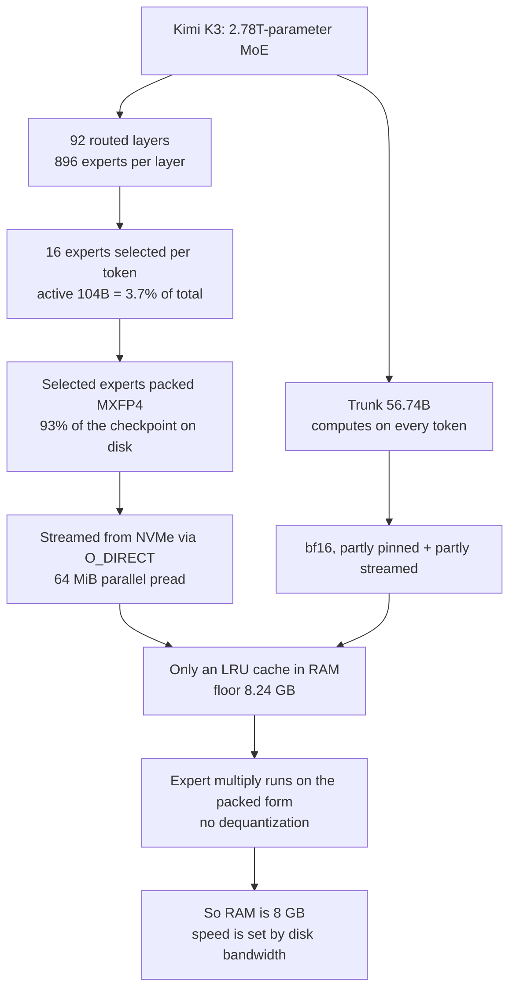
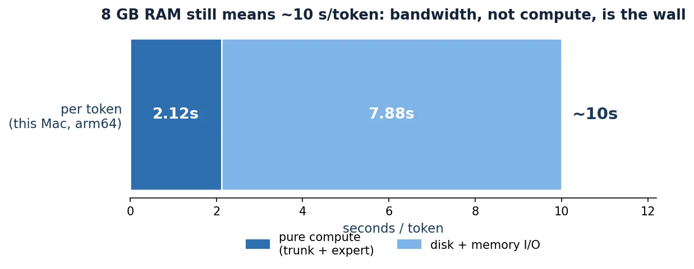

*An abstraction of a huge model reaching a small amount of RAM by streaming only the part it needs through a narrow passage.*

## Why read this

You are an engineer who owns LLM serving cost. A team that cannot easily source dozens of GPUs for an on-prem or sovereign deployment is also the audience. Here is the bottom line first. Kimi K3 (a 2.78-trillion-parameter MoE) **does run** on a single CPU core with no GPU. But at 8 GB of RAM it is about 27 seconds per token, so it is not interactive serving. And the real bottleneck is **storage bandwidth**, not RAM. This post confirms that with numbers, not a viral tweet: we actually built the C99 engine and ran its weightless tests and kernel benchmark. Read to the end and you will have an answer to "why does speed not drop when RAM drops," and you will see what the technique means for serving economics the way ThakiCloud looks at them.

## Overview

The phrase "2.78 trillion parameters on 8 GB of RAM" sounds like a trick at first. But there is a structure behind it. Kimi K3 is a mixture-of-experts (MoE) model. Of the 2.78 trillion total parameters, only 104 billion (about 3.7%) are active per token. The other 93% are experts that a given token does not use. This engine keeps the unused experts on disk and reads them only when needed. That is what pulls RAM down to 8.24 GB.

The project is [kimi-k3-in-c](https://github.com/FareedKhan-dev/kimi-k3-in-c). It is a public repository, Apache-2.0, written in C99, and it had passed 9,600 stars when this post was written. The engine binary is 176 KB. The checkpoint (model weights) is 1.56 TB, split into 96 shards. "The engine is small but the weights are huge" is the core of this project. The "8 GB" in the viral line comes from how the weights are handled, not from the engine.

The reason this matters from ThakiCloud's view is one thing. If you can run a frontier-class model on a commodity CPU with no GPU, the cost structure of serving changes. This post tests, by reproduction, whether that claim is true, and if so, how far it holds. We label the numbers we measured on our own Mac as "measured" and the numbers the README author reported as "author-measured."

## What the technique is

There are three mechanisms: MoE expert selection, MXFP4 packing, and NVMe streaming.

First, the MoE structure. Kimi K3 has 93 layers, 92 of which are routed layers. Each routed layer holds 896 experts, and when a token arrives it selects 16 (including 2 shared experts) and computes only those. So the active parameters are just 3.7% of the whole. 92 layers times 896 experts is 82,432 routed experts on disk, and what is actually read per token is a subset of that.

Second, MXFP4 packing. The selected expert weights are packed to 4 bits. Precisely, a 4-bit nibble with one 8-bit scale every 32 elements. These packed experts take up 93% of the checkpoint on disk. The important point is that the experts are **never dequantized**. The multiply is performed directly on the packed 4-bit form. Dequantizing to bf16 would balloon RAM eight-fold, so the design pays that cost in disk bandwidth instead.

Third, NVMe streaming. When processing a token, the 16 needed experts are read from disk with O_DIRECT (bypassing the page cache) in parallel pread chunks of 64 MiB. The read experts are kept in an LRU cache in RAM, in part; the rest are sent back to disk. The trunk (the 56.74B that computes on every token) is held in bf16, partly pinned and partly streamed from the packed trunk file.



In plain terms, imagine a library holding 1.5 million books (2.78 trillion parameters). When a question comes in, it pulls only 16 books (the 3.7% that are active) and reads them, keeping the rest in the warehouse (disk) and fetching them on demand. A small reading desk (8 GB of RAM) is enough because only 16 books are read at a time. The speed of turning pages from the warehouse (bandwidth) is what the answer depends on.

## Install and integration

The engine compiles and its weightless tests run without a checkpoint. The commands and results below are what we actually ran in an isolated sandbox while writing this post. The machine is Apple Silicon (macOS, arm64), the compiler is Apple clang, and OpenMP comes from Homebrew libomp.

Clone the repository.

```bash
git clone --depth 1 https://github.com/FareedKhan-dev/kimi-k3-in-c.git
```

Build it and run the weightless tests. `make test` builds the CLI and test binaries, then runs the checks that need no checkpoint (ops, cache, streaming, oracle).

```bash
make test
```

Check the version of the built binary.

```bash
./bin/k3 --version
# k3 1.1.0
```

Run the kernel benchmark. `make bench` measures only the kernels at real Kimi K3 dimensions. It does not read the weights; it measures compute performance only.

```bash
make bench
```

To run it you need AVX2 + FMA on x86-64 and NEON on arm64. AVX-512 is not required. The toolchain is GCC 9 or newer, or Clang 10 or newer, plus libm and OpenMP. To actually run the full model you need about 1.7 TB of storage (the 1.56 TB checkpoint plus the packed trunk).

## Hands-on results

We confirmed four things on this Mac. Every value is captured from `run-N.log`.

First, the build succeeded. The return code of `make test` was 0, and 18 binaries were produced (the main `k3` at 312,752 bytes, and 17 test binaries). The size differs from the 179,736-byte Linux binary in the README because of the platform and architecture (arm64 + NEON).

Second, the weightless tests all passed. Cache ring, trunk streaming (O_DIRECT, page-cache bypass, 64 MiB parallel pread), and the truncated / bad-manifest rejection cases all PASS.

Third, the full-model oracle gate passed. The point to read carefully is that this oracle uses a **small synthetic fixture** (hidden 128, 13 layers, vocab 256, 4 MLA + 9 KDA, 8 experts top2 shared2), not the real 2.78-trillion weights. So this test checks whether the engine matches a reference implementation bit-exactly. Result: GATE 1 (teacher forcing) 32/32, GATE 2 (greedy decode) 20/20, GATE 3 (incremental, KV cache + KDA state) 20/20 all matched, and the verdict was "ENGINE MATCHES THE REFERENCE EXACTLY." We did not measure the real model's speed here.

Fourth, the kernel benchmark gave us measured numbers.

```
kernel benchmark at REAL Kimi K3 dimensions
built WITH NEON
bf16 matmul  12288 x 7168      1.36 ms     129.9 GFLOP/s
             trunk is 56.74 G params/token -> 0.87 s/token at this rate
MXFP4 matmul 3072 x 3584       0.28 ms      77.8 GFLOP/s
             16 experts x 3 mats x 92 layers -> 1.25 s/token
measured compute budget at the floor is about 10 s/token
```

This number is the heart of the post. Pure compute is the trunk 0.87s plus the experts 1.25s, under 2 seconds combined. But at the floor (8 GB of RAM, mostly disk streaming) it is actually about 10 seconds per token. Compute is barely 20% of the whole; the other 80% goes to the bandwidth of reading weights from disk.


*Per-token time breakdown measured on this Mac (arm64, NEON). Pure compute (trunk 0.87s + expert 1.25s) is only 2.12s, while the measured floor (8 GB RAM) is about 10s. The gap is weight-streaming bandwidth.*

The README author's reported measured speeds (the author's environment, not our Mac) are worth including too. Raising RAM lets you keep more experts resident and reduces the bandwidth burden, so speed goes up.

| RAM | latency per token (author-measured) |
|---|---|
| 8 GB | 26.5 s |
| 32 GB | 24.2 s |
| 64 GB | 19.8 s |
| 128 GB+ | 5.6 s |

Memory going from 8 GB to 128 GB, sixteen times, reduces latency only from 26.5s to 5.6s, about 4.7 times. That is evidence bandwidth, not RAM, dominates. The README's memory ladder points the same way. Left in bf16 it is 5,560 GB; the shipped checkpoint alone is 1,560 GB; the always-active trunk resident is 113.49 GB; and the measured floor is 8.24 GB. A 675x reduction versus bf16.

## ThakiCloud product implications

ThakiCloud's Metis (our K8s-based AI/ML serving platform) serves models across many customer environments. There are three reasons this technique matters to Metis serving economics and to on-prem and sovereign deployments.

First, on-prem and sovereign environments with a GPU constraint. Serving a frontier-class model normally needs dozens of GPUs. But if you use an approach like this engine's, "compute only the active parameters and keep the rest on disk," a path opens for handling certain workloads with no GPU at all. If it is a batch or async job that does not need low-latency interactive dialogue, that is. For a customer building sovereign AI but constrained on GPU supply, this is one experimental yet real option.

Second, redefining the serving bottleneck. This reproduction shows "reducing RAM does not reduce speed." If the bottleneck is I/O (bandwidth) rather than compute, the investment target changes too. Not bigger RAM, but faster NVMe, larger parallel reads, and smarter expert placement. This is where Metis serving-economics analysis should ask "how much bandwidth" rather than "how many GPUs."

Third, MXFP4 and packed-form multiply are a reference point for the quantization direction. Multiplying directly on the packed form without dequantizing is a standard approach for 4-bit serving. When Metis designs low-bit serving, "how do you structure the smallest active set to move between disk and RAM" is the essence of this technique.

One line through the Paxis (Agent-Native Cloud) lens. If an agent, per turn, runs many model calls in parallel rather than one big model call, then 10 seconds per call across dozens concurrent calls can put total throughput back into a practical range. This is where the technique slots into a "many in parallel" strategy rather than "one fast."

## Limitations and counterpoints

The biggest limitation is speed. Ten-plus seconds per token is not interactive. "2.78 trillion on 8 GB" is a proof of feasibility, not a production serving proposal. Even the author-measured 5.6 s/token at 128 GB is 4.7 minutes per 50 tokens.

Second, storage cannot be avoided. A 1.56 TB checkpoint, about 1.7 TB combined. Without that premise you cannot start. "8 GB of RAM" is a pair with "1.7 TB of disk."

Third, this reproduction did not measure the real model's speed. The oracle test used a synthetic fixture to check engine correctness only, and the kernel benchmark measured compute only. We could not measure the end-to-end speed of actually reading the 2.78-trillion weights in our environment (it needs 1.7 TB of storage plus NVMe). That is why the speed table cites the README author's measured values.

Fourth, 4-bit MXFP4 can carry a quality loss versus bf16. This engine focuses on "does it run on 8 GB," not on whether that loss is acceptable. Quality validation is outside the scope of this post.

## Summary

What this post confirms is one sentence. **Running 2.78 trillion parameters in 8 GB of RAM is possible, and the bottleneck is storage bandwidth, not RAM.**

Here is the next action we recommend. If you must process a frontier-class model on-prem or sovereign with no GPU, validate this approach starting from batch and async workloads, not interactive ones. The investment priority is faster NVMe and larger parallel reads. And ask "how do we shrink the active-parameter ratio and move the rest between disk and RAM" rather than "how small can we fit the RAM." This C99 engine is a real, built, and verified answer to that question.
