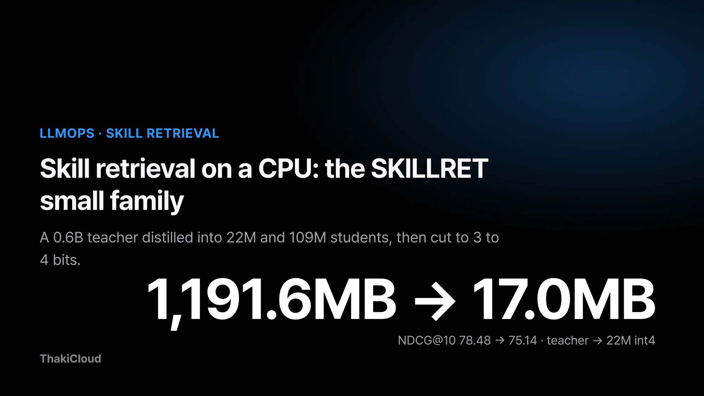
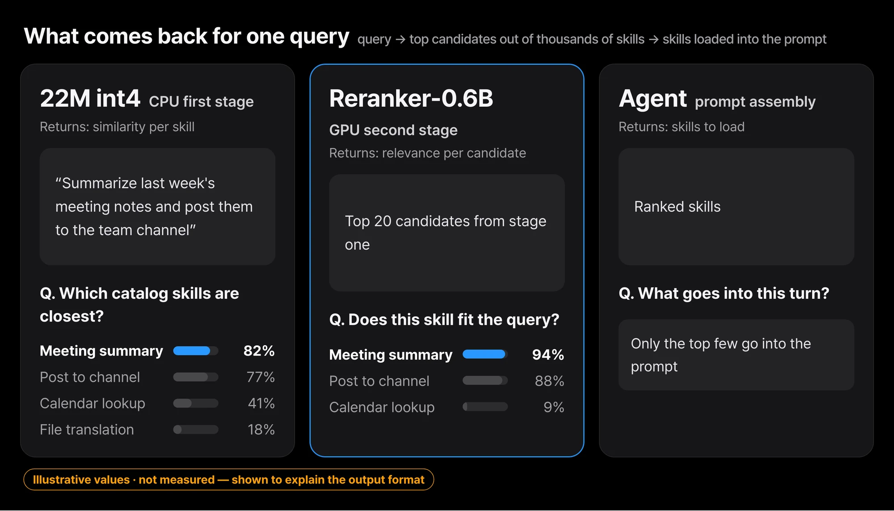
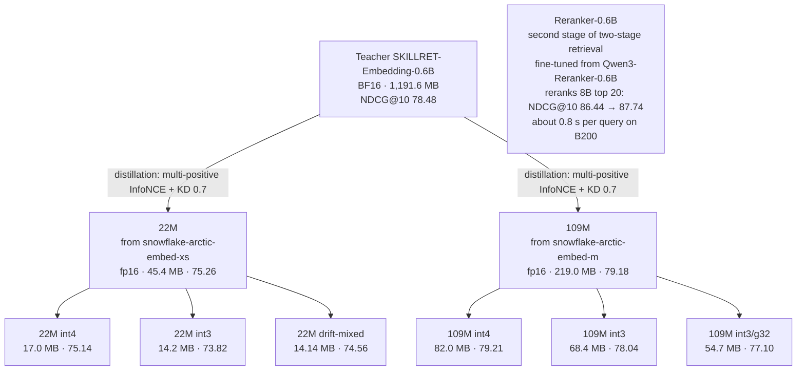
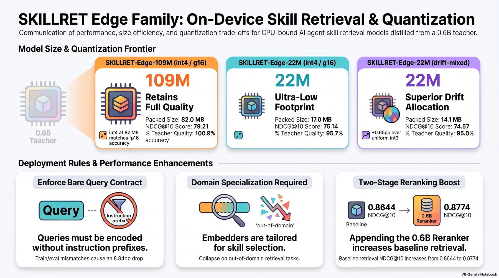
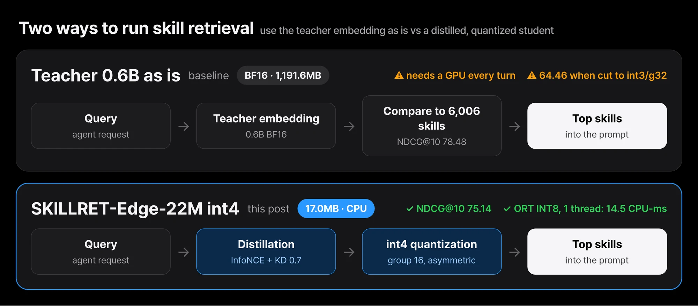
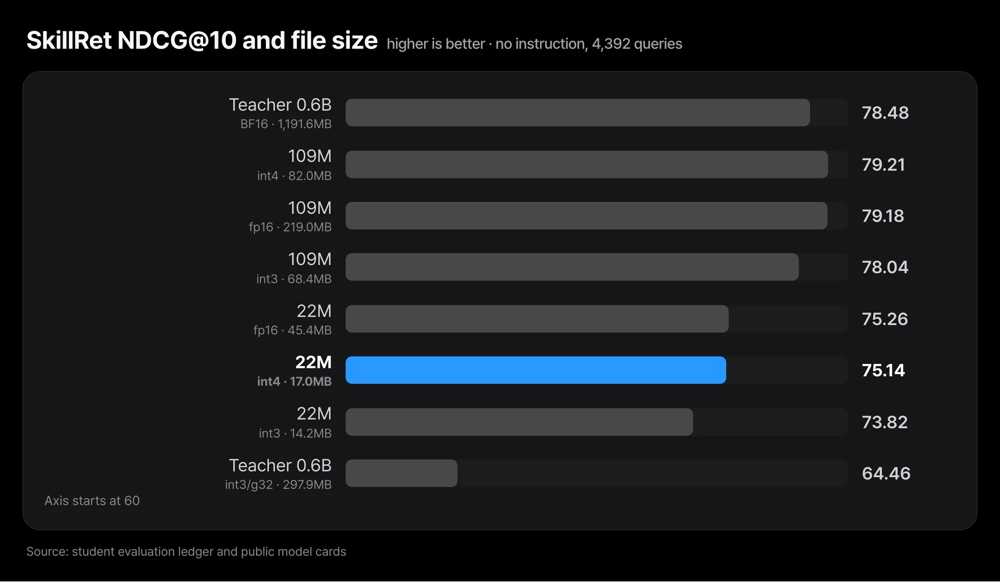
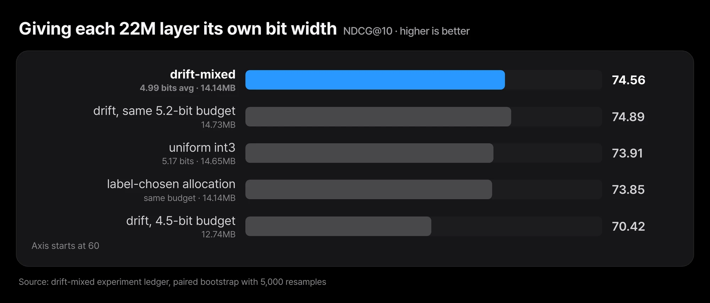
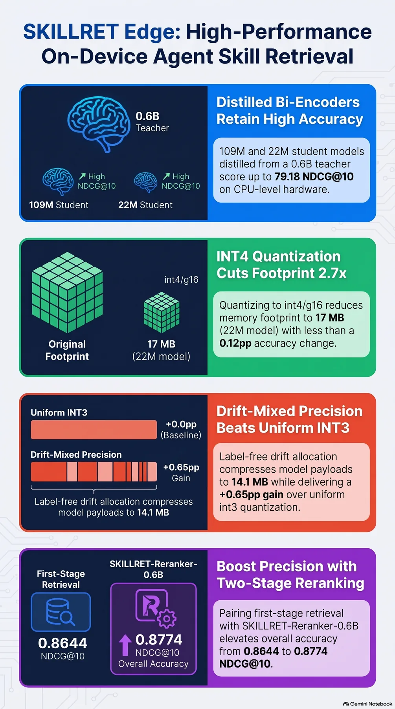

*From the 0.6B teacher (BF16, 1,191.6 MB, NDCG@10 78.48) down to 22M int4 (17.0 MB, 75.14)*

Once an agent has thousands of skills attached, every turn starts with a choice: which of them go into the prompt. We built the [SkillRet benchmark](/tech-blog/en/research/skillret-skill-retrieval-benchmark-thakicloud/) to measure that step and released 0.6B and 8B embedding models for it.

Even the 0.6B model is 1,191.6 MB in BF16. Skill retrieval runs once per turn in front of everything else, so dedicating a GPU to it is hard to justify. The question became: how small can the model get, while keeping most of the teacher's retrieval quality, so that it runs on a single CPU core?

This post covers the nine models that came out of that work: 22M and 109M students, their int4 and int3 variants, drift-mixed (which gives different layers different bit widths), and Reranker-0.6B for two-stage retrieval. The 305M model and its INT8 failure are covered in the [preregistered gates post](/tech-blog/en/owm/preregistered-gates-three-models-open/), so we do not repeat them here. Distillation trains a small model (the student) to imitate a large one (the teacher); quantization stores weights in fewer bits to shrink the file and memory.

## Nine models branched off one teacher

The job itself is simple. The model takes an agent's request and returns a ranking of nearby skills from the catalog. Quality is measured with NDCG@10, a 0 to 100 score for how high the correct skills land within the top 10.

*A request goes in; scores and a ranking per skill come out. The query, skill names and scores are invented examples that show the format*

The family of nine looks like this. Each node carries its released packed-file size and NDCG@10.

<!-- nlm-visual -->

*Infographic generated by NotebookLM from the sources.*

## The numbers come from three conditions that must not be mixed

The numbers in this post come from three different setups, and they must not be compared across setups.

The first is the student evaluation. It uses the SkillRet test split (4,392 queries, 6,006 skills, dataset revision `a050ad2`) with no instruction prefix on queries, CLS pooling, L2 normalization, a 256-token limit and FP32 arithmetic. The metric is NDCG@10 with a per-query standard error of 0.42 to 0.46. The teacher (SKILLRET-Embedding-0.6B) scores 78.48 under this setup.

The second is the reranker evaluation. A reranker is a second-stage model that rereads only the few dozen candidates from the first stage, together with the query, and fixes their order. It uses the same test split, but in the benchmark team's harness with each model's recommended prompt, and it reranks the top 20 candidates returned by the 8B embedding model. In that harness the 0.6B model scores 81.12 and the 8B model 86.44. That is why these numbers do not match the 78.48 above.

The third is CPU cost. The machines and the input length (truncated to 128 tokens) differ, so these numbers never share a row with the quality tables.

> Values from a different prefix condition are not comparable in this post. A different instruction before the query at training and evaluation time can move the same checkpoint's score by a large margin. Every table is filled only with first-condition (no-prefix) values.

## Distillation mixes contrastive learning with the teacher's distribution at weight 0.7

There are two student sizes. 22M starts from snowflake-arctic-embed-xs and 109M from snowflake-arctic-embed-m (BERT-base size). In 22M, 51.6% of the parameters sit in the embedding table, so the transformer layers themselves are very thin.

Training mixes contrastive learning with knowledge distillation. A multi-positive InfoNCE loss handles queries with more than one correct skill, and a KD loss that follows the teacher's similarity distribution is added with weight 0.7. Training ran for 12 epochs. The epoch was chosen on a separate holdout whose skills do not overlap the training skills, never on the test split.

*Using the teacher as is means 1,191.6 MB in BF16 and a GPU. The 22M student in int4 is 17.0 MB and runs on one CPU core*

### One prefix moved a score by 8.84 points

Early on, one checkpoint seemed to score higher after quantization than in fp16. The cause turned out to be different query prefixes at training and evaluation time. That mismatch alone moved the same checkpoint by 8.84 points. The discarded 80.82 teacher score has the same origin. Since then every student is trained and evaluated without a prefix.

### Tried and dropped: a LEAF auxiliary loss

We also tried a LEAF auxiliary loss (weight 0.3) that aligns the student's embedding space directly with the teacher's. On 22M it lowered the score from 75.26 to 73.75, a drop of 1.51 points. The paired standard error over the same queries was 0.194, so this was a real loss and not noise. Our reading is that forcing the student into the teacher's space competes with the retrieval objective, and we did not adopt it.

## Under one condition, int4 is nearly free and int3 starts to cost

Everything below was measured under the first setup (no prefix, n=4,392). Quantization is group-wise asymmetric min/max with group size 16 unless stated otherwise. Sizes are the packed files actually stored on disk. "Top-10 overlap" is the share of the fp16 model's top 10 skills that survive quantization.

| Model | Precision | Size | NDCG@10 | Top-10 overlap |
|---|---|---|---|---|
| Teacher 0.6B | BF16 | 1,191.6 MB | 78.48 | reference |
| Teacher 0.6B | int3/g32 | 297.9 MB | 64.46 | not measured |
| 22M | fp16 | 45.4 MB | 75.26 (±0.45) | reference |
| 22M | int8 | not recorded | 75.27 | 99.2% |
| 22M | int4 | 17.0 MB | 75.14 | 89.1% |
| 22M | int3 | 14.2 MB | 73.82 (±0.46) | 76.6% |
| 22M | int3/g32 | not recorded | 71.37 | not measured |
| 22M | int2 | not recorded | 59.42 | 41.2% |
| 109M | fp16 | 219.0 MB | 79.18 (±0.42) | reference |
| 109M | int8 | not recorded | 79.18 | 99.3% |
| 109M | int4 | 82.0 MB | 79.21 | 90.1% |
| 109M | int3 | 68.4 MB | 78.04 (±0.44) | 78.9% |
| 109M | int3/g32 | 54.7 MB | 77.10 | not measured |
| 109M | int2 | not recorded | 63.55 | 38.6% |

*The main rows of the table with their sizes. The axis starts at 60, so bar differences look larger than they are*

Four things stand out.

First, 22M and 109M are about 3.9 points apart. 109M in fp16 (79.18) is 0.70 above the teacher (78.48), but that is within the standard error, so the honest claim is "on par with the teacher". 22M in fp16 keeps 95.9% of the teacher's score. 109M is 4.8 times larger.

Second, int4 costs almost nothing in NDCG (22M −0.12, 109M +0.03), yet top-10 overlap is only 89 to 90%. The average score holds, but roughly one query in ten has a different skill somewhere in its top 10. A system that caches rankings or pins them in regression tests should know this.

Third, the cost shows up at int3: −1.44 points for 22M and −1.14 for 109M. Raising the group size to 32 widens the 22M loss to −3.89. At int2 both models break down (59.42 and 63.55).

Fourth, distilling first and then quantizing beat quantizing the large model directly. The teacher at int3/g32 is 297.9 MB and scores 64.46; 22M int4 is 17.0 MB and scores 75.14.

## Per-layer bit widths are smaller and slightly better, but miss the bar

To see whether the same bytes could keep more quality, we gave different layers of 22M different bit widths. The allocation was chosen without labels. We passed 1,500 calibration skills and 150 calibration queries through the model with one layer at a time switched to 2, 3 or 4 bits, and measured how far the output embeddings drifted from the original (1 minus cosine). An integer program then picked the combination with the least drift inside a given bit budget.

The result gives the embedding table 2 to 3 bits and the middle attention and FFN blocks 4 bits. We released it as SKILLRET-Edge-22M-drift-mixed. Evaluation follows the first setup, and differences come from a paired bootstrap over the same queries with 5,000 resamples.

| Comparison | Size | NDCG@10 | Difference [95% CI] |
|---|---|---|---|
| drift-mixed (4.99 bits on average) | 14.14 MB | 74.56 | reference |
| uniform int3 (5.17 bits) | 14.65 MB | 73.91 | drift +0.65 [+0.35, +0.96] |
| drift at the same 5.2-bit budget | 14.73 MB | 74.89 | +0.98 [+0.64, +1.33] over uniform int3 |
| label-chosen allocation, same budget | 14.14 MB | 73.85 | drift +0.71 |
| 5 random allocations, same budget | 14.14 MB | 65.00 to 66.83 | drift +7.7 to +9.6 |
| drift at a 4.5-bit budget | 12.74 MB | 70.42 | a size uniform quantization cannot reach |

*The five random allocations (65.00 to 66.83) are left out of the bars. The axis starts at 60*

One point has to be stated plainly. The success bar fixed before the run was "+1.0 point over uniform int3 at the same bytes". At the same bytes drift reached +0.65 and missed it; at the same bit budget it reached +0.98, just short of the bar. So the claim for this model is only "smaller than uniform int3 and slightly better".

The allocation order clearly carries value, though. Random allocations at the same budget lost 8 to 9 points. The drift ordering held when the calibration data was split in half (Spearman 1.000), while a label-based ordering did not reproduce (−0.29 to +0.34).

The method does not always win. A follow-up that applied it to three other embedding models landed 0.85 to 1.01 points below uniform quantization at the main budget. drift-mixed worked on SKILLRET-Edge-22M; it is not a validated general technique.

## The reranker lifts correct skills higher, at a separate GPU cost

For the second stage of two-stage retrieval, we fine-tuned Qwen3-Reranker-0.6B on the SkillRet training split (63,259 queries, 10,123 skills). Skills that four retrievers ranked 21 to 60 served as hard negatives, with 15 negatives per positive, trained as yes/no binary classification. Training ran one epoch on 4 B200 GPUs with an 8,192-token limit.

This table comes from the second setup (the benchmark team's harness) and must not be compared with the student table above.

| Metric | 8B embedding only | 8B top 20 + Reranker |
|---|---|---|
| NDCG@5 | 84.58 | 86.10 |
| NDCG@10 | 86.44 | 87.74 |
| Recall@10 | 93.25 | 93.57 |
| Completeness@10 | 88.11 | 88.96 |

NDCG@10 rose by 1.30 while Recall@10 rose by only 0.32, so the reranker mostly moved correct skills that were already in the top 10 further up.

The cost has to be read alongside. Rescoring 20 candidates took about 0.8 seconds per query on one B200, a different cost class from the CPU students. We have also never measured the reranker on top of candidates retrieved by the 22M or 109M students. A claim that "student plus reranker beats the teacher" has no evidence behind it today.

## On a CPU, thread settings mattered more than integer math

Separately from quality, we measured the cost of running 22M int4 on a CPU along two paths.

The first is the PyTorch path. The `model.safetensors` in the public repo holds the int4 values converted back to fp16, so arithmetic runs in FP32. The real 4-bit packed file (`model-int4-g16.bin`) ships alongside it, but on this path it saves size only, not integer arithmetic.

| Machine (4 threads) | Single query p50 | Batch of 32, per item |
|---|---|---|
| Apple M4 Pro | 6.5 ms | 5.11 ms |
| AMD EPYC 9355 | 3.1 ms | 1.25 ms |

The two machines differ in every part of the hardware, so the gap must not be read as an instruction-set effect. Peak resident memory on the M4 Pro was 1,061 MB, most of it runtime rather than model.

The second is the ONNX Runtime dynamic INT8 path, where matrix multiplications really run on integers. The figures are medians of three runs over 512 SkillRet test queries (272 tokens on average, truncated to 128). The metric is CPU time spent per query.

| Machine | Path | CPU-ms per query |
|---|---|---|
| M4 Pro | ORT INT8, 1 thread | 8.2 to 9.4 |
| M4 Pro | PyTorch, 1 thread | 15.6 |
| Xeon Platinum 8592V pod | ORT INT8, 1 thread | 14.5 (about 69 QPS per core) |
| Xeon Platinum 8592V pod | ORT FP32, 1 thread | 29.0 |
| Xeon Platinum 8592V pod | PyTorch, 1 thread | 26.9 |
| Xeon Platinum 8592V pod | PyTorch, default 8 threads | 74.8 |

Integer arithmetic cut CPU time by 1.7 to 2 times. Thread settings mattered more. With PyTorch at its default 8 threads, CPU time per query was 74.8 ms: 2.8 times single-thread PyTorch and 5.2 times single-thread ORT INT8.

<figure class="fig-video"><video src="/assets/images/skillret-small-family-cpu-skill-retrieval-fig-race-en.mp4" poster="/assets/images/skillret-small-family-cpu-skill-retrieval-fig-race-en.webp" autoplay muted loop playsinline preload="metadata" aria-label="Animation replaying the CPU time per query of four execution paths on a Xeon pod as single-core throughput"></video><figcaption>CPU time per query, replayed as the throughput of a single core. ORT INT8 on 1 thread used 14.5 CPU-ms (about 69 QPS per core); PyTorch at its default 8 threads used 74.8 CPU-ms. The number on the right is queries handled during playback.</figcaption></figure>

Part of the cause was spin-waiting. ORT at 4 threads burned 1.77 core-seconds for every idle second, and setting `allow_spinning=0` or `OMP_WAIT_POLICY=PASSIVE` removed it. Pinning threads to cores did not reduce CPU use (±2%).

We learned one more thing while measuring. The job was labelled as running on an EPYC node, but the node it actually landed on was a Xeon. Since then we read the CPU model name from the log and record it in the ledger.

This ONNX INT8 file has a limit. We only checked that its outputs match the PyTorch path by cosine similarity (1.0000); we did not measure its SkillRet NDCG. For that reason it is not on Hugging Face.

## Outside skill retrieval, the students are weak

The students are specialized for SkillRet and do not carry over to general retrieval. Running BEIR SciFact and NFCorpus through the same evaluation code shows a large gap (NDCG@10).

| Model | SkillRet | SciFact | NFCorpus |
|---|---|---|---|
| 22M fp16 | 75.26 | 55.58 | 16.86 |
| 109M fp16 | 79.18 | 50.17 | 7.54 |
| Teacher 0.6B BF16 | 78.48 | 69.43 | 33.86 |
| E5-base-v2 | 51.72 | 71.05 | 35.52 |
| EmbeddingGemma-300M | 60.44 | 78.32 | 38.75 |

109M is the best on SkillRet and the worst on NFCorpus at 7.54. For anything other than searching a skill catalog, these models are the wrong choice.

## Symmetric quantization and int2 really do break

Symmetric quantization has one failure mode. When every value in a group is zero, the fp16 scale underflows to zero and produces NaN, which looks like a model collapse. Every released model is reported with asymmetric (group min/max) quantization.

int2 really does break down: 59.42 for 22M and 63.55 for 109M, with no size advantage over int4 worth having. The "INT2 collapses to about 0.1" label refers to post-training quantization of the 0.6B teacher, not to the students.

## In Paxis, only the wiring and latency are done

The Paxis agent server (the `praxis` repository) has a tool scorer that decides which tools go into the prompt each turn, and its default is TF-IDF. A setting switches it to an embedding scorer, with SKILLRET GPU serving and CPU serving listed as targets. In a 43-label measurement recorded in the repository, TF-IDF got 17 right and SKILLRET-Embedding-0.6B got 38.

22M was deployed on CPU vLLM in the demo Metis environment on September 29, and only latency was measured: p50 13 ms for one cached query, and p99 351 ms under a load of 8 concurrent turns. That measurement used the Paxis request format (with an instruction prefix), so its conditions differ from the CPU tables above. The 43-label benchmark has not yet been run with 22M.

In short, the wiring and latency numbers for using 22M in Paxis tool selection exist, but it is not on by default and its quality has not been verified in that role. Serving it on CPU in Metis has been confirmed up to a latency measurement.

<!-- nlm-visual -->

*Infographic generated by NotebookLM from the sources.*

## Closing

| If you need | Candidate | Basis |
|---|---|---|
| The smallest model with minimal loss | 22M int4 (17.0 MB, 75.14) | ✅ 0.12 below fp16 · ⚠️ about 11% of the top 10 changes |
| Quality first at this size class | 109M int4 (82.0 MB, 79.21) | ✅ on par with the teacher · ⚠️ weak at general retrieval |
| Under 15 MB | 22M drift-mixed (14.14 MB, 74.56) | ✅ smaller than uniform int3 and +0.65 · ⚠️ misses the pre-set +1.0pp bar |
| Best accuracy, GPU available | 8B + Reranker-0.6B (87.74) | ✅ NDCG@10 +1.30 · ⚠️ different harness, about 0.8 s per query |

If you want to try it, a good first experiment is to run 22M int4 pinned to one thread and compare its top 10 against the fp16 model on your own skill catalog. How much the ranking shifts shows up before any change in the average score.

Three items remain: measuring a reranker on top of the students under the same condition, measuring NDCG for the ONNX INT8 file, and running the Paxis label benchmark with 22M. Nothing was retrained or re-evaluated for this post; every number comes from existing ledgers and the published cards.

The released models are under the ThakiCloud organization on Hugging Face: [SKILLRET-Edge-22M](https://huggingface.co/ThakiCloud/SKILLRET-Edge-22M), [22M-int4](https://huggingface.co/ThakiCloud/SKILLRET-Edge-22M-int4), [22M-int3](https://huggingface.co/ThakiCloud/SKILLRET-Edge-22M-int3), [22M-drift-mixed](https://huggingface.co/ThakiCloud/SKILLRET-Edge-22M-drift-mixed), [SKILLRET-Edge-109M](https://huggingface.co/ThakiCloud/SKILLRET-Edge-109M), [109M-int4](https://huggingface.co/ThakiCloud/SKILLRET-Edge-109M-int4), [109M-int3](https://huggingface.co/ThakiCloud/SKILLRET-Edge-109M-int3), [109M-int3-g32](https://huggingface.co/ThakiCloud/SKILLRET-Edge-109M-int3-g32), [SKILLRET-Reranker-0.6B](https://huggingface.co/ThakiCloud/SKILLRET-Reranker-0.6B).
