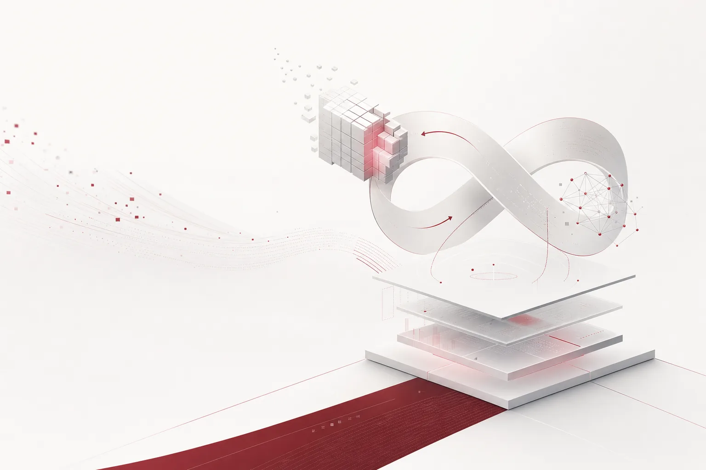

48.1% is not a big number on its own. For a Qwen-family model's math score, it would be a single line on a leaderboard. The sharpness of today's news came from who raised the score. Researchers at MIT CSAIL demoed a technique where the frontier model GPT-6 Astra directly edits the weights of another neural network. Astra diagnosed the underlying logic of the target network and repaired it, and Qwen's math score climbed to 48.1%. It was fixed, not retrained.

This morning's HuggingNews digest holds ten items, starting with one lab's technique and reaching SEC filings, a $20 billion funding round, and a bank's restriction on tool use. The directions differ, but put together they form one scene. It is a page where the loop of models making and fixing models has gathered, and on the same page the lines of cost, access, and sovereignty that wrap around that loop are drawn.

*A visualization of the core concept of this post.*

## A Model That Fixes Weights

Written out exactly as the researchers demoed it, Astra reads the underlying logic of the Qwen network, diagnoses where that logic broke, and repairs it at the weight level. Here, "reads" is a technical action. You have to read the internal logic of the target network from the outside in order to diagnose what is wrong and fix the weights. The existing path to improvement was retraining. You feed in data and compute, run the steps, and produce the next version of the model. This technique skips that middle. It is work done on the inside of a model that is already running.

This one move changes where "capability" sits. The moment capability becomes something that can be read and fixed, rather than a fixed property of the model, the assumption of a box that gives an answer when you put a prompt in starts to wobble. A model comes close to a material where you can find and patch a specific line. Like software receiving a bug patch, a path has opened for a model to receive a logic patch.

Being able to fix weights changes the very concept of a version. Just as a code bug patch leaves a commit history, a model's logic repair leaves a patch history. You need to be able to trace when, which logic of which model, met which tool and got fixed. The moment a model receives patches the way software does, version control and history tracking move into the basics of operation.

It is also easy to miss that the target was Qwen. Qwen is an open-model family, and the tool that fixed it is a frontier lab's model. That gap is large: the tool sits on the frontier side, the target on the open side. This is not the picture of a frontier lab doing internal maintenance on a closed model. It is an external tool raising a specific capability of an open model. That the fixed capability was math is in the same context. Math is a domain where answers can be verified, so a score can confirm whether the logic repair actually led to a functional improvement. The length of the path matters more than the 48.1% number itself. If this path generalizes, the distance between an open model's weakness and a frontier model's strength becomes a patch, not a retrain. That is where the pricing model of a model changes. A model is not an asset you buy once and use for a long time. It is something you fix and refine.

## The Loop About to Close

Two of today's articles sit on the same loop. CEO Sam Altman said OpenAI's next GPT series will be based on an internal model that solved the Navier-Stokes equations. An internal model solved the fundamental equations that describe how fluids move. What to note is the shape of what became the basis of the next product. It is not a benchmark score. It is the research result of solving the Navier-Stokes equations, the research activity that made that model. The model did the research, and that result becomes the foundation of the next model.

Anthropic's filing points at the other side of the same loop. The company's internal forecast, inside an SEC document, said the next model may soon reach a level that dramatically accelerates the pace of research. The one who wrote the forecast is the company itself. The weight of this event is that the document carrying that forecast is a filing submitted to the SEC. OpenAI said it is building tomorrow's model with today's research, and Anthropic said tomorrow's model will accelerate the research itself. Two different sentences, pointing at the same fact. The loop of models making models is about to close. The bottleneck of this loop used to be human researchers. Today's news is the scene where that bottleneck becomes a variable.

The way this loop reaches the enterprise side is by compressing the model replacement cycle. In a structure where research determines the model's speed, if the speed of research is pulled back into the model, the gap between version generations shortens. It means a model assignment decided today can already be last generation by next quarter's budget meeting. A structure of picking one model and using it for a long time changes into a structure of continuously picking and using many models.

## Two Curves

Today put out a number on the capability side as well. Gemini 4 Carbon debuted at number one on Mercor's APEX-Agents leaderboard. Pass@1 84.2%, mean 90.4%. Pass@1 is the first-attempt success rate. 84.2% means that on agent tasks, more than 8 out of 10 were completed on the first attempt. The sentence "the first evaluated model to pass a mean above 90%" was also written alongside this model. The agent benchmark baseline had been in the 80s; this is a line above 90.

The same day, the same model produced a number on the cost side as well. On the GDPx test that SemiAnalysis built to measure AI capability on professional work, Gemini 4 Carbon provides the capability at four times lower cost than Opus 5.5. The assessment is that the efficiency is close to the industry's lead. A 90s score and a four-times-lower price both attach to the same model. This combination reads in the language of a buying decision. It matters that both came from the same model on the same morning. The equation where "a stronger model" translated only into "a more expensive model" bent today.

An agent workload is a structure that calls a model hundreds of times a day. On a day when capability and cost move at the same time, choosing which model for which task becomes the core of operation. The table of models you can choose from also widens. Hume released the Audio Decision API. A tool that judges a speaker's emotional state from a voice recording, identifying subtle acoustic nuances like laughter or hesitation. A specialty API sits at the serving table alongside general-purpose LLMs. The more routing options there are, the more the value of the choosing layer grows.

## The Lines Being Drawn

While the loop is about to close, there are places drawing lines. Goldman Sachs restricted the use of Claude Code and GitHub AI tools to the engineering role. Trading and banking staff no longer have access to certain AI assistants. A financial firm chose "close it off by role" before "leave it open to everyone". It means redrawing the access rights to a specific tool at the role level.

SpaceX chose the other side. On the Grok Bot assistant, it is testing a feature that gives subscribers extra credits if they consent to their interactions being used for training. A structure where user consent itself becomes a billing item. This is a case where data consent entered feature design, tied to credits. OpenAI drew its line toward sovereignty. It expanded its partnership with Abu Dhabi into a new contract and integrated generative AI into the operations of an Emirati state-owned enterprise. The targets are the energy and investment sectors. When AI goes inside a state-owned enterprise, where it runs and who can see it automatically become questions.

Set the three lines side by side and there are three axes. Role, consent, jurisdiction. It is a day when lines are drawn simultaneously on the three axes of permission, around who will use it, what will be given, and where it will run.

Capital holds all of this up from below. Oracle filed with the US Securities and Exchange Commission for a common stock issuance of $10 billion, and simultaneously is pursuing a $10 billion unsecured funding. $20 billion goes into building AI infrastructure. While lines are being drawn, money flows, and on the infrastructure side it grows at a speed that exceeds any company's operating speed.

## The Serving Table Holds the Answer

Today's news points at one spot. That models change faster than any one company can chase. Weights are editable, and the research loop is about to close. The ceiling of capability moves at 90, the floor of cost at 4x. Access is restricted by role, consent is billed as credits, and the deployment target goes into state-owned enterprises. On such a day, the enterprise answer is not in buying and holding the strongest model. It is the layer where you can change, without touching the workflow, which model runs where, on which task, with which record.

Paxis is ThakiCloud's Agent-Native Cloud, currently at v1.1 GA. It manages Skills, Tools, Policies, and Audit Logs as first-class resources. Autonomy is checked from L0 to L3 with policy gates and recorded in the audit log. Isolated sandbox execution holds the boundary of agent behavior, and MCP connectors and the skill marketplace supply tools. It supports sovereign and on-premises K8s (ai-platform) deployments, and CostRouter picks the best model per task and assigns it to execution.

Today's news maps to that layer almost item by item. The 4x cost gap between Gemini 4 Carbon and Opus 5.5 is the variable CostRouter corrects. The larger the gap, the bigger the saving per route. Goldman Sachs' role-based access restriction and SpaceX's consent-based credits are the work of defining policy and leaving a record in an enterprise deployment. Policies and Audit Logs do that work at the resource level. The flow of Abu Dhabi's state-owned enterprise means the execution environment has to be able to run inside the customer's jurisdiction. Sovereign and on-premises K8s deployment is that seat. For the loop acceleration Anthropic forecast, the autonomy levels and isolated sandbox execution become the mechanism that tightens the boundary per task.

The direction on the model side is set by the labs, and the direction on the money side is set by the capital market. What the enterprise can choose is the direction of the layer that runs the models. Today's 48.1% showed that a model is something that can be fixed. The 4x showed that a model is something that can be swapped. The advantage of operation is in the layer that picks, runs, and records.

## References

This post was written by synthesizing the following news.

- HuggingNews, [GPT-6 Astra Edits Neural Weights to Boost Qwen Model's Math Score to 48.1%](https://huggingnews.com/ai/gpt-6-astra-edits-neural-weights-to-boost-qwen-models-math-score-to-481p-4720ace6)
- HuggingNews, [Google's Gemini 4 Carbon Tops Mercor's APEX-Agents Leaderboard With First Mean Score Above 90%](https://huggingnews.com/ai/googles-gemini-4-carbon-tops-mercors-apex-agents-leaderboard-with-first-36f3932d)
- HuggingNews, [Oracle Targets $20B in Fresh Capital to Fund AI Infrastructure Buildout](https://huggingnews.com/ai/oracle-targets-20b-in-fresh-capital-to-fund-ai-infrastructure-buildout-4d1ae76a)
- HuggingNews, [Anthropic Warns Future AI Models May Soon Trigger 'Dramatically Accelerated' Research Pace](https://huggingnews.com/ai/anthropic-warns-future-ai-models-may-soon-trigger-dramatically-accelerated-5873b68a)
- HuggingNews, [SpaceX Ties Grok Bot Usage Resets to Training Data Opt-In](https://huggingnews.com/ai/spacex-ties-grok-bot-usage-resets-to-training-data-opt-in-290f13a9)
- HuggingNews, [OpenAI to Release Next GPT Using Model That Solved Navier-Stokes Equations](https://huggingnews.com/ai/openai-to-release-next-gpt-using-model-that-solved-navier-stokes-equatio-1dde1157)
- HuggingNews, [OpenAI Seals New Pacts to Deploy AI Across UAE Energy and Investment Sectors](https://huggingnews.com/ai/openai-seals-new-pacts-to-deploy-ai-across-uae-energy-and-investment-sec-7a4884aa)
- HuggingNews, [Hume Launches Audio Decision API to Analyze Emotion in Voice Recordings](https://huggingnews.com/ai/hume-launches-audio-decision-api-to-analyze-emotion-in-voice-recordings-4c72d06e)
- HuggingNews, [Google's Gemini 4 Carbon Offers 4x Lower Cost Than Opus 5.5 on New AI Agent Benchmark](https://huggingnews.com/ai/googles-gemini-4-carbon-offers-4x-lower-cost-than-opus-55-on-new-ai-agen-e2a87831)
- HuggingNews, [Goldman Sachs Limits Claude Code and GitHub AI Access to Engineering Staff](https://huggingnews.com/ai/goldman-sachs-limits-claude-code-and-github-ai-access-to-engineering-sta-111818ce)
