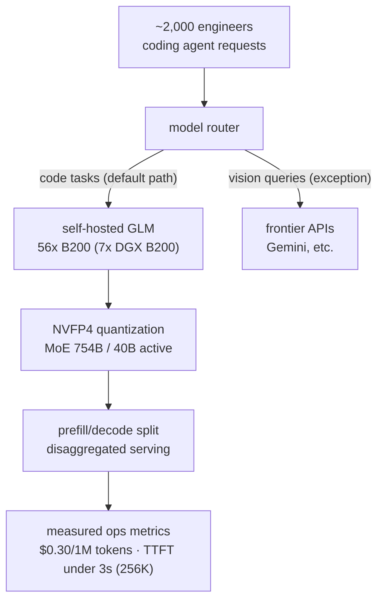

*An abstraction of tokens flowing one way through self-hosted serving while the bill stays flat.*

## Why read this

If you run an infrastructure team that operates coding agents at scale, you are standing at a fork in the road right now. Keep going with frontier APIs, or move to self-hosted open-weight models. This post walks a real year of the second path, with Revolut's numbers, and then decomposes the mechanisms that produced those numbers. The bottom line up front: the 10x cost difference was not a model choice. It was three tuning recipes, NVFP4 quantization, prefill/decode disaggregation, and context rightsizing. All three are levers we work with when we tune the Metis serving stack.

## Overview

David Abitbol, who leads operations and infrastructure at Revolut, presented this material at AI Engineer New York on 2026-10-13, and The Register covered it on 2026-11-03. The core facts are these. The default coding model for roughly 2,000 engineers was self-hosted GLM, and the cost was at the level of 1/10 of OpenAI Codex and Anthropic's Claude Code. Abitbol also presented internal numbers of a 60% improvement in coding time and a 70% improvement in lead time.

The timeline shows the default changing in sequence. Early 2025, Gemini. Early 2026, Claude Code. Then GLM-5.1 was brought in as self-hosted, and today GLM-5.3 is the default model, running on 56 Nvidia B200 GPUs, i.e. 7 eight-GPU DGX B200 systems. GLM is a MoE model from Zhipu, known internationally as Z.ai. The 5.1 has a structure with 754B total parameters but only 40B active per token.

The timing the coverage points to matters too. Abitbol framed this transition not as a "model story" but as a "shipping story." The frame is the organization's shipping speed and cost, not what the model can do. In 2026, coding-agent cost became a first-order line item in infrastructure budgets, and that is part of the backdrop for why this talk resonated.

## What happened

The first commercial adoption started with a budget cap. According to Abitbol's retrospective, they initially set spending limits between 1,000 and 10,000 dollars per engineer per month, and ROI was "mediocre." Tokens were expensive, so the team was in the phase of reducing the act of using them in the first place. In his retrospective Abitbol said, "We were highly skeptical about the cost of AI," and that skepticism is the starting point of everything that followed.

What did the cap look like operationally? Each team negotiated an agent spend budget, and usage shut down when it hit the cap. The "ROI was mediocre" remark shows a period when money was being spent but the output had not yet justified it.

What does it change operationally when self-hosted becomes the default? Engineers no longer spend money on the agent. No budget request per task, no expected-return justification per prompt. The moment "something you can use" becomes "something you use freely." Abitbol kept pointing at this shift in the mental model, not the change in the bill, as the bigger effect.

Once self-hosted became the default, the landscape changed. The billing is flat, and because no one counts tokens, the scope of use widened. Beyond coding, debugging, Jira tickets, and Confluence documentation all moved to agents. Abitbol put it as: with unlimited tokens, you can simply do that freely.

In short, two stages. Stage one is a cost switch from "too expensive, so not used" to "cheap, so used." Stage two is a usage expansion where cheap tokens create new use cases. Most organizations stop at stage one, but the 1/10 number only carries real meaning for organizations that reach stage two.

The serving setup is shown in the diagram below.

## The three levers behind 10x

In the numbers Abitbol presented, what deserves attention is not the savings ratio itself but where he attributed the cause. He attributed most of the performance jump to three tuning levers. Scaling GPU count was not the main driver.

First, NVFP4 quantization. The weights of the 754B MoE need 380GB of GPU memory at original precision. Low-precision quantization must shrink that volume before the contexts of 2,000 users can be stacked on 56 B200 GPUs at once. Per-user context occupancy ranges from 6GB to 26GB depending on precision.

The MoE structure is the center of serving economics here. Total parameters determine performance. Active parameters determine inference cost. GLM 5.1's 754B total carries the performance, and only 40B active per token sets the compute. It is a structure that lets you handle a very large model at serving cost close to a medium one, with the precondition that the serving stack must absorb the weight memory. That is where quantization and context management come in.

Second, prefill/decode disaggregation. The prefill stage, which processes the input context, and the decode stage, which keeps emitting tokens, have different resource profiles. Run them mixed together and long-context users drag down the response speed of short sessions. Disaggregated serving that separates the two stages is what holds the interactive feel.

Third, context rightsizing. Abitbol's position, as the coverage summarizes it, is that "Long context is a scam." Being able to serve 1M tokens does not mean you need 256K; what is actually needed is around 256K. The measured targets: under 3 seconds to first token at 256K context, and 200 tokens per second for interactive speed. He also recalled that after 5 pm, when user count drops, throughput got close to 800 tokens per second.

Why does time-to-first-token matter? In interactive coding, the feedback loop runs from keystroke to completed change. If the first token takes more than 3 seconds, the agent becomes a batch job. Streaming at 200 tokens per second is what creates the feel of the answer continuing in that gap. The recollection that it got near 800 tokens per second after 5 pm shows how the same hardware multiplies the felt speed when load drops.

The unit of $0.30 is worth pinning down too. It is the per-1M-token price of the GLM-5.1 hosting Abitbol presented, and in the coverage's words, it is at the level of 1/10 of OpenAI Codex and Anthropic's Claude Code. What matters is that this unit price is a realized price. It is a number that comes out after actually running 2,000 users on 56 GPUs, and it includes operating cost. The practical way to read this case study is to compare the self-reported $0.30 and the 1/10 ratio against your own organization's per-person spend.

The three levers in one sentence: weights smaller, stages separated, context just enough. All three live in the serving stack.

The three levers are not independent either. Quantization lowers weight memory, which widens the context budget per GPU. Prefill/decode disaggregation protects the felt speed of long-context users, which raises overall session density. Context rightsizing shrinks the working set, so the first two effects spread across more real users. Pull one and you might get 2x. You need all three for a 10x story.

## Policy: designing the exception

Model choice is not the whole story. Revolut's current policy is "GLM is the normal path, frontier is the exception." GLM has not fully replaced GPT or Claude. The model router sends vision queries to Gemini-class models and code to GLM. Leaving an exception lane open is the core of the design. The open-weight default carries most of the work, and the quality ceiling is delegated to the exception path.

The exception works as a routing rule. There is no human judgment in the middle. Users entering vision work do not need to be aware that an expensive model is being used, and code work simply stays on the default path. Leave the exception lane to human judgment and the default becomes a budget-negotiation item again. Make it a rule and the default scales without spend.

The work that lands in the exception is usually two kinds: high-difficulty reasoning that only frontier models do well, and modalities the default path does not handle. Abitbol's talk does not give an exact exception ratio, but the actual shape of the policy is "default GLM, exception frontier," not "all GLM."

The security-adjacent remark is also striking. On privacy concerns about Chinese open-weight models, Abitbol pointed to a bigger risk: "APIs that go through China." Run the weights on on-prem or regional cloud resources and there is nothing to worry about. That is a stance that looks at the data's movement path before the model's nationality.

The phrase "on-prem or regional cloud resources" is worth noting too. Self-hosted does not mean one data center. It means deployable options within and outside regions that carry data-sovereignty constraints. For organizations where data is defined as not crossing a particular border, that is a choice an API-only architecture cannot offer.

## Implications for ThakiCloud products

This case study feels especially close to us because the three tuning recipes are first-class items in Metis's serving stack. NVFP4 quantization is an area we handle as a proprietary quantization recipe. Prefill/decode disaggregation is a standard task in vLLM-based disaggregated serving. Context rightsizing is a serving-default tuning problem. Revolut's 56 B200 configuration and our cluster scale differ, but the order and direction of the levers are the same. You have to hold three axes, weight volume, stage separation, and context size, for 1/10 to remain 1/10.

Through the Paxis lens, the "frontier is the exception" routing is the key scene of agent economics. The moment tokens become 1/10, agents move into use cases nobody used them for before. Debugging, ticket triage, documentation work. Total agent automation cost is the product of per-token price and usage, so even with price alone dropping, usage fills in and the total bill stays flat. If Paxis is the control plane of agent execution, what the Revolut case proves is that open-weight serving redrew the lower bound of the execution cost structure. A design with a cheap default path and an exception lane is what creates agent economics.

The on-prem view fits in one line. Serving where data does not leave is not an exception at organizations with strong security requirements. It is the default. That is the same direction as why Revolut saw "APIs that go through China" as the bigger risk.

Let's check once more how the recipe lands practically in Metis. NVFP4 quantization is an iterative recipe of re-measuring accuracy per model and choosing. Prefill/decode disaggregation is a scheduling problem of how to split the cluster across the two stages and how to attach queues. What the Revolut case confirms is that the recipe holds at the scale of 2,000 engineers. Even when scale changes, the order of the levers holds.

## Limitations and counterarguments

First, all the numbers are self-reported by the presenter. The 60% coding-time improvement, the 70% lead-time improvement, and $0.30/1M tokens are from Abitbol's talk, not independently verified measurements. In particular, $0.30/1M is the GLM-5.1 hosting cost and may differ from the token unit price of the current default model, GLM-5.3.

Second, the entry barrier is large. The weights alone are 380GB for the 754B MoE, and 56 B200 GPUs means 7 eight-GPU systems. The 1/10 of self-hosting is a story for organizations that can absorb that scale. For small teams, API pricing may still be cheaper. Compare token unit price against GPU fixed cost and engineering operating cost.

The quality ceiling is acknowledged too. The "frontier is the exception" policy itself presupposes that the default path does not handle all code. The talk does not state the exception ratio or the difficulty distribution of the work that lands there.

The security view is also one side's interpretation. Abitbol's stance of separating the nationality of open weights from the serving path is reasonable, but the premise that "Chinese APIs" are dangerous admits other assessments. Bringing the data path in-house does not make model supply-chain risk disappear.

Next is our own analysis. 2,000 engineers and 56 B200 GPUs are averages of totals. Agent usage is not uniform per person. Active users consume multiples of the average in tokens. If the distribution is skewed, "1/10" is the average of the bill, not every user's number. We recommend organizations considering self-hosting model capacity by the 95th-percentile user. The average user underestimates load.

Finally, the shadow of the Jevons paradox. When tokens get cheaper, usage grows. When usage grows, the total bill climbs again. "The billing is flat" is the phrase at the time of the talk. Whether the bill a year later keeps the same shape cannot be concluded from this one case study.

## Bottom line

Three takeaways from the Revolut case. First, the 10x cost difference is a result of serving tuning, not of model choice. NVFP4 quantization, prefill/decode disaggregation, context rightsizing. Self-hosting without those three levers is not 1/10, it is just a GPU ledger. Second, routing with an open-weight default path and frontier as the exception is the design that keeps the quality ceiling while lowering the price floor. Remove the exception lane and the default becomes the ceiling. Third, when tokens get cheaper, new use cases appear. You have to set the goal as redesigning usage, not just cutting cost, for 1/10 to remain 1/10.

If you run coding agents at organizational scale, the next decision is not "which model do we use" but "where do we serve." This case is one year's answer sheet to the second question.

## References

- The Register (2026-11-03): [British fintech Revolut slashes AI coding costs 10x by cutting out Claude and going self-hosted](https://www.theregister.com/ai-and-ml/2026-11-03/british-fintech-revolut-slashes-ai-coding-costs-10x-by-cutting-out-claude-and-going-self-hosted/5307345)
- Talk: David Abitbol (Revolut), AI Engineer New York (2026-10-13)
- Original tweet: [RT @guilleflorvs](https://x.com/hjguyhan/status/2117630980412579951)
