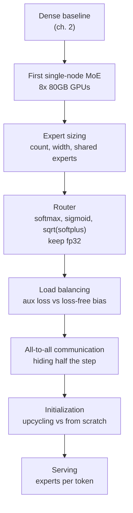

*An abstraction of the router distributing tokens to experts, using the hospital specialist system as the metaphor.*

## Why read this

This post is for ML engineers and infrastructure engineers who have trained dense models and are now preparing to move to MoE training. The target is teams that have to decide how much GPU time to spend exploring MoE. The bottom line up front: 18 of the 20 best open models today are MoE, and the know-how to train them well stayed inside the heads of a handful of teams. Hugging Face has now released that know-how as a free handbook, distilled from hundreds of thousands of GPU hours of experiments. The core value of the handbook is not a list of conclusions. It is a debugging methodology: change one flag at a time and verify against logs and numbers. That methodology can be borrowed as-is on any GPU cluster. If you want to decide which experiments to run, and in what order, before spending serious money, this handbook is that order.

## In plain terms

MoE, Mixture of Experts, is a structure where one model holds many small experts and activates only a subset of them per token. The easy analogy is a hospital's specialist system. A dense model is one general practitioner who sees every patient alone. An MoE model is a front-desk nurse, the router, who assigns each patient, each token, to the right specialist, the expert. The questions the handbook answers become natural on top of that analogy. How many specialists should there be, and how narrow should each specialty be. Which assignment method works best. How do you stop one specialist from being overloaded while the others sit idle. How do you cut the walking time of referrals between specialists, the all-to-all communication. The handbook answers all of these with real experiment numbers, and it shows how to read the numbers, not just what they are.

## Overview

The handbook was released on November 5 as the Hugging Face Space "The Ultimate MoE Training Handbook". The subtitle is "A hands-on guide to training Mixture-of-Experts models". The author is Nouamane Tazi, a research engineer at Hugging Face who has worked on Megatron-LM scaling for a long time. Co-founder Thomas Wolf promoted it with the tweet "18 of the 20 best open models today are Mixture-of-Experts. Dense is basically over."

The reason the release matters is that the know-how did not exist before. The MoE architecture itself is not new, but the judgment criteria for training MoE well were scattered across official docs. The Megatron-LM MoE README explains what each flag does. It does not say how the loss curve or the load balancing numbers move when you change that flag. This handbook is Hugging Face filling that gap with its own experiments.

The scale is substantial. According to coverage, the handbook runs about 70,000 words, 55 interactive figures, and includes runnable code. The experiments behind it took hundreds of thousands of GPU hours. The figure differs by source. Wolf's promotion material says about 800,000 GPU hours, Tazi's own material says about 500,000 GPU hours, and I could not verify the original text directly, so both are recorded. The handbook is built around NVIDIA's Megatron-LM framework, and its numbers come from real runs on Hugging Face clusters such as Alps GH200. The warning the handbook gives itself, "do not transfer these numbers to other clusters as-is", is the sentence to remember before reading anything else.

There is a structural reason MoE is this firmly entrenched at the top. MoE keeps total parameters large while keeping the active parameters per token small. You grow capacity without growing per-token compute proportionally. For a team that serves open models, this is a choice of cost structure, not of quality. That is exactly why the know-how of learning to use this cost structure matters as much as the architecture choice itself.

## What this handbook is

The handbook is organized to be read in order, from a first MoE run to production. Chapter 2 is the runway. It lays out the hardware check, the image build, tokenization, the dense baseline, and the first single-node MoE. The first MoE recipe uses eight 80GB-class GPUs, a line you can cross on a single node. It is a deliberate design choice to lower the entry barrier of "a first MoE run".

Chapter 3, the body, answers the seven core questions. Expert sizing: how many experts, how wide each one, and whether to add shared experts. Router design: softmax, sigmoid, or sqrt(softplus), and why to keep it in fp32. Load balancing: the conventional aux loss versus DeepSeek's loss-free bias approach. All-to-all communication: why about half of each step goes to communication between experts, and how to hide it. Initialization: upcycle an existing dense checkpoint, or train from scratch. Serving: can you serve with fewer experts per token than you trained with. And the recommended flag block: where to start.

The remaining material is on the serving and deployment side. There are topics like expert paging, moving experts page by page at serving time, but community reviews note the body leans toward the train loop and the deployment side is thinner.

The interactive figures deserve a mention as a strength of the Space format. Instead of static blog images, 55 figures let you click through and watch how the load balancing numbers move when a flag changes. The design keeps you from stopping at "I only read the conclusions", and lets you follow the experiments.

*The handbook's training path from chapter 2 into chapter 3. Each step changes one flag and verifies against the logs.*

## How to read it and where to start

The order matters. The handbook is not a book you read fully and then train with. It is a methodology: train while you cross-check flags against logs.

The first step is to run the chapter 2 dense baseline on your own cluster. Without a dense baseline, the MoE numbers have no frame of reference. You have to know how far dense goes on the same data, the same token budget, and the same hardware before you can say what the MoE switch actually buys you. An MoE experiment without a comparison point leaves only the fact that the loss goes down, not a judgment on how far it went.

The second is the first single-node MoE. What you are chasing at this stage is not performance but environment correctness. You check the hardware, the image, the tokenizer, and whether the loss curve behaves. If per-expert utilization skews to one side, or the all-to-all ratio comes out far from what you expected, that is more likely an environment problem than a model design problem. Fix the environment first, then move to chapter 3.

The third is moving through the chapter 3 questions one at a time. Change exactly one flag, then read what changed in the logs and the numbers. Change several flags at once and you lose the ability to say which variable produced the result, and the experiment becomes a guess instead of a judgment. The recommended flag block is the starting point, and the structure is to ablate one thing at a time from there.

## Key findings

The numbers below are experiment results the handbook's authors ran on Hugging Face clusters. As the handbook itself warns, they do not transfer to other clusters as-is. So read them not as conclusions but as "validated questions".

**Expert sizing.** The most repeated sentence is that "at fixed total and active params, finer experts help up to a point". There is a regime where splitting into more, narrower experts pays off, and the payoff hits a limit. In one ablation the loss kept dropping until 128 experts, and gains stopped after that. The case: 128 experts, each one a quarter of the model width, top-8 routing. Looking at released systems, the majority use 128 to 384 experts with top-4 to top-8 routing. It is a good first coordinate for designing an MoE model.

Whether to add shared experts is another point chapter 3 covers. Beyond the experts the router picks per token, a shared expert is one that every token always passes through. In regimes where tokens do not spread evenly, the shared expert carries the baseline capability, and the handbook treats this as a design variable alongside expert sizing.

**Router.** The handbook compares three router activation functions, softmax, sigmoid, and sqrt(softplus), and emphasizes keeping the router in fp32. Routing decisions are decided by tiny numerical differences. Compute them in low precision and the distribution over which expert gets picked drifts quietly. Then the load balancing numbers wobble too. It is the setting you are most likely to drop while chasing training speed.

**Load balancing.** The comparison is between the conventional aux loss, the penalty term that taxes skew, and DeepSeek's loss-free bias, which adjusts the expert score bias with no extra loss term. The two methods affect per-expert utilization differently, and the handbook treats the choice as something to judge with real load numbers. According to coverage, what readers appreciated most was not the recommendation itself but the real-number examples, such as the load-balance TFLOP/s differences that show up when you run both for a while. Load balancing is the area where "which was better" cannot be answered without looking at the numbers, so the examples take that form.

**Communication.** All-to-all, the communication that moves tokens between GPUs and experts, takes about half of each step. How to hide it under computation is one of the chapter 3 themes. It is where cluster topology, network speed, and expert parallelism meet, so it is the most cluster-dependent chapter.

**The 25x slowdown.** The most memorable piece. A run that goes 25 times slower with not a single error in the logs. The handbook treats this not as a corner case but as a real debugging problem that actually happens. The point: the failure shape of MoE training is often "slower", not "crashed". That connects directly to GPU queue cost management.

**Upcycling and serving.** Whether to upcycle an existing dense checkpoint or train from scratch is a big fork in training strategy, and the handbook covers both paths. The upcycling route inherits the general capability the dense model already has and focuses the training budget on the new experts and routing. The from-scratch route lets you design the structure cleanly from the start, but pays the general-capability training cost again. The answer to which is right depends on the reality of whether you already have a usable dense checkpoint, and it is a decision that changes the structure of the training budget. The serving side asks whether you can serve with fewer experts per token than you trained with. If that holds, total MoE parameters are capacity and only active parameters are cost, so the two can be tuned independently. It is the point that touches the serving budget most directly.

## Implications for ThakiCloud products

ThakiCloud's ai-platform runs training on Kueue-managed GPU queues, with B200, H200, and GH200 clusters. The handbook's cluster-dependence warning is a warning we receive directly. The Alps GH200 numbers do not tell us what will happen on our B200 queue. So the right use is not copying settings. It is rerunning the dense baseline, the first MoE, and the flag ablations in that order on our own cluster, under the same job contract. The handbook's recommended flag block becomes the starting point of that experiment ledger.

The 25x slowdown chapter connects directly to GPU cost management. A job that slows down without crashing holds a queue slot and burns GPU hours, which is one of the larger cost-waste items in a training platform. You need a monitoring item that catches the slow-down-without-error pattern, namely sudden changes in time-per-step and the all-to-all ratio. From the queue's perspective there is a more concrete response. Instead of only alerting when a job's time-per-step exceeds the baseline by a fixed multiple, recording that interval in the experiment ledger lets you trace it with the log set from that time, instead of a belated root-cause hunt.

The platform side also has a concrete form for absorbing this recipe. The three steps, dense baseline, first MoE, and flag ablation, each map to a GPU queue job with a declared duration and output path. Making the handbook's recommended flag block the default spec of the first job, and each ablation a variant spec that differs in exactly one variable, is the implementation that puts this methodology into the experiment ledger. Once that is in place, the 25x slowdown warning is a monitoring rule instead of a sentence on a page, and ablation results are compared across artifacts under the same contract instead of scattered logs.

There is a connection point with Paxis as well. When Paxis's autonomous agents run experiments, the handbook's methodology of changing one flag and reading the numbers afterward takes the shape of an execution protocol an agent can audit. One variable, one experiment, one log set. It is the same shape agent execution records should have.

## Limitations and counterarguments

The limits are clear. First, the numbers come from specific clusters such as Alps GH200, and the handbook itself warns against transferring them. Second, the experiment scale is self-reported by Hugging Face. The mismatch between 800,000 and 500,000 GPU hours remains, and there is no independent third-party verification. Third, Wolf's "Dense is basically over" framing drew pushback from the community. The view that a dense decoder model is still a good starting point for foundational work is not small. The handbook itself is a guide to training MoE well, not a death sentence for dense. Fourth, the serving and deployment material is thinner than the train loop. If your primary question is the economics of inference, this handbook is only part of the answer.

## Wrap-up

For a team starting MoE training, the reading order is set. The dense baseline, the first single-node MoE, and the recommended flag block. The numbers from hundreds of thousands of GPU hours should be read as questions, not conclusions. The question is entirely "what will happen on our cluster", and that question is structured to be answered step by step from the dense baseline. The handbook's first path follows exactly that order. And if your primary concern is GPU cost management, read the 25x slowdown chapter first. Slowing down without crashing is the representative failure shape of MoE training, and it is the item to put in monitoring first.

## Sources

- [The Ultimate MoE Training Handbook (Hugging Face Space)](https://huggingface.co/spaces/huggingface/moe-blogpost)
- [Thomas Wolf's original post (X)](https://x.com/Thom_Wolf/status/2118432475730882627)
- [daily.dev coverage](https://daily.dev/posts/hugging-face-releases-a-free-moe-training-handbook-after-800k-gpu-hours-of-experiments-bkvgav0yz)
- [NVIDIA Megatron-LM MoE README](https://github.com/NVIDIA/Megatron-LM/blob/main/megatron/core/transformer/moe/README.md)
