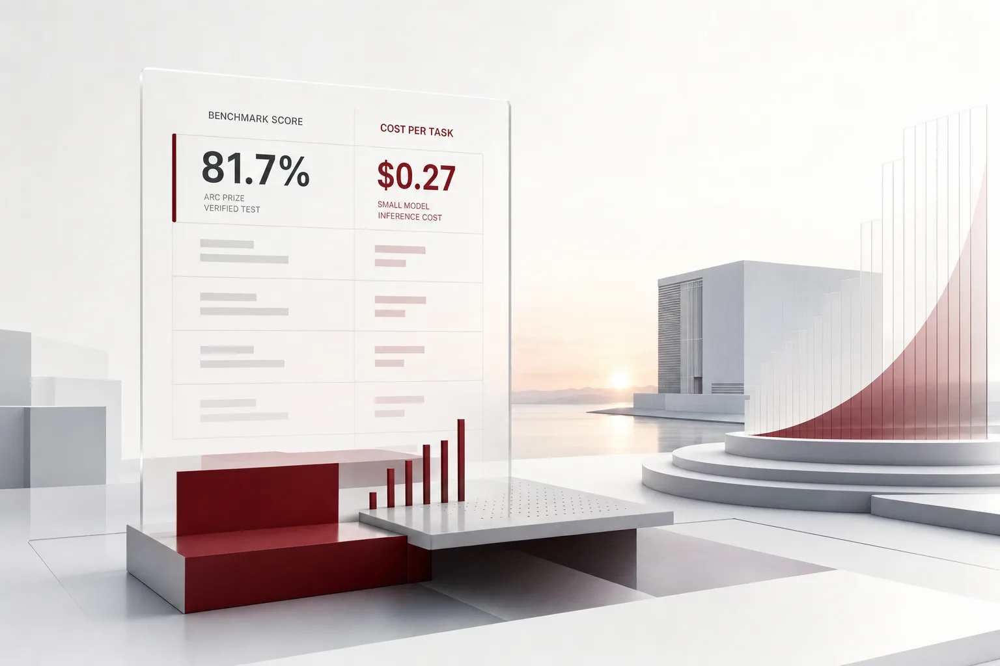

If there is one number to remember from today, it is 27 cents. In the ARC Prize verification test, a small open-weight model ran the reasoning benchmark ARC-AGI-2 at a cost of $0.27 per task, and it scored 81.7 percent, the highest of any open-weight model. Beside the benchmark score, a column for price per task appeared, as clear as it has ever been.

Today's HuggingNews digest is a rare one, the kind where two words, "verification" and "price," keep showing up together. At one end of the scale, Google was planning 2.7 gigawatts of power. At the other, a small model had a price tag of 27 cents per reasoning task. Both ends of this scale say the same thing. The AI industry has started putting a price on everything, and companies have entered a phase where their position on that price list is their strategy. That morning, infrastructure was traded in gigawatts and intelligence was traded in cents. If you run agents today, the one thing to take from this digest is clear. The unit of account for AI cost has moved to the task.

*A visualization of the post's core concept.*

## The Price Column Next to 81.7%

The model is Thinking Machines Lab's Inkling 2 Small. On the ARC Prize verification test it scored 81.7% on ARC-AGI-2 and 96.5% on ARC-AGI-1. What draws the eye here is the cost sitting next to the score: $0.27 per task on ARC-AGI-2, $0.08 per task on ARC-AGI-1. That is the top score among open-weight models on ARC-AGI-2.

Until now, a benchmark result was a single column of scores. You chose a model on score alone, or bought infrastructure on price alone. This time a price column showed up next to the score. What that change means is simple: intelligence has become something that carries a price per task. And the unit price of handling one reasoning task has come in under 30 cents, with easy tasks falling below 10 cents.

Once a price column appears, it will not stay short for long. Small models compete on unit price, and their scores climb with it. The yardstick companies use to compare models changes with them. It becomes the moment when "how many cents per task does this step in our workflow run" is the question behind model selection. When you can see, side by side, the path of buying the same reasoning quality at 8 cents per task and the path of buying it from a top model, the unit at which budgets are split moves from the model to the step.

One more thing to note is the model's identity: open-weight. If you can download the weights and run them on your own servers, the story changes. The 27 cents is not just a number. The fact that open-weight sits behind it is what makes it more than that. If you hold the weights, where you run that 27 cents becomes a choice, a rented endpoint or your own servers. With the latter, the 27 cents becomes a cost that shows up on your own power bill. All of today's infrastructure news below moves against the backdrop of that "own servers" possibility.

## The Other End of the Scale: Gigawatts and Trillions

The other end of the scale is capital that moves in units of power and in units of trillions. Google is building its first data center hub in Wyoming. The project is called Tembo. It will spend $17 billion on 716 acres in Laramie County, with a planned power capacity of 2.7 gigawatts. 2.7 gigawatts is on the order of the power a small city uses.

Anthropic is moving to list on Nasdaq (ticker ANT) before Thanksgiving. It aims to raise $80 to $100 billion, at a valuation of $1.25 to $1.75 trillion. An IPO that raises up to $100 billion on its own. OpenAI is running a round at a pre-money valuation of roughly $1.25 trillion, and it is keeping its data center expansion plan intact even as local opposition builds.

Two companies share the number $1.25 trillion. It is the floor of Anthropic's IPO valuation and OpenAI's pre-money valuation. In a phase where AI labs are being priced as trillion-dollar assets, the meaning of this number is simple: the cost structure of running top models will keep moving on the assumption of this scale of capital.

The row to watch in this list is Microsoft's, because it is moving in the opposite direction. It decided not to renew part of the AI cloud computing capacity it leases from Oracle and is cutting the lease back. After a $5 billion capex gap, it revised its entire partnership strategy with smaller data center developers. It walked away from several high-risk deals and adopted stricter partner oversight. The largest buyer has started removing the lines it no longer needs. In a market where GPU capacity is bought and sold, the buying side is now reading the lines, too.

The $5 billion capex gap is worth looking into a little further. Planned spending and the capacity actually secured did not line up, and the buyer's response was "verify more." That is the trust standard of the capacity market moving from contract to verification. It applies directly to enterprise execution environments. When you hand your agent infrastructure to an outside provider, that provider's quality standard becomes the reliability of your own service.

Meta is handling the location problem differently. After repeated opposition from local voters, it said its president has personally started looking for international sites that will accept the infrastructure. Location has joined the price list, too, and on that list the outcome of a vote has become a variable.

## Today's Keyword Is "Verification"

The ARC Prize test that produced the 27 cents was, at its base, a "verification" test: a result confirmed by a reproducible procedure. On the same morning, Axiom published a formalization, in the Lean programming language, of the proofs of the Weil Conjectures I through IV. The proof is in a form a computer can verify, and it is used to validate the Stacks library. That is a structure in which a mathematical proof made by AI is checked again by a machine. Physical Superintelligence used an unreleased Anthropic model to find a proof of the Aaronson-Ambainis conjecture, a long-open problem in quantum complexity. That is the use of intelligence expanding from reasoning tasks to knowledge production. At the same time, the fact that it leaned on a single unreleased model means the execution path had only one branch.

The point here is not that a famous problem was solved. It is that the proof was published in a form a machine can re-check. That is a demonstration that this form could become the standard for deliverables.

Verification does not stay with deliverables. Microsoft's tightened partner management after the $5 billion gap is verification of the infrastructure itself. It means the party that rents capacity has started auditing the quality of the party that lends it. And the disclosed conflict of interest, in which Anthropic offered a job to a METR risk assessor in the middle of an internal review of AI development speed, is a signal that the process of verification itself is now being verified. An evaluator trying to hire an assessor shows how heavy the scrutiny on enterprise AI has become.

The standard of trust is moving from claim to a record that can be re-verified. Not "it worked," but "here is the record of it working, and a machine can check it again."

ARC Prize verification, Axiom's Lean formalization, Physical Superintelligence's proof search, the three share a common thread: the deliverable itself becomes re-checkable. The same frame enters the enterprise adoption process. If an AI deliverable leaves a record that can be re-verified, adoption does not have to rest on the model vendor's claim.

## Three Lines That Change the Enterprise's Position

Cost. Once the unit price per task is set, the cost of an agent workflow starts to read as the sum of its per-step unit prices. Simple steps go to a small open model at 8 to 27 cents, and a top model is used only for the hard reasoning. The longer the price list grows, the more it matters who picks the model for each step. Laying out the whole workflow on the price list, step by step, is what budget management now is. The "AI cost" that was only ever grasped as a single lump is being split into line items. Once it is line items, each one can be optimized.

Supply. Microsoft's lease cut means capacity supply is no longer a guarantee that holds by default. Locked into a long-term dedicated contract, it even costs you to scale down. Local voter opposition and Meta's search for overseas sites mean the location of the infrastructure itself is in flux. An execution path tied to a single vendor and a single region is exposed head-on to that volatility. A structure that can flexibly scale up and down has become, this time, a question of stability. The moment the supply side pours in gigawatts, the demand side starts deleting lines. That is the scene today's digest shows.

Trust. Today's "verification" keyword shows the acceptance standard for AI deliverables changing. From now on, what a company receives is not the sentence "it worked" but the record that lets you confirm it worked. No log, no deliverable.

## The Paxis Lens

Today's three pains, cost, supply, and trust, take the same shape in the agent execution environment. ThakiCloud's Paxis is an Agent-Native Cloud and a first-generation product (v1.1 GA). Skills, Tools, Policies, and Audit Logs are all first-class resources. The four things that govern agent execution are not options; they are the platform's original structure.

Per-task model selection (CostRouter) is what pins today's price list onto each step of the workflow. Routine steps go to a small open model, and only the steps that need it go to a top model. 27-cent reasoning enters the workflow as one step. Sovereign and on-premises Kubernetes deployment (ai-platform) is an alternative supply line. In environments where you must serve open-weight models internally and data cannot cross a border, capacity becomes your own asset. The sovereignty question that Meta's search for international sites points to is answered by this form of deployment.

Policy gates and audit logs are the enterprise version of the "verification" keyword. The acceptance standard for agent deliverables becomes a re-checkable record, and because autonomy is governed in stages from L0 to L3 and execution runs in an isolated sandbox, the reliability of that record holds. Even if a conflict of interest arises mid-evaluation, as in the METR case, if the access and execution history remains, it can be checked. MCP connectors and the skill market also open the skill supply line into several branches.

Will near-term enterprise AI budgets split into two columns? The capex column, measured in gigawatts and trillions of dollars, and the operating column, measured in cents. The former is the industry's story. The latter is the column a company has to read for itself. What sets the size of the latter column is no longer choosing a model, but attaching the right model to the right step.

## References

This post synthesizes the following news.

- HuggingNews, [Anthropic Presses Ahead With Pre-Thanksgiving IPO to Raise Up to $100B at $1.25T to $1.75T Valuation](https://huggingnews.com/ai/anthropic-presses-ahead-with-pre-thanksgiving-ipo-to-raise-up-to-100b-at-1f735eb3)
- HuggingNews, [Microsoft Scales Back Rented AI Cloud Computing Capacity From Oracle](https://huggingnews.com/ai/microsoft-scales-back-rented-ai-cloud-computing-capacity-from-oracle-9b1ec0eb)
- HuggingNews, [Anthropic Offered Job to METR Auditor During AI Speedup Review](https://huggingnews.com/ai/anthropic-offered-job-to-metr-auditor-during-ai-speedup-review-cb62ba12)
- HuggingNews, [Thinking Machines' Inkling 2 Small Tops Open Weight Models on ARC-AGI-2 With 81.7% Score](https://huggingnews.com/ai/thinking-machines-inkling-2-small-tops-open-weight-models-on-arc-agi-2-w-c46f8750)
- HuggingNews, [Microsoft Tightens Oversight of AI Data Center Partners Following $5B Capex Gap](https://huggingnews.com/ai/microsoft-tightens-oversight-of-ai-data-center-partners-following-5b-cap-56da82cb)
- HuggingNews, [Midterm Election Pushback Won't Slow OpenAI's Data Center Expansion](https://huggingnews.com/ai/midterm-election-pushback-wont-slow-openais-data-center-expansion-01b03d75)
- HuggingNews, [Meta Eyes International Expansion for AI Data Centers Following Wave of Local Voter Rejections](https://huggingnews.com/ai/meta-eyes-international-expansion-for-ai-data-centers-following-wave-of-84226a18)
- HuggingNews, [Google Plans 2.7 GW Power Capacity for New $17B Wyoming AI Campus](https://huggingnews.com/ai/google-plans-27-gw-power-capacity-for-new-17b-wyoming-ai-campus-0171e9b7)
- HuggingNews, [Physical Superintelligence Solves Aaronson-Ambainis Quantum Computing Conjecture](https://huggingnews.com/ai/physical-superintelligence-solves-aaronson-ambainis-quantum-computing-co-122d6033)
- HuggingNews, [Axiom Releases Computer-Verified Proof of Weil Conjectures to Validate Stacks Library](https://huggingnews.com/ai/update-axiom-releases-computer-verified-proof-of-weil-conjectures-to-val-bfdd43e4)
