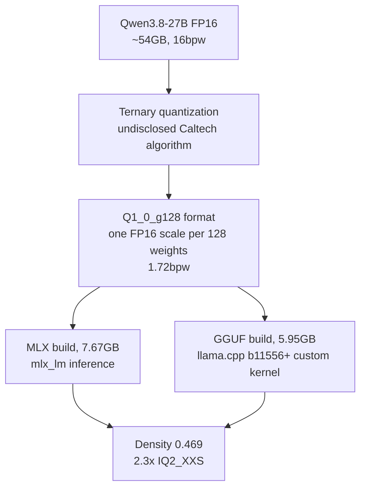
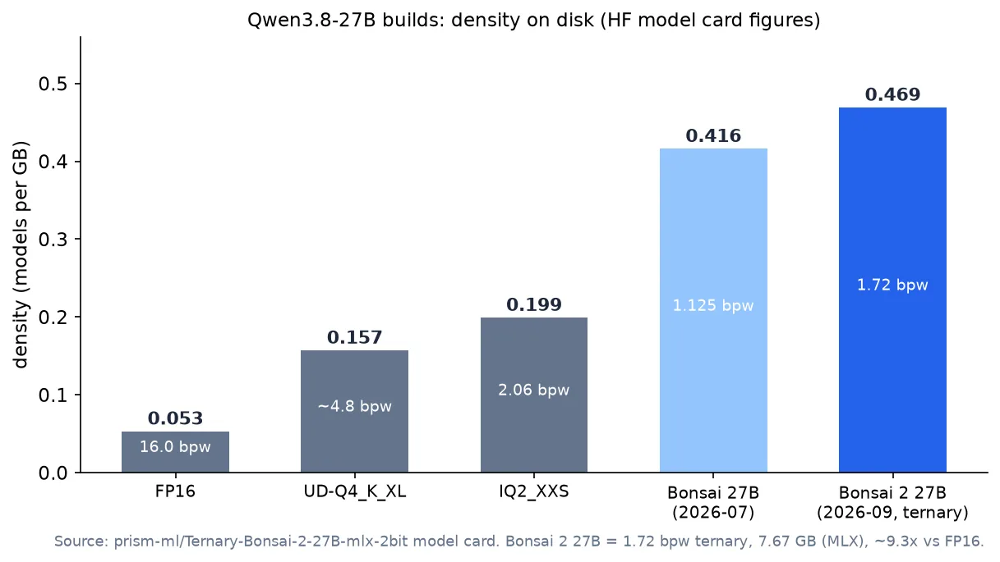

## Who should read this

This post is for infrastructure and platform engineers who have to pick a bit-width build of a 27B-class open model against a node's memory limit. Bottom line up front: a 1.72-bit ternary build of Qwen3.8-27B that fits in 5.9GB genuinely exists, and the model card claims 98.2% of FP16 performance retained across 14 thinking-mode benchmarks. And there is a caveat before you take that claim at face value: the gap's source is not the storage format but an undisclosed quantization algorithm, which we verified firsthand with the released 1.7B weights in July.


## In plain terms

Imagine compressing a 54kg dumbbell set into a 6kg case. The weight is one ninth, but the load you can actually lift stays at 98%. The catch: the compression method is not public. If you try to pack it yourself from the format alone, the dumbbells shatter (collapse) and nothing lifts at all. This post is about the 27B version of someone who has that method, and we hold a record of opening the 1.7B case ourselves to check it was real.

## Overview

PrismML's Ternary Bonsai 2 27B, released in September 2026, is a ternary quantization (each weight takes one of −1, 0, +1) of Qwen3.8-27B. It is a hybrid-attention causal LM, and the build includes a 0.92GB vision tower, making it multimodal. The model card's core figures:

| Item | Figure (model card) |
|---|---|
| Weight bit-width | 1.72 bpw (2.25 as stored in MLX) |
| Disk size | LM 7.67GB + vision 0.92GB = 8.60GB (GGUF PTQ1_0 is 5.95GB) |
| vs FP16 | ~54GB → ~9.3x (ideal weight-only figure) |
| Performance retention | 98.2% of FP16 intelligence (mean 86.32 → 84.78 over 14 thinking modes) |
| Density | 0.469 models/GB (2.3x IQ2_XXS at 0.199, ~9x FP16 at 0.053) |
| Formats | MLX (Safetensors), GGUF (PTQ1_0 / PQ2_0 / Q2_0) |
| License | Apache-2.0 |

The 14 thinking modes are MMLU-Redux, MuSR, GSM8K, MATH-500, AIME25, AIME26, HumanEval+, MBPP+, LiveCodeBench, IFEval, IFBench, BFCL v3, MMMU-Pro, and OCR Bench v2: reasoning, math, coding, instruction-following, tool-calling, and vision mixed together. 98.2% is the mean of that set, and the card does not publish per-benchmark retention, so where retention is weakest is not visible from here.



## What the technology is

The storage format is simple. Q1_0_g128 means 128 weights share one FP16 scale; for ternary that is (128 × 1.5 + 16) ÷ 128 = 1.71875, rounded to 1.72bpw. Binary is (128 × 1 + 16) ÷ 128 = 1.125bpw under the same structure.

We re-ran that bit-accounting today with our own code (the reproduction harness selftest we built in July): ternary g128 lands at 1.71bpw with a 9.36x compression on naive reconstruction, matching the card's 1.72bpw and ~9.3x. In other words, the "5.9GB" size is partly explained by the format alone, and that part is re-verified.

The unexplained part is bigger. How the weights get assigned to −1, 0, +1 and how the scales get optimized to skip the collapse without retraining is not public. The 8B paper's §3 says "proprietary Caltech intellectual property ... rigorous mathematics rather than ad hoc heuristics." What is public: the format, the inference kernels (PrismML-Eng forks of llama.cpp and MLX), and the benchmarks.

Running it is one of two paths. The MLX build loads with stock mlx_lm:

```python
from mlx_lm import load, generate
model, tokenizer = load("prism-ml/Ternary-Bonsai-2-27B-mlx-2bit")
prompt = tokenizer.apply_chat_template(
    [{"role": "user", "content": "Explain the hybrid attention design of Qwen3.8-27B"}],
    add_generation_prompt=True)
text = generate(model, tokenizer, prompt=prompt, verbose=True)
```

The GGUF builds split: PTQ1_0 (5.95GB) needs the PrismML kernel fork, while Q2_0 (7.63GB) runs on stock llama.cpp b11556+. Between the 5.95GB density and the 7.63GB standard-compatibility build sits a 1.7GB choice.

Ternary spending 0.59bpw more than binary has a structural reason. Allowing zero as a weight value puts sparsity into the format itself, and that directly lowers reconstruction error. In the same selftest, naive reconstruction relative error is 0.6004 for binary and 0.4348 for ternary, about 28% lower. In our July 1.7B verification, both naive variants collapsed: binary at 601,600x, ternary at 731,792x. More bits did not save naive assignment. The 0.59bpw is space for "where to put the zeros," and that placement is what makes it lossless. The placement algorithm is the undisclosed IP.

## Our verification record (July 2026, 1.7B)

In July, when the 1.7B variant of the same family was released, ThakiCloud ran an independent verification on a fixed evaluation passage. The conclusion: "the released model is genuine; the public format alone is not reproducible."

| Variant | bpw | PPL (fixed passage) | vs FP16 |
|---|---|---|---|
| Qwen3-1.7B FP16 | 16 | 2.027 | 1.00x |
| PrismML 1-bit Bonsai (released weights) | 1.125 | 1.971 | ~0.97x (lossless) |
| QuIP (rotation + GPTQ, public stack) | 1.125 | 4.213 | 2.1x |
| QuIP + salient 3% | 1.571 | 2.24 | 1.1x |
| naive binary (public format) | 1.125 | 2,109,839 | 601,600x (collapse) |
| naive ternary g128 (public format) | 1.71 | 2,688,795 | 731,792x (collapse) |



Three takeaways from the table. First, loading the released weights with stock transformers yields perplexity nearly identical to FP16: "lossless" at 1.125bpw is a re-measurable fact, not a self-report. Second, naive quantization from the public format alone collapses by 10^5 to 10^6: the format does not prevent collapse. Third, the public stack (GPTQ error compensation, QuIP rotation, salient-weight handling) gets close, but standing lossless at pure low-bit with no escape hatch remains in the undisclosed territory.

The recovery arc is worth recording: naive collapse (~10^6x) drops to the 10^5x range with GPTQ error compensation, incoherence rotation (QuIP) reaches 2.1x at pure low-bit, and keeping the top 3% of salient weights in FP16 closes it to 1.1x. At 1.7B, that public stack approaches "usable," while PrismML stood lossless at 1.125bpw pure with no 3% escape hatch. Our July observation that incoherence scales with model size (the 0.6B anomaly of 1277x shrank to 2.1x at 1.7B) points in a favorable direction at 27B, but whether it holds at 27B is not knowable before a 27B re-measurement.

PPL on a short fixed passage is a coarse signal. It separates "works" from "collapses," but it does not prove per-category retention (the 98.2%). Independent re-verification of the 27B figure requires serving the density build with the custom kernels and running the full benchmark suite.

## Implications for ThakiCloud products

As a platform that serves the same base model, this figure is a choice, not a comparison. Our production serves an NVFP4 4-bit build of Qwen3.8-27B; at 4-bit class, bit accounting puts it at roughly a third of the 16bpw size (~15GB [bit-accounting estimate]), while the 1.72bpw ternary sits below half of that (ideal 5.8GB, 7.67GB as stored in MLX). If both builds can be served, the number of models per node doubles.

That changes the unit of capacity planning. The question shifts from "does this model's weights fit in memory" to "how many copies of this intelligence fit on this node." For on-prem and sovereign customers where node count is fixed, the density of 27B-class intelligence maps directly to serving unit cost, and 5.9GB widens the serving radius to consumer-grade single GPUs and unified-memory machines. The price of buying density is twofold: dependence on the undisclosed kernels (PTQ1_0 requires the PrismML fork of llama.cpp; Q2_0 needs b11556+), and the verification burden that 98.2% is a mean in which per-benchmark gaps may hide.

One line reaches the agent view as well: when serving cost drops with model density, the same budget runs more agent executions, which is the share the serving layer contributes to the execution economics of Paxis.

## Limits and counterarguments

First, 98.2% is the mean over 14 thinking modes. The card publishes no per-benchmark retention, so whether retention is weakest on the hardest reasoning items is not judgeable from this post. Second, do not forget the method is undisclosed. This model is not "a public format that quantizes well"; it is "released weights holding a sealed algorithm inside a public format." A third party can re-verify the bit-account and the behavior of the released weights, and nothing more; the right order is to adopt the 27B only after it passes the same independent verification the 1.7B did. Third, kernel dependence: using the 5.95GB density on stock runtimes means following the PrismML fork, and the fork's maintenance rhythm joins the serving risk. Fourth, do not credit the compression with the base model's strength. Qwen3.8-27B is already a strong open model in agentic and coding workloads; half of the 98.2% comes from "the base was good."

## Wrap-up

If your condition is "node memory is 6GB-class and I need 27B-class intelligence," 1.72-bit ternary has moved from out-of-scope to a real option. If you have the memory headroom for 4-bit NVFP4-class, the quality margin is wider and the verification burden is smaller, so taking 4-bit over density is the lower-risk choice. The decision order is always the same: independently confirm the format's bit-account, re-measure the released weights on a stock runtime, and only then check per-category retention with the full benchmarks. Those three steps are what convert "98.2%" from a self-report into a verified fact.

## Sources

- Hugging Face model card: prism-ml/Ternary-Bonsai-2-27B-mlx-2bit (fact-checked 2026-11-08)
- PrismML: Bonsai 2 27B release (prismml.com/news/bonsai-2-27b, 2026-09-17)
- GGUF builds: prism-ml/Ternary-Bonsai-27B-gguf (PTQ1_0 / PQ2_0 / Q2_0)
- ThakiCloud independent verification record: outputs/bonsai-repro/REPORT.md (2026-07-16, Qwen3-1.7B)
- Bit-accounting selftest: outputs/blog-impl/ternary-bonsai-27b/selftest.log (2026-11-08)
