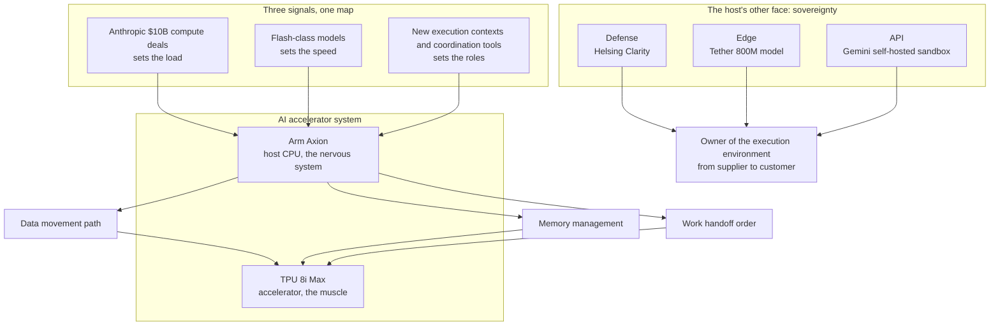

If you have been watching only the chip market, you may have missed the more important move today. Google replaced the host CPU of its newly announced TPU 8i Max with Arm Axion. The accelerator is still a TPU. The quiet layer beside it, the 'host,' is what decides data flow and task orchestration. The point that passes silently beneath the chip's spotlight is today's real news.

Every AI accelerator has a side that gets no spotlight. If the accelerator is the muscle, the host is the nervous system. The chip that does the matrix math, the accelerator. And the CPU that fetches and manages data and hands work off in order, the host. Google reported that the majority of new AI accelerator hosts are now moving to Arm architecture. The story is short. The room to read it is wide. Because the host decides how the accelerator behaves, where the data flows, and who conducts the task orchestration.

The concept of a host is not new to people used to servers. On an ordinary server, the CPU runs the operating system, manages memory, and hands accelerators to applications in turn. This time the status has flipped. With the accelerator at the center of AI, the CPU sitting beside it has become the 'host' that decides the accelerator's fate. The muscle's spec is visible at a glance. The value of the nervous system shows only when it fails. Google is betting that the latter is worth standardizing.

*The article's core concept, visualized.*

## The Muscle Is the TPU; the Nervous System Is the Host

According to the report, the Axion host CPU is in charge of data management and orchestration for the TPU 8i Max. An accelerator's performance is set on announcement day. The host's performance is reset every day, every second. Fetching the data, distributing the work, keeping the flow between accelerators, all of it passes through the host's hands. The same TPU shows a different face depending on which CPU serves as the host. In the past the host was the obvious answer. Now it is a variable of choice. The fact that the majority of new accelerator hosts are moving to Arm means Google itself sees the host as a platform worth standardizing.

Two places in this move deserve attention. First, the diversification of the accelerators themselves. When TPUs, GPUs, and other accelerators are used together, the common language that manages them becomes the host layer. Second, portability. When the host is standardized, the same software and orchestration policies can travel across heterogeneous hardware. That is why the word 'host' feels heavier than the spec war.

Another way to weigh this news is the word 'majority.' If only a few models had adopted Arm hosts, it would be a simple episode. But when the majority of new accelerator hosts move to a single architecture, the host has started playing the role of a platform. Platforms grow standards. Where the standard is set, the cost of moving software and orchestration policies is set too. For a company that must herd heterogeneous accelerators into one fleet, the value of a standardized host outruns the performance of any single TPU.

It is worth asking what changes when the host changes. The host's architecture decides the path of data movement, the way memory is managed, and the order in which work is handed off. Even with the same accelerator, a different host regime means re-fitting the software stack. The reason Google is taking the Arm host to standard status is a calculation to erase that re-fitting cost in one stroke. Buying an accelerator and plugging it in is easy. Making it move as one body is the host's job.

## The 'Host' the Industry Is Moving On at Once

This is not just Google's move. The other news of today each points at the same question. Who runs where, and who coordinates.

The heaviest is money. Anthropic, the maker of the Claude AI assistant, signed new hardware deals worth more than $10 billion with Microsoft and Google. The purpose of the deals is compute, that is, expanded access to compute resources. In an era where model companies buy compute in the tens of billions of dollars, the load the host must carry rises to a business question. The more compute concentrates on specific suppliers, the more valuable the control layer that manages it flexibly becomes. In the era of ten-billion-dollar compute contracts, the question is who manages it and at what cost. The place where that management happens, the host, naturally gets heavier. The faster the market for buying and selling compute grows, the faster the weight of the market that decides how compute is used grows.

Speed is moving too. Google is reported to be distributing a new model under the codename Hydrogen, known as Gemini 4 Flash, to employees through the Jetski development platform for internal evaluation. At the same time, Gemini has landed on Apple CarPlay in a latest app update, spreading as a voice assistant on the dashboards of iOS-compatible vehicles around the world. Agents are moving into new execution contexts. The host's job of orchestrating data and work widens accordingly. An in-car voice assistant is the case where latency and context matter more than raw performance. The moment the place where a user speaks becomes a new execution context, the range of coordination the host must absorb grows with it.

What deserves attention here is the place. The model is moving all the way to where the actual user sits.

A coordination tool has appeared too. Roma 2.0, released by Jans, the former Loom founder, is a task management system for AI assistants. It is designed so that different bots collaborate on a single project using a shared context. The brain of the agent, the body of the sandbox, the nerves of coordination. Today's news shows the anatomy of the host layer as is. The moment multiple agents share a context, the question arises: who can read and change what. That is exactly the boundary problem beside the host.

Read the three stories on one map and the same shape appears. The compute contracts set the load the host must carry. Flash-class models set how fast the host must respond. New execution contexts and coordination tools set which roles the host will take on. Load, speed, role. Where all three grow at once, a layer that can govern all three together is needed. The name of that layer repeats across today's news with the same face.

The three things the host decides are being pressed at once by today's signals, and the three sovereignty signals point at the ownership of the same layer. Restated, the map says this: where the nervous system's load, speed, and roles grow, the owner of the execution environment moves from supplier to customer.

## The Host's Other Face: Sovereignty

As execution environments diversify, the next question is who owns the host. Today's three signals give the hints. One is defense, one is edge, and one is a hyperscaler's API.

First, defense. Helsing, a German defense-tech startup valued at $18 billion, unveiled Clarity, an agentic intelligence platform. Clarity, designed in Europe to counter Palantir's Maven, helps military monitoring missions. In the military domain, where the execution environment runs is the premise. The design requirement of such a platform is sovereignty.

Second, edge. Tether, the issuer of the USDT stablecoin, released a new 800M-parameter model for local tasks such as mobile. It processes data on-device without a constant cloud connection. The fact that a stablecoin issuer entered AI is secondary. The point is that it made cloud-independent execution a product. Seen from the edge, the same logic works in reverse. The less the dependence on the cloud, the more the host beside it must support execution and policy.

Third, and the most convincing, is Google itself. The Gemini API now offers self-hosted sandbox support for managed agents. Developers can integrate their own execution environment and run AI agents in it. A hyperscaler's agent platform has opened ownership of the execution environment to customers. If today's flow has to be compressed into one sentence, this is the most fitting one: by making room for the execution environment in its own agent platform, Google is signaling that the responsibility for execution and control of the data belong to the customer. Even with the same model and the same API, the moment execution happens in the customer's environment, the next topic becomes which policies govern that environment.

The host can no longer be explained by the CPU alone. It is becoming the layer where execution, data, policy, and sovereignty gather. And in that layer, ownership of the execution environment is moving from supplier to customer. The common denominator of the three signals is that the execution environment is coming under customer control. Defense under the name of sovereignty, edge under the name of disconnection, and the hyperscaler's API under the name of customer choice, all moving in the same direction. The subject of execution is passing from supplier to customer.

## Where the Agent Host Becomes a First-Class Citizen

In the agent world, this host role has already taken its place as a product. ThakiCloud's Paxis is an agent-native cloud. As the official product v1.1 GA, it serves the host layer of agent workloads. Skills, Tools, Policies, and Audit Logs are managed as first-class resources.

The industry's pain revealed by today's news and this design's response overlap naturally. In an environment where compute contracts concentrate on a few suppliers and the price of Flash-class models keeps falling, a CostRouter that picks a model per task absorbs cost volatility as routing policy. When an agent must run on an air-gapped network, in a sovereign data center, or in a K8s cluster the customer opens itself, isolated sandbox execution and the ai-platform for sovereign/on-prem K8s deployment become the landing point. As the scope of multi-agent coordination widens, the L0~L3 autonomy governance, policy gates, and audit logs draw the boundary of who can do what. MCP connectors and the skill market open the path for external tools and skills to join this host. The moment an agent touches tools and data across several organizations, audit logs become the basic material of operations. The diversification of execution environments and the shift of ownership that today's news point to are exactly the yardstick of such a host layer's maturity.

If the accelerator's host decides data flow and orchestration, the agent's host decides the range of autonomy and the cost of execution. Google is standardizing its own host, and customers have started demanding ownership of the execution environment. Today's news points exactly at that spot. The year the question of who owns execution became an infrastructure question.

## What to Watch

The era in which the accelerator was the object of the conversation is ending. The era in which the host, which decides what runs where and under which rules, sits at the center of the conversation has begun. In a world where accelerators become commodities, the difference is made by the host that manages them. If you want to see the direction of the AI industry, it is better to look at the host first, as today.

## References

This post is written from the news below.

- HuggingNews, [Google Transitions Majority of New AI Accelerator Hosts to Arm Axion CPUs](https://huggingnews.com/ai/update-google-transitions-majority-of-new-ai-accelerator-hosts-to-arm-ax-91e6713b)
- HuggingNews, [Anthropic Adds $10B in New Compute Deals With Google and Microsoft](https://huggingnews.com/ai/anthropic-adds-10b-in-new-compute-deals-with-google-and-microsoft-6a4f5226)
- HuggingNews, [Former Loom Founder Jans Launches AI Agent Coordination Tool Roma 2.0](https://huggingnews.com/ai/former-loom-founder-jans-launches-ai-agent-coordination-tool-roma-2-0-53818414)
- HuggingNews, [Helsing Unveils Clarity AI Platform to Rival Palantir's Maven in Europe](https://huggingnews.com/ai/helsing-unveils-clarity-ai-platform-to-rival-palantirs-maven-in-europe-0672d207)
- HuggingNews, [Google Internally Tests New Hydrogen Gemini 4 Flash AI Model](https://huggingnews.com/ai/google-internally-tests-new-hydrogen-gemini-4-flash-ai-model-f594284b)
- HuggingNews, [Tether Releases 800M Parameter AI Model for Local Mobile Tasks](https://huggingnews.com/ai/tether-releases-800m-parameter-ai-model-for-local-mobile-tasks-290bcf8f)
- HuggingNews, [Google Launches Gemini AI Assistant on Apple CarPlay Worldwide](https://huggingnews.com/ai/google-launches-gemini-ai-integration-for-apple-carplay-3712fc80)
- HuggingNews, [Google's Gemini API Now Supports Self Hosted Sandboxes for Managed Agents](https://huggingnews.com/ai/googles-gemini-api-now-supports-self-hosted-sandboxes-for-managed-agents-96a6380b)
