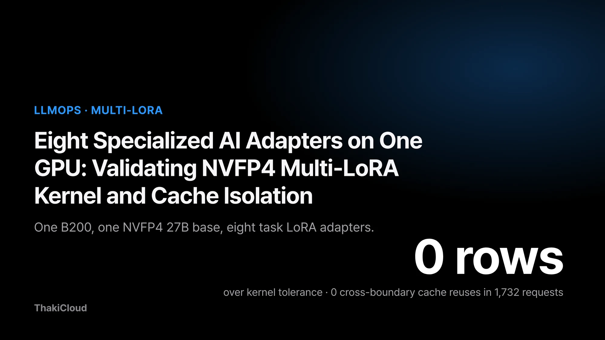
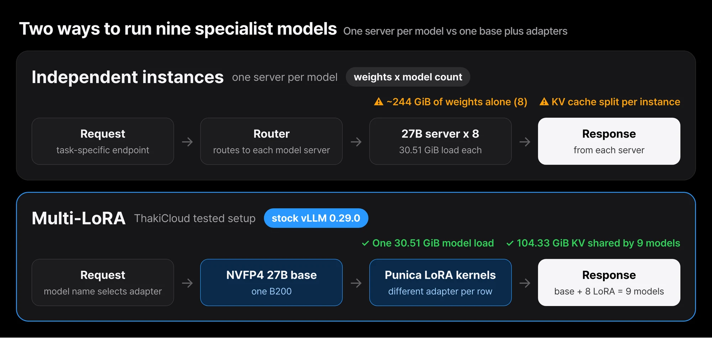
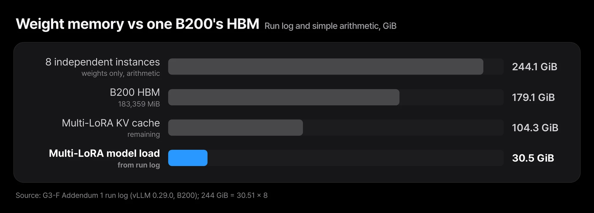
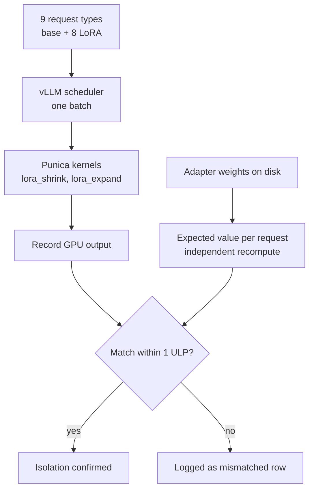
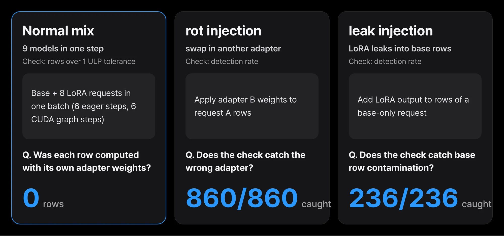

*B200 NVFP4 Multi-LoRA kernel and cache isolation (kernel 2026-11-14, prefix cache 2026-11-16)*

Picture a security operations center that has just brought in a model for security verdicts. Next quarter it needs a model that writes up detection evidence, and after that one that flags RAG answers drifting away from their source documents.

If every task gets its own 27B model on its own server, the GPU count simply tracks the number of specialist AIs. That is the cost structure MSSPs, security integrators and teams running in-house private AI are dealing with today.

ThakiCloud tested one way to change that structure on a single B200. We took one NVFP4-quantized Qwen3.8-27B base and attached eight task-specific LoRA adapters exactly as trained, with no retraining, merging or requantization, and served nine logical models (the base plus eight adapters) from one vLLM engine.

The first question operators ask is whether adapters get mixed up when requests share a batch. On the real NVFP4 27B server we recomputed every LoRA linear module and every token row from the adapter weights on disk and compared.

Zero rows exceeded the tolerance. We then used 1,732 requests to check that the prefix cache, which reuses KV cache from earlier requests, is never reused across adapter or tenant boundaries.

This post covers the setup and the memory arithmetic, how we checked kernel and cache isolation, why the first run was judged a failure, and what this result does not yet tell you. To say it up front: this validation did not establish product stability or task quality, and the configuration is not approved as a product for security decisions.

## Every new specialist AI means more GPUs

The simplest way to add specialist AIs is to fine-tune a model per task and run each as an independent server. It is easy to reason about and failures stay contained.

The cost is that the base weights are loaded into GPU memory once per model, and the KV cache (memory that stores computed state for earlier tokens) is allocated separately per server. When one task gets a burst of traffic, it cannot borrow spare memory from the other servers.

LoRA (Low-Rank Adaptation) is a fine-tuning method that freezes the base weights and trains two small low-rank matrices to add a task skill. Adapters are far smaller than the base, so if the base is shared and each request applies its own adapter, memory grows only by the adapter size as you add specialist AIs.

The idea is not new. S-LoRA and Punica, covered below, proposed it. What we wanted to know was whether it actually behaves correctly with this combination: 27B scale, an NVFP4-quantized base, a B200, and task adapters we trained ourselves.


*Independent instances load the weights once per model and split the KV cache per instance. Multi-LoRA computes different adapters for different requests in the same batch on a single base.*

## One base, eight task adapters

The base is [ThakiCloud/Qwen3.8-27B-NVFP4-GPTQ-txt](https://huggingface.co/ThakiCloud/Qwen3.8-27B-NVFP4-GPTQ-txt), the original Qwen3.8-27B quantized to NVFP4. NVFP4 is the 4-bit floating-point format supported by NVIDIA's Blackwell generation.

All eight adapters were trained on the BF16 base, and we did not retrain them for the quantized base, merge them into it, or quantize them again. The trained adapter files were attached as they were.

| Served name | Task | Public repo |
|---|---|---|
| secproof | Security proof generation | [ThakiCloud/Thaki-SecProof-27B-V1](https://huggingface.co/ThakiCloud/Thaki-SecProof-27B-V1) |
| secdecision | Security verdicts | [ThakiCloud/Thaki-SecDecision-27B-V2](https://huggingface.co/ThakiCloud/Thaki-SecDecision-27B-V2) (LoRA part) |
| factguard | Fact checking | [ThakiCloud/FactGuard-27B-LoRA](https://huggingface.co/ThakiCloud/FactGuard-27B-LoRA) (v0.3-sft) |
| raggate | RAG gate | [ThakiCloud/RAG-Gate-27B-LoRA](https://huggingface.co/ThakiCloud/RAG-Gate-27B-LoRA) |
| ops | Operations agent | [ThakiCloud/Thaki-Ops-27B-v0.1-alpha](https://huggingface.co/ThakiCloud/Thaki-Ops-27B-v0.1-alpha) |
| hw | RTL and hardware | [ThakiCloud/Thaki-HW-27B-v0.1-lora](https://huggingface.co/ThakiCloud/Thaki-HW-27B-v0.1-lora) |
| satoori | Korean dialects | [ThakiCloud/Qwen3.8-27B-Satoori-KO-LoRA](https://huggingface.co/ThakiCloud/Qwen3.8-27B-Satoori-KO-LoRA) |
| humanko | Human-KO SFT | [ThakiCloud/Qwen3.8-27B-Human-KO-LoRA](https://huggingface.co/ThakiCloud/Qwen3.8-27B-Human-KO-LoRA) |

The serving engine is unpatched vLLM 0.29.0. The LoRA settings below are the whole list, and the maximum length was 32K. Adapter paths are placeholders rather than our deployment paths.

```bash
vllm serve ThakiCloud/Qwen3.8-27B-NVFP4-GPTQ-txt \
  --enable-lora \
  --max-loras 8 \
  --max-lora-rank 16 \
  --max-num-seqs 48 \
  --max-model-len 32768 \
  --lora-modules secproof=<path> secdecision=<path> factguard=<path> raggate=<path> \
                 ops=<path> hw=<path> satoori=<path> humanko=<path>
```

Clients pick an adapter by putting a served name such as `secproof` or `raggate` in the `model` field of the OpenAI-compatible API. Calling the base computes without an adapter. The endpoint ThakiCloud uses day to day has DFlash2 speculative decoding attached, but we turned it off for this test so that isolation and decoding speedup would not be mixed into one experiment.

## Eight independent instances do not fit on one B200

In this run's log the NVFP4 27B checkpoint was 28.05 GiB and model loading took 30.51 GiB. That left 104.33 GiB available for the KV cache. The B200 has 183,359 MiB of HBM, about 179 GiB.

If you run the same model as eight independent per-task instances, simple arithmetic puts the weights alone at about 244 GiB. That does not fit on one B200, so you need at least two, and the KV cache is split across instances as well. In the Multi-LoRA setup only one copy of the base plus the small adapters is loaded, and the remaining 104 GiB of KV cache is shared by all nine models.


*Eight independent instances exceed one B200 (about 179 GiB) on weights alone. Multi-LoRA left 104.33 GiB of KV cache after a 30.51 GiB model load. This is memory arithmetic, not a cost measurement.*

These numbers are memory arithmetic. We did not measure throughput, latency, power or cost per request, so there is no basis yet for saying that some number of GPUs became fewer GPUs or that cost fell by some percentage.

We handle cost comparison only through a model that takes a customer's GPU price, request volume, concurrency and SLA as inputs, and its output is labeled as an estimate, not a measurement.

## Checking at the kernel level that adapters stay separate when requests mix

Operators worry about two failures with Multi-LoRA. One is request B's adapter being applied to request A's tokens. The other is LoRA output leaking into a base request that should use no adapter. Comparing response text does not reliably catch either, because when adapters answer similarly a wrong computation can still produce a plausible sentence.

So validation G3-F Addendum 1 (2026-11-14) looked directly at the output of the Punica kernels vLLM uses for LoRA. These are two Triton stages, `lora_shrink` and `lora_expand`, that compute each row in a batch with the adapter of the request that row belongs to. The verdict was `FAST_KERNEL_ISOLATION_PASS`, meaning kernel isolation held on a limited sample.



Stage P0 tested the kernels alone with synthetic tensors and no model. With a 4096 to 4096 linear layer, rank 16, 768 rows and three seeds, we ran six cases covering a batch of the base plus two LoRAs and a batch of the base plus eight LoRAs, and all six passed. Zero values exceeded the tolerance and no base row was modified.

An independent reference that recomputed everything from scratch without touching the kernel buffers gave ratios of 0.47 to 0.79, under the 1.0 pass line. To see whether the check itself catches faults, we injected two on purpose. "rot" swaps one request's adapter weights for another adapter's, and "leak" adds LoRA output to base rows. Both were detected on every seed.

Stage P1 brought up the real NVFP4 27B server. For every LoRA linear module and every token row we compared the value the GPU kernel wrote against the expected value computed from that request's adapter weights, checked against the contents on disk.

The tolerance was 1 ULP. A ULP is the size of one step in the last place of a floating-point number, so a 1 ULP difference is the smallest difference there is, the kind that a change in rounding order can produce.


*Three checks on the real NVFP4 27B server. Normal mixed batches had no wrong rows, and every injected fault was caught.*

Here is what we found. Zero rows exceeded the tolerance and no base row was modified. There were zero mismatches between the adapter a request was routed to and the model recorded in the response. Across the nine models including the base, all 72 ordered pairs (9×8) were distinguished, each backed by at least 145 rows.

All nine models landed in a single GPU step six times on the eager instrumented server and six times on the CUDA graph server. On the CUDA graph server, the metadata buffer passed to the kernels (the table saying which row uses which adapter) matched the actual request mapping on all 370 of 370 steps. When we injected rot and leak faults on the same server, they were detected 860/860 and 236/236.

## Telling a 1 ULP difference apart from a wrong adapter

The verdict did not come on the first try. The first run, a day earlier, was judged `NOT_ISOLATED_ULP_DRIFT`. In 2 of 2,792 rows in the mixed run, a difference within 1 ULP appeared (metric value 0.0104). The baseline for comparison had only 735 rows, so the threshold sat at its floor value of 0.001. The two small differences crossed it, and by the rules that was a failure.

For the second run we grew the baseline to 48,589 rows. The same kind of difference then showed up in 11 rows (2.3×10⁻⁴) even when only one model was running. In other words, it was not something that only happens in mixed runs.

The mixed-run rate (7.2×10⁻⁴) is about three times the baseline, but with only two cases the baseline rate alone gives about a 13% chance of seeing two or more. That is neither evidence of a mixing effect nor proof that there is none.

The NVFP4 independent baseline came from 81 single-model steps and 48,589 LoRA rows. Zero values exceeded 1 ULP, and the largest fraction of elements with differing bits was 0.010417. Under the pre-registered rule (four times the observed maximum) that set the threshold at 0.0417. We did not borrow values observed on the BF16 side to set it.

The first verdict stays on the record, unchanged. The point of growing the baseline was not to manufacture a PASS but to separate a 1 ULP numerical difference from a wrong LoRA being applied. The fact that the same check caught all 860 rot injections is the evidence that it tells a wrong adapter apart from a 1 ULP difference.

Actual GPU time was 21.6 minutes, about 0.36 GPU-hours on a B200. When we tried to answer the same question with a full BF16 evaluation it took 6.3 hours, but the scope of that check was different, so it should not be read as a like-for-like comparison.

## The prefix cache did not cross adapter or tenant boundaries either

Computation can stay separate and things can still mix through another path. vLLM's prefix cache reuses the KV cache of a prompt whose beginning matches an earlier one, which saves computation.

But if two requests with the same system prompt belong to different adapters or different customers, that reuse is both a computation error and a breach of an information boundary, because LoRA-applied KV values differ per adapter.

Validation R7-C1 (2026-11-16) looked at this path alone. The engine was vLLM 0.33.0rc1, a different version from the 0.29.0 used for the kernel check above. There were 1,732 requests in total: 16 in a pre-check (GATE) on two items, and 1,716 in the main run (FULL) on 44 items × 9 models.

- 886 requests (GATE 6 + FULL 880) resent the same prefix with the same adapter and the same cache namespace (the same tenant salt, or no salt on both), so they should have hit the cache. All 886 did. At least 3,328 tokens were reused, 97.9% of the prompt. This confirms the cache was actually on.
- 846 requests (GATE 10 + FULL 836) should not have hit the cache, and none did. In 792 of the FULL ones, the same prefix was already in the cache under a different adapter or a different salt just before the request, so a wrong reuse was actually possible.
- Wrong reuse across adapters (cross-LoRA) and across tenant salts (cross-salt) was zero. That includes 44 chances where one tenant had just filled the cache and another tenant salt sent the same prefix, and 396 chances where a request without a salt followed a salted one with the same prefix.

The verdict was `R7C1_PASS`, and a recount by a separately written script that does not import the verdict code produced the same result. The first attempt did not finish because of an infrastructure problem and is recorded as `INCOMPLETE_INFRA`.

Two conditions apply to the reading. Requests without a salt do reuse the cache within the same adapter. That is normal engine behavior and not evidence of tenant isolation; separating tenants requires a salt on every request. Also, vLLM's cache key contains the adapter's name and path, not its weights.

Reloading different weights under the same name and path was outside this test, so operations need a rule to change the name or path whenever an adapter changes. This shows that vLLM's cache salt separates cache reuse; it is not a certification of multi-tenant security as a whole.

## Adapter quality is judged separately

Kernel isolation means each request is computed with its own adapter. It does not mean that adapter delivers its original quality on the NVFP4 base. The adapters were trained on the BF16 base, so quality when attached to the quantized base has to be judged per adapter. These are the verdicts as recorded in the ledger.

| Adapter | Verdict when attached to the NVFP4 base as is |
|---|---|
| SecProof | QUANT_ADAPTATION_NOT_NEEDED (judged usable without retraining) |
| RAGGate | QUANT_ADAPTATION_NEEDED (needs adaptation to the quantized base) |
| FactGuard | QUANT_ADAPTATION_NEEDED (needs adaptation to the quantized base) |
| Satoori | Undecided |
| SecDecision | Reported for reference only |
| Ops, HW, Human-KO | Not in scope of this verdict |

So putting all eight on one engine works, but that does not mean all eight are ready to use at their quality on NVFP4.

The task evaluation (E1, 2026-11-16) split the same way. SecProof got all 327 items right and did not degrade with DFlash2 acceleration on. RAGGate (accuracy 0.9367) and FactGuard (0.9167) had the same accuracy with DFlash2 on and off, but each produced one new severe misjudgment only with it on.

Follow-up analysis found the same flips with DFlash2 off, and sending one request repeatedly, alone and with no cache hits, gave slightly different top-candidate token probabilities every time. On items near a decision boundary, a difference that small is enough to change the answer.

We did not establish the cause of this repeat instability. Both diagnostic runs meant to narrow it down failed at the instrumentation stage. We confirmed only that the LoRA path runs through a particular kernel (split-K with atomic accumulation). That this kernel runs is not proof that it causes the instability.

The diagnosis was closed with the cause undetermined. We therefore have not approved this configuration as a product for tasks like security decisions, where the same input must get the same answer. If the work resumes, we will not load all eight at once; adapters will go in one at a time, starting with those that pass per-task quality gates.

## What this result does not tell you

This validation checked two narrow properties, kernel and cache isolation. You cannot claim the following from it.

- Task quality of each adapter. Apart from SecProof, the adapters either need quantization adaptation or have no verdict yet.
- Repeat-decision stability. The same request still gets slightly different probabilities, which can flip answers on boundary items, and we have not established why.
- Long-running stability. The kernel check sample is limited to nine evaluation prompts and four mixed rounds.
- Kernel output during CUDA Graph replay. On the CUDA Graph server we only confirmed that the metadata buffers matched; row-level output differences were measured directly only on the instrumented server with CUDA Graph off.
- Product behavior combined with DFlash2 speculative decoding. The integration test could not tell adapters apart, so product use is on hold.
- Throughput, latency, power and cost per request. We did not measure them, and the cost measurement run is on hold. There is no measured cost saving.
- Access control over customer data. Kernel and cache isolation mean computation and cache entries do not mix. It does not guarantee per-tenant data isolation, authentication or log separation. Those have to be designed and verified separately at the platform layer.
- Production approval. This result is not a decision to go to production.

## What we confirmed on the path S-LoRA and Punica opened

The idea that many LoRA adapters can share a base to improve memory and batching efficiency came from earlier research. [S-LoRA (Sheng et al., 2023)](https://arxiv.org/abs/2311.03285) showed how to serve thousands of adapters on one machine with a unified memory pool, which keeps adapters in main memory and moves only the ones used by running requests onto the GPU, plus custom kernels.

[Punica (Chen et al., 2023)](https://arxiv.org/abs/2310.18547) proposed the SGMV (Segmented Gather Matrix-Vector Multiplication) kernel, which batches requests that use different LoRAs together, and showed that the GPU only needs one copy of the base.

What ThakiCloud adds is not a new algorithm but measurement. On a real combination of 27B scale, an NVFP4-quantized base, a B200 and eight task adapters we trained ourselves, we checked isolation by comparing kernel output row by row rather than comparing response text, and separately checked that the prefix cache does not cross adapter and tenant boundaries.

We also published the failed verdicts and how they came about, along with the limits of per-adapter quality and repeat stability.

## What changes for private AI operations

When an MSSP or security integrator builds private AI inside a customer's environment, adding one specialist AI has so far meant adding GPU servers. If Multi-LoRA with a shared base keeps computation and cache separate, a new task could become training one adapter and registering it with the existing engine.

ThakiCloud's ai-platform runs GPU workloads and vLLM serving on Kubernetes, and Paxis, which runs on top of it, is the control plane that passes agent actions through policy gates and audit logs.

To put specialist models for security verdicts, fact checking and RAG gating on one engine in those gate positions, the models first must not interfere with one another at the computation level.

This validation is the first evidence for that precondition. Actually putting them there, though, requires passing per-task quality gates and repeat-decision stability first, and this result has not reached that stage.

## Closing

We attached eight LoRA adapters we trained ourselves to one NVFP4 27B base without retraining and served nine models from one B200. Even when requests for different adapters shared a batch, each row was computed only with its own adapter, and zero rows exceeded the tolerance. Every injected fault was caught. The prefix cache was not reused across adapter or tenant salt boundaries either.

What we did not verify is just as clear. The sample is small, and most adapters have either not passed or not been judged on task quality and repeat-decision stability. We did not measure throughput or cost. So this configuration is not approved as a product for security decisions, and the DFlash2 combination is on hold. Please do not read a kernel isolation pass as a task quality pass.

If you are evaluating a similar setup, do not stop at comparing response text. Add fault-injection checks and cache boundary checks first. If your check cannot catch rot and leak, you cannot trust its pass verdict either.

**Are you deploying each specialist AI on its own GPU?** ThakiCloud is designing an AI serving architecture that shares one base model across task-specific LoRA adapters. We can review your GPU memory requirements and expected cost against your current setup. Expected cost comes as an estimate, including workloads where a shared setup turns out more expensive.

[Request a free GPU cost assessment]({{ "/en/gpu-cost-assessment/" | relative_url }}?utm_source=techblog&utm_medium=post_cta&utm_campaign=multilora_cost_assessment&utm_content=b200_nvfp4_multilora)
