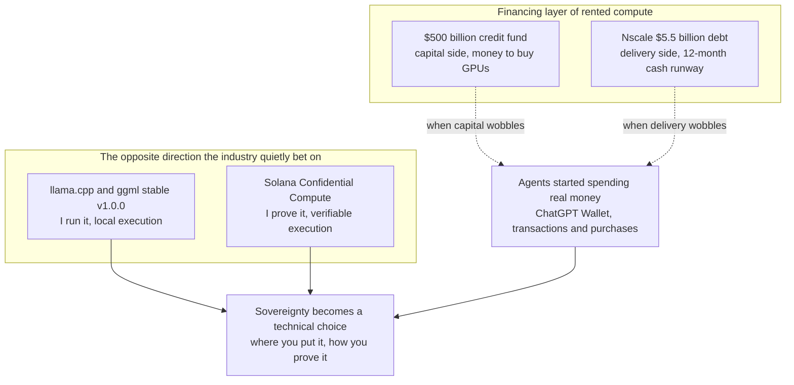

If you have been watching a quieter layer than model rankings or chip geopolitics, this morning's AI news tells a different story. The story that actually moved today was about the money that keeps the GPUs running.

Let me give you the conclusion first. The question of the day is no longer 'which model is strong' but 'who can keep the compute running, and can that compute be trusted.' Today's HuggingNews digest had a lot of familiar stories mixed in. But the signals worth reading were in the quiet layer. Two stories about money, and two stories about running AI inside your own boundary. Put the four together and a clear picture emerges. For operators who run agents on rented compute, today's signals land even more directly.

*The core concept of the post, visualized.*

## Two numbers on one page

Two numbers that are awkward to put side by side stand out in the compute supply chain this morning. One is $500 billion. It is the size of the credit fund for AI startups to buy GPUs, and the partners financing it are reconsidering whether to participate after leadership changes on the Nvidia side. The other is $5.5 billion. It is the debt of GPU cloud Nscale, and its cash runway has shrunk to 12 months. Nscale warned that it needs additional capital to fulfill its 2027 contracts, including building data center campuses.

On the surface, one is a financial story and the other is a corporate finance story. But the layer both point to is the same. It is the money that keeps the GPUs running.

Let me take this further. For a few years, the AI industry's compute has mostly run on a rent-it structure. Someone puts up enormous capital to buy GPUs at scale and build data centers, and leases them to startups and enterprises. The $500 billion credit fund sits at the very top of that structure. It is the money to buy the GPUs, the capital that funds the supply itself. Nscale is the operator that actually carries the debt and delivers those GPUs.

The problem is that both are wobbling at the same time now. If the money to buy GPUs slows down, the flow of new compute shrinks. If the operator that has to deliver compute has 12 months of cash, a question lands on the stability of 'rented compute' that customers took for granted. In other words, renting compute is no longer the safe default. That is today's signal.

It is worth noting that these two numbers are not independent events. One is the 'capital side' that supplies the GPUs, and the other is the 'delivery side' that hands them over. When the capital side wobbles, the debt burden on the delivery side comes to the surface. Both numbers say the same thing in the end. The 'rented compute' model, which was the default for years, has reached a point where it must now defend its own funding and its own solvency.

## The opposite direction the industry quietly bet on

On the other side of that signal there is quiet resistance. On November 13, the developers of ggml and llama.cpp released a stable v1.0.0. It is an update that unifies the technical base of the tools that run AI locally. The fact that the reference framework for local inference has reached the number 1.0 means that the scattered execution tools are converging on a single trustworthy base. The same day, Solana released Solana Confidential Compute, an open source tool bundle. It is a system that lets developers build private AI applications using hardware-based verification and on-chain attestation.

The two companies are different, and on the surface their directions differ. But the logic underneath is one. Run AI inside your own boundary, on your own hardware, and in a verifiable way. The days when local inference was a hobby and privacy was an add-on option are over. The stabilization of the local base and the spread of confidential computing are the hedge the industry has quietly laid down against the risk of the GPUs it rents and lends.

Let me connect this to the section right before. When the financing layer of rented compute wobbles, the value of 'I run it and I verify it' rises. llama.cpp is the answer to 'where do you run the model,' and Solana Confidential Compute is the answer to 'how do you prove that run is safe.' The two fill in both faces of sovereignty at the same time.

Restated as one map: the wobbling financing layer (capital side, delivery side) and the quiet hedges (local execution, confidential execution) meet at the layer of agents spending real money, and together they make sovereignty a technical choice.

Why does this matter? Because these technologies are no longer in the experimental stage. llama.cpp reaching 1.0 means the local execution base has entered a stage where downstream tools can depend on it. And Solana's confidential computing is open source that anyone can audit. 'I run it and I prove it' has moved from the territory of 'can it be done' to the territory of 'will it be done.' That is the essence of the change.

## Why sovereignty became a technical choice

Today's chip news completes this picture. OpenAI told congressional offices that it supports passing a bipartisan bill to block Chinese companies' access to AI chips. The named bills are the MATCH Act and the AI Overwatch Act. Meanwhile, researcher Will DePue pushed back on doubts about a forensic study linking six Chinese AI models to export-controlled Nvidia Blackwell GPUs, and said the chips used by DeepSeek V4.1 remain uncertain.

Let me unpack the meaning. When chips are managed geopolitically and the chip behind a model becomes a question that requires forensic proof, 'where the compute is and whether it can be verified' is no longer an IT detail. It is an architecture decision. In the past, sovereignty was a sentence that stayed inside policy documents or executive remarks. Now it is a question that must be decided at the design stage. Which model, on which hardware, where, and how do you prove it.

The reality that a researcher must publish a forensic paper to prove which model ran on which chip means that the origin of compute has entered the center of industry trust. Today's structural shift is that sovereignty is coming down from policy documents into the inside of engineering.

## Agents started spending real money

Let me go one layer further. Today's agents are no longer chatbots that just answer. OpenAI launched ChatGPT Wallet, a payment tool that lets dots AI agents execute transactions and buy goods on a customer's behalf. SpaceX also realigned its AI division toward autonomous agents and tools for software developers, and in the process cut Grok Imagine headcount to raise the priority of the Grok bot and coding tools.

What matters here is not that 'the agent got better.' It is that the agent has been made to act in the real world. It spends money and writes code. The moment an agent acts in the real world, the environment that runs it matters. Approval scope, execution isolation, after-the-fact logs. These questions are no longer optional.

And one more step from here connects to today's theme. If the compute that runs the agents is itself rented, and that rented compute is wobbling, infrastructure risk stacks on top of the risk of 'what the agent does.' These two risks are not independent. They multiply.

## What to watch next

So what should we watch next? First, whether Nscale's warning turns into concrete fundraising moves. If the additional capital needed for its 2027 contracts actually comes in, the story about GPU cloud solvency changes. Second, whether the partners of the $500 billion credit fund actually pull out. If they do, the flow of new GPUs slows and the value of 'your own compute' rises. Third, whether llama.cpp 1.0 and confidential computing move beyond developer tools into a default option in enterprise environments. If that happens, sovereignty completes its move from 'alternative' to 'default.' Fourth, how enterprises that move on-prem for sovereignty handle the operational burden of model serving. In a world where you must prove the origin of chips and the safety of execution, the cost of that proof becomes part of the infrastructure. Read that way, all four of today's stories point to this question. One thing to add: these four signals are in a relationship where each confirms the others. When one moves, you read the rest, and when the rest move, one becomes clearer. That is why this morning's picture is not fragments but a single direction.

## The lens that ties it all together

So where does ThakiCloud's Paxis stand in this picture? What today's news ultimately exposed is the pain the industry must solve itself. Open model on-prem serving, GPU scheduling, safe agent execution, sovereignty, cost. Paxis is the agent-native cloud that came out to answer exactly this pain. It is a formal product at v1.1 GA, and it treats Skills, Tools, Policies, and Audit Logs as first-class resources.

The core of this story is that it is about sovereignty. Because Paxis runs on sovereign and on-prem Kubernetes (ai-platform), it has no need to depend on GPU clouds financed with someone else's money. Own boundary, own hardware, own verification. The two signals that llama.cpp and Solana spoke as 'I run it' and 'I prove it' are, here, not ideology but the shape of the product.

Cost is the pain that today's numbers point to directly. CostRouter picks the right model per task and keeps cost down. In the 'money of compute' problem that $500 billion and $5.5 billion point to, the user is no longer held by someone else's funding curve. Isolated sandbox execution, policy gates, and audit logs turn 'should we trust the agent's actions' from a prayer into a manageable problem. The autonomy governance from L0 to L3 sets the approval scope step by step. MCP connectors and the skill market are matched to the multi-model, multi-tool reality today's stories imply.

And the reason all of this is bundled into the single word 'agent-native' is clear. The sovereignty and cost of compute, and the safety of agent execution, have become three problems that can no longer be treated separately. In the end, what today's news says is one thing. The model war is loud but the compute war is quiet. And that quiet war is fought over where you put the GPUs and how you verify them. The industry is already moving quietly inside its own boundary. There is one question left. Will you stand on the inside of that boundary, or on the renting side.

## References

This post synthesizes the news below.

- HuggingNews, [Researcher Will DePue Defends Nvidia Blackwell Forensics, Says DeepSeek V4.1 Chip Remains Unknown](https://huggingnews.com/ai/researcher-will-depue-defends-nvidia-blackwell-forensics-says-deepseek-v-054458da)
- HuggingNews, [OpenAI Urges Passage of Bipartisan Bills to Block China's Access to AI Chips](https://huggingnews.com/ai/update-openai-urges-passage-of-bipartisan-bills-to-block-chinas-access-t-4501bfb4)
- HuggingNews, [Lenders Consider Withdrawal From Nvidia's $500B AI Credit Project After Leadership Change](https://huggingnews.com/ai/lenders-consider-withdrawal-from-nvidias-500b-ai-credit-project-after-le-cd11d248)
- HuggingNews, [OpenAI Launches ChatGPT Wallet to Enable AI Agent Online Purchases](https://huggingnews.com/ai/openai-launches-chatgpt-wallet-to-enable-ai-agent-online-purchases-37c975a7)
- HuggingNews, [Llama.cpp Launches Stable v1.0.0 Version of Local AI Framework](https://huggingnews.com/ai/llamacpp-launches-stable-v100-version-of-local-ai-framework-a2b20147)
- HuggingNews, [SpaceX Cuts Grok Imagine AI Staff to Prioritize Grok Bot and Coding Tools](https://huggingnews.com/ai/spacex-cuts-grok-imagine-ai-staff-to-prioritize-grok-bot-and-coding-tool-0c07ba7c)
- HuggingNews, [Nscale's Debt Hits $5.5B and Cash Runway Falls to 12 Months](https://huggingnews.com/ai/nscales-debt-hits-55b-and-cash-runway-falls-to-12-months-feb012c6)
- HuggingNews, [Solana Debuts Confidential Compute Tools for Private AI Development](https://huggingnews.com/ai/solana-launches-tools-for-private-ai-with-onchain-hardware-verification-4ec62009)
