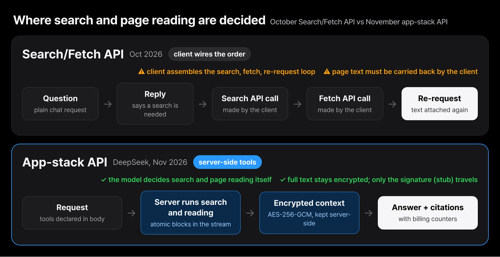
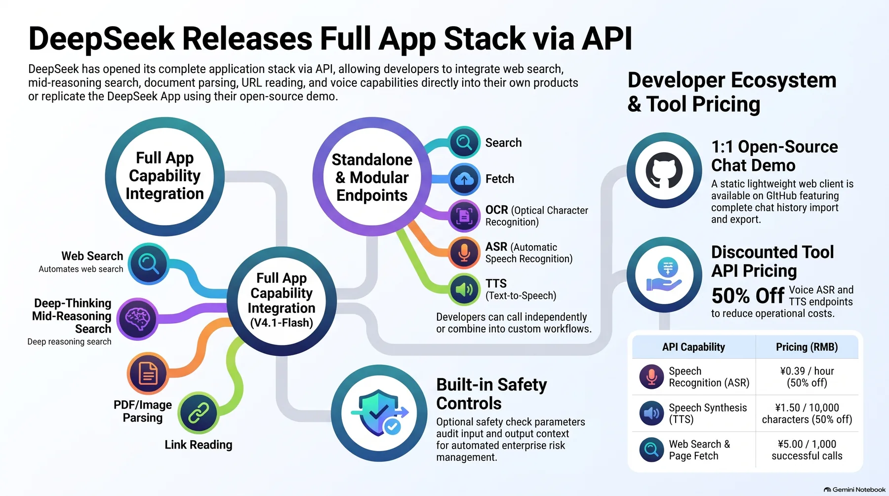
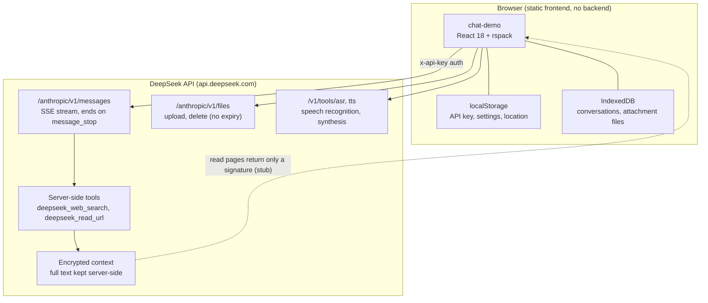
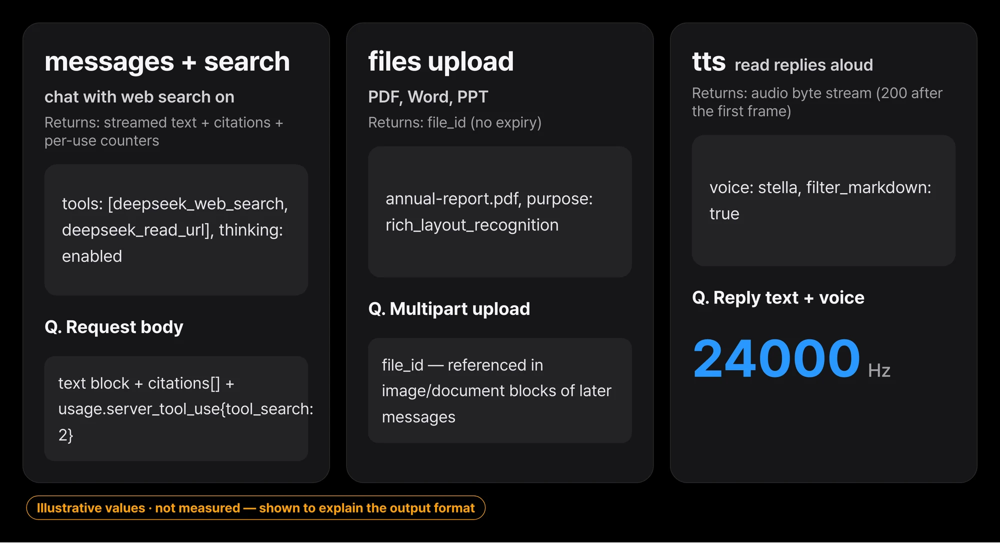
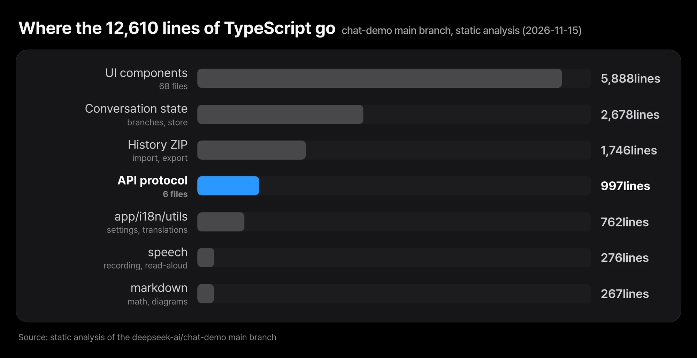
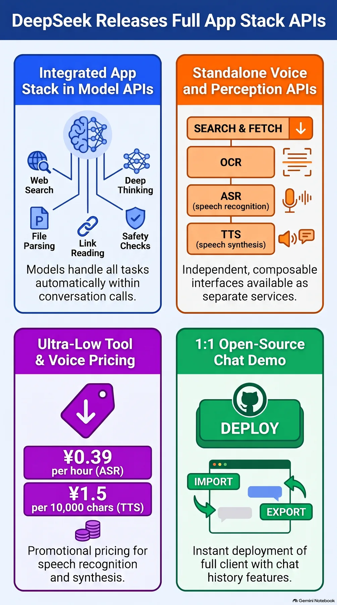

If you operate an LLM inference platform or own the API design of an agent app, this post tells you what to look at in DeepSeek's Nov 13-14 announcement. What they released was not a new model. It was the API's "menu." This post shows how the new feature protocol actually works and where the metering needs your attention.

The conclusion first. The substance of this release is not the open-source frontend. It is that DeepSeek published server-side tools, per-use billing, and encrypted context as part of the protocol itself. The entire app experience rides on a single Anthropic-compatible Messages API, and the client is a static frontend of 166 files and 216KB. We pulled the chat-demo source and read it. Below is how the protocol works, and what the structure means for ThakiCloud's Metis and Paxis.


*The whole set of app features moving inside the API server, visualized.*

## The moment a model company becomes an app platform

On the night of Nov 13, DeepSeek opened the core capabilities of its app as APIs. The targets: web search, deep search, file parsing, URL reading, and voice. IT之家 reported that night, QbitAI the next day, and on Nov 14 DeepSeek's official X account confirmed "the full app experience, now via API."

Each capability is a standalone interface. Search, Fetch, OCR, ASR, and TTS can each be called on their own and freely composed. According to QbitAI, search was cited at 5 yuan per thousand calls as an example of per-use pricing. The official documentation page does not yet show a per-use rate table.


*In the October style, the client wired the search, fetch, and re-request order itself. In the November style, tools are declared in the request, the server lets the model decide, and read pages are kept encrypted on the server.*

On the model side, press reports name V4.1-Flash, which supports the new extensions across the Messages, Responses, and ChatCompletions API styles. Meanwhile, the model IDs written in the chat-demo source are two: `deepseek-flash` (the default) and `deepseek-v4-pro`. These do not conflict; they are different layers. The press names a version; the source names the identifier used in requests.

The ecosystem context matters too. On the same day, DeepSeek's GitHub org shows `deepseek-harness` pinned at the top. An agent harness with the slogan "Everything is a Plugin," at roughly 281k stars as of writing. The inference framework `DeepInfer` (26k stars) and the file-parsing component `dsh-libreoffice-kit` belong to the same family. Cui Tianyi, lead of DeepSeekHarness, told APPSO that "the next super app doesn't have to be one super app for everyone. Everyone can now create a super app."

<!-- nlm-visual -->

*Infographic generated by NotebookLM from the sources.*

## In plain terms

Think of the DeepSeek app as a full-service restaurant. Until now you could only eat at their place, and both the menu and the recipes stayed in the kitchen. The Nov 13 announcement opens the kitchen's workflow as a service. When the waiter (the browser) takes an order, the kitchen (the server) searches the menu itself (web search), flips through the recipe book (URL reading), preps the ingredients (file parsing), and reads the dish description aloud (TTS). Even voice orders are taken in the kitchen (ASR).

chat-demo is a "front of house with only waiters." There is no kitchen. The frontend takes the order and passes it along; all the cooking is done by the DeepSeek API. That is why 216KB is enough. The receipt (context) is special too. The full text is encrypted and kept in the kitchen (the server), and the waiter gets only a stub (a signature). On the next order the stub comes back, and the kitchen matches it to unfold the recipe again.

We keep this analogy through the end. As you read the architecture and protocol below, track which work happens in the kitchen and which happens at the front.

## The order desk is thin: a browser with no backend

The first line of the chat-demo README says it all: "A static chat demo powered by the DeepSeek API. No application backend is required: the browser connects directly to the configured API service." It is a static demo, it needs no application backend, and the browser connects straight to the configured API service.

The stack is light. React 18.3, rspack 2.0, zustand 4.4 for state, idb 8.0 for IndexedDB where conversations and attachments live. KaTeX for math, Mermaid for diagrams, Prism for highlighting. TypeScript 7.0.2, with oxlint and oxfmt for lint and format. You need Node.js 22.12+ and pnpm.

The architecture diagram shows one layer of server-side tools wedged between the client and the API.



Three design points stand out. First, the API origin is set at build time. You change it with `createConfig({ apiOrigin, devServer })` in `rspack.config.ts`, and the default is `https://api.deepseek.com`. In other words, the structure can point at any Anthropic-compatible service. Second, files are uploaded with the `files-api-2025-04-14` beta header and have no expiry. Third, a live deployed demo (`deepseek-ai.github.io/chat-demo/`) is actually up. We confirmed HTTP 200 at the time of writing.

## Search, page reading, files: all server-side tools

The core of this release is the tool declaration inside the request body. Put `deepseek_web_search` (enables web search and search-while-thinking) and `deepseek_read_url` (reads the links in this turn's user message) into the `tools` array of the Messages API request, and the server lets the model decide and perform searches and page reads on its own.


*The three calls chat-demo actually makes. The request/response shapes come straight from the source types.ts; the input examples are invented.*

The source's type definitions show that the search tool actually does five things. `search` (plain web search), `deep_search` (deep search), `read_link` (page reading), `image_search` (image search), `deep_image_search` (deep image search). With the thinking mode on, the model searches and reads pages in the middle of its reasoning. Tool-call blocks arrive atomically inside the stream.

Citations are restored by the server. The citation markers the model writes in its text are matched by the server to real sources (title, URL, cited text) and attached to the text block as a `citations` array. Within the same block, duplicates are removed by URL. The client renders the block as-is.

Context handling is the most refined part. The full text of search results comes down as Base64 `encrypted_content` encrypted with AES-256-GCM, and the client cannot decrypt it. All the client displays is the `snippet`. When a page is read (`read_link`), a stub called `signature` sits in the result block. On the next request the client returns that signature verbatim, and the server decrypts it and re-attaches the page to the end of that turn's question.

Put simply, the heavy part of the conversation context is stored on the server, and the client only carries the stub. That is token savings, and it is also a trust boundary. The client cannot verify what the server saw.

Billing is separate from tokens. The response's `usage.server_tool_use` carries `web_search_requests` (all attempts, including failures), `tool_search` (successful calls that returned non-empty results; this is the billable count), `tool_fetch` (billable page reads), and `tool_image_search` (billable image searches). Keeping the attempt count and the billable count in separate fields means billable units are defined at the protocol level.

Extension fields come along too. `safety_check` takes `low`/`high`; at `high`, a basic risk review covers input and output, and `safety_tokens` shows up in usage separately. Turn on `title` and a session title arrives in `message_delta`. The `latest_reminder` role is a slot for context snapshots (like location settings) that the server inserts before the user message.

File parsing sets its purpose at upload time. PDF, Word, and PPT use `rich_layout_recognition` (the server parses the layout); text, code, spreadsheets, and e-books use `user_data` (stored without parsing). Note that in the extended mode with search on, `document` blocks are not supported. You get a 400. In extended mode only images (`image` blocks) can go in as files.

How deep the compatibility layer goes is worth verifying. Per the official API docs, Claude model-name aliases are accepted. `claude-opus*` maps to `deepseek-v4-pro`, and other `claude*` names map to `deepseek-flash`. A Claude SDK app runs on DeepSeek by changing only `base_url` to `https://api.deepseek.com/anthropic`.

## Running it on your machine is easier than you think

Setup is exactly what the README says.

```bash
git clone https://github.com/deepseek-ai/chat-demo.git
cd chat-demo
pnpm install
pnpm dev
```

You need Node.js 22.12+ and pnpm. `pnpm dev` starts the dev server at `http://localhost:8090`. Before your first chat, enter an API key in Settings. It lands in the browser's localStorage under `chat-demo:api-key`.

A static deploy is `pnpm build` into `dist/`. The repository ships two releases, v0.1.0 and v0.1.1 (both Nov 13), each with three static archive assets. Grab one and double-click `index.html` to run locally with no build. The file:// page does need browser storage support and an API service that allows the cross-origin requests.

You can also move the app's conversation history. The ZIP exported from Settings uses `export_format_version: 3`, with the manifest as the first entry. When chat-demo imports that ZIP, it replaces all conversations in a single IndexedDB transaction. The message tree (`id`/`parent_id`), branches (`current_message_id`), search steps, and the signatures of read pages all come along. That is the concrete mechanism behind the "replicate the app 1:1" claim. The ZIP excludes the API key, app settings, and non-image attachment originals.

Voice, confirmed in the source. ASR is `POST /v1/tools/asr`: upload WAV (mono 16-bit PCM) or Ogg Opus, up to 120 seconds and 8MiB, and the full text comes back in one response. TTS is `POST /v1/tools/tts`: it returns 200 as soon as the first frame is produced and streams raw binary PCM (24kHz mono 16-bit). There are two voices, `stella` (default) and `tide`. With `filter_markdown: true`, the server strips code blocks, tables, citations, and long formulas before speaking.

## The numbers: 166 files, 216KB

This post's experiment is a static analysis of the pulled source. In this environment there is no access to the npm registry, so `pnpm install` and `pnpm build` were not run. The numbers below come from static analysis of the original files, and what could not be reproduced is stated as not reproduced.

| Item | Measured value |
|---|---|
| Total files | 166 (plus 22 directories) |
| TypeScript/TSX | 118 files, 14,610 lines |
| CSS | 36 files, 4,634 lines |
| main branch tarball | 221,735 bytes (~216.5KB) |
| Live demo | HTTP 200 (deepseek-ai.github.io/chat-demo) |
| Stars (at writing) | ~2k, 329 forks, MIT |


*The API protocol layer itself is only 997 lines. Conversation state and history ZIP handling take 4,424 lines, showing where the thick part of this thin-looking demo lives.*

The API surface was read directly from the source. Five endpoints: `/anthropic/v1/messages` (SSE), `/anthropic/v1/files` (POST and DELETE), `/v1/tools/asr`, `/v1/tools/tts`, and `GET /models` (free) for key verification. Auth is the `x-api-key` header; `Authorization: Bearer` also works. File requests need the `anthropic-beta: files-api-2025-04-14` header.

Structurally, the split of `src/services` catches the eye. `api/` (requests, SSE, protocol types), `chat/` (conversations, branches, storage), `chat/history/` (ZIP import and export, 8 modules), `speech/` (recording, read-aloud), `markdown/` (parsing, highlighting, math, diagrams). A large share of the 14k lines of TypeScript goes to history and chat state management. The features look thin, but the context and history handling is the thick part.

## What it means for ThakiCloud's products

This release sends a message to both of ThakiCloud's products, Metis and Paxis.

**The Metis (inference platform) view.** First, it shows a pattern for adding a billing layer to a "model plus features" API. On top of token billing, per-use tool billing rides in `usage.server_tool_use`, with attempts and billable successes kept in separate fields. It demonstrates a protocol design where an inference platform can charge per feature unit. Where ThakiCloud serves models on K8s GPUs and manages queues with Kueue, this creates a new point to watch: per-unit metering for tools like search, parsing, and voice, on top of token rates.

Second, the depth of the compatibility layer is the migration cost. By accepting Claude model-name aliases, an app can switch to DeepSeek by changing only `base_url`. For a platform that serves multiple model vendors, this depth of compatibility means clients can swap models with almost no code changes. If Metis receives requests from several model providers on a single service surface, this announcement reconfirms that how deep you dig the compatibility surface is itself a competitive asset.

**The Paxis (agent-native cloud) view.** The DeepSeek app experience (thinking plus search plus page reading plus files plus voice) is, in the end, an agent loop delivered through a tool protocol. The 281k-star `deepseek-harness` claiming "Everything is a Plugin" points in the same direction as Paxis treating Skills, Tools, and Policies as first-class resources. `latest_reminder` (the server inserting a snapshot into the context) is an early example of the policy layer intervening in the conversation directly, and `safety_check: high` together with the rule to discard content on refusal shows that the policy gate and the audit log belong inside the protocol.

The practical one-liner: once Paxis agent work can consume search, page reading, and file parsing as billable API units instead of building them in-house, the per-turn cost of the agent loop changes. The structure where cheap serving (Metis) funds agent economics (Paxis) just earned one more piece of evidence.

## A demo is a demo: lines not to cross

Some lines need honest attention.

First, no backend means the API key sits in browser localStorage. That is exactly right for personal and demo use, and exactly wrong as a multi-user production pattern. Key exposure and CORS are inherent constraints of this structure.

Second, the extended mode with search on does not support `document` blocks (400). A scenario using web search and document file parsing in the same request is not possible with this structure.

Third, thinking blocks from past turns are not sent back in requests. Tokens are saved, but long multi-turn reasoning is compressed by design. That tradeoff is something the reader should know about.

Fourth, the encrypted context puts the trust boundary on the server. The client carries the signature, but it cannot verify what the server decrypted and attached.

Fifth, the UI languages are Chinese and English only. There is no Korean UI.

Finally, watch the billing fields. `web_search_requests` counts failures too; the actual charge is `tool_search`. If you do not monitor the gap between the two, the cost of a tool-using app stays invisible.

## In closing

What DeepSeek released was not the frontend. It was the kitchen's workflow. An app can be decomposed into "API plus thin client," and the surface of that decomposition carries tools, billing, and encrypted context written as protocol. That is the substance of this event.

If you run a platform, put the tool list (`tools`) and the billing fields (`usage.server_tool_use`) on the table you watch, not the model names. If you are a developer, you can run the reference implementation on your machine in ten minutes, and you can move your app's history into a ZIP to see exactly which context the server keeps. Now that the kitchen recipes are public, which restaurant to open is your problem.

<!-- nlm-visual -->

*Infographic generated by NotebookLM from the sources.*

## Sources

- [deepseek-ai/chat-demo (GitHub)](https://github.com/deepseek-ai/chat-demo)
- [DeepSeek API docs, Messages API](https://api-docs.deepseek.com/zh-cn/api/create-message)
- [chat-demo live demo](https://deepseek-ai.github.io/chat-demo/)
- [QbitAI coverage](https://www.qbitai.com/2026/11/510003.html)
- [IT之家 coverage](https://www.ithome.com/1/026/960.htm)
- [APPSO (wechat) coverage via agihunt](https://agihunt.info/en/p/1a1d74b6025ad2df72cc8333f95)
