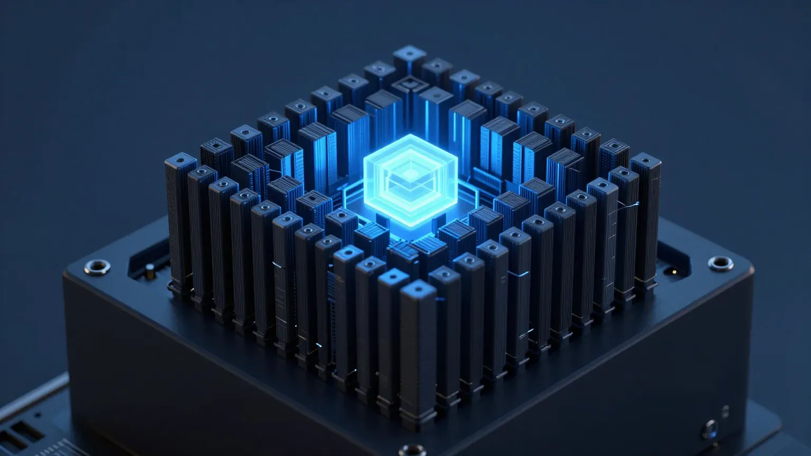
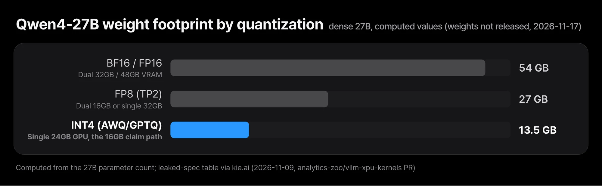
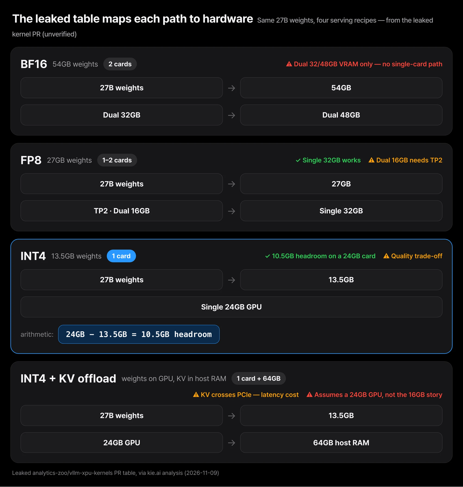
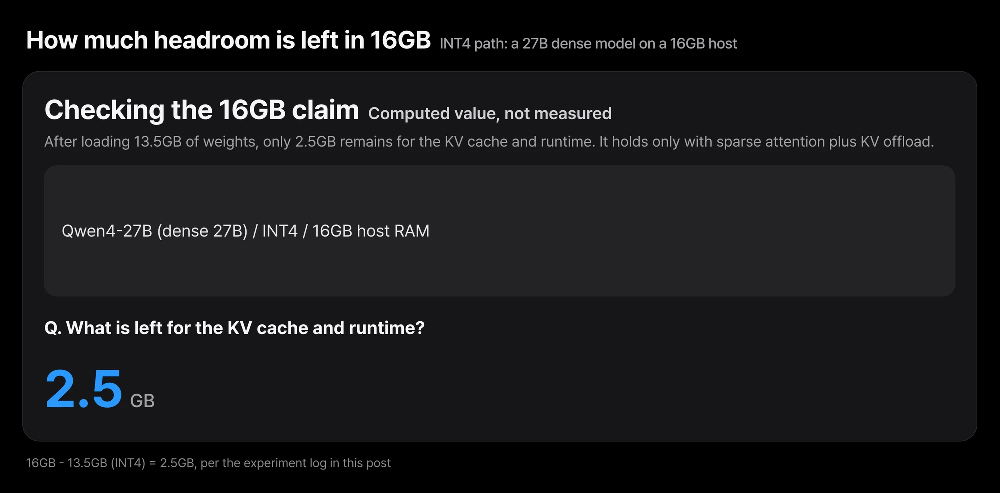
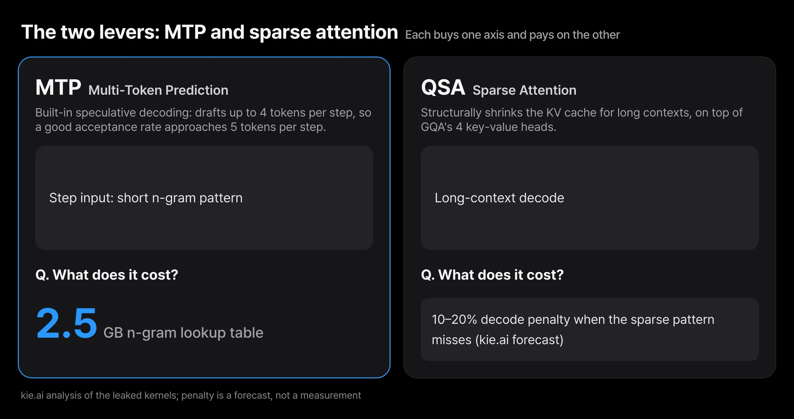
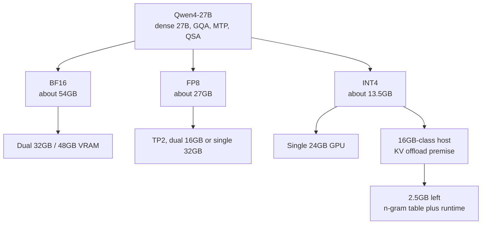

*The 27B class, compressed toward a single card. The claim is arithmetic, not magic.*

If you pick GPU specs or serving strategies for on-prem or edge environments, this post is for deciding what to prepare when the Qwen4-27B weights land. Qwen4-Max shipped API-only on November 16, the smaller models are promised open-source, and on the 17th Unsloth's line, "will run on 16GB RAM setups," did the rounds.

The reason the 16GB number pulled attention is that the 27B class was, until now, out of reach for a single card. The previous-generation Qwen3.8-27B weighs about 54GB in BF16, so loading the weights alone took two cards. Getting that class into a 16GB-class machine requires something to change, and that something has already surfaced, in the form of a leaked kernel pull request.

The conclusion first: putting 27B into 16GB is not magic. It is the deterministic result of INT4 quantization plus sparse attention that shrinks the KV cache. What changes is not model capability, it is the deployment target. This post lays out the leaked spec, re-runs the memory arithmetic, and asks what it means for serving strategy.

## Between Max and 27B, one week

On September 22, at Apsara 2026, Alibaba Cloud CTO Liu Daheng named the Qwen4 family: 27B, Max, Plus, Flash. No specs, no license, no date. What happened next happened inside a week.

Max was pre-announced on November 11 and released on the 16th. Max is API-only. No weights, no self-hosting, a Qwen-cloud-only structure. And the release notes carried one line: the smaller models in the Qwen4 family will be open-sourced. The flagship in the API, the small models in open source. That split is the center of this week's discussion.

The 17th was Unsloth's post. The smaller models are coming soon, and Qwen4-27B will run on 16GB RAM setups. The model that received the open-source promise first, 27B. And a number you can picture on a laptop or an Apple Silicon machine, 16GB. Together they make the sentence "the 27B class lands in your machine," and that sentence changes the faces of the people who serve it.

The family structure puts 27B in sharp relief. Max, Plus and Flash are the API ladder; 27B is the open-source rung. The flagship stays in the cloud, and the deployable model is where you go look for 27B class. The previous generation had the same shape, and 27B was the self-hosting reference point then. Qwen4-27B is a promise to push that reference point to smaller hardware.

## The leaked spec is a map, not territory

The spec surfaced before release, through a kernel pull request. The target is PR 22 of analytics-zoo/vllm-xpu-kernels, kernels for Intel's XPU acceleration stack. kie.ai published an analysis on November 9, and the spec numbers in this post follow that analysis. But it is not official weights, and there are no verified benchmarks. It is a map read from the blueprints.

What the map says: Qwen4-27B is dense 27B, not a mixture of experts. The hidden dimension is 5,120 and the feed-forward size is 14,336. Attention is 24 query heads against 4 key-value heads, a GQA structure.

Two features attach to that. One is MTP, Multi-Token Prediction, drafting up to four tokens per step. The other is QSA Sparse Attention, coupled with n-gram lookup tables. These two decide the memory arithmetic. MTP speeds up generation, but the lookup table adds a capacity cost.

Sparse attention shrinks the KV cache, the largest consumer in long-context serving. kie.ai estimates a 10 to 20 percent decode penalty on the sparse side. Speed and memory trade against each other.

One more thing. 5,120 divided by 24 is 213.3. A head dimension must be an integer. That does not prove the leak wrong, but it is a signal to read the numbers only within the confirmed range. So this post does not compute per-token KV cache. The leak stays a leak; only the parameter count enters the arithmetic.

## The arithmetic of 16GB

Start with the weight footprint. Multiplying 27 billion parameters by bytes per weight is deterministic. BF16 gives 54GB, FP8 gives 27GB, INT4 gives 13.5GB. The leaked table agrees. The only variable is which path you take.

*The same 27B spans a 4x footprint range by dtype. The 16GB claim starts at the smallest bar, INT4.*

The leaked table maps each path to hardware. BF16 goes to dual 32GB or 48GB VRAM. FP8 with TP2 goes to dual 16GB or a single 32GB. INT4 goes to a single 24GB GPU, the example being an RTX 3090. The INT4 variant that offloads KV to RAM pairs a 24GB GPU with 64GB host RAM. So the 16GB number Unsloth quoted is not in this table. The table's floor is a 24GB GPU.

*BF16 maps to dual 32/48GB VRAM, FP8 to TP2 dual 16GB or single 32GB, INT4 to a single 24GB GPU with 10.5GB of headroom. The variant that offloads KV to host RAM pairs a 24GB GPU with 64GB of RAM — the 16GB number is not in this table.*

*16GB spends 13.5GB on weights alone, so the KV cache and runtime must fit in the remaining 2.5GB.*

Then where does 16GB come from? yottalabs' November 16 piece gives the context. In the Qwen3.8-27B lineage, the 4-bit weight footprint is about 16GB, with a note that the n-gram table can add capacity on top. That splits into two readings.

The first: "the weight footprint is 16GB." INT4 weights at 13.5GB plus the MTP n-gram table approach 16GB, and on that reading Unsloth's "16GB RAM setup" is shorthand for the smallest machine that can host the weights.

The second reading: "the whole machine is 16GB." On that reading the arithmetic holds only with conditions attached. 16GB minus 13.5GB leaves 2.5GB. The KV cache and runtime must all be solved in those 2.5GB. A 24GB card leaves 10.5GB.

2.5GB and 10.5GB are entirely different stories. "16GB setup" is a conditional sentence: INT4 as premise, a drastically small KV cache, and offload running alongside.

Put the two readings side by side and the message converges. 16GB is not "fits with room to spare"; it is "the smallest number where the math works." This is where the arithmetic meets the leaked features. Sparse attention and KV offload are not nice-to-haves, they are the conditions under which 16GB exists.

What a 16GB-class machine is, also matters. An Apple Silicon machine with 16GB unified memory, a workstation with 16GB of RAM, or an edge box with one 16GB GPU. The three machines share a memory size but not the available VRAM or the offload headroom. In unified memory the GPU and the OS split the 16GB; in the edge box, weights sit in RAM and only the KV goes to the GPU.

The leaked table's FP8 dual-16GB path is in the same context: 27GB split across two 16GB cards was already a recipe premised on 16GB cards. What INT4 opens is the road to the 27B class on one of those cards.

## What MTP and sparse attention mean for serving

This is where the serving recipe changes. Until now, getting the 27B class onto a single card leaned on one lever: quantization. Go INT4 and absorb the quality tradeoff; that was the whole recipe. Deeper quantization shrinks the footprint, and the bill came back as quality every time.

Qwen4-27B brings a second lever, at the architecture level. MTP is speculative decoding built into the model. Four draft tokens per step; if acceptance is good, it is close to generating five tokens at once. The principle is simple.

Short n-gram patterns are good hints for the next token; the model pays the cost of verifying the prediction, and when it hits, it takes four at a time. The price is the n-gram table. In the 16GB arithmetic, that table is a cost that cuts further into 2.5GB.

QSA shrinks the KV cache. The GQA with 4 KV heads already makes the KV small, and sparse attention narrows the access range once more. In long-context serving the KV is the second-largest consumer after the weights, and this lever cuts that consumption at the architecture level.

The cost is the 10 to 20 percent decode penalty kie.ai estimated, the price paid on tokens where the sparse pattern misses.

*MTP is built-in speculative decoding — up to four draft tokens per step — and pays a 2.5GB n-gram lookup table. QSA structurally shrinks the KV cache for long contexts and pays a 10–20% decode penalty when the sparse pattern misses.*

*The same 27B weights fall onto different hardware by dtype and KV strategy. The 16GB path is the last one, premised on INT4 and offload at the same time.*

The last variant in the leaked table belongs here too. INT4 plus RAM KV cache: 24GB GPU with 64GB host RAM. Weights on the GPU, KV in host memory, an offload path. CPU offload is known territory on the vLLM side as well, though KV traffic over PCIe touches latency, and the 64GB host RAM condition makes it a different story from the 16GB one. It is a recipe premised on a 24GB GPU.

The combined effect of the two levers shows up in a form serving engineers know: speculative decoding, which used to be attached at runtime, moves inside the model, and the KV, which used to be tuned in the serving config, is shrunk by the architecture. The recipe is moving into the model. That is the real force behind the 16GB number.

The implication for serving is that dtype choice is no longer the only axis. The same INT4 weights get different footprints and speeds depending on sparse-attention settings, KV offload, and MTP acceptance rate. The recipe has to be set per environment. BF16 multi-card, FP8 dual, INT4 single, INT4 plus offload. Four paths all serve the 27B class.

## What it touches in serving strategy

For Metis, which serves models over a K8s GPU queue, this is a change in the quota table. The 27B class was, until now, a BF16 multi-GPU job or an FP8 two-card job. If Qwen4-27B proves out the single-card INT4 recipe, the GPU share for the same quality class drops to a quarter or an eighth.

A single-card row appears in the Kueue quota plan. When admitted jobs carry smaller footprints, more serving fits on the same physical resources, and the waiting queue gets shorter.

The more important side is on-prem and edge. If the 27B class fits in 16GB of RAM, the model can sit on a laptop, a workstation, or one box in the data center. Sovereignty and low cost, the two axes ThakiCloud works with, extend to the customer's machines. Running the 27B class in an environment where data never leaves means that environment itself becomes the serving node.

Take one concrete case. An air-gapped box with two 24GB cards versus one card running INT4 differs in purchase cost and in power. If the 27B class stands on a single card, the box's spec sheet changes. On workloads where the quality tradeoff is acceptable, the two-card GPU becomes one, and the freed slot becomes headroom for other serving.

When the weights drop, the first thing to look at is not the benchmark but the real footprint including the n-gram table. That is where 13.5GB versus 16GB becomes a question of existence.

On the Paxis side, the economics of agent execution change. The skill harness makes hundreds of inferences per task. 27B-class inference was, until now, work that had to go to a GPU server. If a 16GB-class node can handle it, the per-node cost of agent execution drops, and a new line appears on the map of where inference goes.

This is not an argument to move now. It is a statement that the decision table of which class of model runs where gains a row.

## What the numbers do not say

The limits, in order. First, nothing is measured. No weights, no benchmarks. The spec is a leaked kernel PR, and the numbers are third-party articles. The head geometry does not divide evenly, as shown above. The 16GB claim itself lives in Unsloth's post, and the Qwen-side primary source is not confirmable at this point.

Second, 16GB is not 24GB. The arithmetic stands on 2.5GB of headroom. Sparse attention carries a 10 to 20 percent decode penalty, and the MTP table adds capacity. When both land in reality, "it fits" can flip to "it is tight." And MTP acceptance rate varies by workload; when drafts miss often, speculative decoding becomes overhead.

Third, timing. The open-source promise came with the Max release, but there is no date for the 27B. The previous generation followed the flagship with the 27B weights about one to two weeks later [estimate]. And whether Qwen4-27B is the same quality class as the Qwen3.8-27B lineage is still unknown.

The architecture changed, the attention changed, and the training data is a mystery. Staying dense instead of moving to MoE is good news, but it does not say quality on its own.

## In closing

Putting 27B into 16GB is not a model announcement, it is a recipe announcement. INT4, GQA, sparse attention, MTP. Each is a known tool. The claim is that the combination makes the 27B class a single-card story.

Until the weights land, the right reading is a spec to prepare for, not a number to trust. Three things to prepare: the INT4 plus KV-offload serving recipe, the single-card row in the quota table, and the footprint measurement script that includes the n-gram table.

The day-one checklist, written in advance: the actual byte count of the safetensors, whether the n-gram table ships as a separate file, the measured footprint under INT4 serving, decode latency with QSA on and off, and the MTP acceptance rate.

Those five numbers turn the leaked map into territory. When Qwen4-27B drops, the arithmetic moves from the leak to the real thing. That is when the real serving-strategy discussion starts.

Sources:
- [kie.ai, Qwen4-27B Architecture Analysis (2026-11-09)](https://kie.ai/blog/qwen4-27b-architecture-analysis)
- [yottalabs, Qwen 4 27B release date, specs, hardware (2026-11-16)](https://www.yottalabs.ai/post/qwen-4-27b-release-date-specs-hardware-what-is-known-2026)
- Unsloth X post (2026-11-17, via this queue's RT; primary source not confirmable, claim quoted only)
