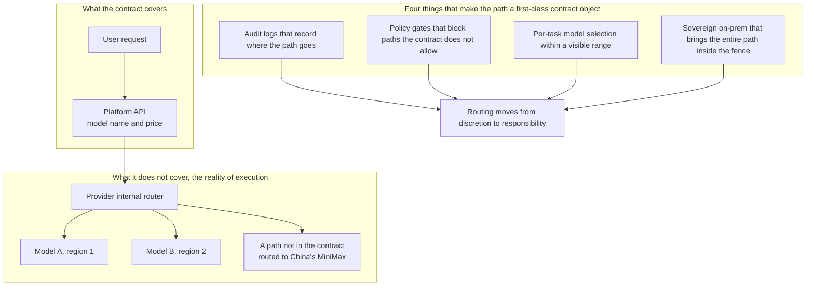

*The article's core concept, visualized.*

## You Picked the Model. You Did Not Pick the Path

The model looks like something you chose. But the path your prompt traveled was not something you chose. This week, that invisible route became a contract violation.

OpenRouter co-founder Alex Atallah said that multiple AI inference providers were routing user prompts directly to China's MiniMax. The condition was not that the user requested that model. The routing happened regardless of whether users actually had access to the model. OpenRouter claims this prompt routing violates the DPA, the data processing agreement.

This needs unpacking. A DPA is a promise a provider makes to its users. It means your data will only be processed on these routes, for these purposes. But the technical reality of the inference layer is different. A provider takes a request and routes it internally to whatever models and backends it wants. The object of the contract (data flow) and the object of the technology (routing) are separate things, and this incident is a crack in that gap.

Why providers have an incentive for private routing, I will not assert here. What is clear is that if routing is tied to a provider's profit structure, it will not stop without an audit. As long as a path exists in the technical execution but not in the user contract, the responsibility to prove that path exists is not assigned to anyone under the contract.

In practice, the audit is simple. When you contract an AI service, ask three questions. First, which model and which region does the prompt reach? Second, how do you know? Third, who is responsible if a path not in the contract is found? The first question usually gets answered with a model name. The second is where the real answer lives. The third is where the contract lives.

OpenRouter is the marketplace that sells that routing freedom. The supply side publicly claiming DPA violations is itself a strong signal. If the providers had kept their paths quiet, the marketplace would have had a history of looking the other way. That it stepped forward means the path problem is no longer buried under the label "industry practice."

## Why the Broker Layer Grew

It is hard to call the routing layer simply bad. Routers and marketplaces exist because the model market has grown too large for any one company to handle. Comparing dozens of models by price and performance and switching among them like credit cards is now everyday. That freedom is real, and its value is real.

The problem is that as the broker layer grows, the distance between contract and execution grows too. In the past, data sovereignty was a question of hosting location. Where the server is. Now it is a question of routing path. The same request can come in at the same price and under the same name, while behind it the model changes, the region changes, and the processor changes. The user sees only the front and leaves the path behind it to the provider's discretion. The freedom to choose a model and the freedom to choose a path are different freedoms.

This week there is one contrasting case. Tesla began rolling out FSD v15, an update to its end-to-end driving network, along with the claim that handling of safety critical situations improved 25x. FSD has one unusual property. From sensor input to vehicle actuation, everything on the path is inside its own stack. No third party model sits on that path, and there is no routing. That is why the "25x" claim can come from a single voice. Tesla is the side that speaks to everything on the path. Set against an API service built on top of a router, the difference is exactly this. The moment the side that answers about the path and the side that builds the path are different, the address of responsibility becomes unclear.

## Institutions Pay $1.2 Million a Year for a Single Path

On the other side, the University of California pays OpenAI $1.2 million a year. The scope is 10 campuses, and the targets are students, professors, and staff. The structure is the notable point. A public institution buys closed commercial AI in a form where the contract with the supplier is clear. It contracts knowing who provides the service, where the data goes, and where responsibility lands.

And the contract is annual. Even knowing the path may change, every year it reselects this supplier, this path. Payment for visibility is repeated selection.

The same logic works in reverse. The scarcer the data, the more you want the path to be clear. A university's research data, student records, and internal documents are data that wants to say "only on this path." The $1.2 million annual contract can be read as the price paid for path visibility. The problem is that individuals and small businesses that go through a router cannot buy that visibility. A supplier's internal routing is a black box to them, and "path" as a contract object did not exist in the first place.

## The Week Local Alternatives Finally Became Real

The most interesting event this week is that the "alternative that does not send data out" crossed from idealism into calculation.

Thinking Machines' new model Inkling 2 Mini reached number one on Hugging Face trending. It is assessed as matching Qwen3.8 27B in performance at one sixth the cost. And what matters more is that Unsloth's quantized GGUF version follows right behind at number two. GGUF, the format for running models locally, is mentioned alongside. This is the story of this week's hottest model and a local version of that model trending together.

Read the two signals by multiplying them. Once a small model that competes at one sixth the cost exists, the answer "because that is the only option" no longer holds for the question "why send data outside." Above a certain scale of inference workload, on-prem or sovereign deployment starts to be economically sound. Data used to be sent out because local alternatives were expensive. Now the cost curve has moved. When the price of sovereignty drops, the question of whether to do it becomes a governance question.

The DPA incident and Inkling's trending are two sides of the same coin. The incident revealed the cost of sending data out, and the model shows the cost of not sending it. Once the alternative's price fell to one sixth, the question of whether to send data outside gets an answer, because continuing to send it is now a waste.

## Agents Started Spending Money

Data paths are no longer a theoretical question because agents have already started spending money. According to Stripe data, spending through AI agents doubled over the past month. And the largest category in agent commerce became travel. Not software, not digital goods, but real-world services.

Travel becoming number one is no accident. Travel is a high unit price, repetitive action domain. One trip contains multiple bookings, multiple payments, and multiple changes, and flights, hotels, restaurants, and local transport each carry their own payments and data. The more an agent repeatedly touches a domain, the more each contact needs a record. It is a different order from one-off document generation. Booking a flight is close to a contract.

When an agent books, pays, and makes changes on behalf of a user, the user's identity information, payment information, and location information travel paths the user has never seen. If the routing incident above happened in a chat prompt, what happens if the same thing happens in an agent that executes real payments? It is the moment the contract object moves from "data" to "action."

Payment is an action with legal meaning. Money should move only within the range the user approved, and a record must remain of which agent processed which payment over which path. Since spending doubled in a month, the scope of delegated authority and audit tracking must double with it.

The industry's direction says the same thing. In Arena's updated Alignment Index, a benchmark that measures how faithfully an agent follows user intent, OpenAI took all seven top spots. That intent fidelity can be measured by score means "the agent acted as it said" can be verified. But that verification ends at the model's output. It does not reach where the data went. Intent fidelity and path visibility are separate governance objects, and the DPA incident shows that the latter is much weaker.

## The Contract Object Is Moving from Model to Path

This week's signals, gathered into one, are three events. The routing incident, the institution's annual contract, and the sharp cost drop in small models. All three point to the same point. The unit of trust in AI is moving from "model" to "path."

Models can change. Prices change, benchmarks change, and the ranking of the strongest model changes. Paths are different. A path, once set, is an object that cannot be changed without a record. Where the prompt goes, where the agent's action goes, and whether that can be proven. These questions become standard items in procurement and compliance review. Just as the DPA became a standard item in SaaS, the "routing specification" is becoming a standard item in AI.

The content is not complex. The model ID a request reaches, the processing region, the list of intervening processors, and the retention period. That is all. Right now this information sits somewhere in an operator's internal documents. The moment it is made into a contract annex, routing changes from "discretion" to "responsibility."

The answer is not to distrust the routing layer. The answer is to make the path a first-class contract object. Audit logs that record where the path goes, policy gates that block paths the contract does not allow, routing that picks a model per task within a visible range, and sovereign on-prem deployment that brings the entire path inside the fence when needed. In a structure with these four, routing freedom and compliance certainty are no longer opponents. The price of sovereignty finally came down this week to a fair level, and the last option has become real.

Restating the map. The contract names the platform API and a model. Execution carries the provider's internal router and paths the contract never names. Audit logs, policy gates, per-task routing, and sovereign on-prem deployment turn the hidden path into an object of the contract.

The role ThakiCloud's Agent-Native Cloud, Paxis, is designed for is exactly this. Skills, Tools, Policies, and Audit Logs as first-class resources, autonomy (L0 to L3) governance, policy gates and audit logs, isolated sandbox execution, MCP connectors and a skill marketplace, and per-task model selection through CostRouter. These are all parts that try to see and govern the "path." But what matters more is that the industry is now asking this question first. Whatever model service you use, ask just one thing.

Which path is your prompt traveling? And can you prove it?

## References

This post synthesizes the news below.

- HuggingNews, [Thinking Machines' Inkling 2 Mini Matches Qwen3.8 27B at One Sixth the Cost, Tops Hugging Face](https://huggingnews.com/ai/thinking-machines-inkling-2-mini-matches-qwen38-27b-at-one-sixth-the-cos-96c2e140)
- HuggingNews, [OpenRouter Says AI Providers Violated DPAs by Routing Prompts to MiniMax](https://huggingnews.com/ai/openrouter-says-ai-providers-violated-dpas-by-routing-prompts-to-minimax-cdc0a820)
- HuggingNews, [Tesla FSD v15 Rollout Claims 25x Improvement in Safety Critical Cases](https://huggingnews.com/ai/tesla-fsd-v15-rollout-claims-25x-improvement-in-safety-critical-cases-693c67f8)
- HuggingNews, [OpenAI Sweeps Top 7 Spots in Arena's Updated Alignment Index](https://huggingnews.com/ai/update-openai-sweeps-top-7-spots-in-arenas-updated-alignment-index-909335ab)
- HuggingNews, [University of California to Pay OpenAI $1.2M a Year for AI Tools Across 10 Campuses](https://huggingnews.com/ai/university-of-california-to-pay-openai-12m-a-year-for-ai-tools-across-10-ee2d61fd)
- HuggingNews, [AI Agent Spending Doubled in Last Month as Travel Becomes Top Category](https://huggingnews.com/ai/ai-agent-spending-doubled-in-last-month-as-travel-becomes-top-category-8b0cbc0e)
