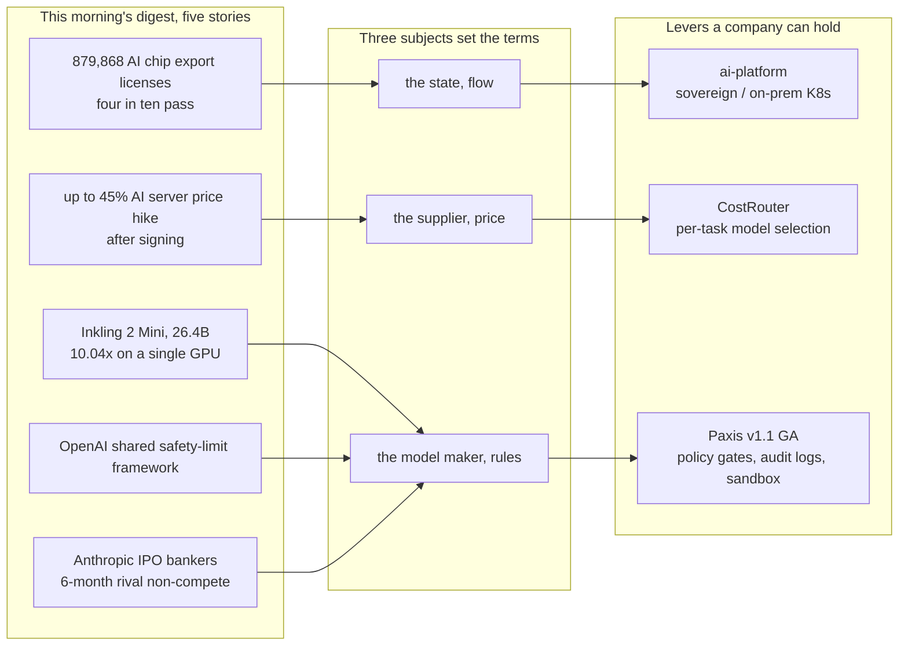

By May 11, 2026, the US Department of Commerce had issued a total of 879,868 export licenses for Nvidia and AMD AI chips to Chinese buyers. Of roughly 3.4 million applications, about four in ten were approved. This number reads as the exact opposite of a blockade. The chips were not blocked. They cleared customs, and a pass was issued.

*Not a blockade, but a pass. The chips were not blocked; a pass was issued. A symbol of the moment the subjects setting the terms change.*

## A World Where Four in Ten Pass

What stands out first in the Commerce approval data is the ratio. If the control were a switch, the ratio would be near zero, or approvals would be close to the number of applications. Reality is somewhere in between: a managed flow. The approval list itself carries a signal, because Chinese military-related companies are among the approved recipients. Export restrictions have worked this way all along, selectively opening and closing. What is new this time is that the selection is confirmed in numbers. Military-related companies on the list means the selection assumes case-by-case management, not a simple axis of friend and enemy. The remaining roughly 2.5 million applications are not on the approval list. Buyers who applied but were not chosen see their procurement schedules slip. The 2.5 million that did not pass are a number too. The reports do not say whether the unapproved portion is a permanent rejection or a delay. On the buyer side, the conclusion is the same either way: the schedule slips. The queue affects price as well as volume. When supply is constrained, the cost of alternative procurement rises with it. There is change on the approved side as well. The moment a license becomes a ceiling on volume, purchasing becomes something handled in a queue. In a market, money can buy anything. In a queue, the number of approvals sets the volume. The shape of GPU procurement changes. From a company's point of view, this is the point at which GPU availability becomes a policy variable. The application queue, the approval rate, even the reasons for rejection have become part of procurement risk. This is the point where the assumption that a contract signed the old way brings chips in the old way no longer holds.

## A Price List That Changes Even After Signing

This morning's HuggingNews digest carried another line alongside the chip licenses. According to a Financial Times report, AI server suppliers raise prices by up to 45% even months after a deal is signed. The old formula of hardware procurement was that the contract itself was the ceiling on cost. Sign, and the unit price is fixed. Fixed, and the budget is set. AI servers broke that formula. The price moves again after signing. Compute now has two price lists hanging at the same time. A structure in which the state sets the flow and the supplier sets the price. Budgeting from a single unit price no longer holds. A policy variable sits inside the cost curve. The phrase worth noting in this report is "months after the deal is signed." Timing is the point. The price rises after the signing that buyers treat as the end of the cost. The risk is invisible at procurement time and shows up at receipt and operation. For an AI infrastructure team, the budget sheet has become a forecast that keeps getting revised. This is the point at which you must calculate the depreciation period of a GPU cluster and its price-adjustment period together. The 45% hike is a result of supplier pricing power after the contract, not a one-time event. The negotiating leverage moved with it. In past long-term contracts, the buyer was the side locking in the unit price. The supplier was the side receiving it, and once the contract was signed, most price disputes were over. The structure of this re-pricing case is different. After the signing was done, the price moved toward the supplier side. That means re-pricing risk has started to be included in the cost of long-term contracts. From a finance perspective, the certainty of GPU procurement drops. It is a zone where the fixed part of capital expenditure leaks into the variable part of operating expenditure. When the floor of cost wobbles, the entire investment calculation built on top of it reopens. As long as you are buying hardware, there is no way off this curve.

## The Backflow of Efficiency

While re-pricing proceeds on the hardware side, software moves in the opposite direction. The same morning's digest carries an item on Thinking Machines. Inkling 2 Mini, a 26.4B parameter model, recorded a 10.04x speedup on KernelBench-Mega. The execution environment is a single Nvidia RTX PRO 6000 GPU, running locally. Not a cluster, not a cloud. The smaller the infrastructure, the more work you can run on the same budget. A result ahead of Grok 4.7 and GPT-6.1-Sol. The reason this case is worth recording is the nature of the benchmark. KernelBench-Mega is a benchmark that deals with code making GPU operations faster, a task about compute itself. The quality of kernels sets the performance ceiling of the same GPU. A good kernel pulls more operations out of the same chip. A model that writes kernels is a multiplier on the hardware side. That is the mechanism by which efficiency becomes a cost lever. It opens a path to get more out of the chips you already own, instead of buying more. The model that took the top of this task is a 26B running on a single GPU. In a specific task, the performance curve has come down below the previous frontier. This is not a story of frontier models being replaced. It is a story of the model lineup per task getting thinner. The ratio of work to model becomes a variable in cost engineering. In an environment where server unit prices rose 45% and chip flow became a policy variable, the lever a company can hold is on the model side. It is the company that must answer which model runs which task on how many GPUs.

## Rules Become Infrastructure

Two items in the second half of the digest are small in numbers but point the same way. OpenAI released internal data on its own pretraining progress and proposed a framework for the whole industry to adopt common safety limits. Anthropic asked senior executives at the 22 banks that manage its record-scale IPO to sign a restriction. Key deal bankers cannot work with AI competitors for six months. A frontier lab publishing training data to the industry and demanding common limits, and a company ahead of its IPO binding its bankers with non-competes, look separate on the surface. But both are acts of writing rules into operations and business. When common safety limits are adopted, there is a standard every company using AI must answer to, and an IPO non-compete is a contract stating that the flow of information and people is a managed asset. The "rules" around AI have entered the deployment environment. Rules are now the same kind of question as uptime and latency. Questions have appeared: what, where, within what limits, who saw what data. This is a zone where you must answer those questions. Deciding what to audit comes first. The question only holds if you have set in advance which logs to keep over what period and who may read them. These governance tools will soon appear in procurement questionnaires and contracts. Because questions about safety limits do not stay in the back office. They are moving into the sentences of service terms. Compliance cost is a flow that becomes a cost renewed every quarter. The time until a standard is set is also a cost. While the common-limit framework hardens into an industry standard, companies adjusting their operations to it spend repeatedly. The compliance burden for companies using AI in production will keep rising for a while. But the object of the burden changed. The center of the question moved to how you use it and how you prove it.

## Change the Lens

The five stories this morning converge on one point. The subjects setting the conditions for running AI are three: the state, the supplier, the model maker. A company's share is to take those conditions and operate within them. The practical question narrows to one. This is the point where you ask whether the conditions you have accepted can be governed by operations. Whether you can choose which model runs on which GPU for each task and prove it at the policy and audit level. Go through the digest's points in order, and each has a corresponding infrastructure capability.

*The five stories read as the three subjects that set the terms (state, supplier, model maker) and the three levers a company can hold.*

First, chip flow. In an environment where flow is managed by licenses, ai-platform deployed sovereign or on-prem to your own K8s becomes an alternative that lowers dependence on overseas supply. Next, unit price. The device that reduces re-pricing after signing is CostRouter's per-task model selection. A path to lower the cost hardware must carry is open in the model lineup. The case where Inkling 2 Mini won a narrow task on a single GPU is an example. Third, safe execution and governance. Now that safety limits and non-competes have entered the deployment environment, this is a zone where you must prove what an agent ran, where, and under which policy. That is the work of policy gates, audit logs, and isolated sandbox execution. MCP connectors and the skill market keep tool connections within the same frame. ThakiCloud's Paxis (the official product, v1.1 GA) treats Skills, Tools, Policies, and Audit Logs as first-class resources and operates agents under autonomy governance from L0 to L3. Because autonomy governance handles how far to delegate, and audit logs handle how to prove what was delegated. A policy gate sits where the two questions meet. If I were to name an asset of the pass era, it would be not the chip but a platform that knows which model runs on which chip under which rules.

## References

This post synthesizes the following news.

- HuggingNews, [US Approved 879,868 Nvidia and AMD AI Chips for China, Including Military Firms](https://huggingnews.com/ai/us-approved-879868-nvidia-and-amd-ai-chips-for-china-including-military-2b543e39)
- HuggingNews, [Thinking Machines' 26B Inkling 2 Mini Hits 10.04x on KernelBench-Mega, Topping Grok 4.7 and GPT-6.1-Sol](https://huggingnews.com/ai/thinking-machines-26b-inkling-2-mini-hits-1004x-on-kernelbench-mega-topp-5af2f854)
- HuggingNews, [OpenAI Releases Internal Pretraining Data to Push for Shared AI Safety Limits](https://huggingnews.com/ai/openai-releases-internal-pretraining-data-to-push-for-shared-ai-safety-l-3359a145)
- HuggingNews, [Tech Suppliers Hike AI Server Prices Up to 45% After Deals Are Signed](https://huggingnews.com/ai/update-tech-suppliers-hike-ai-server-prices-up-to-45percent-after-deals-66567603)
- HuggingNews, [Anthropic Barred IPO Bankers From Working With AI Rivals for 6 Months](https://huggingnews.com/ai/anthropic-barred-ipo-bankers-from-working-with-ai-rivals-for-6-months-d4d4645b)
