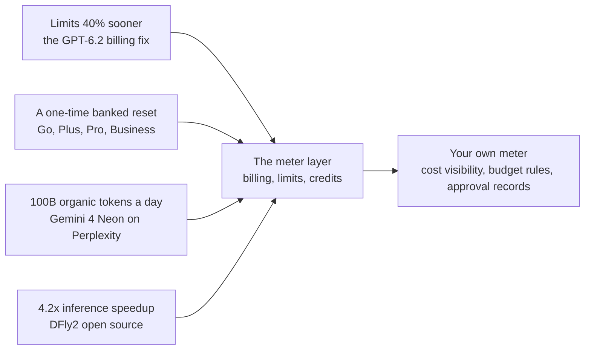

Today, the most important fix in the AI industry was not made to a model. If your team runs a service on top of an external model API, this morning's news is immediately a story about your own costs. OpenAI fixed a billing error that arose during the GPT-6.2 launch, and as a result of that fix, paid users now reach their usage limits 40 percent faster. In the age of agents, the model decides the quality of the answer, and the meter decides how much of that answer the customer can actually use. Even if no line of the model changes, if the meter shakes, the product shakes too. Agents do not stop working when the time is up. Usage keeps accumulating day and night, so even a small metering error compounds every single day. That is why a bug in the billing layer is no longer a support problem but a product problem. The model wars are now a given. The competition over who has the smarter model is stacked on top of the competition over who can deliver that intelligence to whom, how much, and at what price. And the outcome of that competition is decided not by benchmarks but by the numbers on the meter that accumulates every day. Look closely at the news from the same morning, and all of it points to this single layer. A company that had to compensate for a billing bug, a demand of 100 billion tokens that doubled in a day, and a tool that cuts token production cost by more than half. The three stand on different sides. But the meter is the ground all three are stepping on together.

*An abstract image of today's news: the meter sits at the center, between the layer that makes intelligence and the layer that uses it.*

## The limit is the product's boundary

Today's signal starts with OpenAI's billing news. According to reports, OpenAI fixed a billing error that occurred during the GPT-6.2 launch. The effect of the fix appeared among paid subscribers of ChatGPT and Codex. They now reach their usage limits 40 percent faster than before the fix. It is worth noting that the two product names appear side by side, because it means a conversational product and a coding-agent product share the same metering layer. A chat where a person asks once and an agent that loops on its own and pushes through tasks use tokens in different shapes. Yet if the meter counts both together under a single plan, an error moves both of them together as well. Early-launch billing had failed to count tokens against the intended baseline, and with the fix the meter returned to its proper place. From the customer's point of view, this is not a question of "how much a plan costs in total." It is a question of "how many days the limits on the money I paid will last." In a subscription structure, the limit is the wall the user sees as the end of the product. And this time, that wall moved 40 percent. Billing errors are usually quiet, because they show no sign until the moment the limit arrives. This case, where correcting an early-launch error re-adjusts the limits of many paid subscribers at once, shows how quickly that quietness can move a product. A model bug cuts the quality of the answer, and a meter bug changes the quantity of the product. Which one the customer feels more depends on the use case, but in the age of agents that run workloads continuously, the latter is often more direct. An agent that hits its limit does not slow down in the middle of a workflow, it stops the work. If the effective capacity of the same plan drops by 40 percent, the execution plan the team had already drawn has to be redrawn. The limit is not a number on a price list but the boundary of what can be executed.

## Compensation is also counted by the meter

The form of compensation OpenAI chose was a one-time credit. The company issued a one-time banked reset for subscribers on the Go, Plus, Pro, and Business plans, described as a usage credit for the billing error at the GPT-6.2 launch. A banked reset is the act of returning set-aside usage back into the meter. But this is a patch, not a new baseline. A temporary credit will run out eventually, and the standard against which things are measured again becomes the corrected meter. It is meaningful to look at the scope. From consumer plans to business plans, the same metering layer sat at the center, and the same error affected all of them. It is a scene that shows metering is not an accessory to the consumer service but the common foundation of the product. A company that uses an external API as a component of its own service must compute its baseline excluding this kind of one-time credit, because the next budget is set against the meter that has returned to normal. The month in which credits remain is an invoice that reads kindly. It is from the month after the credits run out that the real cost curve appears. What this news shows is that even the unit of compensation has to be the meter. The bug could be counted in units of tokens because the apology, too, could be calculated in units of tokens.

## The demand the meter recorded is now real

The demand side sits in the same layer. Google's Gemini 4 Neon passed 100 billion tokens per day on Perplexity. Daily usage is double what it was the day before. The more important point is what caused this growth. Perplexity, which is in a position to push a model as the default, reported that this demand was not pushed in by default routing but was driven by the users' natural choice. When a platform can push a model as the default, an increase in usage is hard to read as a signal. If the push itself is the cause, the number does not tell you the product's popularity. This time the cause was the user's choice. The meter effectively recorded the user's voluntary choice 100 billion times a day. At this point the number becomes a market signal. On a morning when usage doubles onto the model the user chose on their own, model selection comes out from being an internal platform setting to the surface of the product. Demand that doubles in a day is something that metering must handle just as much as capacity. If the layer that counts usage does not grow as fast as the layer that serves it, the bigger the signal, the bigger the error grows along with it. Where which model to use starts to determine demand, the meter layer moves to the front line of the product. Routing the same service to Neon costs differently, and routing it to another model costs differently again. When the meter shows these choices, routing is no longer a detail on the plumbing-engineering side. It is a product decision. When the usage signal comes from the user's choice rather than a default, the routing policy has to follow that choice. The structure in which the data the meter has accumulated becomes the input to policy becomes the standard starting today.

## The meter's denominator keeps coming down

On the supply side, the meter's denominator is being pressed down. Tencent open-sourced DFly2. It is a speculative decoding drafter, a tool that accelerates inference for sparse AI models. According to what was reported, it provides up to a 4.2x speedup. The model is unchanged, and what changed is how the time and cost of producing one token are counted. If the same output is produced 4.2 times faster, the cost per token can come down by that amount as well. When production cost drops this much, the meter is re-adjusted. Price, limits, and the boundaries of plans all need to be measured again against the new cost curve. The fact that this tool is open source means the movement of the denominator is not one company's story. It created a structure in which the cost curve that becomes the meter's denominator can come down across the entire serving stack. An acceleration tool looks, on the surface, like a supply-side story. But the customer receives that story through their own invoice. The meter is the layer where supply and demand meet. The price of intelligence is decided not inside the model but in that meeting. In a world where the denominator is coming down, the cycle for resetting the meter's baseline gets shorter. A price list can be refreshed every few quarters instead of every few years.

## What operators need when the meter shakes

Now let's move to the company's position. A team that runs agents on top of an external model API experiences every change in plans, limits, and billing as an execution-cost event. The limit arriving 40 percent sooner. A temporary credit that appears for a month. Inference cost coming down thanks to an acceleration tool. This morning's news showed a scene in which all three variables move at once. Each of them moves the execution curve of the same agent workload. What the team needs is its own meter. The eye that knows how much each task cost, the rule decided in advance for what to do when the budget is exceeded, and the record of when a task ran, on which model, and with whose approval, that is what it is. Once these three are in place, a change in external billing is no longer an accident but a variable that can be monitored. Turning external shaking into an internal variable is exactly what your own meter does. The question this morning's news leaves is not whether the meter will shake. It is whether the operator is watching their own meter. And mornings like this do not end with one. Just as three variables moved at once today, there is a good chance the meter moves first again tomorrow.

*The variables of limits, compensation, demand, and supply move at once. The moment a team receives them with its own meter, cost visibility, budget rules, and approval records, external shaking becomes an internal variable.*

## The place where the meter is treated as a first-class resource

It is at exactly this point that Paxis's position becomes clear. Paxis is ThakiCloud's agent-native cloud and a full product at v1.1 GA. In this product, Skills, Tools, Policies, and Audit Logs are not secondary features but first-class resources. In the logic of the meter, Policies are the rules that govern the meter, and Audit Logs are the records that make the meter verifiable. CostRouter, which picks a model per task, is the feature that holds the cost curve visibly in place even when external prices and limits move. It helps execution stay on a cost path that fits the budget even in the moment the meter shakes, and that choice is left in the record. Autonomy L0 to L3 governance is the framework that sets, the more the meter shakes, up to what level of autonomy execution can be entrusted. Policy gates and audit logs let you follow the moment a task is approved, stopped, and compensated. Isolated sandbox execution, MCP connectors and a skill marketplace, sovereign, and on-premises K8s (ai-platform) deployment provide execution paths that are not tied to a single supplier. For the meter's numbers to be trusted, the infrastructure the meter runs on has to be verifiable first. Sandbox and on-premises execution paths take on that role. A meter the company can read for itself is the only meter that can become an asset. Today's news is also proof that the competition over that asset has already begun.

The model makes the intelligence. The meter gives that intelligence its shape. In the second decade of AI, the competition that starts first is not between models but between meters.

## References

This post was written by synthesizing the news below.

- HuggingNews, [Google's Gemini 4 Neon Tops 100B Daily Tokens on Perplexity Without Default Routing](https://huggingnews.com/ai/googles-gemini-4-neon-tops-100b-daily-tokens-on-perplexity-without-defau-95bf0ece)
- HuggingNews, [OpenAI Paid Users Hit GPT-6.2 Limits 40% Faster After Billing Fix](https://huggingnews.com/ai/update-openai-paid-users-hit-gpt-62-limits-40percent-faster-after-billin-022d53c8)
- HuggingNews, [OpenAI Activates Banked Usage Reset for Paid Plans After GPT-6.2 Billing Fix](https://huggingnews.com/ai/openai-activates-banked-usage-reset-for-paid-plans-after-gpt-62-billing-6e09cc73)
- HuggingNews, [Tencent Open-Sources DFly2 to Boost AI Generation Speed Up to 4.2x](https://huggingnews.com/ai/tencent-open-sources-dfly2-to-boost-ai-generation-speed-up-to-42x-d116e979)
