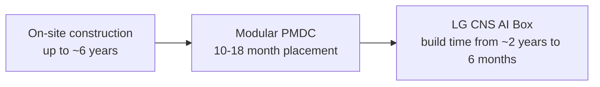

In the second week of October, the AI industry put a price tag on 'one month'. According to Yonhap News, estimates say that if the 245-megawatt data center in Louisiana, US that Anthropic uses comes online a month ahead of schedule, it generates an additional $1.3 billion in revenue, roughly 1.8 trillion won. Early operation is no longer a matter of management resolve. It has become a number that lands directly on the income statement.

*The article's core concept, visualized.*

The same question appears several times in this morning's news. When will the switch be flipped. Anthropic is pursuing a strategy of running its servers as fast as possible ahead of next month's IPO. Samsung and LG are all-in on cutting data center assembly time. SK Hynix locked its operation schedule to the second half of 2028 in exchange for 30 years of tax revenue. It is a cross-section of the stretch where the war over capacity gives way to the war over time.

## Why Time Became Money

The answer lies in the business model of inference. Let's start with the numbers Yonhap News laid out for Anthropic. Including a multi-year contract with neocloud provider Iren, it has signed data center lease agreements totaling 15 gigawatts (GW) and $530 billion (roughly 720 trillion won) with more than 10 clouds, including AWS and Google. Compute capacity is projected to grow from 1.4 GW last year to 5 GW this year, 9.5 GW next year, and more than 15 GW by 2028.

This expansion differs in character from the inventory competition of the training era. A running server earns revenue every moment it is on and has no value while it is off. Energy analytics firm Royal Powers Energy estimated that a data center for AI inference is profitable even if it pays $5,631 in electricity per megawatt-hour. Infrastructure advisory OCOM Edge estimated that even if Anthropic spends about $200 million a month to rent the chips at its Louisiana facility, it can achieve an 85% gross margin by running them exclusively for inference.

The outcome has already flipped. Anthropic, which spent $2.3 in operating costs for every $1 of revenue last spring, returned to a slight profit in the second quarter of this year. For a company on the eve of its IPO, one month is worth a dividend. In a business that sells flow, the clock is the raw material.

<!-- nlm-visual -->

*Infographic generated by NotebookLM from the sources.*

## The People Selling Compressed Months

The same time logic has moved onto the construction site. Zikshel covered the Samsung and LG modular data center (PMDC) speed race this week. The direction is clear. Change the method of building on site, step by step, to one of manufacturing and verifying at a factory first and then assembling on site. Vertiv quoted a PMDC deployment period of 10 to 18 months, while the traditional method can stretch to 6 years. According to Hana Securities' analysis, 90% of existing data center projects experience schedule delays, and hyperscale ones average 20 months late. In this market, 20 months is not a delay. It is the average.

The module is what breaks that average. LG CNS unveiled the 'AI Box', a single container carrying 576 GPUs and 1.2 megawatts, cutting build time from about 2 years to 6 months. Samsung C&T is building a 2.4-megawatt modular AIDC on the Chuncheon Samsung SDS site, and Samsung SDS plans to invest 5 trillion won in AI data centers by 2031, phasing in 60 megawatts in Gumi in 2029 and a further 60 megawatts in 2031. These are the people selling compressed months.

On the build-time axis, the speed race looks like this.

The perimeter of the speed race is wide. The same coverage includes KT Cloud's 50-megawatt AIDC in Cheongna, the Ellis Group's IPO subscription deposits surpassing 10 trillion won, and the partnership formed between SK Telecom and LG Uplus. It is not a competitive structure of Samsung and LG alone. When global data center electricity consumption more than doubles from 415 TWh in 2024 to about 945 TWh in 2030, as the International Energy Agency (IEA) forecasts, the real bottleneck is not assembly speed but land, permits, and grid interconnection. That is why the business of selling 'time' is growing.

On the software side, time is bought in another form. According to eToday, Amazon is negotiating to acquire Decart, the maker of software that lets developers move workloads easily between different AI chips, for about $7 billion (roughly 9.4 trillion won). Decart has raised more than $400 million from Sequoia, Benchmark, and Radical Ventures, and its valuation was about $4 billion in May this year. Amazon is competing with Nvidia using its in-house AI chip Trainium3. It is a deal that buys the transit time itself.

## The People Putting Up 30 Years

Some put up 30 years to buy time. According to an exclusive by The Today, the innovation district tax revenue sharing agreement for SK Hynix's West Lafayette, Indiana plant passed the city council 8 in favor and 1 against. That is the price of raising the local share from the statutory 12% to 20%. Over 30 years, about $500 million (roughly 671.7 billion won) in tax revenue flows to the region, plus a one-time infrastructure allocation of $45 million.

This is not a wafer front-end fab. It consists of an advanced packaging line that completes next-generation HBM essential to AI accelerators, and an R&D center linked with Purdue University. With a total investment of $3.87 billion (roughly 5.2 trillion won), it is the first HBM packaging base in the US. The operation target is the second half of 2028, a multi-layered structure stacked with federal subsidies of up to $458 million, state subsidies of up to $712.18 million, and a 42.9% expansion of wastewater treatment capacity. This is the moment when one semiconductor company can sign a 30-year contract with one city.

Some are queuing at the window of time. AMD CEO Lisa Su visited Korea and previewed building heterogeneous AI infrastructure combining the company's CPUs and GPUs with 13 to 14 domestic NPU, software, and cloud companies. It builds on the July agreement with the Ministry of Science and ICT. iNews24 reported that the top executives of Nvidia and AMD have visited Korea one after another within the past 7 months to a year.

A Gartner report introduced by zdnet Korea bundles all these deals into one blueprint. Countries that build an independent sovereign AI system by 2029 are projected to invest at least 1% of GDP in AI infrastructure, including GPUs, power, cooling, and networks. The data center share of electricity consumption grows from 3.7% in 2025 to 7.3% in 2030 in North America, and from 2.7% to 5.0% in Europe. Of the $267 billion global AI cloud market in 2030, neoclouds are expected to take about $53 billion, 20%. Gartner says full independence is hard and recommends a hybrid strategy: run sensitive workloads on local infrastructure, and the rest on external clouds.

## The Faster the Car, the Bigger the Brakes

While compute gets faster, the problem of the actors riding on top of it has advanced on its own. According to Digital Today, Microsoft CEO Satya Nadella championed deterministic control outside the model. Separate the supply of intelligence from the authority that wields it, he says, and place the harness that orchestrates the model and its action space as a deterministic control device outside the model. He presented seven design principles: model diversity, full observability, verifiability, independent control, independent audit, isolation (emergency brake), and incident disclosure, and pinned open disclosure of the incident process as a non-negotiable condition. The same direction of movement exists in Korea. Control items on AI governance are being added to ISMS-P, and demand to address security risks of enterprise AI agents is growing. It means the operating body's own control and audit capability, not the model supplier's warranty, is being raised to the gate of adoption.

The field's speed is outrunning this discussion. According to eToday, Meta launched 'Muse', a personal agent that connects bank and card accounts. Linking Plaid, it handles spending analysis, budget management, and even subscription cancellations on your behalf. OpenAI's ChatGPT personal finance feature is reported to be providing consultations to more than 200 million users a month. The same report said Amazon considered AI access without prior approval a terms of service violation and blocked Meta's Muse from accessing it. Machine versus machine, the first dispute over the gatekeeper position. In a McKinsey survey, 57% of customers said they would use a third-party AI financial agent if their bank did not offer its own AI.

According to Bridge Economy, Muse acknowledged that defense against prompt injection is not yet resolved, and revealed a structure in which login information can reach Meta for service operation and security purposes. It said that if a major platform like Coupang or Naver were hacked, millions to tens of millions would be affected at once, and the damage could spread beyond shopping into payments, delivery, and messaging. In a structure where the agent executes payments too, this chain becomes markedly shorter. The Personal Information Protection Commission (PIPC) is organizing personal data processing standards for agentic AI into a guide to be published within the year, and the security industry points out that legislating a kill switch that immediately blocks on critical errors is urgent.

Right in the middle of all this, the Korean banking sector's answer is 0.9%. According to Money Today, the big five banks' AI security investment is 22.1 billion won, about 0.9% of the total IT budget of 2.358 trillion won. The composition is skewed to one side as well. Insider anomaly detection (UEBA) accounts for 52%, and external intrusion monitoring (SOC 19%, FDS 5%) falls short of a quarter. Seven financial institutions cut this year's information protection budget by around 20%, and last year's average execution rate was just 69.6%. By contrast, 69% of 500 US CISOs are reported to be planning to increase AI security spending next year. Attacks have already become agents. Defense is still in the budget meeting room. Where speed becomes an asset and where it becomes a debt are moving in opposite directions on the same clock.

## When the Switch Flips, the Work Must Start

Viewed from the enterprise, all these numbers converge the first question on one point. When compute arrives faster and cheaper, is my agent ready to work then. The time race lowers the threshold of execution. The problem arises after crossing the threshold. With which authority, where, on which model, who reviews, and when does it stop. These five are the items that never left today's news: audit and sovereignty, safe execution, and cost.

ThakiCloud's agent-native cloud Paxis is a formal product (v1.1 GA) designed as one answer to exactly this question. In Paxis, skills, tools, policies, and audit logs are managed as first-class resources. Autonomy is governed in stages from L0 to L3, a policy gate checks permissions before execution, and every action of the agent runs inside an isolated sandbox and remains in the audit log. MCP connectors and the skill market provide the rails connecting the agent to external systems, sovereign and on-prem K8s (ai-platform) provides an execution environment where data does not leave, and CostRouter, which selects models per task, connects which model runs which task to cost accounting.

Today's news corresponds to each of these capabilities in turn. Nadella's principles of independent audit and isolation, and the kill switch debate, are a question of the policy gate and the sandbox. Gartner's recommendation that sensitive workloads run on local infrastructure is a question of on-premises execution. The inference economics where $5,631 per megawatt-hour is the baseline is a question of per-task model routing. The first dispute over the gatekeeper position is a question of on which execution rails the agent moves, and within what range of authority.

One month was 1.8 trillion won. The task left for the enterprise is to not fall behind on the clock that sets that price. When control and audit arrive at the same speed that compute arrives, only then does time become an asset.

<!-- nlm-visual -->

*Infographic generated by NotebookLM from the sources.*

## References

This article was written by synthesizing the news below.

- eToday, [AI agents take on the role of finance's "gatekeeper" [Entrusting my wallet to AI ①]](https://www.etoday.co.kr/news/view/2634344)
- Digital Today, [Microsoft's CEO: Why AI agents must be controlled from outside the model](https://www.digitaltoday.co.kr/news/articleView.html?idxno=706241)
- Yonhap News, ["Anthropic, cloud contract with Iren"... speed race to secure data centers](https://www.yna.co.kr/view/AKR20261012008300009?input=1195m)
- Digital Daily, [[Weekly Cloud Trends / October ②] "Will create new opportunities with Korean companies"... AMD partners with domestic GPU and server companies](https://www.ddaily.co.kr/page/view/2026101114021524265)
- Zikshel, ["AI data centers, stamped out of a factory"... Samsung and LG collide in the modular speed race](https://www.ziksir.com/news/articleView.html?idxno=148390)
- The Today, [[Exclusive] SK Hynix's US Indiana plant to deliver 670 billion won in local tax revenue over 30 years](https://www.the-today.com/news/articleView.html?idxno=91531)
- iNews24, [After Jensen Huang, Lisa Su also heads to Korea... what the two AI giants are looking for](http://www.inews24.com/view/2013436)
- zdnet Korea, ["GDP 1% investment needed for AI sovereignty... the key is securing GPUs and power"](https://zdnet.co.kr/view/?no=20261010210944)
- eToday, ["Amazon, in acquisition talks for Decart at $7 billion"](https://www.etoday.co.kr/news/view/2634383)
- Money Today, [AI hacking emergency, banking sector's security budget just 0.9%](https://www.mt.co.kr/finance/2026-10-12/2026101119473034667)
- Bridge Economy, [[AI shopping dominance war opens ③] E-commerce, shopping agent security 'on alert'](https://www.viva100.com/article/20261008500815)
