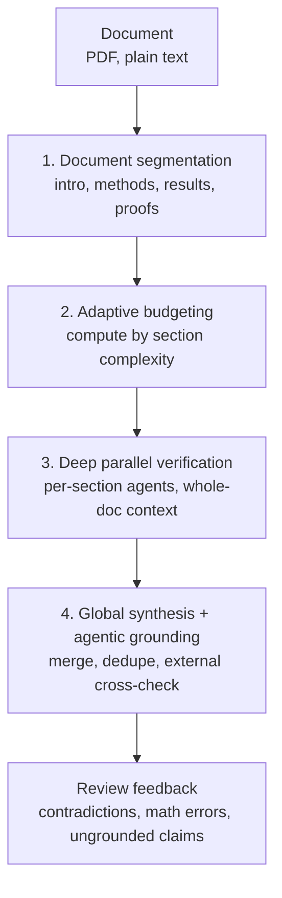

## Who should read this

This post is for the people who submit ML papers or review technical documents. The decision it informs is one: whether to adopt a pre-submission AI review stage. Google Research released Deep Review on October 14, 2026, an agentic system that stress-tests manuscripts, design documents, and complex proposals. It has already delivered pre-submission feedback on 16,000+ manuscripts across four conferences, and it now offers everyone two free reviews per week. The signal: pre-submission checking is becoming standard infrastructure, not research-community culture.

## The system in one picture

Think of a factory inspection station. The product, here the manuscript, is first disassembled into parts, the sections. Inspectors are assigned inspection quotas by part complexity; a dense part like a proof gets looked at longer. Each part goes to its own inspection bench and is checked in parallel. Finally, a chief inspector merges the findings, removes duplicates, and cross-checks them against an external standard, here web-sourced references. Deep Review runs that inspection station over a document, and the defects it hunts are the ones that only appear when things are taken apart: logical contradictions, mathematical errors, and unsupported claims.

## Overview

Deep Review went public on October 14, 2026, via the [Google Research blog](https://research.google/blog/analyzing-technical-documents-with-deep-review/). The official description is an agentic AI system engineered to give rigorous feedback and technical verification on complex documents. It is the evolution of the Paper Assistant Tool, PAT, which had been running opt-in inside Google, and this release opens the service to everyone.

The target documents are broad. Initial input is PDF and plain text, with multi-file input coming soon. The company says it is expanding to Google Docs and presentation files, and lists design documents, slide decks, legal contracts, and financial materials alongside scientific papers as use cases.

## What Deep Review is: the 4-stage pipeline

The core of Deep Review is a four-stage agent structure.

Stage 1, Document segmentation, breaks the document into units like introduction, methodology, experimental results, and proofs. Stage 2, Adaptive budgeting, allocates compute per section by complexity; dense sections like proofs get more thinking time. Stage 3, Deep parallel verification, runs separate agents per section in parallel, each agent aware of the whole document, not just its own section. Stage 4, Global synthesis and agentic grounding, merges the findings, deduplicates them, and verifies the claims against external sources via web search.

What separates it from a summarizer is that verification is the goal. It hunts logical contradictions, mathematical errors, and claims that no source supports, and the final stage actually runs web search to check claims against outside evidence. The structure does not stop at internal consistency.

## Pilot results and market context

Before launch, the service ran as PAT, giving opt-in pre-submission feedback to authors at four major CS conferences: STOC 2026, ICML 2026, NeurIPS 2026, and ICLR 2027. The scale: 16,000+ manuscripts.

The blog also cites submission growth. Submissions to three AI venues passed 74,000, up from 45,000 in 2025, 32,000 in 2024, and 23,000 in 2023. As submissions grow, the time a reviewer can spend per manuscript shrinks, and the value of catching defects before submission grows for the author. From a researcher's side the arithmetic is simple: a top-tier submission faces several human reviewers, each with a bounded amount of time, and an automatic check that catches math errors and contradictions pre-submission is a low-cost investment relative to a desk rejection. The fact that 16,000+ authors opted in is evidence the arithmetic already works. Paper volume and automated pre-checks reinforce each other.

## How to use it

Anyone can use the service, with two free document reviews per week. Beyond that, or for programmatic access, the Deep Review API runs on a Gemini API key. Submitted files are retained for one year for user display, a condition that matters for teams sensitive about document retention.

The documents that benefit most are papers with dense proofs and heavy citation. The adaptive-budgeting structure favors exactly that type, since harder sections get more compute. For creative writing or light technical blog posts, the payoff is limited; spend the twice-a-week budget on documents that are about to be submitted.

## ThakiCloud product implications

### Paxis (Agent-Native Cloud)

The four stages are, as-is, the DAG Paxis executes. The segmentation, budgeting, parallel verification, synthesis order carries dependencies, and the parallel verification stage is a fan-out shape. Running a document-verification agent of the same structure on Paxis lets you record the verification result and its provenance, which section, which agent, which external source, as an audit log. Review becomes a first-class resource of the platform instead of a one-shot output.

Our in-house paper-review pipelines, the paper-review and feynman-peer-review family, are close to a single agent that reads the whole document through. The difference from Deep Review is per-section parallel verification and external grounding. Porting those two into the in-house review agent should pay off on quality, not just speed: each agent can concentrate on the densest sections, which raises the chance of catching fine defects like math errors.

Read the four stages as an execution graph and the bottleneck is the final synthesis, not the parallel verification. If merging section findings into one feedback and cross-checking sources is slower than the fan-out, the synthesis agent decides the total latency. The same operational principle applies to Paxis's DAG execution: give the synthesis stage a sufficient budget.

### ai-platform (Metis serving)

The serving-side implication is modest. Deep Review is a managed service with no open-weights version, so a direct inference-cost calculation does not apply. But the workload shape, many concurrent agents each holding whole-document context, is the classic case where multi-tenant context management and cost allocation become important on a serving platform.

## Limitations and counterarguments

First, it is a closed service. No open-weights release, no self-hosting option, and verification quality depends entirely on Google's models. For customers with data-sovereignty requirements, the fact that the document goes to an external service and is retained for a year is the biggest hurdle.

Second, initial formats are PDF and plain text only. Multi-file input is pending, and the support range for design documents and presentations is still expanding. For teams whose documents are scattered across files and links, there will be a wait before the whole scope fits.

Third, the effect on paper acceptance is not published. We know that feedback went to 16,000+ manuscripts, but the announcement does not show whether the pre-check actually found defects that changed outcomes. Until it is measurable, the correct read is "an inspection station that exists," not "one that has proven itself."

## Bottom line

Deep Review puts the agentic structure of disassemble, assign inspection quotas, inspect in parallel, and cross-check outside onto pre-submission review. It has already operated on 16,000+ manuscripts at four major conferences, and the fact that anyone can now get two free reviews per week means pre-submission review is becoming standard infrastructure. For the reader, the most immediate action is one: run your next submission through this week's two free reviews. For us, it is the reference design for rebuilding the in-house review agent around per-section parallel verification and external grounding.

## References

- Google Research, [Analyzing technical documents with Deep Review](https://research.google/blog/analyzing-technical-documents-with-deep-review/)
- The Deep Review launch announcement on Google's official X account (NewsFromGoogle)
