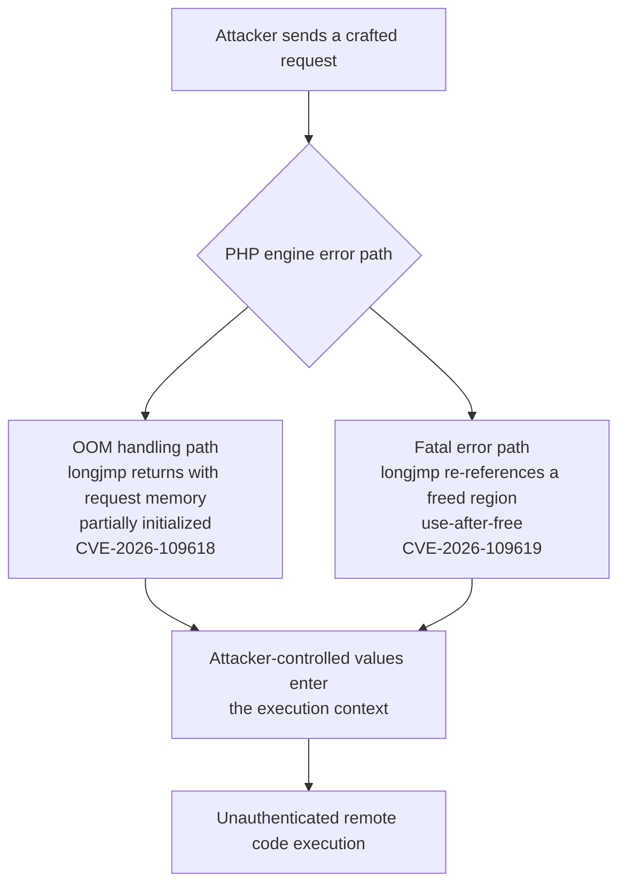
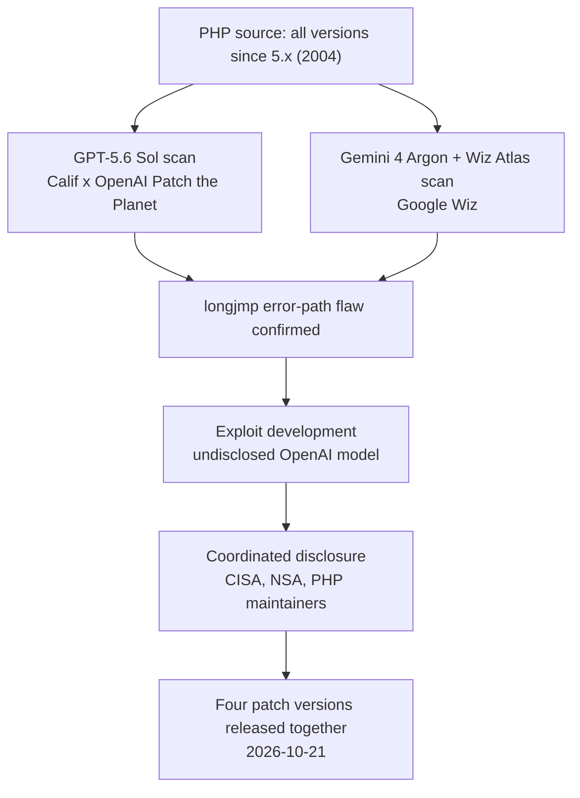

*What PHP2Shell brought above the surface is only two CVEs. OpenAI says it holds more already, and says similar findings will increase sharply.*

## Why Read This

This is for security and operations engineers running PHP stacks, and for platform engineers who need a factual basis for judging where LLM security capability has actually arrived. The conclusion, up front: LLMs have crossed from "tools that find known bug patterns" to "agents that genuinely picked a 22-year-old vulnerability in a production stack that humans had left untouched," and the first concrete proof is PHP, which holds up roughly 70% of the internet. If you operate PHP, check your patch status today. If you build platforms, recompute what "reading code with AI" costs, on both the offensive and defensive side.

## In Plain Terms

Imagine the plumbing of an apartment building from 2004. The main water line opens and closes millions of times a day, so it is the best-maintained part of the building. The emergency valve, the one you would only open during a fire, has never been opened, and its interior has rusted while sitting there. When humans inspect plumbing, they look at the main line. LLMs do not. The fact that "this valve has never been opened in 22 years" is itself a flag, so they open every emergency path, one by one. PHP2Shell is what burst when they opened that emergency valve, the error path that returns via longjmp.

## Overview

On October 21, 2026, the PHP maintainers released four versions at once: 8.2.35, 8.3.36, 8.4.27, and 8.5.12. They patch the two flaws CISA put on its urgent advisory, CVE-2026-109618 and CVE-2026-109619. Both let an unauthenticated request reach remote code execution (RCE) by traveling through error paths that call longjmp, the C library's nonlocal control transfer function. Under CVSS v4.0, both score 9.2, Critical.

The core of the story is not the patches. It is how the hole was found. The security firm Calif, participating in OpenAI's Patch the Planet initiative, made the initial discovery with GPT-5.6 Sol, and exploit development was done with a different, undisclosed OpenAI model. Independently, Google's security unit Wiz found the same flaw with Gemini 4 Argon plus Wiz Atlas. Two organizations, two model stacks, one hole. That convergence is the most noteworthy part of this incident.

The hole is 22 years old. It has existed since PHP 5.x shipped in 2004. The affected range is effectively "everything since 5," and the EOL releases from 5.4 through 8.1 have no patch, so migration is the only option for them. With the commonly cited statistic that roughly 70% of the internet runs on PHP, any organization on WordPress or Drupal is inside the blast radius.

## What Is PHP2Shell

The name was given by the Dutch NCSC. "PHP to Shell": get a shell out of PHP. The mechanism can be read as two CVEs with one root. When the PHP engine hits a fatal situation, it calls longjmp to return to an earlier context. Rare in a normal C core, but on the paths longjmp crosses, allocation may not have finished. Control can come back into a request structure where only part of the memory is initialized, and the rest is filled with attacker-influenced values.

CVE-2026-109618 lives in the out-of-memory handling path. The request memory is returned via longjmp in a partially initialized state. CVE-2026-109619 lives in the fatal error handling path. After longjmp, the engine references an already-freed region, a use-after-free. Both are reachable by a single external request, with no authentication.

Why it never fired for 22 years is simple. These paths only open when memory is genuinely exhausted or a genuine fatal error occurs. Load tests rarely open them, and code review rarely sees them. The rarely-taken path is where flaws live longest, outside human inspection.

## Two Companies Picked It: Patch the Planet

Patch the Planet is the open-source security program OpenAI launched on June 22, 2026, built jointly with Trail of Bits. HackerOne and Calif are partners, and it targets more than 30 open-source projects. It runs under the Daybreak program. GPT-5.6 Sol chose PHP for its first real engagement.

To be precise, the sentence "GPT-5.6 Sol picked PHP" is only half right. The initial discovery was GPT-5.6 Sol's work. The exploit development, the step that actually executes code through the hole, was done by a different, undisclosed model. OpenAI says this distinction matters. Discovery and verification are separate capabilities, and only a flaw verified all the way to exploitation counts as a real vulnerability.

And Wiz found the same hole on its own, with Gemini 4 Argon plus its code analysis tool Wiz Atlas. Two companies, two model architectures, converging on the same longjmp paths. The "the model just got lucky" reading loses force here, because it means the PHP longjmp error paths are reachable by "a large enough LLM plus the patience to read a codebase to the end."

GPT-5.6 went GA on July 9, with three tiers: Sol (flagship), Terra (balanced), and Luna (fast and cheap). Greg Brockman saying "PHP was my first programming language" is not a coincidence. Putting Sol on the face of this story carries the message that the flagship can do this.

## Exploitation and Patches

At the time of disclosure, OpenAI reported no exploit in the wild. Exploitation attempts surfaced immediately after. AWS observed attempts starting October 17, four days before the public patch, according to Datadog Security Labs. watchTowr reported honeypot-based attempts on October 21, and Singapore's CSA reported broad attempts plus multiple PoCs on October 22. Whether CISA added these to its KEV catalog as of October 21-22 could not be confirmed. [unconfirmed]

The patches are four versions.

| Release | Patch version | Status |
|---|---|---|
| PHP 8.2 | 8.2.35 | Released 2026-10-21 |
| PHP 8.3 | 8.3.36 | Released 2026-10-21 |
| PHP 8.4 | 8.4.27 | Released 2026-10-21 |
| PHP 8.5 | 8.5.12 | Released 2026-10-21 |
| PHP 5.4-8.1 (EOL) | none | Migration required |

NSA's guidance is blunter. If you cannot patch, go offline. Most cloud PHP services applied the patch quickly, but on-prem and PHP embedded in container images need manual verification.

The check sequence is simple. First, run `php -v` at every entry point and record the version. If a load balancer sits in front of the web tier, repeat it per node, and cron jobs or workers that run from the CLI are separate entry points that easily get missed. Then check container images. If you pin the base image to a `php:8.2` tag, you have to rebuild or pull and verify that the digest actually moved to 8.2.35 or later. Tags are floating, so "8.2" in the image name does not mean patched. If you are on an EOL release, there is no patch alternative and you need a migration plan. WordPress and Drupal plugin compatibility testing included, migrations like this usually take weeks, not days.

## The Weight of "Tip of the Iceberg"

OpenAI itself called this PHP hole the "tip of the iceberg." It already has "several" significant vulnerabilities in hand, and it expects similar findings to "increase sharply" in the coming months. No concrete count exists anywhere. [unconfirmed]

What matters about the phrase is direction, not numbers. Past announcements of "an LLM found a vulnerability" mostly came from lab conditions, artificially planted bugs, or a specific function family. PHP2Shell is different. It came from a path that has been in production for 22 years, running daily on millions of sites, and that no human had ever opened. The capability "an LLM reads a codebase to the end" has now been verified as an offensive weapon in the field.

From the defender's side, the same sentence cuts differently. What comes out if we point an LLM not at 30 projects but at our entire running stack? The list would be "the rarely-taken paths," "the error handlers that were never tested," and "the longjmp in the EOL dependency."

## Implications for ThakiCloud

Through the ai-platform lens, this incident raises the value of a workflow that checks "the patch state of PHP stacks in customer environments." In on-prem and sovereign environments, PHP embedded in container images is managed manually, and pinning the output of `php -v` to a CI or operations dashboard is now a minimum defense line, not an option. ThakiCloud's ai-platform serves models across diverse customer environments, and checking "the patch state of the customer environment" sits in the same operational context.

Through the Paxis lens, this incident changes the economics of "LLM code audit" workloads. Paxis is ThakiCloud's Agent-Native Cloud, treating skills, tools, policies, and audit logs as first-class resources. The structure of Patch the Planet, scanning projects with an LLM, managing a coordinated disclosure calendar, and separating exploit development onto a different model, is exactly the shape of Paxis's DAG multi-agent orchestration plus policy gates plus audit logs. In the period when LLMs are used on both the offensive and defensive sides, the operating question is whether that use is auditable and passes through policy gates.

## Limits and Counterarguments

First, the accuracy of "GPT-5.6 Sol discovered it." The initial discovery and the exploit development were done by different models, and the exploit model is undisclosed. Generalizing to "Sol's capability" is premature, and there is a fair critique that OpenAI is attributing the whole credit to one model on purpose.

Second, the PHP longjmp path is special. LLMs only hold the advantage when the conditions stack: a rarely-taken path, an old language, a C core with manual memory management. Whether the same edge exists in modern languages like Rust or Go, with automatic memory management, is not yet proven.

Third, the direction of "increase sharply." If LLMs help the offense, they help the defense too. The problem is speed asymmetry. The offensive LLM only has to open the rare path. The defensive LLM has to open all of them. If an LLM picked 22 years of debt in a day, can it also block it in a day? The PHP2Shell patch was written by humans. The LLM only verified it.

Fourth, the 70% statistic. "Roughly 70% of the internet is PHP-based" is repeatedly cited by security media, but the vintage of the underlying metric is old. [estimate]

## Summary

If you run PHP, look today at `php -v` and check whether you are at 8.2.35 or later, or on an EOL release. If you are on EOL, set a migration date. If you cannot patch at all, review going offline, the way NSA says.

If you are a platform engineer, recompute two questions under the premise that "an LLM can read code to the end." Where are the rare paths in our stack, and can we run an LLM scan of those paths the way Paxis does, with policy gates and audit logs in place? When OpenAI called this the tip of the iceberg, it was marking the start of the period when LLMs are used on both sides. The hole hidden for 22 years was opened by an LLM, and the speed of that opening will only increase from here.

## Sources

- OpenAI: Coordinated Disclosure of Critical Vulnerabilities: https://openai.com/index/coordinated-disclosure-of-critical-vulnerabilities/
- TechCrunch: PHP Armageddon. OpenAI, Google's Wiz find ancient holes, panicking the internet: https://techcrunch.com/2026-10-21/php-armageddon-openai-googles-wiz-find-ancient-holes-panicking-the-internet/
- The Verge: GPT-5.6 Sol was used to identify critical PHP flaw: https://www.theverge.com/tech/1015481/gpt-5-6-sol-was-used-to-identify-critical-php-flaw
- NCSC-NL: php2shell: https://github.com/NCSC-NL/php2shell
- Wikipedia: PHP2Shell: https://en.wikipedia.org/wiki/PHP2Shell
- GPT-5.6 Sol model docs: https://developers.openai.com/api/docs/models/gpt-5-6-sol
- Andrew Curran tweet: https://x.com/AndrewCurran_/status/2112913197774807491
