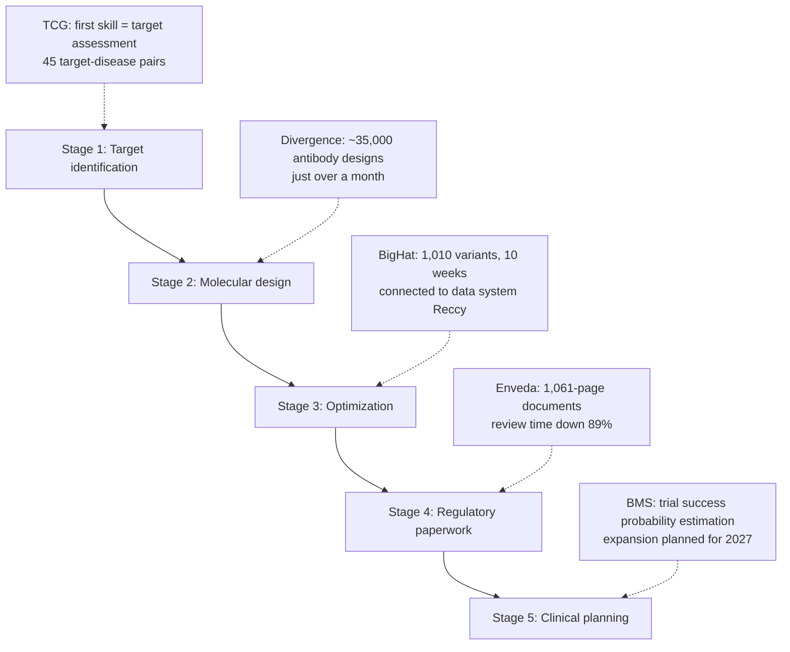

*A glowing path threading through a DNA double helix. We abstractly rendered the agent's movement connecting each stage of the closed loop.*

## Why read this

If you build an agent platform, or your team is about to decide whether to bring an AI agent into a regulated industry, read this for one question: "How far down the closed loop can we trust an agent?" Here is the conclusion up front. The early drug-development partnership results Anthropic published on October 27 show, in numbers, that frontier-model agent use is moving past code writing and search assistance into closed-loop work like experiment design, document review, and clinical-trial planning estimation. But every number is preclinical, and the announcement itself is premised on "Claude still needs to improve."

## Overview

The tweet went out on October 27 (UTC) from the @AnthropicAI account, and the body is the research blog post [early progress on accelerating drug development with Claude](https://www.anthropic.com/research/early-progress-drug-development) (Team Science, posted 2026-10-27). First, the four core facts of the post:

- Anthropic's scientists ran deep-research partnerships with **six organizations** developing new drugs. BigHat Biosciences, Bristol Myers Squibb (BMS), Divergence Labs, Enveda, Generate Biomedicines, and The Column Group (TCG).
- They also began drug-discovery work independently, and in the process **acquired a one-person company called Mithril Medicine**.
- Drug development is not a single problem; it is a process where bottlenecks are distributed from target identification through molecular design, manufacturing optimization, regulatory paperwork, and clinical design and operations. So it chose the strategy of going deep into actual drug programs.
- It states the purpose of this work in three ways: understanding model strengths and limits across a broader set of problems in order to set model-improvement priorities; providing more biopharmaceutical companies with Claude adoption cases; and hoping that some programs lead to drugs that are actually effective for food allergies, rare childhood diseases, cancer, and so on.

## Measured results by case

Chapter 01 of the post is per-partner case studies. We carry over the published numbers as-is.

**Generate Biomedicines, modality engineering.** In work extending CAR-T cell therapy to solid tumors, they wanted to shorten part of the therapy's genetic instructions to free up instruction space. Six scientists used Claude Code to get new design proposals, and one of them was about 70% shorter than the standard version. In the lab, this design made immune cells produce about 10x more receptors, removed tumor cells more efficiently, and kept the immune cells active longer.

**Divergence Labs, hit generation.** Food-allergy treatment targets the way IgE molecules detach from immune cells. After Claude turned the target into a detailed design plan, it autonomously generated roughly **35,000 antibody designs** in just over a month. In initial testing it found 3 designs that bind IgE and 20 that detach it, and 3 of those detached IgE more strongly than the standard drug.

**BigHat Biosciences, lead optimization.** Combining AI with an automated lab, it improved the binding, stability, and aggregation properties of two candidate molecules (antibody fragments). Claude was connected to BigHat's experimental data system **Reccy** and proposed molecular changes, and the lab synthesized and tested 1,010 variants over roughly ten weeks. Midway, a doubt arose that standard thermal-stability and aggregation metrics could be misleading, so Claude and Anthropic researchers re-analyzed the raw data and proposed different metrics and protocol changes; the key predictions held. As a result, the best version bound more than 10x more strongly than the original, the cancer-targeting candidate stayed in solution at a temperature 18C higher, and the in-body-retention candidate aggregated more than 100x more slowly.

**Enveda, manufacturing documents and regulatory paperwork.** Enveda's manufacturing chemists spent up to 75% of their time on paperwork. In a system that connects the full manufacturing documents to Claude, a 1,061-page document test showed Claude caught all 11 problems human reviewers found, and 7 of those were ones humans missed. Human review time fell 89%, dropping from over 25 hours to under 3 hours. Claude also drafted two regulatory documents; one took 4 hours where manual work would have taken about 3 months.

**The Column Group, company founding.** TCG is using Claude to set up a new company, **Pleiades**, running an unusually large number of drug programs for a small team. Pleiades' first Claude skill evaluates "is a drug target worth pursuing?" and was assessed on 45 target-disease pairs.

**Bristol Myers Squibb, clinical planning.** BMS is using Claude to evaluate clinical-trial plans for early-stage drugs and to estimate the probability of trial success. It plans to expand this work in 2027. BMS's early-clinical-development SVP Michael Pourdehnad is quoted in the post: "From a single prompt, Claude produced the initial analysis that would take days, and it did so while keeping high-sensitivity data secure."

*The points where Claude actually entered the 5 stages of drug development. Each case's numbers are per Anthropic's published source.*

The independent program leads to the acquisition of Mithril Medicine. Mithril is a one-person company run by Cody Tranbarger, developing treatments for two forms of rare childhood muscular atrophy; it reportedly coordinated contracts, logistics, and experiments across 11 external labs with Claude and delegated much of the operations. As a result, one candidate treatment took less than 18 months from idea to promising mouse-experiment results, and Anthropic said it expects human clinical trials could begin as soon as the second half of 2028 if the candidate holds up.

## Service expansion

Chapter 02 is closer to the deployment structure than to the research itself. It launched **Claude Science**, an AI workbench for researchers, and provides Claude credits to biomedicine researchers. The **Life Sciences Verification Program** lets trusted organizations use the most powerful models with a relaxed version of the safeguards; it aims to resolve the problem of abuse-prevention safeguards slowing down legitimate biological research. It also opened a public call for guest investigators.

## Implications for ThakiCloud products

Read through a Paxis lens, this announcement gives three signals.

First, **stage-by-stage penetration of the closed loop**. Under the headline "agents discover drugs," the actual cases are far more staged: document review (Enveda), variant proposal (BigHat), success-probability estimation (BMS). When an agent platform enters a regulated industry, the first touchpoint is verifiable stage work, not open-ended generation. When Paxis designs domain agents too, defining the stage-by-stage scope of responsibility (what it proposes, what it executes, what goes to human approval) comes first, the same order this announcement shows.

Second, **data-system connectivity is the premise of quality**. The core of the BigHat case is that Claude is connected to Reccy; the core of the BMS case is that it operates over high-sensitivity proprietary data. "The model is smart" matters less than "which data, with which permissions, does it touch?" That is what determines the outcome. This is exactly the problem Paxis's MCP connectors and policy gates plus audit logs handle.

Third, **the shape of a domain's first skill**. Pleiades' first Claude skill is a classification skill that evaluates "is the target worth pursuing?" Rather than a huge generation, the evidence is that a domain's entry skill starts as a judgment or evaluation skill. A clue for positioning the first skill when designing a skill pack.

## Limits and counterarguments

Caveats are needed proportional to the weight of the numbers. Every case is preclinical. The post itself states "still at an early stage"; of the 35,000 designs, only 23 (3 binding plus 20 detaching) passed initial testing, and only 3 of those were "stronger than the standard." BigHat's "10x binding" is a lab number at the candidate-molecule level, and Mithril's 18 months is the fast track of drug development, with human trials "as soon as" 2028. Partners are also in the position of including their own cases in the announcement, and regulatory approval does not start from any of these numbers. The claim "agents accelerate drug development" should, at this point, be narrowed to "reduced the work time of the document, proposal, and evaluation stages" to be accurate.

## Wrap-up

The agent-usage landscape of frontier models is shifting. From search assistance to experiment-design proposals, document review, clinical-planning estimation, and even operational delegation for a one-person company. What Anthropic showed with six partners' early results is not "agents replace the whole domain" but **that they enter in order, from verifiable stage work**. For teams building an agent platform, the implication is clear: the next battlefield is the domain, and the entry order is data-system connectivity, the first judgment skill, and stage-by-stage scope of responsibility. Mithril's "18 months" and Enveda's "89%" are not marketing numbers; they are evidence of what position an agent already holds inside the process.

---

*Sources: [Anthropic, Early progress on accelerating drug development with Claude (2026-10-27)](https://www.anthropic.com/research/early-progress-drug-development) · [@AnthropicAI tweet (2026-10-27)](https://x.com/AnthropicAI/status/2115178675050307942)*
