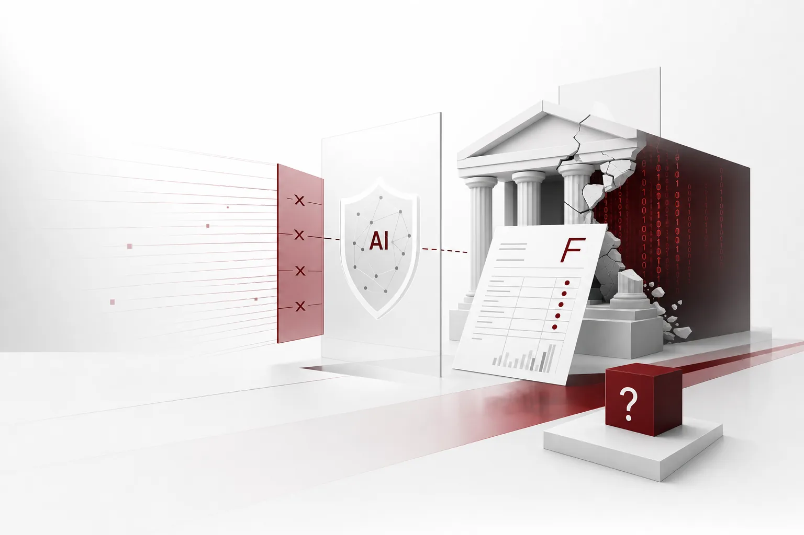

Network separation is a 13-year-old rule. After the large-scale cyberattack of 2013, financial institutions divided internal and external networks, and that wall quietly held for 13 years. In 2026, the Financial Services Commission picked the wall itself as the object of reform. AI is the solvent. And the byproduct is the exam.

*A visual representation of the article's core concept.*

## The Prescription: 'Defend Against AI Attacks With AI'

The background is a mountain of numbers. Between September 30 and November 3 this year, 40 intrusion incidents were reported at 37 financial institutions, and roughly 473,000 records of information were leaked. On top of that, about 1 billion won in company-managed funds was stolen from virtual asset operator hot wallets and e-finance firm deposits. No direct customer harm has been confirmed yet, but the fact that reports continued until November 3 even after the FSC finished its security checklist inspection on October 14 says everything. E-finance, virtual assets, securities, insurance, banking. In one month, virtually every sector was hit, and the structural weakness of small, mid-sized, and new firms without dedicated security staff or investment headroom came to light. As mobile, non-face-to-face, cloud, and AI-based processing expanded, the paths connecting to external systems multiplied, and the attacks came in through the gaps.

In response, the FSC launched a full security review of about 580 financial institutions and said it would hold management, including the CEO, responsible if serious management deficiencies are found. What changes together is the direction of the security policy itself. Real-time detection and response of AI-based abnormal signals, a task force on network separation regulation reform, a pilot of the 'phishing index,' and legislation for strict liability in voice phishing. The authority's judgment is that the conventional defense built on firewalls and network separation has become hard to operate against advanced hacking methods that abuse AI. The trend condenses into one line: defend against AI attacks with AI.

## The Exam: The Report Card of 2,091 People

The prescription carries a hidden premise. The network separation exception opens only to security AI and SaaS. To defend with AI, you first have to be qualified. The rule that was the answer to financial security for 13 years has become the highest hurdle for letting AI in. The FSC selected 13 financial institutions for the second round of emergency relief and notified them. In this round, e-finance operators such as KakaoPay and TossPay were included for the first time, and insurance, securities, and card companies also joined the exception queue.

But one bank was excluded. Kookmin Bank is the only one among the top five banks to be out of both the first and second rounds. The reason was clear. At the end of September, its employee mobile work support system was hacked and the information of 2,091 customers was leaked, and that history came back as the exam answer. The industry calls this structure security trust grading. In a double structure where hacking history is tied to regulatory qualification, the more a bank wants to be safe, the more its past matters. The bank that most needed AI defense had to queue while its peers got their hands on the tools. The FSC will run a task force on full deregulation of network separation this month, and plans to prepare the details of deregulation and a plan for a new AI-based security system by the first quarter of next year. The schedule to tear down the wall is already set.

## The Other Bank: A Gateway Built by Woori Bank Employees

There are banks that were made to return their report cards, and there are banks that put AI on the review desk. Overseas remittance work has long been a repetitive, labor-intensive process: an employee checked foreign-language proof documents, cross-referenced them with foreign exchange transaction rules, and manually selected the payment reason code. In periods where exchange rate swings overlap with import and export remittance demand, commercial banks bear the burden of strengthening compliance accuracy and internal control at the same time. Woori Bank introduced an AI-based review support system, 'FX AI Smart Compliance,' and prioritized its application to remittances for trade and service payments starting November 5. The system extracts text from proof documents such as invoices and contracts via OCR, and the LLM analyzes the document content and the remittance purpose to automatically recommend the payment reason code. The extracted remittance information is automatically entered into the system. The bank has even completed a patent application for the AI verification and operation methodology.

What is interesting is the verification method. After the pilot, it will run in parallel with the conventional method for about two months, confirm safety, and then go to full application. AI recommends, people verify. Next, expanding the scope of reviewable documents and notifying non-face-to-face booking customers of the pre-review results are planned. A commercial bank placing an LLM in a document review workflow in the most strictly regulated internal control area is a signal of production stage, not pilot. The bank that went one step ahead in the most conservative industry quietly installed its own gateway.

## The Unit of the Wall Changes

The tech industry is piling up the same answer. NVIDIA applied OpenShell, a security runtime that manages the permissions and execution scope of AI agents, to Box. Box is a tool that builds automation workflows when business processes are described in natural language, and it starts trial operation for enterprise customers in Q4. Box announced a 20% improvement in search accuracy, a 4x increase in response speed, and a 90% reduction in token consumption in Nemotron-based context retrieval, and it also expanded customers' freedom of model choice by introducing an open-weight model family. Since the adoption of generative AI, what companies ask for is not to pick one of search accuracy, data security, and operating cost reduction, but to satisfy all three at once. That is why the combination of a content management platform, a semiconductor maker, and a model provider reads as the standard infrastructure layer for enterprise AI agents.

A Korean company, Webkey, walks the same path in the accounting domain. 'Kyunglinara MCP,' to be released in December, lets generative AI such as ChatGPT and Claude directly query and analyze corporate data. In the past, to use SaaS data with AI, a separate job of exporting to Excel and entering it manually was required, but now the wall itself collapses. Administrators choose from the four areas of funds, sales, purchases, and basic information to control the range of data access, and when the integration is released the connection ends immediately. It has been only a little over a year since MCP spread as a connection standard centered on OpenAI and Anthropic. Before the official release, it also announced a plan to recruit 10 customer companies as a trial group and provide MCP usage and lifetime free use of Kyunglinara for one year. The plan goes further: by 2027, an accounting-specialized AI agent, 'Kyunglin365' (tentative name).

The signal descends to the hardware floor. NVIDIA's agent-dedicated CPU, Vera, is equipped with 88 Olympus cores and up to 1.2TB/s of memory bandwidth, and handles code execution, tool calls, and data processing between GPU inference. NVIDIA's claim is that, based on a 100MW data center, it has 1.6x the AI agent throughput per watt compared to the top x86 CPU. However, each benchmark from NVIDIA, DeepInfra, AMD, and others uses different criteria such as latency, concurrent agent count, and container throughput. An era has arrived where what criteria to measure by matters more than the numbers themselves.

The size of investment that companies take on also grows. SK Group Chairman Chey Tae-won announced at a lecture at the Seoul National University College of Social Sciences that 2,100 trillion won is needed for the 'three mega projects' of semiconductors, physical AI, and AI data centers. In the same session, he named the sustainability of AI development as the biggest concern, and worried that the macroeconomy might not withstand investment of this scale and that the capital buffers of frontier companies such as OpenAI and Anthropic are insufficient. SK Telecom is building a 2GW-class AI factory based on the NVIDIA DSX full stack and introducing Vera Rubin with HBM4, and SK has already pledged about 1,000 trillion won of investment in 15GW AI data centers. A global AI investment of up to 10 billion dollars, about 13.428 trillion won, through HYAICO Corporation has also been confirmed. The policy side turns the same topic. The National AI Strategy Committee will review the 'Korea Artificial Intelligence Legislative Framework (Draft)' at its third plenary session on the 6th, and even defense sovereign AI and a government-wide data pipeline were put on the agenda. The AI Action Plan finalized in February contained 99 execution tasks and 326 policy recommendations, and this session is a place to enter the execution orbit by configuring task forces for core tasks.

The direction converges. The wall, that is, the network, is no longer the unit of security. The unit is moving to the permissions, scope, and audit of the agent. The FSC's 'new AI-based security system' and the industry's 'agent security runtime' point to the same place.

## From 'Can You Use It' to 'Can You Prove It'

So the question placed before companies changes. Not whether AI can be adopted, but whether it can fully answer the question 'how did you use it.' Who, under what policy, in what scope, leaving what audit record, with what degree of autonomy, where, at what cost it moved. The parallel operation that Woori Bank ran for two months and the four-area access control designed by Webkey are both in-house versions of that answer. If GW-class data centers and 1,000 trillion won-class investment are the promised flow, then agents of considerable scale entering a corporate intranet is no longer the exception. In an era where security history becomes a grade, the exam means not a regulatory item but a product requirement.

## Paxis Lens: Putting Answers into the Execution Layer

This is the place where ThakiCloud's agent-native cloud Paxis steps up to the examination stand. Paxis (v1.1 GA) handles the four elements that the exam asks about as first-class resources: Skills, Tools, Policies, Audit Logs. What the agent can do, which tools it can call, and under what policy it moves are defined before execution, and every action is left in the audit log. Autonomy levels from L0 to L3, governance and policy gates, and isolated sandbox execution institutionalize the structure that 'AI recommends and people verify.' How high to raise autonomy is not the ability of the model but the judgment of the organization, and the policy gate is a device that supports execution until that judgment changes. Woori Bank's current parallel operation is the state of low autonomy itself, and raising that stage by stage as trust accumulates is Paxis's ladder.

Mapping today's news to the pain it exposed is clean. Because the record already exists before the question of audit, it becomes not panic but a query. The bank's security audit evidence now directly relates to regulatory qualification, not an internal document. That is why the ledger that is not revealed normally and is only hurriedly created when an incident or inspection comes to visit must become an asset that accumulates every day. For environments such as network separation and closed networks not to become an obstacle to AI adoption, you must be able to stand up the agent execution environment inside the wall, and Paxis provides that place with sovereign and on-premise K8s execution. Tool connections like Kyunglinara MCP or Box are not individual craftsmanship, but are plugged into a single policy layer with MCP connectors and a skill market. For cost, per-task model selection and CostRouter prevent the zero-sum between safety budget and AI cost.

The paradox of the prescription is ultimately a signal. The competition of 2026 is not the side that used AI faster, but the side that can fully answer audit earlier. In an era where security becomes a grade, the moat is not the wall but the ledger. For those who make the exam a byproduct of execution, the security report card is no longer an obstacle.

## References

This post was written by synthesizing the following news.

- Tokenpost, [1.6x agents per watt... NVIDIA claims Vera CPU performance](https://www.tokenpost.kr/news/ai/433654)
- Jemin Ilbo, [NVIDIA and Box strengthen AI alliance... aiming at the enterprise business automation market](https://www.jemin.com/news/articleView.html?idxno=846312)
- Vegan News, [Webkey, Kyunglinara MCP released in December... query corporate data from AI](https://www.vegannews.co.kr/news/article.html?no=401067)
- Korea Financial Economy, [Woori Bank introduces AI into overseas remittance review](https://www.kfenews.co.kr/news/articleView.html?idxno=667621)
- ZDNet Korea, [National AI Strategy Committee, first plenary session of the Ha Jung-woo regime... raising the AI action plan to 'execution orbit'...](https://zdnet.co.kr/view/?no=20261105173923)
- Yonhap Infomax, [Chey Tae-won "Investment of 2,100 trillion won in mega project, no way to follow without betting" (End...](https://news.einfomax.co.kr/news/articleView.html?idxno=4443309)
- CEO Score Daily, [Chey Tae-won handles SK's global AI investment directly... 13 trillion won in cash, 'HYAICO Corporation...](https://www.ceoscoredaily.com/page/view/2026110511054249561)
- Geconomy, [[Urgent in financial security] 37 financial companies breached in a month... leakage of 470,000 pieces of information, 10...](https://www.geconomy.co.kr/news/article.html?no=325335)
- Asia Economy, [[Exclusive] Kookmin Bank, again fails in 'network separation exception' over hacking incident... Nonghyup Bank, Kakao...](https://view.asiae.co.kr/article/2026110607380691848)
