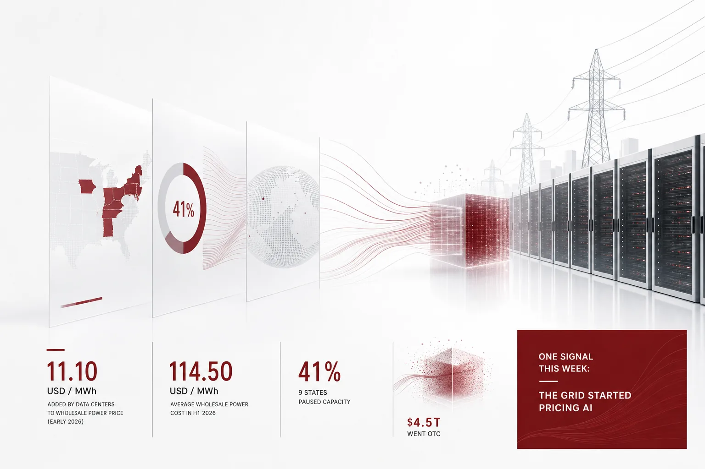

If you own an AI services budget, the place to circle first this week is the grid bill. PJM's independent market monitor estimated that data center demand added $11.10 per MWh to early-2026 wholesale power prices. The average wholesale power cost for the first half of 2026 was $114.50 per MWh. The first half of 2026 that the monitor estimated is already a period that has passed. It is not a forecast for next year. It is the value of a bill that has already been paid. The line data centers added to the grid is a little under 10 percent of the total. It is a line that comes with every unit of power bought in that market. Per the monitor's explanation, the line was made by demand. As data centers consumed more power, wholesale prices went up. That means every other power user in the market started paying more. This week's news is the industry's answer to that line. US governors, AI companies, and a foreign government each answered in a different direction.

*We visualized the core concept of the post.*

## The $11.10 on the bill

Read in one line, the monitor's estimate says this. Of the $114.50 per MWh PJM wholesale power price in the first half of 2026, data center demand added $11.10. It is a value computed by estimating how much lower the price would have been without data center demand. Take the added line out and the price falls to under $103. In other words, nearly 10 percent of the first half's power price came from data centers. The name independent market monitor is also worth noticing. It means the estimate comes from a monitor that measures how the market moved from the outside. And the bill for this line is not paid only by the data center owner. Data centers run around the clock. The longer they run, the thicker the line. Because it is reflected in the wholesale price, every company that buys power in the same market shares part of it. The line is not a small value that disappears next quarter. As long as data center demand sits on the grid, it stays in the wholesale market. The grid bill is addressed to the whole industry.

## The 41 percent of capacity nine governors paused

The first answer was the brake. Nine US governors pledged construction pauses on 41 percent of planned data center capacity. Concern has spread through investment circles that state-level data center construction freezes, following recent election results, could slow the fast expansion of AI hubs. The body that hit the brake is the state, a political unit. It is worth separating out that the pause target is "planned." It is 41 percent of capacity that was still scheduled to be built. When a construction schedule slips, the new inference capacity that was supposed to come from that schedule slips with it. 41 percent is a large share of the construction schedule. What deserves attention is that the pause is still at the "pledge" stage. It means the market started moving at the level of a governor's promise, before any regulation exists. What investment circles fear is the "fast expansion" of AI hubs specifically. Not the halt of one facility, but the shaking of a region's entire expansion schedule. This news should not be read as "a few states oppose data centers." It is the political calendar starting to set the speed of AI infrastructure. The more expensive the grid bill gets, the more a region asks "why should we pay." The governors' pledge is the answer to that question.

## OpenAI's answer was a rename

OpenAI's answer was the cheapest one. OpenAI updated its careers site to label its data processing facilities "AI compute campuses." It explained the intent as reducing friction with local communities and easing regional backlash against data centers. The medium, a careers site, carries meaning. The moment the new name appears on the page that hires the people who will work in those facilities, the company's official description has changed. The backlash OpenAI wants to manage is aimed at the facilities themselves, and at the burden those facilities leave on a region. Data center is a word that evokes noise and power consumption. Campus evokes lightness. Naming is the lowest-cost intervention. But a rename does not change the load on the grid. The $11.10 line the monitor computed is computed the same way whether the sites are called campuses or not. A name change is an act that reduces friction, close to an act that does not reduce the bill. OpenAI chose the former this week.

## $4.5 trillion, a position off the books

The third answer was moving debt to a new position. The top seven AI companies pledged $4.5 trillion in infrastructure spending that does not show up as assets and liabilities on their accounting books, that is, off-balance-sheet spending. The weight of the word "pledged" is also notable. It is not money already paid. It is a commitment to spend going forward. New analysis pointed out that most of these companies' infrastructure spending is concentrated in off-balance-sheet structures. It warns that the credit risk of tech companies pushing AI expansion has risen. The core of an off-balance-sheet structure is that the entity doing the spending moves outside the company's books. Construction continues, but it is not recorded on the books. This structure shifts the cost of expansion outside the financial statements investors normally look at. That is exactly the point the analysis worries about. The farther the cost moves from where it can be seen, the bigger the question "who pays for it in the end" becomes. Set this week's numbers side by side and the background shows. The capacity governors paused, the power price the monitor computed, and the $4.5 trillion pledge all moved in the same window. The grid bill and the debt structure head in the same direction. In both cases, the cost of expansion moves to a place where it will be settled later.

## There was also a country that said it would not hit the brake

In the middle of that, the UK explicitly said it would not hit the brake. The UK growth minister made clear that the UK will not slow its AI ambitions even amid the US-driven data center backlash. The UK government decided to push its plans for expanding computing infrastructure and AI capabilities regardless of the political current. The UK drew a line that the mood of the US backlash would not transfer to the UK. The US is caught in state-level friction. The UK declared continued progress at the national level. The unit of friction differs. In the US it is governors. In the UK it is the government. The direction differs, but the premise is the same. Computing expansion is a national agenda. The question is no longer "will we expand." It is "who pays the cost, where, and how fast."

## The model that does not carry the bill

On the other side of the bill, its inverse is being born. The Hugging Face research team confirmed that webAI's TwIL-8B model outperformed the LFM3-1.7B model in AI agent tests. The result demonstrates that specialized reinforcement learning can adapt an inference model into an autonomous agent. The point where a small model beat a larger one is its fit with the task. The 8B class is the level of model that a company can consider running in its own environment. It also matters that Hugging Face, the operator of the venue where models are deployed and compared, put out this confirmation. The owner of the venue updated the reality of agent workloads on top of it. At the same time, the yardstick for measuring "can we trust an agent" changed. The fact that a consistency metric was added to a leaderboard is itself a signal that "how capable is it" is no longer enough. Researcher Joel Niklaus added a consistency metric to the AI coding harness leaderboard. It tracks how often a coding agent wrapper succeeds when it runs the same task three times in a row. The number one in the updated reliability ranking is Hermes Agent. "Did it succeed three times in a row" became the yardstick. On the supply side, the unit of control is also narrowing to "a specific tool." Google is planning to let K-12 school administrators disable specific AI tools such as Gemini and NotebookLM from student accounts while keeping search service access intact. Even on the tool supply side, this means preparing a "switch off only the specific part" mechanism instead of the "switch off everything" approach. It is a movement where the particle for turning AI on and off is subdivided down to a single tool. As the bill of the giant centers goes up, small models have become useful. Consistency becomes a yardstick, and control gets finer. That is the inverse of the grid bill.

## Where the next power bill gets decided

None of the answers seen this week, the governors' brake, OpenAI's rename, or the off-balance-sheet debt structure, lowered the $11.10 itself. The bill changes when the "location of execution" changes. Where power is used and where facilities sit is no longer an infrastructure team question. It has become an AI operations budget question. For companies, this week's news is a preview of an era where power prices and construction schedules are AI operating variables. The more expensive the center, that is hyperscale, gets, and the more uncertain its schedule, the higher the value of running the AI you need from a location where you can control it. This is where this week's news points. The moment the location of execution becomes a cost variable, the platform that manages that location becomes the infrastructure. ThakiCloud's Agent-Native Cloud Paxis (official v1.1 GA release) is the platform that built this standard into the execution environment. On sovereign, on-prem Kubernetes (ai-platform), it keeps execution inside the customer's data center, and first-class resources are Skills, Tools, Policies, and Audit Logs. Autonomy is divided from L0 to L3. Each stage passes a policy gate. A record is left in the audit log. Execution happens in isolated sandboxes. External systems connect through MCP connectors and the skill marketplace. CostRouter selects the model per task. Then a small model like TwIL-8B becomes a practical option, and the "three times in a row" yardstick becomes an item the platform measures and controls. The $11.10 per MWh data centers added to the grid is the first installment. Where AI execution sits decides the shape of the next bill. The question left for companies this week is "where will we run it."

## References

This post was written by synthesizing the news below.

- HuggingNews, [Google to Let K-12 Schools Block Specific AI Tools Without Losing Search Access](https://huggingnews.com/ai/google-to-let-k-12-schools-block-specific-ai-tools-without-losing-search-5e84bc71)
- HuggingNews, [Nine US Governors Pledge Pauses for 41% of Planned Data Center Capacity](https://huggingnews.com/ai/nine-us-governors-pledge-pauses-for-41percent-of-planned-data-center-cap-29ac15fd)
- HuggingNews, [OpenAI Rebrands Data Centers as 'AI Compute Campuses' to Curb Local Backlash](https://huggingnews.com/ai/openai-rebrands-data-centers-as-ai-compute-campuses-to-curb-local-backla-ee822a69)
- HuggingNews, [Data Center Demand Added $11.10 per MWh to PJM Wholesale Power Costs in Early 2026](https://huggingnews.com/ai/data-center-demand-added-1110-per-mwh-to-pjm-wholesale-power-costs-in-ea-c33f770a)
- HuggingNews, [Hermes Agent Leads Reliability Ranking on Updated AI Coding Harness Leaderboard](https://huggingnews.com/ai/hermes-agent-leads-reliability-ranking-on-updated-ai-coding-harness-lead-9dfa3ba5)
- HuggingNews, [Seven Top AI Companies Pledge $4.5T to Off-Balance-Sheet Infrastructure Spending](https://huggingnews.com/ai/seven-top-ai-companies-pledge-45t-to-off-balance-sheet-infrastructure-sp-08e4ff5b)
- HuggingNews, [Hugging Face Finds webAI's TwIL-8B Model Beats LFM3-1.7B in AI Agent Tests](https://huggingnews.com/ai/update-hugging-face-finds-webais-twil-8b-model-beats-lfm3-17b-in-ai-agen-44549c8f)
- HuggingNews, [UK Growth Minister Rules Out Slowing AI Ambitions Amid US Data Center Backlash](https://huggingnews.com/ai/uk-growth-minister-rules-out-slowing-ai-ambitions-amid-us-data-center-ba-f9d12bd2)
