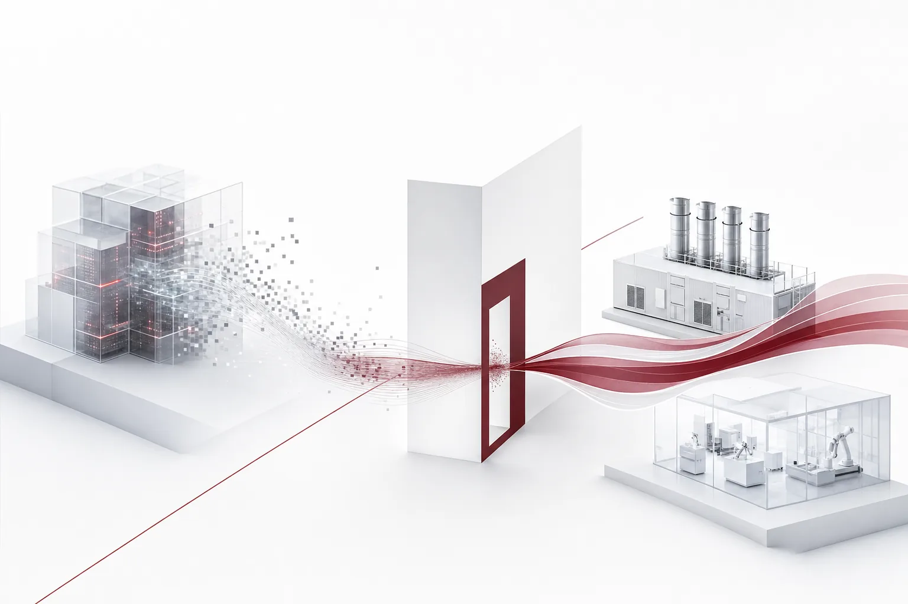

The core of today's news fits in one sentence. A bigger data center no longer guarantees a faster model, and the money still goes to electricity. Readers should take two things from that combination. One is that the source of speed has changed. The other is that, unlike electricity, that source cannot be bought off a shelf. The independent evaluation group METR published an analysis finding that compute growth is hard to see as the main driver behind Anthropic's recent 2x speedup in AI progress. In the same week, Anthropic signed a $3.4 billion contract with OnePWR to secure 1.7GW of gas generators. One side removed compute from the source of speed. The other added $3.4 billion to its power. That collision is the freshest signal in today's digest.

*Visualizing the core concept of the article.*

## What the Verdict Said, and What It Did Not

METR's analysis covers Anthropic's model development process. Note that METR is an independent evaluation group. This is a verdict measured from the outside. Inside, it is easy to say, "We grew our compute and got a 2x speedup." But if that explanation does not hold up when measured from the outside, the formula has changed. In that verdict, compute growth, the first candidate, was ruled out.

A 2x speedup means halving the model development cycle. If data center scale was not the main cause of halving a generation's time, then the "buy bigger GPUs" formula is shaken as a whole. Until now, the order of investment decisions was simple. Set the compute scale first, then pick the model. But if the main cause is not compute, that order flips. Compute becomes a precondition of operation.

Still, today's news contains no answer to what made the 2x speedup. The alternative driver that METR pointed to is not within the known range. So this article focuses more on what was removed than what was added. The reasoning goes like this. If compute is not the main cause, the variable that produces a bigger leap on the same resources is likely to be the training method, data utilization, or the organization's speed of execution. The ability to produce better results on the same compute budget, in other words output per unit of compute, has now become the unit of competition. If that reasoning is right, the $3.4 billion in the next section reads better.

## Why Did the $3.4 Billion Go to Generators

No company stops its power purchases just because speed does not come from compute. Anthropic's OnePWR contract comes down to two numbers. $3.4 billion, and 1.7GW of gas generators. The purpose is to stabilize the power supply to server facilities. With power demand continuing to grow, Anthropic moved to procure energy directly. The fact that the contract is for gas generators leaves room for interpretation, but the direction is clear. Instead of waiting on supply, put the supply source in its own hands. It is money to buy "not stopping". The currency of keeping operations running.

One more step makes today's paradox clear. Compute no longer being the driver of the 2x speedup may be the end of the research phase. But the power demand of the execution phase stays the same, and may even grow. The autonomous agents we will meet in the next section run tasks that repeat inference many times. Money has to flow out as service. The $3.4 billion in gas generators is exactly that spend.

There is one more place where capital flows in the same direction. Argentina's President Milei has the plan to build a large data center in southern Patagonia and make it a new center of AI. The plan is reported under the name "unregulated AI hub". Power has become a scarce resource. And a scarce resource spawns new regions. That is why Patagonia is mentioned. Land where regulation and power are both cheap is rising as a new variable in the GPU price competition.

One distinction matters. Power becoming a scarce resource and electricity itself doubling model speed are separate issues. The first is an infrastructure bottleneck. The second is a research driver. Reading them mixed together misses the essence of the race toward autonomy. It is no accident that the news of buying electricity and the news of redefining speed came out in the same week. One is a spend. The other is a diagnosis.

## If Not Compute, Where Does the Lever Move

METR's verdict does not say to abandon compute. It says the formula for output per unit of compute has changed. So what should a company do? Today's news shows two directions.

One direction is an operating method that gets better results on the same budget. Which model to attach to which task, how far to automate and where to place human approval, and how to keep execution quality high become the questions. Even with the same model, a different assembly produces a large difference in results. In a world where the formula for output per unit of compute has changed, that assembly method is the competitive edge. METR's verdict can be called the day this kind of operating method was formally recognized as valuable. The two directions share one point: the fix comes from changing how you use what you have. That is why today's news matters. The direction of spending and the direction of operations are pulling apart for the first time.

The other direction is to make agent execution itself the competitive edge, beyond model performance. The center of gravity is moving toward running execution more, faster, and more safely. To follow that direction, we need to look at the news around autonomy together.

## Autonomy as a New Axis

Tencent announced that it will build AI science labs that operate fully autonomously, without human intervention. The goal is to speed up its own scientific research. It is a corporate-level formalization of an experiment that removes human hands entirely. Apple is developing a revamped assistant, targeted for release next year, that handles complex tasks by driving apps and navigating software on its own. It is an attempt to close the AI gap with competitors. The OS maker has stepped into the layer of agent execution. DeepSeek's open-source agent tool Harness reached 1.54 million daily active users, up 545% in a little over a month. The company cited its modular software design as the cause of the growth.

All three companies are looking in the same direction. Beyond a model that "thinks", toward a model that "executes". The directions split in two, though. Apple's and DeepSeek's autonomy is the kind that must work at the consumer's fingertips. Tencent's autonomy is the kind that operates entirely out of human sight. The first is held to usability standards. The second is held to control standards. What makes the Harness numbers especially meaningful is that agent tools are moving from a developer's toy to an everyday tool. It is open source, and usage grew more than fivefold in a little over a month. That is a signal that competition in the execution layer is pulling in mainstream usage.

And there is a sentence missing from all three stories. Safety, control standards, how far to automate. Not a single line addresses any of them. The speed of autonomy is reported, while the boundaries of autonomy are left out. That gap leads to the next section.

## Ban and No Regulation, the Two Poles of Autonomy

Reactions to autonomy are already scattered across two extremes. One end is Tencent's unmanned lab. It is an attempt to maximize autonomy. The other end is Bloomington, Indiana. The city council there unanimously adopted an ordinance banning the operation of autonomous AI systems capable of self-improving their own intelligence. The unanimity is the important part. It is not an ordinance with dissent or abstentions mixed in. Every council member voted the same way. It is worth remembering that an era has arrived in which a local council's vote can ban autonomous AI.

While national-level legislation was still being prepared, localities moved first. It is a case showing that the speed of regulation does not scale with the size of the jurisdiction.

Outside that setup is Patagonia. It comes forward with the proposal of a large-scale, unregulated AI hub. The maximization of regulation and the zeroing of regulation landed in the same season. What question is left for companies in this setup? How far to set autonomy, and how to prove that autonomy. That is the question. Autonomy that cannot be proven does not survive regulation. Autonomy that can be evidenced becomes the company's asset. For a multinational company, one more line applies. The regions where a Bloomington-style ban happens and the regions where a Patagonia-style hub lands will end up coexisting inside the same company. So what is needed is not a setting optimized for one jurisdiction, but evidence that can be submitted in any jurisdiction.

## The Execution Layer Is Where Speed Is Now Produced

The industry pain revealed by this news comes in three parts. Infrastructure where power is the bottleneck, agents with growing autonomous execution, and a regulatory environment that is becoming uncertain. The insight METR's verdict adds on top of this: the source of speed is not the scale of compute but how execution is assembled and controlled.

ThakiCloud's Agent-Native Cloud Paxis is a formal product. At version 1.1 GA, the product sits exactly in that execution layer. In effect, Paxis treats Skills, Tools, Policies, and Audit Logs as first-class resources. An agent's autonomy level is set in stages from L0 to L3, a policy gate lets execution through, and every decision lands in the audit log. Execution happens inside an isolated sandbox, and tools are extended through MCP connectors and a skill marketplace. It can run in sovereign or on-premises K8s environments, and CostRouter, which picks the best model per task, is the feature most directly relevant now that the formula for output per unit of compute has changed. In product terms, today's pain maps like this: the power bottleneck is a question of where to set up the execution environment, the expansion of autonomy is a question of autonomy levels and policy gates, and the uncertainty of the regulatory environment is a question of audit logs.

In the era of buying speed with electricity, the amount of GPUs secured was the competitive edge. Now, the edge goes to whoever can demonstrate more execution on the same resources. And whoever can show that evidence to regulators and customers works in either configuration: a Bloomington-style ban or a Patagonia-style no-regulation. METR removing compute from the drivers of the 2x speedup was a vote not for the future of research but for the layer of execution.

## References

This article was written by synthesizing the news below.

- HuggingNews, [METR Rules Out Compute Growth as Main Driver of Anthropic's 2x AI Progress Speedup](https://huggingnews.com/ai/metr-rules-out-compute-growth-as-main-driver-of-anthropics-2x-ai-progres-09fa3e96)
- HuggingNews, [Anthropic Secures 1.7GW of Gas Generators in $3.4B Agreement With OnePWR](https://huggingnews.com/ai/anthropic-secures-17gw-of-gas-generators-in-34b-agreement-with-onepwr-a157c09d)
- HuggingNews, [Bloomington City Council Outlaws Superintelligent AI in Unanimous Vote](https://huggingnews.com/ai/bloomington-city-council-outlaws-superintelligent-ai-in-unanimous-vote-d7f46928)
- HuggingNews, [Tencent to Launch Fully Autonomous AI Science Labs](https://huggingnews.com/ai/tencent-to-launch-fully-autonomous-ai-science-labs-c6b56faf)
- HuggingNews, [Milei Targets Argentine Patagonia for Large-Scale Unregulated AI Hub](https://huggingnews.com/ai/milei-targets-argentine-patagonia-for-large-scale-unregulated-ai-hub-2f3ccc62)
- HuggingNews, [DeepSeek's Harness AI App Reaches 1.54M Daily Active Users](https://huggingnews.com/ai/update-deepseeks-harness-ai-app-reaches-154m-daily-active-users-325c18dd)
- HuggingNews, [Apple Aims to Launch Autonomous Siri Next Year to Close AI Gap With Rivals](https://huggingnews.com/ai/apple-aims-to-launch-autonomous-siri-next-year-to-close-ai-gap-with-riva-92fde965)
