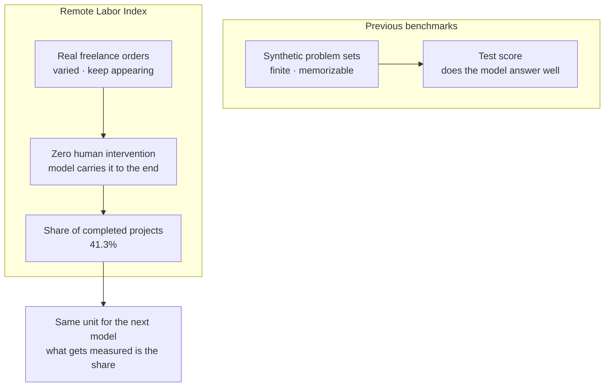

Today's morning news contains a number that is hard to read as a benchmark score. The share of real freelance work that an AI model finished with no human touch at all, 41.3%, is a piece of the labor market, not a test result. The central story in today's HuggingNews digest is Anthropic's Claude Fable 5.2 and Mythos 5.2. The two models fully automated 41.3% of real freelance projects on the Remote Labor Index, run jointly by the Center for AI Safety and Scale. According to the headline of the report, the automation rate is nearly double that of the rivals. What makes up this benchmark is real work. The form of the score, the material of the questions, and the way of reading the results all changed at once. The moment the object of measurement changed to work itself, what the number tells us is how much of the work a model can take on. This single change appears in other stories in different forms. Acceleration faster than forecasts, a first risk alert, a pool of models spreading like a commodity, and the hardware layer entangled with trade policy. Model talent and the places where models run started competing at the same speed in the same morning. Let's read these stories one by one today.

## A Benchmark That Measures Work

The Remote Labor Index measures by a different yardstick than the benchmarks seen so far. The unit is the share of entire projects, from receiving a commission to delivering the result, that are automated to the end. What this share contains is real freelance work, genuine orders that people took in and processed. The fact that these are real orders is what sets this benchmark apart. Synthetic problem sets are finite and can be memorized, but orders in the freelance market are varied, new ones keep appearing, and it is hard to manipulate the benchmark. The word "fully" also carries weight. It means a person never intervened once, and the model alone carried the project to the end. In an evaluation that stops at partial help, a person follows through to the end, but here the model fills the final stretch. One more point to note: two models entered this evaluation. Claude Fable 5.2 and Mythos 5.2 are models from the same vendor but separate lines, and the fact that both recorded this share together means the product family as a whole has started to move by share of work. The rival comparison of "nearly double" also holds on this yardstick. In other words, the capability gap between companies has passed the stage where it is measured only by a few points. It has reached a range where a model can take more than four out of ten freelance jobs wholesale. That is exactly where the 41.3% points. The same index applies as is to the next model. With each new model, what gets measured is the share. This number reads with two different meanings: the model answering well, and the whole piece of work finishing. In the latter case, the model begins to take the place of the person doing the work. So it is hard to call this number a score. Because the object of evaluation became the task, the model is being evaluated as a worker.

*This is where the unit of measurement changed: not a test score on synthetic problems, but the share of real freelance work completed end to end with no human intervention.*

## Speed Ahead of Forecasts

The story of acceleration came out of the same news cycle. METR, an independent evaluation body, reported that Anthropic's AI model development is progressing quickly. A report from a body that measures development speed from the outside moved the industry's risk alert system: a connection that was hard to see before. On the basis of that report, the global risk monitor Sentinel issued its first orange alert. The fact itself that a monitor scanning industry risk raised an alert over one company's model development speed means that speed has become an indicator the industry watches together. In the same time frame, the AI Futures Project pulled its median forecast for when a superhuman AI researcher will appear from about 2030 to 2027. The project judged that actual development speed is running ahead of its own prior forecasts. One METR report produced the alert and the forecast revision in the same week. The alert aims at the gap between how fast capability arrives and how fast the receiving side prepares. The superhuman researcher forecast moving to 2027 means the timeline companies used to plan agent adoption has shifted forward by that much. Companies that had decided to wait and see have had that window shrink. The three events point in the same direction. Speed is compressing the schedule. Plans that companies drew to a 2030 horizon now have to be redrawn to a 2027 horizon. When the question of capability moves from how far it goes to how fast it arrives, the question of preparation has to move with it.

## When Models Become a Pool

While capability is rising, the way models are distributed is moving toward the commodity side. Google publicly released its frontier model Gemini 4 Carbon on November 10. Until then it had been run with limited access for about two weeks. Public access is provided in Google Cloud Platform and Agent Studio. This is the moment when the agent platform is handed over together with the model. So far, using a model meant calling its API, but now the apparatus where the model works comes in the same package. The hyperscaler's agent studio is now the default destination for frontier models. As long as a frontier model release happens at the same time as the agent platform, companies choose the model and the execution environment in the same place, at the same time. In drug discovery, Geodesic's NovaAtom-Lite outperformed AlphaFold 3 on a benchmark. It is a model designed to figure out how molecules such as proteins and nucleic acids bind. There is not a single best model, and in each domain the standard model's seat is being taken by a specialized model. The wider the domains where work unfolds, the bigger the model pool grows.

The access layer one step below also becomes a commodity. Stripe integrated OpenRouter's AI token routing and cost management tools into its business ecosystem. The payments processor added a specialized routing tool to its ecosystem and now embeds the function of handling AI token routing and costs on behalf of companies. Token routing has become an item on a payments processor's operations dashboard. The layer of model access is entering the systems of non-AI companies as a feature. One layer further down, hardware also becomes a variable. Microsoft warned that import restrictions on new Chinese-made optical transceivers would delay the construction of US AI data centers, and called on the White House to drop the plan. As the infrastructure that supports AI becomes entangled with trade policy, when and how much cluster supply will arrive becomes a premise of operations planning. Models become a pool, access becomes a commodity, and hardware becomes a political variable. Competition is quietly moving below the model.

## So What Do Companies Buy

When the unit of measurement becomes work, what companies ask also changes. The old question was how smart the model is. The current one is where to let the agent work and how to prove the work it does. Anthropic's moves show this direction. It is shifting the focus of the Claude assistant to the enterprise segment and designing specific features for professionals such as legal workers. In professions that handle sensitive information, capability is a given, and the questions are where the data goes and who can verify the agent's actions. Documents that an assistant aimed at the legal profession touches are close to the company's most sensitive materials. The more work gets finished, the heavier this question becomes. The enterprise offensive toward professionals is starting at exactly the moment when the phrase "full automation" began to appear in benchmark reporting. Google DeepMind's recent project continues this flow. Using the AlphaProof Code framework, it formally proved a security property of the production machine code of the Signal messaging protocol. It is a project run for about a month. It set a formal guarantee on production code that is actually running. It is also a signal that formal verification is moving from the realm of experiment into the realm of operations. If there is a model that handles 41.3% of real work alone to the end, companies will demand the same level of proof from the agents that process work. "Did it do well?" is the benchmark's question, and "Did it do it within its authority, and can you prove it?" is the company's question. If the latter question goes unanswered, the meaning of the former score blurs. Companies' purchasing criteria are now moving toward execution guarantees.

## The Platform Lens

Where most of the questions left by today's news converge is where the foundation of agent work sits. Paxis is the Agent-Native Cloud that ThakiCloud built to answer this question. It is already a shipped, formal product (v1.1 GA), and its first-class resources are Skills, Tools, Policies, and Audit Logs. It governs agent autonomy across L0 through L3, places a policy gate before each action, and keeps that history as an audit log. Execution happens in an isolated sandbox, and tools and capabilities connect to MCP connectors and the skill market. In a sovereign or on-prem K8s (ai-platform) environment, it runs inside the company's internal network, and per-task model selection (CostRouter) decides which model to use for which task.

Today's news reads naturally on top of this foundation. The 41.3% automation rate raises the question of safe execution. Agents work inside an isolated sandbox, and each action must pass a policy gate. This is exactly the safety structure needed after handing real orders over wholesale. Sentinel's first orange alert and the 2027 forecast raise the question of autonomy level. Dividing the level an agent can handle on its own into L0 through L3 and governing it is something that must get finer as capability arrives faster. The release of Gemini 4 Carbon and the emergence of NovaAtom-Lite raise the question of model pool management. The reason CostRouter is needed, to pick a model per task rather than lean on a single model, is shown by today's news itself. The enterprise offensive toward sensitive domains such as legal raises the question of data location. The answer to that question is an on-prem K8s environment kept inside the company network. What the four questions share is a controlled execution layer.

## A Question to Prepare For

In the next benchmark report, the number of work share and the number of test score will appear side by side. Capability faster than forecasts and the alerts that follow, pooled models and commoditized access: all of this comes to companies in the form of a single question. Where to put the foundation of work. The orange alert that landed in the same week as the 2027 forecast is a signal that the preparation period is short. Companies' next decision will be made about where to let agents work and how to prove it. While that decision is being delayed, the share of work will quietly grow.

## References

This post was written by synthesizing the news below.

- HuggingNews, [Anthropic's Claude Fable 5.2 Automates 41.3% of Freelance Projects on Remote Labor Index, Nearly Doubling Rivals](https://huggingnews.com/ai/anthropics-claude-fable-52-automates-413percent-of-freelance-projects-on-d98f16dc)
- HuggingNews, [Google Launches Gemini 4 Carbon Publicly on Google Cloud and Agent Studio](https://huggingnews.com/ai/google-launches-gemini-4-carbon-publicly-on-google-cloud-and-agent-studi-8cd567bc)
- HuggingNews, [Global Risk Monitor Sentinel Issues First Orange Alert Over METR Report on Anthropic AI Speedup](https://huggingnews.com/ai/global-risk-monitor-sentinel-issues-first-orange-alert-over-metr-report-083a1f18)
- HuggingNews, [AI Futures Project Pulls Superhuman AI Researcher Forecast to 2027 From 2030 After METR Report](https://huggingnews.com/ai/update-ai-futures-project-pulls-superhuman-ai-researcher-forecast-to-202-5a83245c)
- HuggingNews, [Anthropic Targets Corporate Knowledge Workers With Expanded Claude AI Productivity Suite](https://huggingnews.com/ai/anthropic-targets-corporate-knowledge-workers-with-expanded-claude-ai-pr-510c68ca)
- HuggingNews, [Google DeepMind's AI Formally Verifies Signal's Production Machine Code](https://huggingnews.com/ai/google-deepminds-ai-formally-verifies-signals-production-machine-code-a7312e09)
- HuggingNews, [Stripe Integrates OpenRouter to Manage AI Token Routing and Costs for Businesses](https://huggingnews.com/ai/stripe-integrates-openrouter-to-manage-ai-token-routing-and-costs-for-bu-b8a5e45a)
- HuggingNews, [Microsoft Warns Proposed Ban on Chinese Optical Transceivers Would Delay US AI Data Centers](https://huggingnews.com/ai/microsoft-warns-proposed-ban-on-chinese-optical-transceivers-would-delay-55a3553c)
- HuggingNews, [Geodesic's NovaAtom-Lite Outperforms AlphaFold 3 on Drug Discovery Benchmark](https://huggingnews.com/ai/geodesics-novaatom-lite-outperforms-alphafold-3-on-drug-discovery-benchm-b5c2982c)
