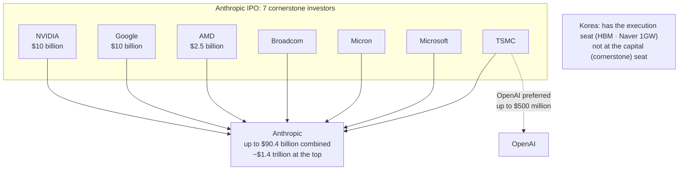
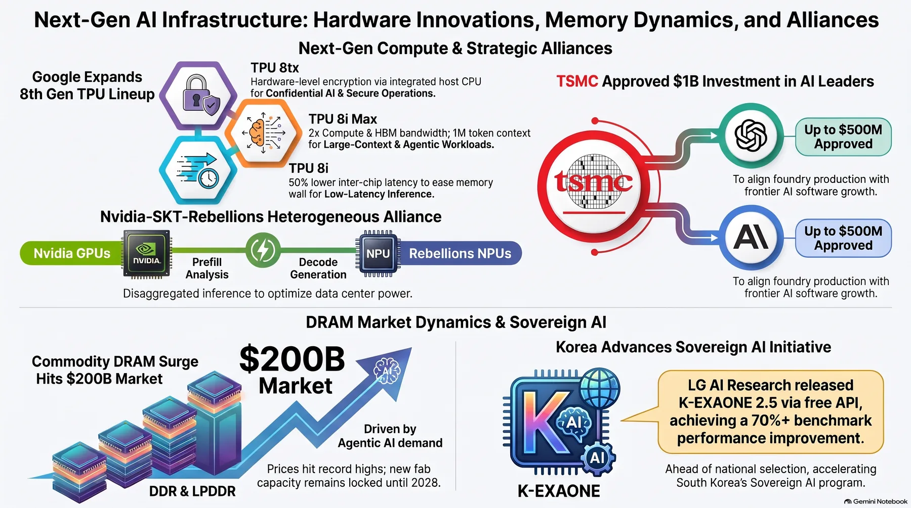
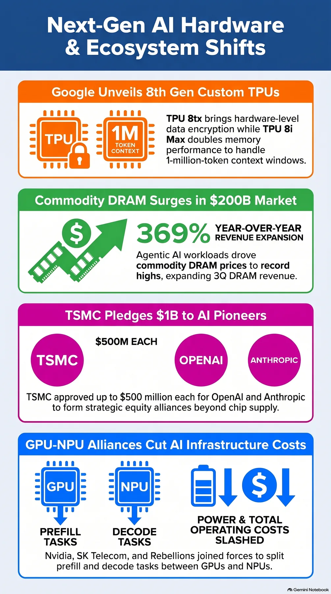

In November, a strange scene unfolded at NVIDIA AI Day Seoul 2026. The event ran on a two-day COEX schedule, November 9 to 10. In the middle of those two days, Chief Strategist Madison Huang abruptly canceled her visit to Korea, ahead of a meeting with Deputy Prime Minister Baek Keun-hyun and a Kakao Mobility event.

A day earlier, on November 8, the NVIDIA board opened an independent committee investigation. The matter: CEO Jensen Huang acknowledged and apologized for an affair with a woman suspected of ties to a Chinese intelligence agency.

On the surface, this reads as one company's governance scandal. But the AI industry is interpreting the event as a supply-chain one. The global AI supply chain has already become a single table where companies sit across from each other as shareholders, rather than a stack of each company's products. The subject of this post is not any one CEO. It is that table.

## The Table Where Competitors Became Shareholders

The numbers speak. First, Anthropic. The IPO offering is 825 million shares at $70 to $78 per share, for up to $64.4 billion. On top of that, seven companies, NVIDIA, Google, AMD, Broadcom, Micron, Microsoft, and TSMC, signed pre-allocation agreements for up to $26 billion in non-voting shares (Series N) at the offering price. Combined, that is up to $90.4 billion. At the top of the range, the valuation is about $1.4 trillion. NVIDIA and Google each put in $10 billion, and AMD put in $2.5 billion. Reports also say Anthropic grew its Microsoft and Google Cloud usage commitments by $10 billion in the past month.

This capital event is not unrelated to Korea either. Analysis suggests that domestic AI startups and cloud operators will become more sensitive to NVIDIA GPU access and cloud price changes after the Anthropic listing. Someone else's IPO has become a variable in our execution costs.

This is not the "investment for returns" people usually talk about. NVIDIA is securing long-term demand for its own chips and cloud. Google is doing the same. TSMC is the world's largest foundry, and its board approved on November 10 equity investments of up to $500 million each in OpenAI preferred shares and Anthropic IPO stock, up to $1 billion combined. On the same day it also approved a $40.9 billion capex allocation, and the $265 billion investment in Arizona, US, is underway. TSMC projects roughly 44% revenue growth in 2026, and its explanation is blunt. AI semiconductor demand exceeds production capacity.

The demand side is swelling too. Anthropic's total computing and infrastructure commitments are about $900 billion. In Q3 it posted a $567 million operating loss, swinging from a $974 million operating profit in Q2. Of its $41.3 billion computing contract with Lambda, $34.9 billion is cancelable if data-center securing fails. The world's largest model company is rolling on commitments it cannot fully control itself.

And the "competitors" are hedging with their own chips. Google Cloud revealed two eighth-generation TPUs, the TPU 8tx and the TPU 8i Max, without warning. The 8i Max pairs two 8i chips in one package, doubling HBM bandwidth and supporting a 1 million token context. The 8tx implements hardware-layer confidential computing and cuts latency by up to half with a low-latency boardfly network. Support for customers building TPUs directly in their own data centers is expanding as well.

Neocloud CoreWeave's results show the state of the table legs. Q3 revenue was $3.661 billion, up 168% year over year. But Q3 capex was $14.511 billion, and operating cash flow covered only 21% of it. Debt stands at $46.873 billion, and net interest expense of $846 million is 4.1 times operating income. The yield on its 2031-maturity corporate bond rose to 15.5%, and the CEO forecast $9 billion in customer prepayments and deposits over the next three months. This is growth that borrows to secure GPUs, a structure where the cost of capital lands on the table as-is.

The paradox of today's table is right here. Chips and models and cloud and foundries, things that have competed with each other, are now each other's shareholders. The tighter the coupling, the more a risk at one point becomes a risk for the whole industry. All seven cornerstone investors sit at the chip, model, and cloud tables at the same time. It is a structure where the risk of one chair becomes the risk of the whole table. The Jensen Huang risk is the first test question.

*One risk table. The chip, cloud, and foundry giants that used to compete are now each other's shareholders. Seven cornerstone investors pre-allocated up to $26 billion in non-voting (Series N) shares, and TSMC took stakes in both Anthropic and OpenAI.*

<!-- nlm-visual -->

*Infographic generated by NotebookLM from the sources.*

## Where Does Korea Sit

One side of execution is clearly in Korea. NVIDIA paid 1.3 trillion won on November 6 for new Naver shares and is set to become the third-largest shareholder soon. Add the 1GW-class AI data centers Naver and SK Telecom are pushing, the HBM supply from Samsung Electronics and SK Hynix, and investments in domestic AI startups such as PointTwo Technologies and Upstage, and Korea is deeply entangled on this table.

But the capital seat is farther away. Samsung Electronics and SK Hynix joined the $65 billion Series H in May as "strategic infrastructure partners." They were not included in this Anthropic IPO cornerstone pre-allocation. AMD, Micron, and TSMC took those seats. The memory and foundries that keep this table running are not at the table where decisions are made. And that memory is in a high-price, tight-supply phase as well. Counterpoint Research counts Q3 global DRAM total revenue up 369% year over year, approaching $200 billion, with average selling prices for DDR and LPDDR both at record highs. The spread of agent AI, which performs computation autonomously, is changing the structure of memory demand. Major makers cannot bring new fabs online before 2028, so tight supply and high prices are expected to continue through 2027.

A warning in the opposite direction comes with it. If semiconductor makers and AI services combine, the supply and access terms of the world's top models could tilt toward the makers, and domestic companies' negotiating power could fall. The seat at the capital table translates directly into bargaining power.

The common view says Korea's risk is NVIDIA dependence. But there is room to turn that view around. Dependence itself is not that scary, because it can be hedged. On November 9, at a side event of the same NVIDIA AI Day Seoul, NVIDIA, SK Telecom, and Rebellion signed a three-party MOU. It is disaggregated inference, with NVIDIA GPUs handling the prefill and Rebellion's Rebell R200 handling the decode. The R200 is integrated into NVLink Fusion and the MGX rack architecture and is being validated in SK Telecom's AI data center, targeting a low-latency inference system for MoE models in the tens of trillions of parameters by 2028. Google's TPUs are another hedge. Dependence can be turned into a list of alternatives like this.

What cannot be changed is the position outside the capital table. That is where the Jensen Huang risk shows why it matters. The US Congress has already demanded a briefing from the CEO. Under NVIDIA's bylaws, the board can remove the CEO by a majority of all directors. If the investigation drags on, the uncertainty becomes not a stock-price drop but a wobble in next-generation product launch schedules and new investment decisions. The industry reads that AI investment is driven by big tech's medium-to-long-term capex plans and service demand, so near-term supply disruption will be limited. But the larger the investment, the more the schedule matters. For now, the contracted GPU supply schedule is expected to proceed without a hitch. Second Vice Minister Ryu Je-myung of the Ministry of Science and ICT gave that outlook in the National Assembly. Even so, industry assessments converge on one point. What to prepare for is not the current schedule but the moment the schedule changes.

## The Layer That Doesn't Shake: the Execution Layer

So in this structure, what should companies that actually use AI hold in their hands?

The core of today's news is that the tables are shaking. The chip table shakes, the model table shakes, and the cloud table shakes too. The risk investigation, the capex allocation, the TPU 8i Max, the 15.5% bond yield, the three-party alliance. All of it is news about the tables shaking. Domestically, at the same venue, LG AI Research fully opened the K-Exo 2.5 API for free, and evaluation showed the AutomationBench score jumped from 16.9 to 74.6 after 8 weeks of additional training. The seats for models are growing just as much.

But among the layers where company work runs, there is one that does not shake no matter how the tables shake. The execution layer, where policy, audit, sandboxing, and model selection are designed as first-class resources. ThakiCloud's agent-native cloud Paxis (the formal product, v1.1 GA) organizes that layer into a single platform. Skills, Tools, Policies, and Audit Logs are not features bolted on afterward. They are first-class resources of the platform. A company defines autonomy levels L0 to L3, runs a policy gate before execution, and every execution is recorded in the audit log. Isolated sandboxes run the work, and MCP connectors and the skill market link it to external systems. No matter which way the chip and model markets tilt, CostRouter picks the best-fit model per task. If needed, work can also run in a sovereign or on-premises K8s (ai-platform) environment.

In this layer, autonomy is a switch before execution, not a check afterward. The company itself defines how much authority to give its agents, and execution opens only as far as defined.

There is no need to read the "Jensen Huang risk" as a Paxis story. Read it, not as a Paxis story, but as a story that the table's center of gravity keeps moving. Whether that move is a new governance investigation, a foundry capex adjustment, or a neocloud funding problem, the impact that lands on companies is the same. It is three questions: where does execution happen, how safely does it run, and what does it cost. Where, how safely, at what cost. The answers to these three questions must not shake just because the tables shake.

## The Next Risk

The next Jensen Huang risk will probably not be Jensen Huang. The network's center of gravity moving to a different chair next time. That is the essence of the cross-investment table.

There is no need to measure the size of the table every day. What to measure every day is whether the legs of your seat stand on the layer that does not shake.

So today's news is not an event to remember as one company's scandal. It is an event to remember as a structural signal: the world's AI industry is one risk table. Having confirmed that at least the execution seat is already in Korea, what to prepare now is not predicting the other chairs. It is keeping our companies' execution layer in place no matter which table shakes. That is the lesson today's news leaves.

<!-- nlm-visual -->

*Infographic generated by NotebookLM from the sources.*

## References

This post was written by synthesizing the following news.

- SBS Biz, [Anthropic raises up to $1.4 trillion; NVIDIA and Google invest $10 billion each](https://biz.sbs.co.kr/article_hub/20000345584?division=NAVER)
- Jemin Ilbo, [TSMC approves up to 725 billion won investment in OpenAI, strategic beyond AI semiconductor supply](https://www.jemin.com/news/articleView.html?idxno=846867)
- The Korea Economic Daily, [CoreWeave Q3 revenue up 168%, funding through own revenue and partner investment](https://www.hankyung.com/article/202611118841i)
- Korea Wood Newspaper, ["Custom chips for the AI agent era"; Google surprise-releases two 8th-generation TPU products](https://www.woodkorea.co.kr/news/articleView.html?idxno=92475)
- Global Economic, [Unexpected turn amid the HBM sprint: generic DRAM surge and the fab cliff](https://www.g-enews.com/view.php?ud=202611110735278870fbbec65dfb_1)
- Newswire, [LG AI's "K-Exo 2.0" catches up with China's DeepSeek; Korean sovereign AI also growing](https://www.newspim.com/news/view/20261110001152)
- ITDonga, ["Three-party alliance in search of efficiency"; hands joined to strengthen sovereign AI capability on heterogeneous computing](https://it.donga.com/109889/)
- Newsway, [Korean AI leans on NVIDIA; attention on the Jensen Huang risk](https://www.newsway.co.kr/news/view?ud=2026111015335681001)
