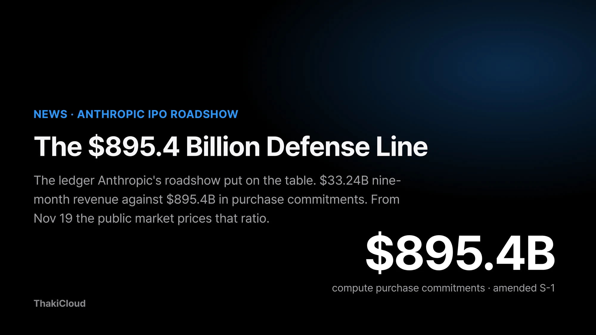
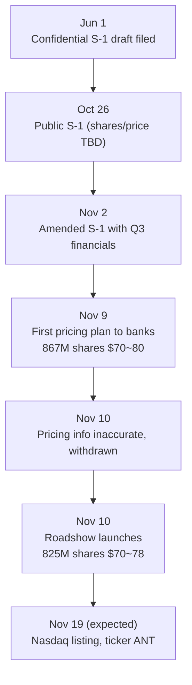
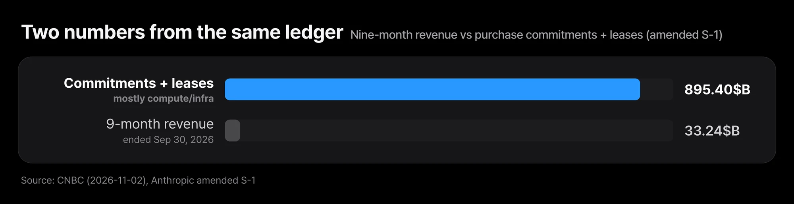
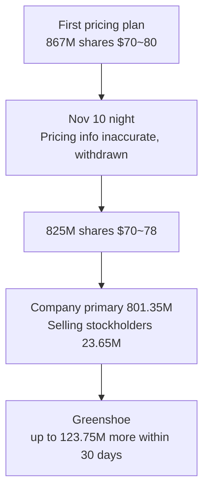
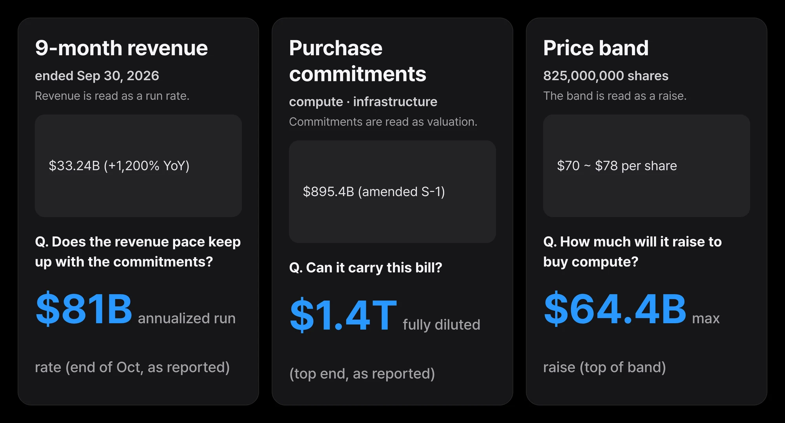
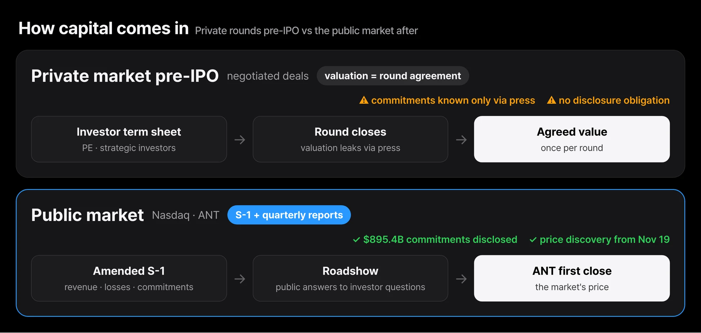

If you own an AI service budget, or you watch how AI companies move capital, the roadshow that started on November 10 is the event you cannot miss. Anthropic has launched its roadshow for a Nasdaq listing. On day one the first pricing plan was withdrawn, and in the roadshow video the company itself explains how it will turn $895.4 billion in compute purchase commitments. This roadshow is the first time the largest compute ledger in the AI industry goes public. The public market starts grading that ledger on November 19.

Yesterday we looked at the cross-investment table this IPO created. Today's subject is the roadshow itself. The question is one: will the public market accept a ledger that pairs $33.24 billion of revenue with $895.4 billion of commitments. This post walks through that ledger, the withdrawal, and the company's answer. Three things happened in this roadshow together: the first pricing plan was withdrawn and reopened, a video in which the company explains its own compute was released, and November 19 was set as the listing date. The subject of all three events is one: how to answer the bill.

*The core concept of this post, visualized.*

*The core ratio of the ledger Anthropic's roadshow disclosed.*

## In plain terms

Think of an installment contract. When a company that cannot pay cash puts tomorrow's goods on an installment plan, the contract lists what it has earned so far and every installment to come. Anthropic's S-1 is that contract. Nine months of revenue: $33.24 billion. Debt: itemized. Installments to come: $895.4 billion. Once the roadshow begins, that contract is no longer a private conversation between the company and a few investors. Everyone can read the ledger, and from November 19 every page gets a price. An installment contract has one extra option too: within 30 days you can add one more tranche. That is the greenshoe option, 123,750,000 shares. This option, too, is a value visible only once things go public.

## A ledger that changed shape three times in a month

First, the sequence. On June 1, a draft S-1 was filed confidentially. On October 26, the public S-1 landed, with the share count and price range still undetermined. On November 2, an amended S-1 added Q3 financials. On November 9-10, the first pricing plan was circulated and then withdrawn, and the roadshow launched. In one month the shape of the ledger changed three times.

*The core of the sequence. The pricing plan is not a single announcement but a series of corrections.*

The dates show that the roadshow is not one announcement but a chain of corrections. The first pricing plan was pulled after a day, on the grounds that some pricing information was inaccurate. The withdrawal became news in its own right, because the price band is now in a place where the market gets to question it. Note one thing. The official announcement is dated November 10, the same day as the withdrawal. The retraction and the roadshow launch happened inside the same day. The company did not pause and wait. It pulled the flawed plan and reopened with the corrected package the same day. That speed is part of the story.

## Twenty-seven times revenue: the $895.4 billion commitment

The largest number in the ledger is the purchase commitment. Per the amended S-1, total purchase commitments and lease agreements come to about $895.4 billion. In the S-1 language quoted by CNBC, substantially all of it relates to compute and infrastructure. Nine-month revenue is $33.24 billion. The commitment is roughly 27 times the revenue.

*Commitments are about 27x revenue. The bill is already running every quarter.*

Compute and infrastructure costs alone point the same way: up $14.4 billion over nine months, a 329 percent increase year over year. This bill is not a future liability. It is already running every quarter. CNBC reports that Anthropic gets much of its capacity from Amazon, Google and SpaceX, and relies on neoclouds for some compute. A neocloud is a cloud provider specialized in GPU compute for AI training and inference, a new supplier class outside the three big clouds. The strategic investors sit on the supplier side of the bill. The people who supply the compute and the people who hold the company's stock are at the same table.

Quarterly growth is slowing at the same time. CNBC lists quarterly growth rates of 132 percent, 144 percent and 47 percent and flags the deceleration. Q3 revenue was roughly $17 billion, up about 1,127 percent from the year-ago quarter. Still double-digit growth, but the shape of the curve has changed.

## A $104 billion loss that is mostly not a cash loss

The loss number is bigger than the commitment. The nine months ended September 30 show a $104 billion net loss. The prior-year period lost $25.1 billion. Q3 alone is a $23.29 billion net loss. But most of that loss does not read as cash that left the building this quarter. Per CNBC, most of it comes from changes in the fair value of convertible notes and derivative liabilities.

Back to the installment contract. When the rate environment moves, the mark on the contract gets rewritten, and the difference lands on the books as a gain or a loss. It is not money spent; it is the debt's value re-marked. The convertible notes Anthropic issued sit in that position. Here is the mechanism. Convertible notes are debt that can be converted into stock. As the company's value rises, the conversion value of the notes rises with it, and the mark of that liability grows. That growth is booked as a loss in the current period. The better the market sees the company, the larger the loss on the books can be. It is a ledger separate from cash flow. Operating results are yet another ledger. Against the $567 million Q3 operating loss carried in [yesterday's post](/en/news/jensen-huang-risk-ai-supply-chain-table/), the $104 billion net loss is a number you have to read a different way.

## The first pricing plan, withdrawn after a day

The most newsy moment of the roadshow was the withdrawal. Per Reuters and FXStreet, the first pricing plan circulated to banks proposed roughly 867 million shares at $70 to $80, raising up to $69.3 billion. Late on November 10, that version was pulled. The stated reason: some pricing information was inaccurate.

The relaunched roadshow opened with a smaller package. 825 million shares at $70 to $78. Of those, 801,351,354 are newly issued by the company and 23,648,646 are sold by existing stockholders, whose proceeds the company does not receive. At the top of the band, the company raises about $62.5 billion and the total offering is up to about $64.4 billion. A greenshoe option for up to another 123,750,000 shares within 30 days is attached.

*The withdrawal and the relaunch. The package that changed in one day.*

## The 90 pages of risk the company wrote itself

The S-1 carries a risk-factor section the company wrote for itself. Per CNBC, the amended S-1's risk factors run to 90-plus pages. It is the part where the company lists its own vulnerabilities before the market asks. The publicly reported numbers read in three directions.

First, compute supply. CNBC reports that much of Anthropic's capacity comes from Amazon, Google and SpaceX, with some reliance on neoclouds. The suppliers are also the strategic investors. If supply terms change, the schedule of the $895.4 billion commitment changes with them.

Second, the structure of the commitment. The purchase commitments and leases are not this quarter's expense. They are amounts that keep going out. Whether the revenue curve keeps up the slope of the commitment curve is the question the public market asks every quarter.

Third, the re-marking of debt. The fair-value changes in convertible notes and derivative liabilities that produced most of the $104 billion loss mean the company's value and its loss figure can move in opposite directions. The point is not that these risks are big or small. They are now a ledger that must be answered in public. In the private market, the risk factors were a document between the company and its investors. In the public market, one line on the 90 pages becomes material for analyst notes and quarterly comparisons.

One more thing to keep in mind when reading those 90 pages. Some risks are structured to get bigger the better the company does. The fair-value loss on convertible notes is exactly that type. Read only the loss numbers from this risk list and the ledger is read upside down.

## Total effective compute, as the roadshow video put it

The Anthropic roadshow video has a section called "Approach to compute." Simon Willison, who extracted its transcript, flags the section as carrying previously unreleased information about how the business works. In it, co-founder Tom Brown describes how the company runs its compute.

The first point is chips. Claude is now trained and served across all four major chip families: AWS Trainium, Google TPU, NVIDIA GPU and AMD GPU. Brown says the AMD port took three days, with basically no human intervention. The model ported or wrote almost 100 percent of the kernels. Onboarding a new chip platform used to take dozens of engineers months of work.

The second point is total effective compute. The company defines it as the product of physical capacity and the compute multipliers discovered in operation. Brown's example is a 4x multiplier: with it, the exact same model trains on 25 units of compute. The company's answer to the $895.4 billion commitment is not "we finish with this many cards." It is "we make the same work happen with less physical compute."

The last line is the newest. As the company approaches recursive self-improvement, Brown says Claude will be able to discover compute multipliers entirely by itself. The multipliers stack, and the discovery of the multipliers is automated too.

## November 19: the day the public market grades

The listing date is expected to be November 19, with trading under the ticker ANT on Nasdaq. As reported, the fully diluted valuation is up to about $1.4 trillion, and the annualized revenue run rate reached roughly $81 billion by the end of October. A separate private placement of up to $26 billion runs alongside the IPO. Reuters reports that Google has secured an option for up to $10 billion of non-voting Class N stock.

*What the filing puts in, and what the market reads out. Raise figure is official; run rate and valuation are as reported.*

What changes on November 19 is not the size of the money. It is the shape of the question. In the private market, valuation was the value agreed in each round. Commitments were numbers you could only estimate from the press. From the public market on, the $895.4 billion commitment, the $33.24 billion revenue and the $104 billion loss are re-audited every quarter. The 90-plus pages of S-1 risk factors are the preface to that re-audit.

The procedure ahead is the public market's shape too. Over the remaining days the roadshow continues, the company meets investors and the price band narrows. A final price is set, allocation happens, and the first trade prints on November 19. Until that moment, every number in this post is a value in "proposed" state. From the first close, they become the company's values.

*Where capital comes in changes. From the agreed value to the discovered price.*

## On the reading side of the bill, and the sending side

ThakiCloud runs two products: a Kubernetes-based AI/ML platform that serves models, and Paxis, the Agent-Native Cloud that runs agents on top of it. This ledger touches both.

On the Kubernetes(ai-platform) side, the roadshow hands sovereign and on-prem customers a public reference price for the outside option. If the public market accepts $33.24 billion of revenue against $895.4 billion of commitments, the cost of buying API capacity and the cost of running your own compute both get compared against that mark. Infrastructure companies are now on the side that shows the bill. A company that cannot answer where execution sits cannot answer what its bill looks like. For customers who run compute in their own data centers, this means the benchmark leaves internal estimation. The cost of doing the same work can now be compared against a value the public market prices. That comparison is the new variable in the sovereign conversation.

On the Paxis side, the total effective compute from the video is a concept agent platforms already operate in practice. The multiplier is not a property of the chip. It is the value produced by finishing the same work with less compute. Paxis' CostRouter picks the model per task: 27B-class work goes to the small model, precision judgments to the large one. That is a multiplier an agent-native platform discovers on its own. The 4x in the video is a company-level number. The platform's job is to produce that number at task level.

This roadshow created the first public reference value for the multiplier concept. If the company speaks of 4x at company level, the platform asks at task level: what share of our work could have been finished on cheaper compute? Did the routed tasks keep their success rate? In Paxis every action passes the policy gate and the audit log, so the question "how little did we do it with" is measured and compared at task level. The ledger this roadshow published is a reference value for agent platforms.

Yesterday's table was the story of capital sitting together. Today's ledger is the story of the bill being opened. When the first close prints on November 19, the question the public market asks of the AI industry shifts from "how big are you" to "how little do you spend."

## To close

The roadshow's ledger sums to three numbers: $33.24 billion of nine-month revenue, $895.4 billion of purchase commitments, and a $104 billion net loss that is mostly a fair-value mark on debt. The company's answer is total effective compute, and the public market starts grading it on November 19 under the name ANT.

If you own an AI budget, there is one thing you can do today: pull your own compute bill and ask what your total effective compute is. The 4x in the video is the company-level answer. The multiplier at platform level and task level is the question this ledger leaves the industry with.

After the first close on November 19 there is one more thing to watch: the first quarterly report after the listing. The $895.4 billion commitment, the $33.24 billion revenue and the multiplier the company speaks of will sit in the same frame inside that report. The market will price their consistency for the first time. The roadshow is only the preface of that comparison. The first close is not the end. It is the first grade.

## References

- [Anthropic launches roadshow for proposed initial public offering](https://www.anthropic.com/news/roadshow-launch) (2026-11-10)
- [Anthropic files S-1 with the SEC](https://www.anthropic.com/news/s1-sec) (2026-10-26)
- [CNBC, Anthropic reports $17 billion in Q3 revenue, purchase commitments of $895.4 billion in revised S-1](https://www.cnbc.com/2026/11/02/anthropic-ant-s-1-quarter-financials.html) (2026-11-02)
- [Reuters, Anthropic aims to raise up to $69.3 billion in blockbuster IPO](https://www.reuters.com/business/anthropic-aims-raise-up-693-billion-blockbuster-ipo-2026-11-10/) (2026-11-10)
- [FXStreet, Anthropic launches IPO roadshow after withdrawing its first pricing plan](https://www.fxstreet.com/news/anthropic-launches-ipo-roadshow-after-withdrawing-its-first-pricing-plan-202611111000) (2026-11-11)
- [Simon Willison, Anthropic's IPO roadshow video](https://simonwillison.net/2026/Nov/11/anthropic-ipo-roadshow/) (2026-11-11)
- Previous post: [The AI Industry, One Risk Table: The Jensen Huang Risk and Korea's Seat](/en/news/jensen-huang-risk-ai-supply-chain-table/) (2026-11-11)
