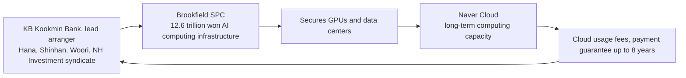
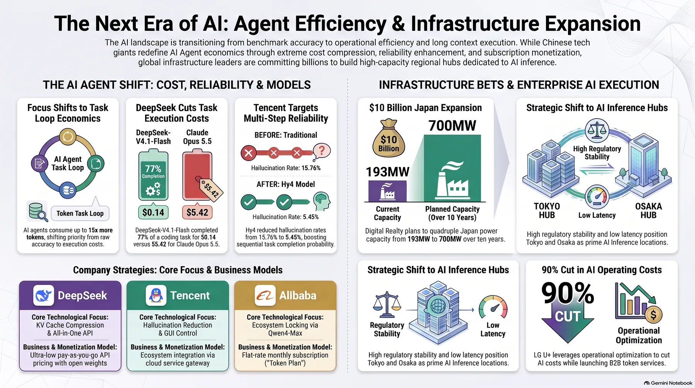
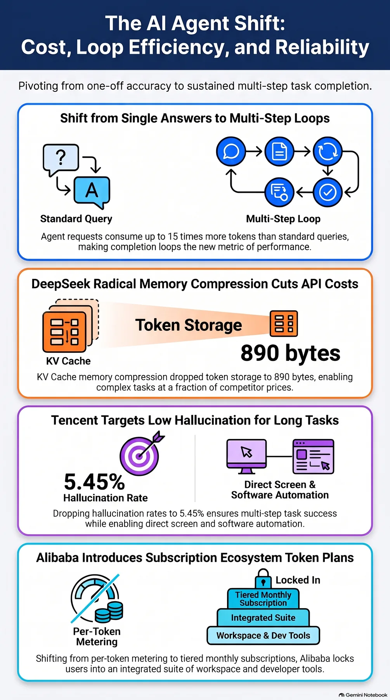

*The collateral is a chip, but the tokens decide the repayment, visualized.*

## The First GPU on a Bank's Books

The terms of Korea's first GPU financing look like this:

- Size, about 10.7 trillion won
- Collateral, GPUs and data centers
- Repayment source, cloud usage fees. Payment guarantee of up to 8 years

According to Consumer Times, KB Kookmin Bank was selected as the lead arranger for a 12.6 trillion won AI computing infrastructure project being pushed by a Brookfield special purpose vehicle, with Hana, Shinhan, Woori, and NH Investment Securities participating in the syndicated loan. The structure is simple: a Brookfield SPC secures GPUs and data centers, provides computing capacity to Naver Cloud over a long period, and the loan is repaid from the usage fees Naver Cloud pays. From the moment this ticket came into being, the GPU is no longer just production equipment sitting in a rack. It has become a financial asset with a price on the books.

Put this ticket before a credit review committee, and the first question would be whether the collateral is real. But what is the second question, the one that actually matters far more? What is running on the GPUs.

<!-- nlm-visual -->

*Infographic generated by NotebookLM from the sources.*

## The Money Arrives Before the Chips

Capital is flowing into Korea's AI infrastructure at a speed without precedent. NVIDIA has completed a $1 billion equity investment, about 1.34 trillion won (4.13%), in Naver, and Naver has signed a computing infrastructure contract with Brookfield worth up to $9 billion. Naver Cloud will start 55MW of operations in the first half of 2027, reach 100MW by the end of that year, 200MW in 2028, and ultimately 1GW.

This fundraising method itself shows that a new market has been born. Global hyperscalers have financed GPU infrastructure with their own investment up to now, but as capex in Korea has grown to the 10 trillion won scale, single-company financing reached its limit, and financing arrangement and participation structures involving banks, securities firms, and asset managers became essential. It is a turning point in which the view that GPUs are managed as assets spreads across the entire financial sector.

This is not news about a one-off deal. It is a signal that a market has emerged in which compute is priced as an asset.

The chips have not kept up with that speed. Per the summary by Invest Chosun, at the Gganbu meeting on October 30, 2025, NVIDIA announced GPU supply cooperation for 260,000 units with the Korean government and Samsung, SK, Hyundai Motor, and Naver. One year later, of the 9,704 units contracted under the government's GPU procurement project, only 2,608 units, 26.9%, have actually been imported into Korea. The fulfillment rate for the full 260,000 units has not even been tallied, and all four companies remain in the preparatory stage of securing site, funding, and business structure. Around the same time, NVIDIA's board announced on the 12th (local time) the departure of CEO Jensen Huang and a leadership change, with CFO Cress taking over as interim CEO. The Chosun Ilbo reported that the record equity investment of more than $40 billion, which Jensen Huang personally led across 105 startup investment rounds this year, could shrink under the interim management's conservative financial stance.

Korea is in a shape where money leads and silicon lags. Look at Japan. According to Global Economic, Digital Realty, the world's second-largest data center operator, announced an additional investment of $10 billion, about 14 trillion won, in Japan over the next 10 years, and through a joint venture with Mitsubishi Corp, will expand capacity from 193MW to about 700MW, roughly 3.6 times. The priority is not a super-large facility for training but AI-inference-only facilities that value latency and data sovereignty. The CEO's one-line reason is striking: Japan is a safe haven with the rule of law and regulatory consistency. Japanese capital is betting on operations, and Korean capital is betting on construction. If inference data centers are sited on low latency in major metropolitan areas and data sovereignty, that is why Seoul also rises to the candidate list as a second hub with the same conditions.

Invest Chosun reads this structure as follows. Because AI infrastructure investment is a project in which the interests of many industries, semiconductors, energy, power generation, construction, and finance, are tightly coupled, when a leadership change, US policy variables, and uncertainty over global Big Tech investment pace overlap, what will decide GPU supply and demand is not supply but acquisition and operating capability. The number 26.9% is precisely a measured value of that logic. The money was raised on the 10 trillion won scale within a year, but the chips that spend that money and the data centers that run the chips are still at the site stage.

## The Double Gap on the Revenue Side: Unit Price Falls, Volume Rises

For a loan where the collateral is GPUs, how repayment capacity is calculated is the next question. The repayment source is usage fees, and usage fees come from tokens. But the unit price of tokens has been falling faster than anyone expected.

LGU+ showed a case of placing its own model such as EXAONE on coding AI and cutting operating costs by about 90% compared to conventional models (AP News). Through model routing that automatically selects the model matching the task difficulty, it claims to have saved more than 25% on general query processing costs and more than 30% on coding agent operating costs, while quadrupling the processing efficiency of the same infrastructure. It also said it will fully launch its B2B token business next year. Competition on unit price is fierce on the model side as well. According to OhmyNews, DeepSeek V4.1-Flash reduces memory per token to as low as 890 bytes with KV cache compression, at a price of $0.15 per 1 million input tokens and $0.6 per 1 million output tokens. Roughly one twenty-third of GPT-5.2's $14 output price.

Volume, by contrast, is rising. JPMorgan analyzed that a single agent request uses up to 15 times the tokens of a general query, because repeatedly reading long context and continuously calling tools make up most of the cost. Unit price drops to one twenty-third, and volume rises 15 times. The revenue of a GPU asset is a function of how many tokens it produces and at how cheap a unit price, and both terms are not constants. Read in the same context, this is also a signal that the unit of competition from the company's perspective is shifting from token unit price to the total cost of completing one task, that is, task cost.

The unit of model competition changes along with it. From how well a single answer is made, to how cheaply and how reliably the loop can be run until the task is finished. It is against the same background that DeepSeek, Tencent, and Alibaba have successively unveiled agent-specialized models over the past two weeks, each offering its own axis of price, trust, and subscription. As OhmyNews pointed out, the question Korean companies should ask is not which Chinese model to trust, but which part of their own business loop costs the most. The revenue of a GPU asset is ultimately determined by how cheaply and how reliably that loop runs.

Financial institutions are aware of this risk as well. As pointed out in the Consumer Times report, if rapid technical obsolescence of GPUs lowers asset value, collateral recovery becomes difficult, and if AI demand falls short of expectations, profitability deteriorates.

## So What Does the Bank Actually See as Collateral

Putting the three sections together, the real safety net of this loan converges not on the metal of the chips but on the software layer that runs on top of them.

First, the workload ecosystem that keeps the GPUs busy. If the cluster sits idle, usage fees stop too, and the collateral reverts to an expensive circuit board. Second, governance. A reason that must be able to answer who executed what through which procedure can also be found on the regulatory side. According to Kyunghyang Shinmun, the US Department of Commerce's Bureau of Industry and Security (BIS) added seven countries including Singapore and Malaysia to semiconductor export controls, and chips of Blackwell class or above become subject to export licenses, review of the importing entity, use-case reporting, and remote access restrictions. We are in an era where the verifiability of the execution environment itself is a regulatory variable. In a structure where Korea, following Taiwan and Japan, faces increasing enforcement pressure as an ally, the ability to record use cases and remote access in an audit-traceable form is no longer optional but an item reflected in the asset price. Third, cost transparency. Only by being able to prove that each token is produced economically can the usage fee, the repayment source, be trusted.

The answer to the questions of why Japan's data centers are called a safe haven and why Korea's GPU import rate is stuck at 26.9% points to the same place. Chips are ultimately bought, and money is ultimately borrowed. But only when there is an execution environment in which the chips run safely, are audited, and generate revenue do those chips and that loan become an asset.

## The Books 12 Months From Now

Looking at this flow 12 months ahead, two things are highly likely to happen. First, GPU financing will not stop at the Naver deal. As capex on the 10 trillion won scale grows, the banking sector will have to repeat collateral valuation and repayment capacity verification, and in that process, execution environments that can show which workloads are actually running on the cluster will begin to be reflected in transaction terms. Second, just as Japan is positioning itself as an inference hub, Korea will have to win the bet with the operating capability to put imported GPUs to work. The side that binds power, cooling, network, operating personnel, and the agent workloads running on top into a single system will earn higher revenue from the same chips. For the collateral to be recognized as an asset, what runs on that asset must be visible.

## The Lens That Answers That Question: Paxis

At this point, ThakiCloud's Agent-Native Cloud, Paxis, enters as the lens. Paxis is not a technology under development but a product officially released at v1.1 GA. And what Paxis governs as first-class resources is four: Skills, Tools, Policies, and Audit Logs.

Audit, sovereignty, safe execution, cost. These are the exact questions that overlap the list of pains companies encountered in the four branches of today's news. Match these four against the three questions the bank asks, and the correspondence becomes natural. What runs on the GPUs? What runs inside Paxis's isolated sandbox is not a script that broke free at will, but a managed agent workload connected through MCP connectors and a skill marketplace. Who approved it? Paxis divides autonomy into governance levels from L0 to L3, passes policy through a gate before execution, and leaves every outcome in the audit log. At what cost was it produced? CostRouter picks the right model for each task, so a single workload is not tied to an expensive single model.

In an era when GPUs are priced as assets, the execution environment that answers what runs on the collateral, who approves, and how much is spent is the layer that determines the price of the asset. Paxis's support for sovereign and on-premise K8s (ai-platform) extends this logic even to finance and public customers who demand data sovereignty most strongly. For the same reason that data sovereignty and regulatory consistency create a safe haven.

In the end, where the 10.7 trillion won ticket goes is not a story of how much compute was secured, but of under which rules agents execute on that compute.

<!-- nlm-visual -->

*Infographic generated by NotebookLM from the sources.*

## References

This post was written by synthesizing the news below.

- Consumer Times, [Banking Sector Arranges 10.7 Trillion Won AI Infrastructure Loan, Pioneering the GPU Financial Market](https://www.cstimes.com/news/articleView.html?idxno=727870)
- Global Economic, ["Quadrupling Asia's Largest Hub"... US Digital Realty, $10 Billion into Japanese Data Centers...](https://www.g-enews.com/view.php?ud=2026111522260750310c8c1c064d_1)
- AP News, [LGU+, Up to 90% Cut in AI Operating Costs, "Full B2B Token Business Launch Next Year"](https://www.apnews.kr/news/articleView.html?idxno=3053142)
- OhmyNews, [AI Agents: Three Answer Sheets from DeepSeek, Tencent, and Alibaba](https://www.ohmynews.com/NWS_Web/View/at_pg.aspx?CNTN_CD=A0003285124&CMPT_CD=P0010&utm_source=naver&utm_medium=newsearch&utm_campaign=naver_news)
- Kyunghyang Shinmun, [NVIDIA's "China-Bypass Supply Chain" Shaken by Jensen Huang Scandal, Bessent...](https://www.khan.co.kr/article/202611160739001)
- Invest Chosun, [[Invest] Jensen Huang Departs One Year After the Gganbu Meeting, What Happened to the 260,000 GPU Promise...](https://www.investchosun.com/site/data/html_dir/2026/11/15/2026111580032.html)
- Chosun Ilbo, [Global AI Startup Investment "Alarm" Over Jensen Huang's Departure, "NVIDIA Vacuum...](https://www.chosun.com/economy/tech_it/2026/11/16/6OSLDZB2BJFCNN7JJ3CJK3R5QM/?utm_source=naver&utm_medium=referral&utm_campaign=naver-news)
