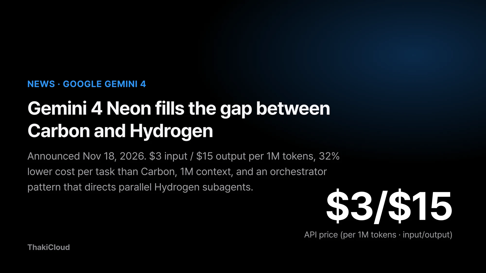
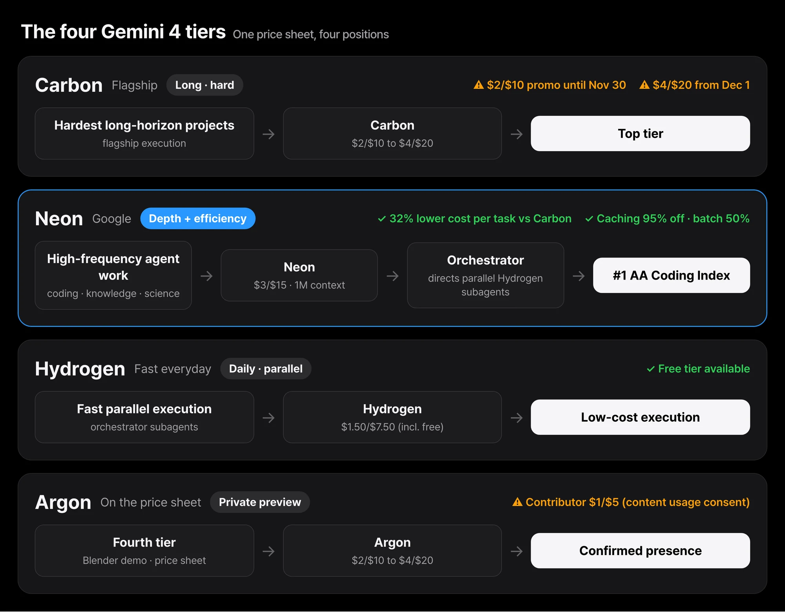
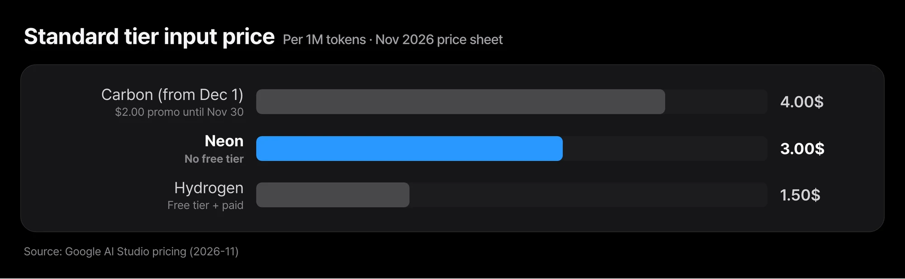
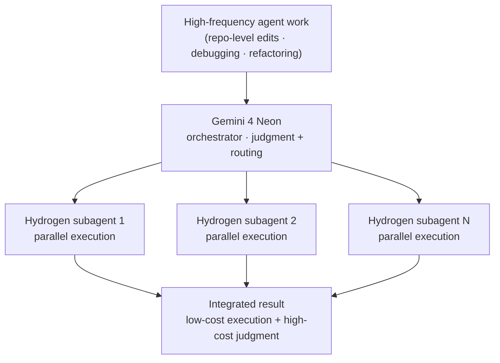
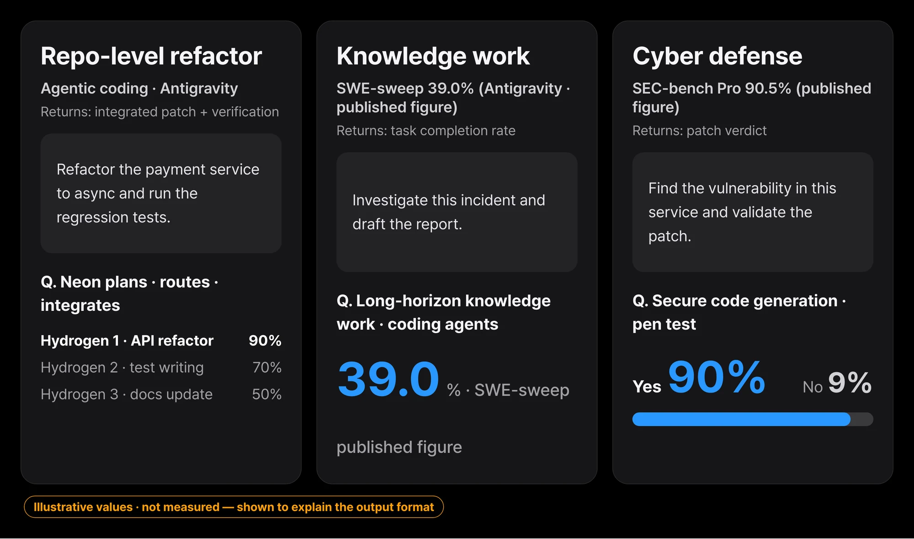

*Abstract visual of the post's core concept.*

If you operate an agent platform, you make the decision "which model does this job go to" every hour. The expensive models are slow, and the cheap ones are shallow. Teams that manage model catalogs face an added problem: three tiers within one vendor means three choices, while two tiers traps you in a binary of "promote to frontier or drop to flash". On Nov 18, Google placed a model in the middle of the two, price sheet included.

The key numbers first. Gemini 4 Neon's API price is $3 input / $15 output per 1M tokens, and the official announcement claims a 32% lower cost per task than Carbon at the default thinking level (high). AA Coding Agent Index 58.6 for #1, AA Intelligence Index 61 for #3 worldwide, and 1M tokens of context.

This post takes on score rankings only in passing. The subject is the position of the gap Neon occupies on the price-performance curve, and the orchestrator pattern the launch showed alongside (Neon directing parallel Hydrogen subagents).

*Gemini 4 Neon · the gap tier between Carbon and Hydrogen. Announced 2026-11-18.*

## The four Gemini 4 tiers, read from one price sheet

The Gemini 4 family has four tiers. Carbon is the flagship for "your hardest, long-horizon projects", Hydrogen handles fast everyday execution, and Neon is the "depth-and-efficiency balance" between them. Argon appears on the price sheet too.

| Tier | Position | Standard price (per 1M tokens, input/output) | Notes |
|---|---|---|---|
| Carbon | Long-horizon, hardest | $2/$10, rising to $4/$20 on Dec 1 | Promo through Nov 30 |
| Neon | Depth + efficiency balance | $3/$15 | No free tier |
| Hydrogen | Fast everyday execution | Free + $1.50/$7.50 | Free tier available |
| Argon | (appears on price sheet) | $2/$10, rising to $4/$20 on Dec 1 | Contributor tier is private preview |

Dec 1 is the day the Carbon promo ends. The moment the frontier reference price moves to $4/$20, Neon ($3/$15) stops being "the tier below Carbon" and becomes "the tier cheaper than Carbon". This price sheet becomes legible after Dec 1.

One more cell on the sheet deserves attention: Argon's Contributor tier. It is a $1/$5 private-preview tier, and the table marks "content used to improve products: Yes". Choosing the cheapest tier attaches a data condition. In a table easy to read by money alone, that cell is the one to read first.

*Tier positions in the Gemini 4 family. Standard tier prices (input shown). Source: Google official blog and AI Studio price sheet.*

## $3/$15: where the 32% number comes from

Google published that at Neon's default thinking (high), cost per task is 32% lower than Carbon's. On the Vals Index and Agent Arena Pareto frontiers (high thinking), it claims "50% to 80% lower than top competing frontier models", and at xhigh, "36%+ less than competing models at their highest setting".

Three levers in the price structure shipped together. Context caching is $0.15, a 95% discount on input (implicit caching only; explicit is not supported), the batch API is $1.50/$7.50 (50% off), and the Priority tier is $5.40/$27 as a latency surcharge. Every thinking token is billed, so "which thinking level do you set" is the variable that decides the real unit price. Neon has no free tier, and all processed tokens (including grounding system instructions) are charged.

Grounding (search and maps) is billed separately. Google Search and Maps grounding is free for 5,000 requests per month across all Gemini 3+ models, then $14 per 1,000 requests, capped at 1,500 per day. For workloads where agents use search tools, this item becomes the second unit-price variable alongside thinking tokens.

The weight of the thinking level on price is worth pinning down. The 32% figure is at the default high, and the claim shifts to "36%+ versus competing models at their highest setting" at xhigh. Being able to choose among four thinking levels (low, medium, high, xhigh) within the same model means the price sheet itself offers "adjust the unit price within one model to match task difficulty". When you change the thinking level instead of swapping frontier for mid-tier, the comparison target becomes another step of the same model.

*Standard tier input prices. Carbon runs a $2.00 promo until Nov 30. Source: Google AI Studio price sheet (2026-11).*

## #1 on coding, #2 on agents: what the benchmarks say

Organizing the third-party benchmarks the release cites, Neon lands as "top on the coding and agent axes, #3 overall".

| Benchmark | Neon | Rank / note |
|---|---|---|
| AA Intelligence Index (xhigh) | 61 | #3 worldwide |
| AA Coding Agent Index | 58.6 | #1 |
| Vals Index | (enterprise 70.9%) | #2 · Pareto frontier |
| Agent Arena Index | 1336 | #2 worldwide · 4,200+ sessions · #2 steerability |
| Agents' Last Exam v1.1 | 75.8% | "on par with leading models" |
| Zapier AutomationBench | 56.3% | #1 overall |
| Vending-Bench 2 | $16,843 | #1 overall (long-horizon business simulation) |
| Terminal-Bench 4.1 | 65.2% | n/a |
| SWE-sweep | 12.8% / 39.0% | mini-SWE / Antigravity (3x+) |

The composition of the agent benchmarks is worth a look too. The Agent Arena Index is measured on 4,200+ real agent sessions (with steerability at #2), and Vending-Bench 2 is a long-horizon business simulation where Neon took #1 ($16,843). Putting session counts and simulated revenue front and center shows the character of the workload Neon targets: agents that run for long stretches.

Context is a unified 1,048,576 tokens (output 65,536 by default, up to 1M with long decode), and thinking levels come in four steps (low, medium, high, xhigh; default high). Inputs are text, image, video, audio, and PDF; output is text. The SWE-sweep figure, 12.8% on mini-SWE rising to 39.0% in the Antigravity environment, points the same way as the established picture: the harness (the agent execution environment) moves scores more than the model swap does.

The knowledge and professional-work axis is the other center of the release. It claims #1 on Legal Research Bench and Tax Agent Bench, and #1 on most of Surge AI's finance, accounting, spreadsheet modeling, and complex constraint following benchmarks. Chartography (dense professional charts) is 73.5%; for science and math, Terminal-Bench Science 70.5%, RiemannBench 84.0%, and HLE-Diamond 71.3% (claimed best in class). The positioning of "synthesizing enterprise documents (spreadsheets, PDFs, charts, audio, video) into structured deliverables" shows up directly in the benchmark mix. The combination of #1 on coding, #1 on professional work, and #3 overall indicates that Neon targets the entire high-frequency professional workload as a middle tier, rather than a single specialized axis.

## The orchestrator pattern the launch showed

One line in the release stands out. Neon is "a fast, high-judgment Orchestrator directing parallel Hydrogen subagents in Google Antigravity". Officially, then, Neon sits closer to a conductor than a solo executor.

*The command structure shown at launch (values are format examples). Source: Google official blog (2026-11-18).*

The pattern matters for the cost structure of agent systems. When judgment (routing, integration, verification) goes to the expensive model and execution (parallel tool calls, code generation) goes to the cheap one, the average unit price of the whole job drops below a frontier solo run. That is because the tokens that need judgment are a minority of the job, while parallel execution accounts for most of the token spend. By the same logic, the moment arrives when Neon's $3/$15 reads as "conductor pricing".

GitHub Copilot got it the same day as GA (Pro+, Max, Business, and Enterprise, usage-based billing, gradual rollout). The changelog's wording, "designed for agentic coding, multistep tool use, and knowledge work", across VS Code, Visual Studio, Copilot CLI, the coding agent, github.com, JetBrains, Xcode, and Eclipse, means the model was attached to an agent execution path from day one.

For developers, three verification paths opened today: GitHub Copilot (usage billing), Google AI Studio (paid tier, including Pro/Ultra subscribers), and Google Antigravity (the agent IDE). The fact that "multistep tool use" sits at the center of the positioning signals that Neon's design point is the middle of the agent execution chain. If you want to measure the judgment-versus-execution token split in multistep work, those three paths are the lab.

Day-one availability, by channel:

| Channel | Who | Notes |
|---|---|---|
| Gemini API (AI Studio) | Paid tier | Rolling out Nov 18, no free tier |
| Gemini app | Pro and Ultra subscribers | Model drop-down selection |
| Google Antigravity | Paid AI subscribers · enterprises | Orchestrator pattern demos |
| Gemini for business (Cloud) | Enterprise API | n/a |
| Android Studio | Paid tier | Via Gemini API |
| GitHub Copilot | Pro+ · Max · Business · Enterprise | Gradual rollout, usage-based |
| Cyber variant | Fairwind Program | "In the coming days", trusted defenders |

## Cyber and safety numbers shipped too

The release presents defense (cyber) benchmarks as a fourth axis. AutoBaxBench is SOTA at 76% on the hard tier, more secure than Carbon on easy/medium/hard. WebExploitBench v1.2 is SOTA at 51.26% at half the cost of competing large models, SEC-bench Pro is SOTA at 90.5% at roughly half the cost per challenge, and Collinear CWE-bench v2 is 70.7%, a 3.4 point uplift over Carbon.

Safety indicators were published alongside. Cheating on Terminal-Bench 4.0 is 0.0%, the shortcut rate in the internal coding evaluation is 2.45%, the lowest of any Gemini 4 model, agent honesty passes at 99.2%, and on Gray Swan's IPI benchmark the attack success rate is 0.0% at the highest thinking. On ExploitGym, the release claims "frontier-level at half the tokens of Carbon". For security work, the point is verification quality, which is why that figure carries weight.

The distribution path of the cyber variant is also worth noting. A separate build goes first to trusted defenders through the Fairwind invite program, "in the coming days". That is a structural choice to run attack and defense workloads on a surface separate from the general API. For teams that use security agents, when that surface opens is a variable in the adoption timeline.

## The moment a mid tier changes the tier structure

Compressed to one line, the launch is "frontier quality at a mid-tier price". But the real variable is the structure that appears when the Carbon promo ends on Dec 1. After that, the three price bands are fixed (Carbon $4/$20, Neon $3/$15, Hydrogen $1.50/$7.50 with free), and the default for "high-frequency professional workloads" is likely to move to Neon.

For agent platforms, this is a problem that changes the dimension of model selection. The moment the orchestrator pattern becomes an official structure, "which model do we use" becomes "what goes on the judgment step, what goes on the execution step" as a routing problem. If the judgment step's quality (steerability, integration) sets the success rate of the whole job and the execution step's unit price sets most of the total cost, the existence of a middle tier shifts the cost function by a dimension. The accurate reading is that a position to save 32% was born inside the system.

## Where the two ThakiCloud products read it

From the ai-platform (K8s-based AI/ML serving) side, the price sheet itself is the signal. The three levers of 95% caching discount, 50% batch discount, and Priority surcharge are exactly the variables a multi-tenant inference platform uses when composing tiers and consumption modes per workload. The 95% caching discount targets "high prefix-reuse workloads" (agents that repeatedly process the same system prompt or the same document bundle), and the 50% batch discount is the share of non-interactive offline agent batches. The workloads that use those two levers and the workloads that buy Priority are, in practice, different customers.

The Dec 1 Carbon price increase raises the reference cost of the frontier class, making it the moment to retune "which jobs move from frontier to mid-tier". Because ThakiCloud's serving stack operates around cost efficiency and self-hosting, the mid tier's unit-price structure goes directly into the model-selection arithmetic for on-prem deployments.

From the Paxis (Agent-Native Cloud) side, the orchestrator pattern connects directly. Paxis's DAG multi-agent execution already presupposes a structure that splits the judgment layer and the execution layer across different models. The Neon-to-Hydrogen release is a signal that this pattern has settled into an official product structure within one vendor, and that the execution economics of "high-cost judgment, low-cost execution" is becoming the default design value for agent platforms. In Paxis's structure, where Skills, Tools, and Policies are first-class resources, "which tier's model attaches to which step" belongs to policy. This launch can be read as the market changing that policy's default value.

## In closing

Gemini 4 Neon is not the strongest model (AA overall #3). It is the model that filled the gap between the strong and the fast with a price sheet labeled "depth and efficiency". The 32% figure is the per-task saving at the default thinking, and the real price change arrives after the Carbon promo ends on Dec 1.

Two things to check now. Whether your workload's cost-per-task sits with Neon/high or Carbon/default, and re-computing, against the price sheet, how you split "judgment versus execution" across models in your agent pipeline.

On Dec 1, check two more things. After the Carbon promo ends and the price rises to $4/$20, whether the real frontier-to-mid-tier gap is bigger or smaller than the claimed 32%, and whether a second vendor follows the orchestrator pattern. One gap-filling model arriving is the event. Whether the gap becomes a structure is next month's check.

- [Official announcement: Introducing Gemini 4 Neon](https://blog.google/innovation-and-ai/models-and-research/gemini-models/introducing-gemini-4-neon/)
- [AI Studio model spec](https://aistudio.google.com/docs/models/gemini-4-neon) · [Price sheet](https://aistudio.google.com/docs/pricing)
- [GitHub Copilot changelog (2026-11-18)](https://github.blog/changelog/2026-11-18-gemini-4-neon-in-github-copilot)
