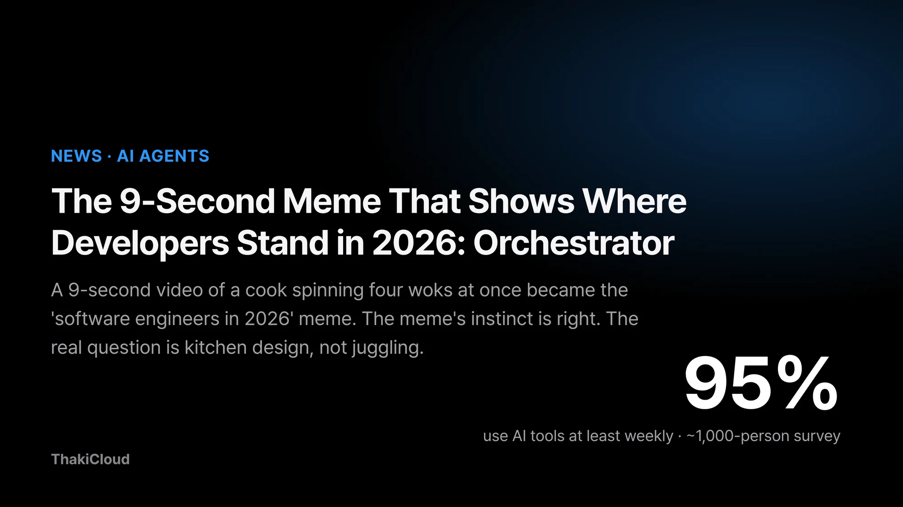
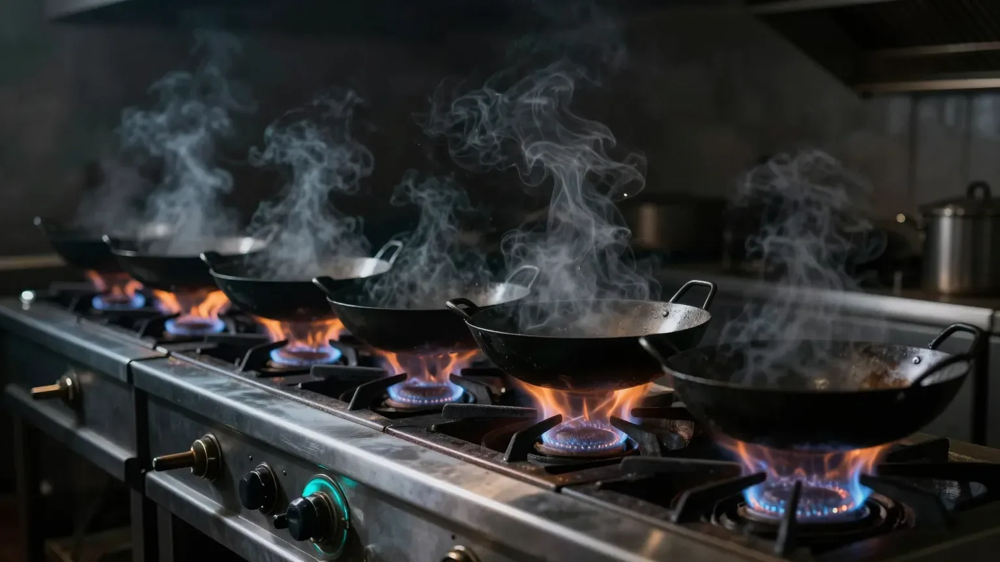
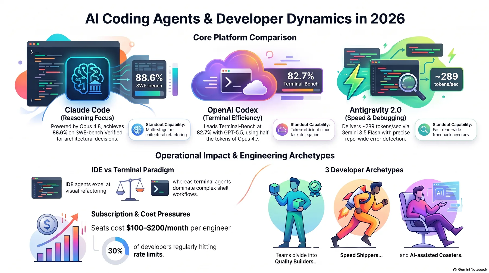
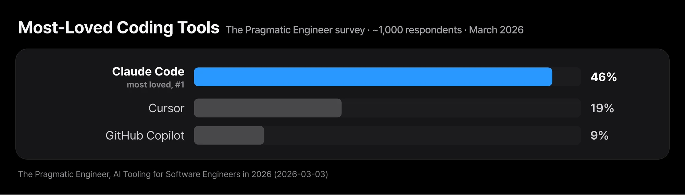
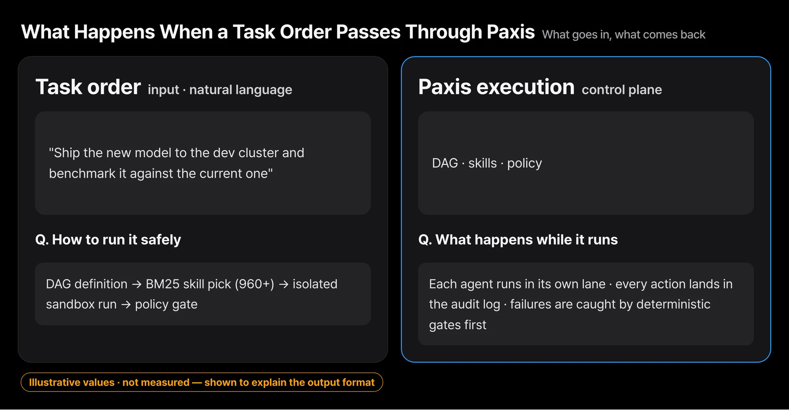
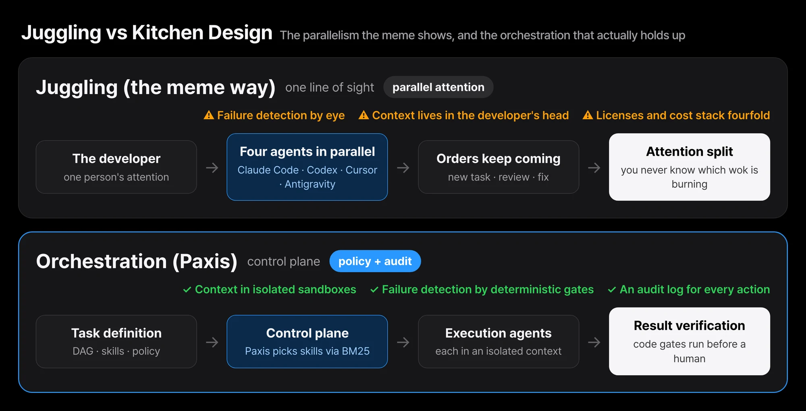
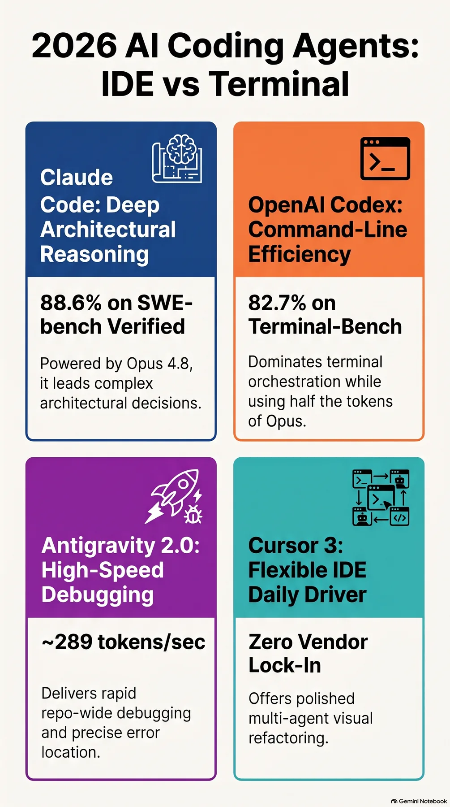

Nine seconds. A Chinese restaurant kitchen. In front of a row of commercial gas burners, a cook has four flames going at once. Every wok holds green beans, and the cook flicks each one with his wrist while pouring seasoning from several bottles at the same time. The video ends there.

In November 2026, the video started circulating with a one-line caption. "Software Engineers in 2026 Orchestrating Claude, Codex, Cursor, Antigravity and other agents." One wok is one agent session. The cook is the developer.

Every time a new order comes in, another burner lights up. The video is only nine seconds long, but the seat it points to is no joke. The meme traveled far beyond the original tweet, re-introduced by several publications as a symbol of 2026 developer culture.

If you are a developer running two or more AI coding agents in parallel, or an engineering leader deciding how your team will use agents, read this post with one question: can you actually take that seat? The meme's instinct is half right.

The "orchestrator" it points to is genuinely the developer's seat in 2026. But the meme only sees the moment of the toss, not the kitchen. The orchestrator's seat is one you can only take when failure detection moves out of your line of sight and a control plane takes its place behind you.

This post anchors the meme's half in two verified sources: The Pragmatic Engineer's survey of roughly 1,000 engineers, and a 2026 coding-agent comparison. Then it unfolds the half the meme does not see: context, failure detection, cost, and the control panel.

*The 2026 agent-coding field, read from a 9-second meme*

## In plain terms

First, let me fix the meme's metaphor. A wok is an agent session, and a burner is the context window powering it. The green beans going in are the task, and the seasoning is the prompt. The cook's line of sight is the developer's attention.

Every time a new task lands, another burner lights up. The meme only shows up to the cook's fingertips. Tossing four woks at once is the same as splitting your attention into four branches.

But a real kitchen does not run on line of sight alone. The stainless-steel control panel in front of the stove row is a place your hands can reach even when your eyes are elsewhere.

Knobs, valves, and timers sit side by side, and the inspection log next to them records who put what into which pot, when. The moment the cook's line of sight leaves the woks, these two things keep the kitchen alive. The next section covers exactly that half: the control plane the meme never shows.

*An abstract re-drawing of the meme's kitchen. A stove row, woks, steam. Exactly what the meme showed.*

<!-- nlm-visual -->

*Infographic generated by NotebookLM from the sources.*

## 95% of the field has already moved

In March this year, The Pragmatic Engineer's AI tooling survey set the baseline. Roughly 1,000 software engineers responded. 95% use AI tools at least weekly. 75% use AI for at least half of their engineering work, and 55% regularly use autonomous agents.

Let me confirm the weight of the phrase "autonomous agent" once. Here it means agents that do file edits, command execution, and result review on their own, in place of a human. A configuration where the human sits in the reviewer seat. In 2025 it was still a lab tool; by March 2026, one in two engineers uses it regularly.

Agent adoption rises with seniority. 63.5% at Staff and above, 49.7% among regular engineers, 46.1% among engineering managers. The survey splits the user base into three: heavy users who apply AI to 80% or more of their time, moderate users at 30-80%, and light users under 30%. Heavy users work with AI by the hour, not by the day. The meme's cook is exactly this person.

The meme's "four woks at once" is not a fringe case. It is a story about what two-thirds of the field already does.

The number that maps most directly onto the meme is the trajectory of Claude Code. It launched in May 2025 and became the most-used tool within eight months. In the "most loved" ranking it leads at 46%, more than double Cursor at 19% and GitHub Copilot at 9%. 57% of respondents use Claude Code or the Claude model family.

*Claude Code leads 'most loved' at 46%, more than double Cursor (19%) and GitHub Copilot (9%).*

## The 2026 field: IDE agents and terminal agents

A coding-agent comparison published in July this year (the Q2 2026 market split) divides the field in two. IDE agents and terminal agents. The IDE camp has Cursor and Antigravity; the terminal camp has Claude Code, OpenAI Codex, and Gemini CLI. The four in the meme caption are exactly these camps, two each.

But the real field has one tool the meme did not count: Gemini CLI, on the terminal side. The meme itself is a beat behind the field.

The article explains why the field splits. IDE agents are good at visual refactoring while you watch diffs on screen; terminal agents are good at command-line orchestration while they move between scripts and pipelines.

It is the same work seen from a different seat. The meme's cook standing in front of the burner row, the terminal, and looking at the wok from the editor screen, the IDE, are different seats in the same kitchen.

The article's conclusion settles on a multi-tool setup. It recommends Claude Code for structural reasoning, OpenAI Codex for terminal automation, and Antigravity for fast iteration.

The engines, as quoted in the article: Opus 4.8 for Claude Code, GPT-5.5 for Codex, Composer 2.5 for Cursor 3, and Gemini 3.5 Flash for Antigravity 2.0. Monthly pricing is also as quoted: $20 for Claude Code and Codex, credit-based for Cursor, free for Antigravity during its public preview.

| Tool | Camp | Strength (as quoted) | Entry barrier |
|---|---|---|---|
| Claude Code | Terminal | Complex structural work, structural reasoning | 5-hour reset window (even after the cap doubled on 2026-05-06) |
| OpenAI Codex | Terminal | Console-based orchestration, task delegation | Quoted at half the tokens of Opus 4.7 |
| Cursor 3 | IDE | Flexible everyday editor work, no vendor lock-in | Credits burn quickly |
| Antigravity 2.0 | IDE | High throughput, precise debugging of large codebases | Free during public preview |

That multi-tool setups have hardened into a recommendation carries an important implication. Each agent runs on a different engine, and the token economics of the same task differ. As quoted, Codex consumes half the tokens of Opus 4.7 on terminal work, and Antigravity processes roughly 289 tokens per second.

The "juggling skill" in the field is, in the end, the work of reading a different gas bill per burner and choosing which one to light. The key is the bill. Because the gas bill differs per burner, even the same kitchen has to choose which burner to light.

The benchmark numbers are recorded exactly as quoted in the article. 88.6% on SWE-bench Verified is Claude Code; 82.7% on Terminal-Bench is Codex. In debugging a Python codebase of over 200,000 lines: 87% for Antigravity, 71% for Cursor, 79% for Claude Code. These sit numbers from different sources side by side, so do not read them as scores from the same lineage.

## Tossing the wok and designing the kitchen are different problems

The meme ends at the moment of the toss. But in a kitchen, the toss is only the shortest phase. There is a separate, important question. The moment the cook's line of sight leaves the wok, what keeps the kitchen alive?

First, context. The cook's line of sight is the developer's attention. Running four agents in parallel multiplies the sessions to watch by four. The five-hour reset window quoted in the article is a concrete example. Long sessions get cut off mid-way. Even when a session is not cut, the seasoning differs per burner. That is why the meme's cook pours from several bottles at once.

Each agent session keeps its own prompt, its own files, and its own judgment criteria separately. The more burners, the more the same seasoning duplicates, and the more it duplicates, the more the flavor drifts. In a kitchen where the burner gas cuts on a five-hour cycle while you are tossing four woks, without a system that tells you which woks are safe to leave alone, it collapses.

Second, failure detection. The meme's kitchen has no timers, no logs, no inspections. Detecting failure is left entirely to the cook's line of sight. The same shape as a team running four agents in parallel and reviewing with its eyes.

As agents multiply, the bottleneck is not the agents, it is the line of sight. The moment attention splits into four branches, detection becomes sampling. There is no guarantee anywhere that a plate looking safe on the surface is cooked through.

Third, cost. An external summary of the survey (Sourcelabs) reports that companies spend $100 to $200 per month per engineer on these tools. Four woks means four burners and four gas bills. Run the meme as-is and the cost quadruples.

Fourth, accountability. In the meme's kitchen, the cook is the sole owner. If one wok is damaged, it is the cook who gets hurt. A team running four agents in parallel with a human line of sight as the sole owner is the same shape.

As agents multiply, accountability per failure thins out, and the price of "nobody noticed" rises. When one wok burns, the whole kitchen burns; when one session slips out of line, the entire deployment shakes.

## Paxis is that control panel

Now let me show the frame the meme does not have. The control panel. ThakiCloud's Paxis is the Agent-Native Cloud that turned this control panel into a product.

Paxis treats skills, tools, policies, and audit logs as first-class resources. When a task order arrives, it does not light the fire immediately. The task is first defined as a DAG (directed acyclic graph), and BM25 picks one from 960+ skills and hands it to an isolated sandbox.

Execution passes through the policy gate, and every action lands in the audit log. In multi-agent work, the DAG runs each agent in its own lane, and the results are combined at the gate.

*When Paxis gets a task order, it does not light the fire immediately. It defines a DAG, picks a skill, runs it in a sandbox, and writes a log.*

Rewrite this configuration in kitchen language, and the control panel has become a first-class resource of the product. Skills are the recipe book, sandboxes are the isolated zones of each wok, the policy gate is the valve, and the audit log is the inspection record.

Paxis's knowledge engine (HKE wiki) lets a running skill reference team documents in place, and the MCP connector re-joins external system authentication (OAuth) without a break. The more a skill runs, the more it self-evolves and its quality rises. None of these three exist in the meme's kitchen.

This is where Paxis's value is clearest in enterprise environments. When a customer asks what the agent did with their data and how it ran it, the answer must remain as a trace.

What can serve as the answer is the audit log alone. In regulated industries, this log becomes a compliance artifact. If the control panel is a luxury in the meme's kitchen, it is a mandatory item in the enterprise kitchen.

In the meme, the cook maps to the engineer on Paxis, and the four woks map to isolated execution agents. The difference is that the control panel and the log sit outside the cook's body. Failure detection is a deterministic gate that runs before a human, and context is not in the cook's head but in the sandbox.

Behind this is a deeper reason. The orchestrator's seat does not open if execution is expensive. Agent work is a form of spending context, tokens, and compute per unit of work, which is why. ThakiCloud's Metis, a K8s-based AI/ML SaaS infrastructure, lowers this execution cost.

GPU queues, serving, and multi-tenant isolation are the kitchen's gas pipes and stove row. The meme's four woks become manageable because execution is cheap, and agent economics only open where execution cost is low.

*The meme's cook spins four woks with eyes and hands alone. Adding more runs is the easy part. Pulling failure detection out of a human line of sight and designing the whole kitchen, that is orchestration.*

## Four things to know before you start juggling

Before closing on the meme alone, let me lay out four sobering things.

First, the meme overstates parallelism. A third of the surveyed field still stays with light users. For deep work on a single codebase, the combination of one agent and one human is still mainstream.

Even heavy users cap out at applying AI to 80% of their time; the rest goes by human hands. The deeper the work, the more winning comes from running one agent deeply. Four woks is not the right answer.

Second, a multi-tool setup doubles licenses and duplicates context. The comparison article's recommendation is a division of labor by each task's strength, not a setup that keeps four burning all day. Running the same task on four agents is paying the bill four times and making a human reconcile the four results once more.

Third, agents are a new attack surface. The more you entrust to autonomous agents, the more important permission boundaries and audit become. If an agent edits files and executes commands, "how much to handle on its own, who to ask when it exceeds, what trace to leave on every transaction" becomes a design question. A control panel without a log is a kitchen without a fire exit.

Fourth, orchestration is not a job title, it is a design. Verification responsibility stays with the human. The more gates run first, the more humans move from watching only what gates miss to fixing the gates themselves. An orchestrator is not someone who tosses more woks. It is someone who designs the kitchen so failures are detected even without tossing.

## In closing

The meme's half is right. The developer's seat in 2026 is the orchestrator, and the 95% weekly usage and 55% agent adoption are not predictions; they are this year's baseline. The half the meme did not show is equally clear. Juggling is not orchestration.

The control plane that pulls failure detection out of the line of sight, the sandbox that isolates context, and the log that can be audited: these three are precisely orchestration. When the three are in place, the seat opens.

In the end, moving from juggling to orchestration is the work of replacing attention with tools. Replacing the line of sight with timers, memory with logs, and judgment with gates. It is what is actually happening in the kitchen the meme showed.

One small experiment you can run today. In two isolated worktrees, split the same task between two agents and have one review the other's diff. It is the smallest experiment of swapping line of sight for a gate. If that goes smoothly, kitchen design has already begun.

<!-- nlm-visual -->

*Infographic generated by NotebookLM from the sources.*

## Sources

- [Jaydeep Karale tweet (original meme, 2026-11-23)](https://x.com/_jaydeepkarale/status/2124717898203849052)
- [The Pragmatic Engineer, AI Tooling for Software Engineers in 2026 (2026-03-03)](https://newsletter.pragmaticengineer.com/p/ai-tooling-2026)
- [Grzegorz Kamiński, Cursor vs OpenAI Codex vs Claude Code vs Antigravity: 2026 (2026-07-16)](https://grzegorzkaminski.eu/en/blog/cursor-vs-codex-vs-claude-code-vs-antigravity-2026)
- [Sourcelabs, Pragmatic Engineer survey summary (2026-04-20)](https://sourcelabs.nl/blog/pragmatic-engineer-survey-how-ai-tools-reshape-engineering-roles)
